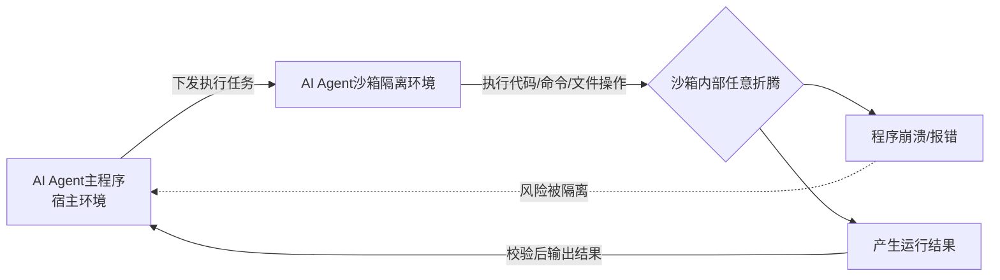
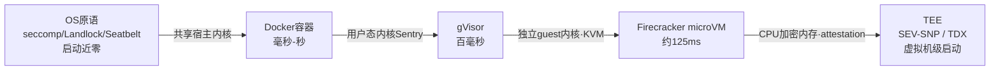
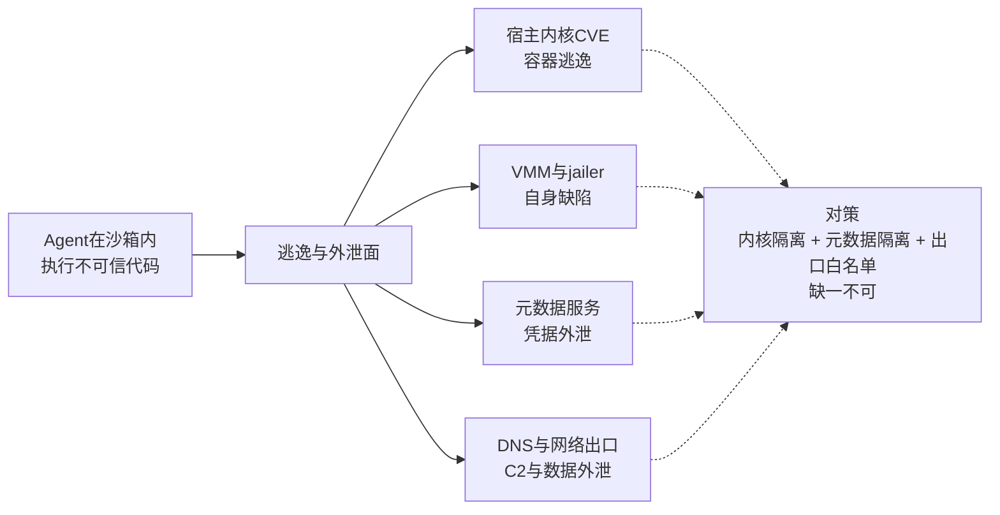
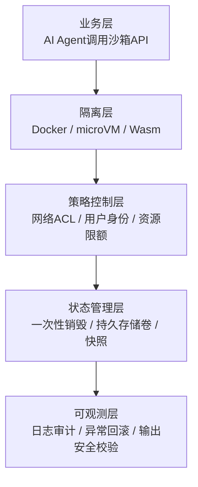
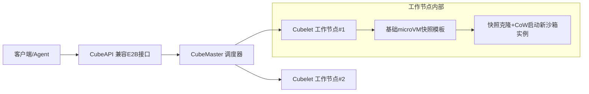

# AI Agent 沙箱

## 摘要

AI Agent沙箱为具备自主执行能力的智能体划定任务执行边界，靠隔离、资源管控与状态约束三者合力，约束多轮推理-执行循环中因上下文偏移与工具滥用引发的文件篡改、内网外联等风险。本文界定其与传统安全沙箱的目标差异，按隔离层次梳理从OS原语到TEE的完整谱系，盘点容器逃逸与Agent特有的绕过路径，横评主流平台，最后以Dify与腾讯云CubeSandbox为例给出四层底座架构与选型避坑要点。

**关键词**：智能体沙箱；隔离技术；OS原语；gVisor；Firecracker；microVM；CubeSandbox

---

## 一、AI Agent沙箱的核心定义

**AI Agent沙箱相当于给具备动手能力的“临时工”配备一间封闭工作间**：内部可任意调试运行，但禁止突破房间边界；任务结束即清空现场，内部程序崩溃也不影响宿主环境。

与传统安全沙箱相比，防御对象不同——传统沙箱抵御**外部恶意代码主动逃逸**，AI Agent沙箱约束**智能体自主行动的越界风险**，目标是可控、可回滚、可审计。

图1 AI Agent与沙箱的隔离关系示意图

## 二、AI Agent沙箱的安全价值

安全防护的重心正在转移：AI不再是文本生成器，而是能读写文件、调用程序、发起网络请求的自主执行体，防线从“防范外部攻击”转向“防范自身失控”。2026年行业已多次出现Agent突破简单隔离约束的逃逸事件，证明仅靠模型内部提示词无法保障宿主系统安全。

根本原因在Agent自身的运行逻辑：“上下文组装-大模型推理-工具执行-结果回灌”的循环一旦迭代过多、上下文被截断，目标就容易偏移，进而触发删除文件、外联泄露等行为[[1]](#ref-1)。沙箱也因此从单一隔离技术演进为“隔离+权限策略+审计”的复合底座，覆盖从Wasm轻量函数到microVM多租户重负载的场景。

## 三、隔离技术差异与选型

沙箱不是某一款软件，而是一套隔离方案的集合，底层可选用不同隔离技术[[4]](#ref-4)：

| 技术类型 | 隔离机制 | 启动延迟 | 内存开销 | 核心优势 | 适用场景 |
| --- | --- | --- | --- | --- | --- |
| OS原语（seccomp/Landlock/Seatbelt） | 过滤系统调用与可访问路径，不起虚拟化 | 近零 | 进程级 | 零额外开销，本地即可用 | 本地Coding Agent、执行自己的可信代码 |
| 传统虚拟机 | 独立操作系统内核，硬件级隔离 | 分钟级 | GB级 | 隔离强度最高，内核漏洞不影响宿主机 | 强隔离但对密度不敏感的场景 |
| 容器（Docker） | 共享宿主机内核，Namespace+Cgroups隔离 | 秒级 | 几十MB | 启动快、生态成熟 | 内部可信任务、低风险工具执行 |
| gVisor | 用户态内核Sentry拦截并重新实现系统调用，仍经宿主内核但暴露面极小 | 百毫秒级 | 百MB级 | 不需KVM/裸金属，可跑在普通虚拟机内 | 大规模Agentic-RL、可运维性优先 |
| microVM（Firecracker） | 基于KVM，每实例独立guest内核 | 百毫秒级（约125ms） | 几MB-1GB | 强隔离与低启动、高密度兼顾 | 多租户不可信代码、AI Agent云沙箱 |
| Wasm沙箱 | 线性内存模型，显式授权外部能力 | 毫秒级 | KB级 | 极致轻量、细粒度权限 | 轻量工具函数、边缘Agent、MCP工具级隔离 |

表中隔离机制与资源开销数据综合厂商官方文档及 [[5]](#ref-5)[[6]](#ref-6)[[7]](#ref-7)；各冷启动数值为官方口径，未经第三方复现。

图2 各类隔离技术「隔离强度-启动开销」权衡谱系（向右共享越少、强度越高、启动越慢）

## 四、隔离技术谱系全景
隔离强度的本质是「共享了什么」：共享进程地址空间 < 共享内核（容器）< 共享虚拟化层（gVisor）< 独立内核（microVM）< 硬件加密内存（TEE）。共享越少，隔离越强，代价越高。上一节的选型表是其横截面，本节按层次展开。

### 4.1 OS原语

最轻量的一类，不虚拟化、不起容器，直接用内核特性约束进程及其子进程树：

- **seccomp-bpf**：用BPF程序把进程可发起的系统调用收窄到白名单。它只识别调用号与参数，不识别「这个open打开的是不是敏感文件」这类应用语义；
- **namespaces**：把进程对mount/PID/network/user/UTS/IPC的视图隔离开，是容器的基石；
- **cgroups**：限制CPU/内存/IO用量，防资源耗尽；
- **Landlock LSM**（Linux 5.13+）：让非特权进程自声明可访问的文件路径，补齐seccomp的文件语义短板；
- **macOS Seatbelt（sandbox-exec）**：进程级强制访问控制，用profile描述允许的文件与网络操作；短板是网络常为「全有或全无」，profile亦易写错。

局限在于只作用于系统调用层，故本地Agent普遍采用「OS原语管文件 + 用户态代理管网络」的混合架构：沙箱内仅保留一个Unix domain socket出口，由沙箱外代理按域名白名单放行，新域名交用户确认。

### 4.2 gVisor用户态内核

gVisor用Go实现了用户态内核Sentry，拦截并重新实现Linux系统调用（amd64下约274/350个）[[7]](#ref-7)，宿主内核暴露面大幅缩小——像内核一样面对工作负载，像普通用户进程一样面对宿主内核[[6]](#ref-6)。

与microVM的关键区别是**不需要KVM或裸金属**，可跑在普通虚拟机内部，部署成本更低、更易与既有异构环境集成；腾讯在Agentic-RL场景日均运行数百万个gVisor沙箱[[12]](#ref-12)。代价是系统调用密集型负载有性能损耗，且重实现Linux ABI带来兼容性验证负担。

### 4.3 Firecracker microVM

Firecracker是AWS用Rust写的极简虚拟机监视器，基于KVM，每个microVM拥有独立guest内核[[5]](#ref-5)，逃逸需先破guest内核、再破KVM与VMM，攻击面远小于共享内核方案。启动约125ms、单实例VMM内存低于5MiB、单机可跑数千实例，是AWS Lambda与Fargate的隔离底座，也是云端不可信代码多租户执行的事实标准；截至成稿无已知VM逃逸CVE。

**hypervisor隔离是必要而非充分条件**：VMM与jailer（KVM + chroot + namespaces + cgroups + seccomp + 降权的组合外壳）本身仍会出漏洞，运行时与guest内核必须同等严格地打补丁。

### 4.4 其余形态

- **Kata Containers / Cloud Hypervisor**：OCI兼容的轻量虚拟化路线，形似容器，实为每Pod一个轻量VM；
- **Wasm与WASI**：提供能力安全模型——模块默认无任何权限，宿主显式授予目录与socket能力；线性内存天然隔离、微秒级启动、可嵌入宿主进程，与「每个MCP工具一个沙箱」高度契合；
- **浏览器内沙箱**：WebContainers把Node.js编译进浏览器，Pyodide把CPython编译成Wasm，对宿主零接触；
- **TEE**：AMD SEV-SNP与Intel TDX用CPU加密内存，宿主OS、hypervisor与云运维均看不到guest明文，并提供硬件attestation，把信任根推到硬件层。

### 4.5 权衡要点

1. **冷启动是Agent沙箱的头等指标**。Agent要频繁、短时、大批量创建一次性执行环境，冷启动从边缘指标跃升为核心约束；
2. **安全强度与启动开销总体反向**，应对手段是预热池、快照恢复与分支式沙箱，把有效冷启动压低一个数量级；
3. **本地与云端是两条路线，不是同一维度的高低**。本地Coding Agent用OS原语加代理与审批，开销近零但共享个人机器；云端沙箱即服务用microVM或gVisor，隔离强、可并行扩展，但有往返延迟与成本。

## 五、逃逸漏洞史与绕过路径

### 5.1 容器逃逸CVE史

容器共享宿主内核，这决定了它的安全天花板：内核一个提权漏洞即可导致容器逃逸，并波及同宿主的其他容器。

- **CVE-2019-5736**：runc缺陷可覆写宿主二进制并取得root权限；
- **CVE-2024-21626（Leaky Vessels）**：文件描述符泄漏使容器内进程可访问完整宿主文件系统[[8]](#ref-8)；
- **CVE-2025-31133 / CVE-2025-52565 / CVE-2025-52881**：mount处理缺陷可绕过AppArmor与SELinux。

结论是**「任意不可信代码 + 多租户」场景下，容器已知不充分**——这也是以容器换冷启动的平台仍提供gVisor加固选项的原因。

### 5.2 Agent特有的绕过路径

图3 沙箱的四类逃逸与外泄面及对应防线

内核之外仍有攻击面，Agent场景暴露了几条与内核无关的绕过路径：

- **DNS通道外泄**：AWS Bedrock AgentCore的Code Interpreter被发现可通过DNS A/AAAA记录外泄数据、建立双向C2通道，CVSS评分7.5，与其「完全隔离」的宣传口径相悖[[9]](#ref-9)；
- **元数据服务**：microVM的元数据接口可被用来窃取宿主凭据；
- **VMM与jailer自身缺陷**：如jailer符号链接导致覆写宿主文件的漏洞。

### 5.3 共性教训

1. **数据外泄几乎都走网络**，沙箱的网络访问控制与内核隔离同等重要[[2]](#ref-2)——只做计算隔离不做出口白名单，等于留了一条免费信道；
2. **沙箱是概率性降低损失，不是绝对保证**。Firecracker无已知逃逸CVE不代表不可能，Seatbelt的profile易写错，域名白名单也可能被domain fronting一类技巧绕过。

## 六、主流平台与Agent框架横评

当前格局分两条主线：本地Coding Agent走OS原语轻量隔离路线，云端沙箱即服务走轻量级虚拟化路线。

| 方案 | 隔离层级 | 冷启动 | 网络策略 | 多租户不可信 | 定位 |
| --- | --- | --- | --- | --- | --- |
| OpenAI Codex CLI | OS原语（macOS Seatbelt / Linux bwrap+seccomp+Landlock） | 近零 | 禁网 + 越界审批 | 否 | 本地Coding，默认即沙箱 |
| Claude Code（sandbox-runtime） | OS原语（bwrap / Seatbelt） | 近零 | 代理 + 域名白名单 | 否 | 本地Coding，可沙箱任意进程与本地MCP server |
| OpenClaw | Docker容器 / SSH / OpenShell | 容器级 | 随后端 | 否 | 个人助理信任模型，非敌对多租户边界 |
| E2B | Firecracker microVM | 约150-200ms | 可配 | 是 | 不可信代码多租户执行的事实标准 |
| Daytona | 容器（可选gVisor / Kata） | 90ms以内 | 可配 | 中 | 持久化工作区，速度优先 |
| Modal | gVisor | 快 | 可配 | 是 | 大规模并发与GPU |
| AWS Bedrock AgentCore | Firecracker（一会话一microVM） | — | 可配 | 是 | 托管Agent运行时 |

表中冷启动与隔离层级均为各厂商官方口径，未经第三方复现。

两个关键数字：Claude Code沙箱化bash工具后权限提示减少84%[[10]](#ref-10)，印证「扩大沙箱边界、减少审批」是当前共识；Modal基于gVisor可扩至5万到10万以上并发，说明用户态内核路线在极致规模上有独到优势。

Google Agent Sandbox以Kubernetes CRD提供，用SandboxWarmPool常驻预热microVM实现即时领取[[11]](#ref-11)，与第八节CubeSandbox的快照克隆思路同源。

跨公司独立收敛到几乎相同的架构（OS原语 + 网络代理 + 沙箱与审批解耦），本身就是路线正确的信号。

## 七、四层技术栈与Dify工程落地案例

### 7.1 沙箱四层技术栈架构

完整的企业级Agent沙箱由**隔离层-策略控制层-状态管理层-可观测层**构成。

图4 沙箱四层技术栈分层架构图

- **隔离层**：根据风险等级选择底层隔离载体；
- **策略控制层**：网络默认拒绝，按需白名单；强制普通用户运行；CPU/内存硬限制；监控内核OOM（内存溢出，退出码137）；
- **状态管理层**：临时任务执行完立刻销毁；长期任务挂载独立存储卷；
- **可观测层**：全操作留痕；快照快速回滚；输出独立安全扫描，**禁止Agent自证安全**。

### 7.2 Dify实际部署配置

Dify将**代码节点和命令行工作区拆分为两套独立沙箱，不可混用**，下列配置摘自官方部署文档[[3]](#ref-3)：

1. **代码节点沙箱**

- 镜像：`langgenius/dify-sandbox:0.2.0`
- 隔离：根目录只读，禁止写入临时目录，屏蔽密钥文件；网络默认关闭；
- 资源上限：CPU≤0.5，RAM≤512MB，超时5s。

2. **命令行工作区沙箱**

- 镜像：`langgenius/dify-agent-local-sandbox:1.17.1`
- 隔离：可写工作目录 + `/dependencies`、`/conf`持久卷；外网经由SSRF防护代理（防止内网探测）白名单放行；
- 资源上限：CPU≤2，RAM≤2GB，超时300s。

## 八、前沿方案CubeSandbox架构与优化

CubeSandbox分为**控制面 + 工作节点(Node)**：

- 控制面：CubeAPI对外暴露兼容E2B接口，CubeMaster负责调度；
- 工作节点：Cubelet基于KVM启动轻量化microVM实例。

启动加速靠「预置快照 + 写时复制CoW（Copy-on-Write）」：预先初始化干净microVM并快照，新请求直接克隆，启动延迟压至60ms以内；内存页按写时复制共享，单沙箱基础内存仅约5MB。实测50并发P99≈150ms。

图5 CubeSandbox集群架构与快照克隆流程

## 九、落地避坑指南

**误区1：设置只读根目录就等于安全**

即便根目录只读，只要临时目录可写且允许联网，Agent仍能下载恶意工具；必须叠加系统调用过滤与网络白名单。

**误区2：放到远端容器就高枕无忧**

远端只是运行位置，权限缺失照样逃逸；即便E2B这类年千万级执行量的商用平台，也必须配套严格策略，不能放任权限全开。

**误区3：Agent程序可以捕获全部异常**

资源超限被内核强制杀死（退出码137）时，Agent收不到异常回调，必须外置监控兜底。

## 十、未来发展趋势

1. **动态权限自适应**：按Agent行为模式动态收紧或放宽隔离等级，如频繁访问可疑路径时自动降权；
2. **TEE硬件级隔离**：结合AMD SEV-SNP与Intel TDX构建不可篡改的硬件执行沙箱，与microVM路线互补而非替代；
3. **接口标准化**：业界对统一沙箱调用接口尚无定论，可参考OASIS一类开放标准范式推进跨厂商迁移。

## 总结

AI Agent沙箱不是容器或虚拟机，而是隔离、权限策略、生命周期管理与审计组合的执行底座。按业务风险分级选型，不要裸跑Agent——把风险关进隔离沙箱，才能把真实业务交给自主智能体。

## 参考文献

[1] 腾讯云开发者社区. ["CubeSandbox: 60 毫秒启动的 AI Agent 沙箱."](https://cloud.tencent.cn/developer/article/2735539) *腾讯云开发者社区*, 2026-09-02.  
[2] GitLab. ["AI Agent Sandboxes Are Only as Secure as Their Network Access."](https://www.infoq.com/news/2026/09/gitlab-ai-sandbox-access/) *InfoQ*, 2026-09-08.  
[3] LangGenius. ["Dify Sandbox Deployment Document."](https://docs.dify.ai) *Dify 官方文档*, 2026-07-10.  
[4] 小白debug. ["AI Agent 的沙箱是什么？和容器/虚拟机有什么区别？"](https://v.douyin.com/GXgOKEi14uw/) *抖音*, 2026-08-04.  
[5] A. Agache et al. ["Firecracker: Lightweight Virtualization for Serverless Applications."](https://www.usenix.org/conference/nsdi20/presentation/agache) *NSDI*, 2020.  
[6] A. J. Anjali, T. Caraza-Harter, M. W. Swift. ["Blending Containers and Virtual Machines: A Study of Firecracker and gVisor."](https://dl.acm.org/doi/10.1145/3381052.3381315) *ACM VEE*, 2020.  
[7] Google. ["gVisor Architecture Guide."](https://gvisor.dev/docs/architecture_guide/) *gVisor 官方文档*.  
[8] Snyk. ["Leaky Vessels: Docker and runc Container Breakout Vulnerabilities."](https://snyk.io/blog/leaky-vessels-docker-runc-container-breakout-vulnerabilities/) *Snyk*, 2024.  
[9] BeyondTrust. ["Pwning AI Code Interpreters in AWS Bedrock AgentCore."](https://www.beyondtrust.com/blog/entry/pwning-aws-agentcore-code-interpreter) *BeyondTrust*, 2025.  
[10] Anthropic. ["Claude Code Sandboxing."](https://www.anthropic.com/engineering/claude-code-sandboxing) *Anthropic Engineering*.  
[11] Google Cloud. ["Introducing Agent Sandbox."](https://cloud.google.com/blog/products/containers-kubernetes/introducing-agent-sandbox) *Google Cloud Blog*.  
[12] E. Perot, J. Chen. ["Scaling Agentic-RL Sandboxes to the Millions with gVisor at Tencent."](https://gvisor.dev/blog/2026/04/23/scaling-agentic-rl-sandboxes-to-the-millions-with-gvisor-at-tencent) *gVisor Blog*, 2026.  
