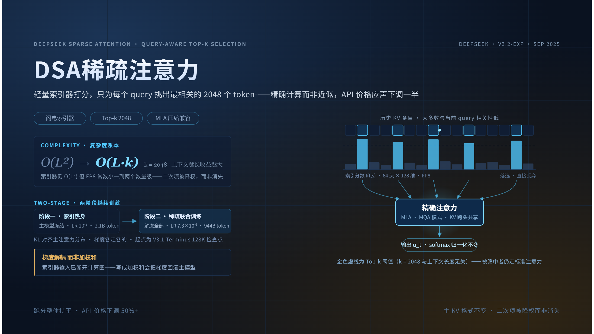
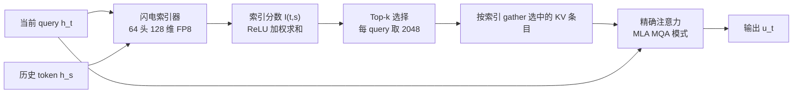
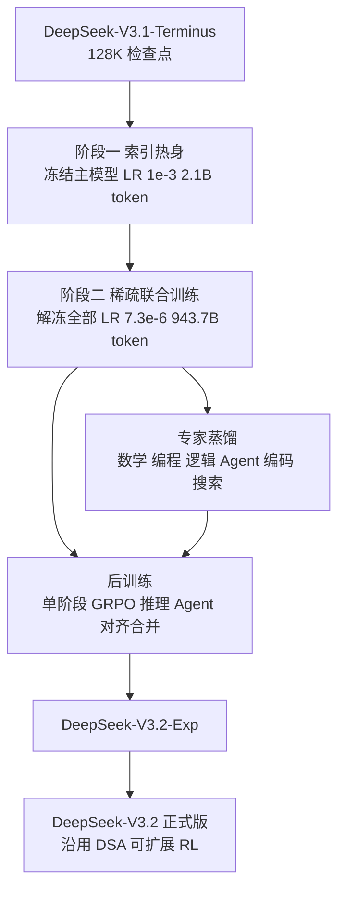

# DSA 稀疏注意力



## 摘要

DSA 是 DeepSeek 在 V3.2-Exp 中引入的查询感知稀疏注意力，用一个轻量索引器给每个 query 的历史 token 打分，只把分数最高的 Top-k 个 KV 条目送进精确注意力。它保留 MLA 的压缩 KV 格式，把主注意力复杂度从二次降到与 k 成正比，并用两阶段继续训练把稀疏模式练进模型。本文梳理其动机、索引与选择机制、训练配方、内核实现与成本效果，并对照 NSA、MoBA、Quest 等方案给出适用边界。

**关键词**：DSA；稀疏注意力；闪电索引器；Top-k 选择；MLA；长上下文；预填充；解码

---

## 1 定义与定位

DSA（DeepSeek Sparse Attention，深度求索稀疏注意力）是 DeepSeek 在 DeepSeek-V3.2-Exp 中引入的查询感知稀疏注意力机制，由**闪电索引器**（lightning indexer）与**细粒度 token 选择**（fine-grained token selection）两个部件组成：索引器先给当前 query 与每一个历史 token 打一个相关性分数，只把分数最高的 $k$ 个 token 的 KV 条目送进精确注意力计算 [[1]](#ref-1)。与 V3.1-Terminus 相比，V3.2-Exp 唯一的架构改动就是引入 DSA，MoE 主干、MLA 注意力与 MTP 预测头都原样保留 [[1]](#ref-1) [[12]](#ref-12)。

理解这一定位很关键：DSA 不是把注意力换成另一种结构，而是在原注意力外面加了一层"廉价的相关性预筛"。被筛中的 token 仍走标准注意力、仍做 softmax 归一化，因此它是精确计算而非近似打分，差别只在于参与计算的 token 少了一个数量级。

### 1.1 MLA 耦合

DSA 长在 MLA（Multi-head Latent Attention）之上，而非替换它。技术报告明确说明，为了从 V3.1-Terminus 继续训练，DSA 实现在 MLA 的 MQA 模式下，原因是内核层面每个 KV 条目必须能被同一 query 的所有注意力头共享，否则重复访存会把稀疏省下来的收益吃掉 [[2]](#ref-2)。

MLA 把每 token 的 KV 压成低秩隐向量 $\mathbf{c}_s$（配置中 `kv_lora_rank` 为 512，另有 64 维解耦 RoPE 分量）[[5]](#ref-5) [[12]](#ref-12)，DSA 只决定哪些 $\mathbf{c}_s$ 被读取，不改变 $\mathbf{c}_s$ 本身的格式。由此得到两条推论：主 KV Cache 的格式与容量不变，所谓"省显存"指的是不再把全部历史搬进计算，而不是压缩率又提高了一档；但索引器需要自己维护一份很小的 key 缓存（单头、128 维），显存并非零增量 [[13]](#ref-13)【推导】。

### 1.2 稠密切换

DSA 保留了回到稠密的通路。参考实现里 Top-k 取值为 `min(index_topk, L)`，序列短于 2048 时等价于稠密注意力 [[13]](#ref-13)；服务端在短序列预填充时还专门实现了 masked MHA 模式来模拟 DSA，因为短上下文跑真正的稀疏路径反而不划算 [[1]](#ref-1)。参考实现同时用 `layer_types` 区分稠密层与稀疏层 [[13]](#ref-13)，说明"全层一律稀疏"并非硬约束。



<p align="center">图1 DSA 打分与选择的数据流</p>

## 2 长上下文瓶颈

### 2.1 计算瓶颈

MLA 解决的是"存不下"：它把每 token 的 KV 压成低秩隐向量，KV Cache 显著缩小，这是 V2 相对同期稠密模型的核心优势 [[5]](#ref-5)。但注意力计算本身仍是 query 与全部历史 token 的两两交互，FLOPs 随序列长度平方增长 [[1]](#ref-1) [[6]](#ref-6)。于是从 V2 到 V3.1，长上下文的主要瓶颈从显存容量迁移到计算与访存带宽：预填充受算力限制，解码每一步都要把整条 KV Cache 读一遍，受带宽限制【推导】。压缩只降低了单位 token 的搬运量，没有改变"每一步都得搬完"这个事实。

### 2.2 既有路线

既有稀疏注意力可按"是否需要训练"分成两族，各有各的代价。

第一族是**原生可训练的结构化稀疏**。NSA 把注意力拆成压缩、选择、滑窗三个分支，选择分支复用压缩分支的注意力分数来挑块，块级稀疏、端到端可训练 [[7]](#ref-7)；MoBA 把 MoE 的门控思想搬到注意力上，按块选择，可在全注意力与稀疏注意力之间切换 [[8]](#ref-8)。这一族的共性是块级粒度：一个块里只有少数 token 真正相关时仍要整块计算，粒度损失换来了内核友好度【推导】；代价是结构复杂，分支融合的门控本身也要参数与调度开销。

第二族是**免训练的推理期近似**。Quest 按页估计 KV 的关键度、只加载关键页，在 32K 上下文下把自注意力时延压低到 1/7 左右 [[9]](#ref-9)；MInference 归纳出 A-shape、Vertical-Slash、Block-Sparse 三种头型，离线定模式、在线近似建掩码，在 A100 上把 1M 上下文的预填充加速约十倍 [[10]](#ref-10)。这类方法不改训练、落地快，但稀疏模式由启发式决定，模型能力不被重新校准，检索型长文上是否掉点只能靠实测【推导】。

这两条路线的遗留空间正是 DSA 的落点：既要原生可训练、又要结构简单，还得与 MLA 的压缩 KV 对齐。

值得注意的是，NSA 的内核设计明确面向 GQA、MQA 这类共享 KV 的架构 [[7]](#ref-7)，而 DSA 必须在 MLA 的 MQA 模式下实例化才能让 KV 条目跨头复用 [[2]](#ref-2)。换句话说，"KV 能不能被多个 query 头共享"是这类方案能否落地的前提，这也解释了 DeepSeek 为何不直接照搬块级压缩分支【推导】。

### 2.3 设计原则

把报告的表述归纳起来，DSA 的设计目标可以提炼成三条检验标准，也适用于评估其他稀疏注意力方案 [[1]](#ref-1) [[2]](#ref-2)：

- **原生可训练**：稀疏不是推理期的补丁，选择过程要参与训练，让模型学会在稀疏下工作；
- **格式兼容**：不破坏 MLA 的压缩 KV，否则继续训练的迁移成本与部署改造代价都会失控；
- **硬件高效**：KV 条目要被多个 query 头共享，打分要能低精度、能分块，否则省下的 FLOPs 会被访存和调度开销吃掉。

## 3 索引与选择

### 3.1 索引打分

索引器对 query token $\mathbf{h}_t$ 与历史 token $\mathbf{h}_s$ 给出一个标量分数，形式上是多个索引头的 ReLU 加权和：

$$
I_{t,s}=\sum_{j=1}^{H_I} w^{I}_{t,j}\cdot \mathrm{ReLU}\left(\mathbf{q}^{I}_{t,j}\cdot \mathbf{k}^{I}_{s}\right)
$$

其中 $H_I$ 为索引头数，$\mathbf{q}^{I}_{t,j}\in\mathbb{R}^{d_I}$ 与权重 $w^{I}_{t,j}$ 由 $\mathbf{h}_t$ 投影得到，$\mathbf{k}^{I}_{s}\in\mathbb{R}^{d_I}$ 由 $\mathbf{h}_s$ 投影得到 [[1]](#ref-1)。落到具体配置上，索引头数为 64、每头维度 128、每 query 取 2048 个 KV 条目 [[12]](#ref-12)。

常见误读是把这里的维度记成"64 维 Query"。按官方配置，索引侧是 64 个索引头、每头 128 维（`index_n_heads=64`、`index_head_dim=128`），索引 Key 则只有一份、由所有头共享（`kv_cache_num_heads=1`），最后由可学习权重把 64 个头的分数加权求和成一个标量 [[12]](#ref-12) [[16]](#ref-16)。头数少、维度小、精度低，是它便宜的全部原因 [[1]](#ref-1)。

### 3.2 Top-k 选择

拿到分数后，每个 query 位置只保留分数最高的 $k$ 个历史 token 的 KV 条目，注意力只在这一子集上计算：

$$
\mathbf{u}_{t}=\mathrm{Attn}\left(\mathbf{h}_{t},\left\{\mathbf{c}_{s}\ \middle|\ I_{t,s}\in \mathrm{Top}\text{-}k\left(I_{t,:}\right)\right\}\right)
$$

选择是 **token 级**而非块级：粒度细到单个 token，不再受块边界约束。同一 query 位置的所有注意力头共享同一份 top-k 索引集合，这正是 MQA 模式下 KV 条目天然共享带来的红利 [[2]](#ref-2)。$k$ 固定为 2048，与上下文长度无关 [[1]](#ref-1) [[12]](#ref-12)。

### 3.3 ReLU 取舍

技术报告对激活函数只给了一句解释：选择 ReLU 是出于吞吐考虑 [[1]](#ref-1)，并没有声称"实测精度更好"。这一点值得强调，因为把 ReLU 归因于效果更优，会让人以为这里做过消融对比，进而误判复现时的调参优先级。这句简短的话背后有三重工程含义：ReLU 不产生全局归一化，省掉一行 softmax 与随之而来的全序列最大值规约；逐元素非线性可完全分块，不依赖跨块统计量；输出恒非负、分布右偏，量化到 FP8 时动态范围容易压住【推导】。索引打分在官方内核中采用 FP8 执行，省算力、省带宽，这是"廉价预筛"能成立的前提 [[1]](#ref-1) [[16]](#ref-16)。

### 3.4 复杂度账本

算清楚复杂度才不会被"线性注意力"的说法误导。主注意力的计算从 $O(L^2)$ 降到 $O(Lk)$，$k$ 是常数，上下文越长收益越大；但索引器本身仍要对每个 query 扫一遍全部历史，复杂度是 $O(L^2 H_I d_I)$，只是 $H_I$ 与 $d_I$ 都远小于主注意力，且用 FP8 执行，常数小了一到两个数量级 [[1]](#ref-1)【推导】。

因此严格说，DSA 是"二次项被降权"而不是"二次项消失"。在 128K 这一量级，索引器的开销可以忽略；若上下文继续拉长几个数量级，它会重新变成主要瓶颈，这与"Top-k 预算固定"一起构成 DSA 的天然边界 [[1]](#ref-1)【推导】。

### 3.5 无分支设计

与 NSA 最直观的结构差异在这里：NSA 是压缩、选择、滑窗三条支路并行，再用可学习门控融合 [[7]](#ref-7)；DSA 只有一条主路径——索引器打分、Top-k 选择、精确注意力，没有压缩分支，也没有独立的滑窗分支 [[1]](#ref-1)。

省掉这两条支路各有代价与补偿。没有压缩分支，远处的历史只能以原始 token 的粒度被选中，好处是不必为了粗粒度摘要额外维护一套压缩 KV，坏处是完全无关的长历史只能靠 Top-k 直接丢弃；没有独立滑窗分支，局部上下文不再被单独兜底，但 Top-k 本身就能自然覆盖近邻 token，且省掉了门控融合的参数与调度开销【推导】。这种"少结构"的取舍与 MoBA 的主张一致 [[8]](#ref-8)，区别只在粒度与打分来源。

## 4 训练流程

DSA 最关键的一步不是架构而是训练：直接给一个训练好的稠密模型套上稀疏选择，性能会明显下滑，因为模型从未在"只看 2048 个 token"的条件下学过。DeepSeek 的解法是从 V3.1-Terminus 的 128K 检查点出发做继续训练，分两个阶段 [[1]](#ref-1) [[2]](#ref-2)。

### 4.1 继续训练

起点是已经把上下文扩展到 128K 的 V3.1-Terminus 检查点，继续预训练与后训练都在同一套 128K 长上下文数据分布上进行 [[1]](#ref-1)。这条路线的经济学含义是：不从零重训，省下的算力远大于加装索引器的开销；代价是必须做分布对齐，让新组件模仿旧模型的注意力行为【推导】。

### 4.2 索引热身

第一阶段只训练索引器，主模型冻结、注意力仍是稠密的。监督信号来自主注意力自身：先把各注意力头的分数按头求和，再沿序列做 L1 归一化，得到目标分布 $p_{t,:}$，再用 KL 散度让索引器的 softmax 分布去逼近它：

$$
L_I=\sum_{t} D_{\mathrm{KL}}\left(p_{t,:}\ \|\ \mathrm{Softmax}\left(I_{t,:}\right)\right)
$$

这一阶段学习率 $10^{-3}$，只跑 1000 步，每步 16 条 128K 序列，合计约 2.1B token [[1]](#ref-1) [[2]](#ref-2)。热身的意义不是教模型新知识，而是让索引器在一开始就站在"和稠密注意力同一套相关性判断"的起跑线上【推导】。

### 4.3 联合训练

第二阶段引入 token 选择、解冻全部参数，学习率降到 $7.3\times10^{-6}$，跑 15000 步、每步 480 条 128K 序列，合计约 943.7B token，每 query 选 2048 个 KV 条目 [[1]](#ref-1)。对齐目标收缩到被选中的集合 $\mathcal{S}_t$ 上：

$$
L_I=\sum_{t} D_{\mathrm{KL}}\left(p_{t,\mathcal{S}_t}\ \|\ \mathrm{Softmax}\left(I_{t,\mathcal{S}_t}\right)\right),\quad \mathcal{S}_t=\left\{s\ \middle|\ I_{t,s}\in \mathrm{Top}\text{-}k\left(I_{t,:}\right)\right\}
$$

这里有一处必须澄清的事实：**索引器输入被从计算图中断开**，索引器只由 $L_I$ 优化，主模型只由语言建模损失优化 [[1]](#ref-1) [[2]](#ref-2)。也就是说二者是梯度解耦的并行优化，而非"$L=L_{\mathrm{LM}}+\lambda L_I$"式的加权求和。把两者写成加权和会误导复现——那样索引器的梯度会回灌主模型，破坏"主模型只对齐语言目标"的设计意图【推导】。

### 4.4 后训练适配

后训练沿用 GRPO，但把推理、Agent 与人类对齐合并进单个 RL 阶段，用来避免多阶段训练常见的灾难性遗忘 [[1]](#ref-1)。正式版 V3.2 继续沿用 DSA，重心转向可扩展强化学习与 Agent 数据合成（覆盖 1800+ 环境、85k 条复杂指令），并首次把思考过程直接接入工具调用 [[2]](#ref-2) [[4]](#ref-4)。多 token 预测结构未被移除，配置中 `num_nextn_predict_layers` 仍为 1 [[12]](#ref-12)。

### 4.5 专家蒸馏

后训练还有一条容易被忽略的主线：专家蒸馏。对数学、竞赛编程、通用逻辑推理、Agentic 编码、Agentic 搜索五个领域，先各自从同一个 V3.2 基座微调出专职专家，再用大规模强化学习把每个专家练强；随后用这些专家分别生成思考模式与直答模式的领域数据，蒸馏回最终检查点 [[1]](#ref-1)。报告给出的结论是，蒸馏所得模型的水平仅略低于各领域专家，差距在后续 RL 中基本抹平 [[1]](#ref-1)。

这条路线与 DSA 的关系是间接但关键的：稀疏注意力决定了长链推理的成本上限，而专家蒸馏加 RL 则是在这个成本上限内把能力往上顶。两者叠加，才解释了 V3.2 为何能在沿用 V3.2-Exp 架构的前提下把跑分推上去 [[2]](#ref-2)【推导】。



<p align="center">图2 DSA 的两阶段训练与后训练链路</p>

## 5 系统内核

### 5.1 自研动因

动态 Top-k 意味着每个 query 参与计算的 KV 长度不同，gather 索引在运行时才产生，形状随输入变化，通用算子库很难直接高效支撑这类动态稀疏路径【推导】。DeepSeek 因此自研并开源了整套内核：TileLang 版侧重可读性、方便研究改动，CUDA 版面向高性能推理；索引器 logit 内核（含分页版）放在 DeepGEMM，稀疏注意力内核放在 FlashMLA [[15]](#ref-15)。

### 5.2 内核分工

表1 汇总了各部件在开源栈中的落点。

| 部件                 | 实现位置                                    | 关键点                                    |
| -------------------- | ------------------------------------------- | ----------------------------------------- |
| 索引器打分（预填充） | DeepGEMM 索引 logit 内核                    | 64 头 × 128 维、FP8、算力受限            |
| 索引器打分（解码）   | DeepGEMM 分页版内核                         | 单 query、访存受限、按页读索引缓存        |
| Top-k 选择           | 索引内核内的选择步骤                        | 每 query 取 2048，索引在运行时生成        |
| 稀疏注意力（预填充） | FlashMLA sparse 内核（`flashmla_sparse`） | token 级 gather 后整段计算                |
| 稀疏注意力（解码）   | FlashMLA sparse 内核（`flashmla_sparse`） | 动态 Top-k 加 KV 分页，可图捕获           |
| 研究参考实现         | TileLang 版本                               | 可读性优先，便于改结构做消融              |
| 服务框架             | SGLang、vLLM                                | DSA 后端、索引 key 独立缓存、分页与图捕获 |

<p align="center">表1 DSA 各部件的内核落点</p>

预填充与解码的优化方向并不相同，因此两条路径是分开实现的：预填充分块处理整段序列，受算力限制，优化重点是 FP8 打分与张量核心利用率；解码每步只来一个 query，受访存带宽限制，优化重点是按页只读必要的索引缓存与 KV 条目，把搬运量压到最低 [[1]](#ref-1) [[17]](#ref-17)【推导】。SGLang 正是把预填充与解码后端拆成两个独立参数暴露出来，可按硬件分别选择 `flashmla_sparse`、`flashmla_sparse_q8`、`fa3`、`tilelang` 等实现 [[17]](#ref-17)。

### 5.3 分页与图捕获

工程上最容易踩坑的是页大小。索引器需要一份独立的 `key&key_scale` 缓存，要求页大小为 64，而 token 级稀疏前向算子要求页大小为 1，SGLang 在同一注意力后端里同时支持了这两种页大小 [[11]](#ref-11)。解码路径支持 CUDA Graph 捕获（以 `--cuda-graph-max-bs-decode` 配置最大批大小），把逐层的调度开销摊平 [[17]](#ref-17)。vLLM 在发布当日即支持该模型，覆盖 Hopper（H100/H200/H20）与 Blackwell（B200/GB200）[[14]](#ref-14)。第三方基准站收录的索引器参考内核标明 64 索引头、128 维、topk 2048、页大小 64、FP8 [[16]](#ref-16)，与官方配置一致。

## 6 效能与评测

### 6.1 成本结构

最直观的验证来自价格：V3.2-Exp 上线当日 API 价格下调 50% 以上，V3.1-Terminus 保留临时接口到 2025 年 10 月 15 日供对照测试 [[3]](#ref-3)。技术报告给出 H800 集群、按 2 美元每 GPU 小时计的成本曲线：预填充与解码的单位 token 成本都随位置增长而抬升，但 V3.2-Exp 的曲线在长位置显著低于 V3.1-Terminus [[1]](#ref-1)。机制上，预填充省的是注意力算力，解码省的是 KV 访存（从每步读全量历史降为读 2048 条），所以上下文越长差距越大 [[1]](#ref-1)【推导】。论文还特别提到短序列预填充改用 masked MHA 模式模拟 DSA，说明收益与长度强相关，短文本并不在稀疏路径的甜点区 [[1]](#ref-1)。

### 6.2 基准表现

表2 对照 V3.1-Terminus 与 V3.2-Exp 的官方评测数据 [[1]](#ref-1)。

| 类别       | 基准（指标）                         | V3.1-Terminus | V3.2-Exp |
| ---------- | ------------------------------------ | ------------- | -------- |
| 通用       | MMLU-Pro（EM）                       | 85.0          | 85.0     |
| 通用       | GPQA-Diamond（Pass@1）               | 80.7          | 79.9     |
| 通用       | Humanity's Last Exam（Pass@1）       | 21.7          | 19.8     |
| 检索       | BrowseComp（Acc.）                   | 38.5          | 40.1     |
| 检索       | BrowseComp_zh（Acc.）                | 45.0          | 47.9     |
| 检索       | SimpleQA（Acc.）                     | 96.8          | 97.1     |
| 代码       | LiveCodeBench（Pass@1）              | 74.9          | 74.1     |
| 代码       | Codeforces-Div1（Rating）            | 2046          | 2121     |
| 代码       | Aider-Polyglot（Acc.）               | 76.1          | 74.5     |
| 代码 Agent | SWE Verified（Agent 模式）           | 68.4          | 67.8     |
| 代码 Agent | SWE-bench Multilingual（Agent 模式） | 57.8          | 57.9     |
| 代码 Agent | Terminal-bench（Terminus 1）         | 36.7          | 37.7     |
| 数学       | AIME 2025（Pass@1）                  | 88.4          | 89.3     |
| 数学       | HMMT 2025（Pass@1）                  | 86.1          | 83.6     |

<p align="center">表2 V3.1-Terminus 与 V3.2-Exp 的官方评测对照</p>

整体是"持平"而非"提升"：除 Codeforces 改用 Elo 评分（2046 升至 2121，不能按百分点解读）外，其余各项差异都在 3 分以内，其中 BrowseComp 两项、SimpleQA、AIME 2025、Terminal-bench 微升，GPQA-Diamond、HLE、HMMT 2025、Aider-Polyglot 微降。

### 6.3 长文与短文本

先说长文。官方在 V3.2-Exp 报告中的表述是正向的：长上下文任务上没有明显退化 [[1]](#ref-1)。V3.2 正式版报告进一步引用了发布后第三方完成的评测，其中 AA-LCR 上 V3.2-Exp 在推理模式下比 V3.1-Terminus 高约 4 分，Fiction.liveBench 的多个指标也持续更好，据此判断基座在长文上没有回归 [[2]](#ref-2)。需要说明的是，这两项都是外部基准、分数由报告转述，官方并未在 V3.2-Exp 报告里直接给出 RULER 一类基准的逐项数字，因此本文不引用未公开的 RULER 得分【推导】。

再说短文本的小幅回退。表2 中 GPQA-Diamond、HLE、HMMT 2025 三项下滑，官方的归因不是稀疏注意力伤到了能力，而是这一批评测里 V3.2-Exp 生成的推理链更短；补上推理预算后差距收敛 [[1]](#ref-1)。这一点与成本曲线相互印证：短序列上稀疏路径并不占优，官方为此专门保留 masked MHA 模式 [[1]](#ref-1)。需要与一种流行说法区分开：报告中并没有"训练分布偏移导致回退"这一表述，"经 RL 修复"也并非对 V3.2-Exp 跑分回退的说明——V3.2-Exp 的下滑被归因于输出长度，而正式版 V3.2 的提升来自更大规模的 RL 与专家蒸馏 [[1]](#ref-1) [[2]](#ref-2)。

正式版 V3.2 仍以 128K 为上限，在搜索 Agent 评测中有两成以上用例超出该上限、需要上下文管理兜底，官方把"冗余自我验证导致轨迹过长"列为待改进项 [[2]](#ref-2)。这条与 DSA 的固定预算直接相关：Top-k 收敛了单步计算，但没有约束生成长度。

### 6.4 适用边界

| 边界       | 具体表现                                        | 应对                                 |
| ---------- | ----------------------------------------------- | ------------------------------------ |
| 短上下文   | $k$ 固定 2048，短序列退化为稠密，稀疏收益趋零 | 走 masked MHA 路径，不必强上稀疏内核 |
| 超长上下文 | 索引器仍是 $O(L^2)$ 打分，会成为新瓶颈        | 配合上下文管理，或叠加分块检索       |
| 部署门槛   | 动态 Top-k 需专用内核与分页支持                 | 依赖 SGLang、vLLM 等已适配框架       |
| 显存       | 索引器另存单头 128 维 key 缓存                  | 主 KV 不变，但需预留这部分余量       |
| 能力波动   | 部分推理基准小幅回退                            | 补推理预算或经后训练修复             |

<p align="center">表3 DSA 的适用边界与应对</p>

### 6.5 版本演进

DSA 的落地分两步走。2025 年 9 月 29 日的 V3.2-Exp 是验证件：官方称其为"通往下一代架构的中间步骤"，目的就是探索并验证长上下文下训练与推理的效率优化，因此只做了架构替换、没有追求跑分新高 [[15]](#ref-15)。2025 年 12 月 1 日的 V3.2 是正式版：架构沿用 DSA，重心转向可扩展强化学习与 Agent 能力，并发布高算力变体 V3.2-Speciale [[4]](#ref-4)。

这条演进路线解释了 V3.2-Exp 为何"跑分持平却仍值得开源"：稀疏注意力属于基础设施级改动，需要推理框架、内核、部署工具链同步就位，先发实验版给生态留出适配窗口，是比直接发正式版更稳的做法【推导】。

## 7 方案对比

表4 把 DSA 与几条代表性路线放在同一坐标系里 [[7]](#ref-7) [[8]](#ref-8) [[9]](#ref-9) [[10]](#ref-10)。

| 维度     | NSA                    | MoBA           | Quest                  | MInference            | DSA                          |
| -------- | ---------------------- | -------------- | ---------------------- | --------------------- | ---------------------------- |
| 训练方式 | 原生可训练             | 原生可训练     | 免训练                 | 免训练                | 继续训练原生稀疏             |
| 选择粒度 | 块级                   | 块级           | KV 页级                | 头型模式              | token 级                     |
| 打分来源 | 复用压缩分支分数       | MoE 式门控     | 页元数据关键度         | 离线模式加在线近似    | 独立轻量索引器               |
| 结构     | 压缩加选择加滑窗三分支 | 单分支块选择   | 关键页加载             | 动态稀疏掩码          | 单分支 Top-k                 |
| 量级证据 | 三支路门控融合         | 全稀疏无缝切换 | 32K 自注意力时延约 1/7 | 1M 预填充约 10 倍加速 | 每 query 2048、API 降价 50%+ |

<p align="center">表4 代表稀疏注意力方案横向对比</p>

差异化的落点有三处：粒度上 DSA 是 token 级，避开了块边界带来的粗粒度浪费；打分上它有独立可训练的索引器，而不是复用别的分支或依赖启发式；训练上它把稀疏写进继续训练流程，与 MLA 的 MQA 模式共用同一份 KV 格式，因此既保留了原有压缩红利，又能继续沿用已有检查点 [[1]](#ref-1) [[2]](#ref-2)。

## 8 口径校正

整理过程中发现四处常见表述与官方材料不符，逐一核对如下，供后续检索与复用时对齐 [[1]](#ref-1) [[12]](#ref-12) [[15]](#ref-15)。

| 常见表述                               | 官方口径                                                  | 依据                       |
| -------------------------------------- | --------------------------------------------------------- | -------------------------- |
| 索引器为"共享 Key + 多个 64 维 Query"  | 64 个索引头、每头 128 维，索引 Key 单份跨头共享           | 官方配置字段与参考内核参数 |
| 索引器损失为交叉熵形式                 | 用 KL 散度对齐主注意力分布，二阶段只对被选中集合计算      | 技术报告公式 3             |
| 总损失为主损失加索引器损失加权求和     | 索引器输入从计算图断开，两套梯度各走各的                  | 技术报告训练小节           |
| ReLU 因实测效果更好而选用              | 报告只说明是出于吞吐考虑，未提供精度对比                  | 技术报告 DSA 原型          |
| 短文本回退源于训练分布偏移、经 RL 修复 | 报告归因于推理链变短，补预算即收敛                        | 技术报告评测小节           |
| 开源内核为 Triton                      | TileLang 参考实现加 CUDA 高性能内核（DeepGEMM、FlashMLA） | 发布公告与模型卡           |

<p align="center">表5 常见表述与官方口径对照</p>

前两处是记录偏差，第三处会实际影响复现——按加权和实现会把索引器的梯度回灌主模型；第四处则关系到工程选型，Triton 生态虽更普及，但官方给出的是上述两套实现。

## 总结

稀疏注意力难的不是少算而是少算之后模型还知道该看哪儿，DSA 用一个便宜的小索引器替主注意力挑出最相关的两千个 token，再用两阶段继续训练把这个习惯练进模型，顺手保住了 MLA 的压缩 KV 和一半的 API 价格，代价是多一套自研内核、一段近万亿 token 的继续训练，以及短文本下几乎为零的收益。

## 参考文献

<a id="ref-1"></a>[1] DeepSeek-AI. [&#34;DeepSeek-V3.2-Exp: Boosting Long-Context Efficiency with DeepSeek Sparse Attention.&#34;](https://github.com/deepseek-ai/DeepSeek-V3.2-Exp/blob/main/DeepSeek_V3_2.pdf) *Technical Report*, 2025.
<a id="ref-2"></a>[2] DeepSeek-AI. [&#34;DeepSeek-V3.2: Pushing the Frontier of Open Large Language Models.&#34;](https://arxiv.org/abs/2512.02556) *arXiv:2512.02556*, 2025.
<a id="ref-3"></a>[3] DeepSeek. [&#34;Introducing DeepSeek-V3.2-Exp.&#34;](https://api-docs.deepseek.com/news/news250929) *DeepSeek API Docs*, 2025-09-29.
<a id="ref-4"></a>[4] DeepSeek. [&#34;DeepSeek-V3.2 Release.&#34;](https://api-docs.deepseek.com/news/news251201) *DeepSeek API Docs*, 2025-12-01.
<a id="ref-5"></a>[5] DeepSeek-AI. [&#34;DeepSeek-V2: A Strong, Economical, and Efficient Mixture-of-Experts Language Model.&#34;](https://arxiv.org/abs/2405.04434) *arXiv:2405.04434*, 2024.
<a id="ref-6"></a>[6] DeepSeek-AI. [&#34;DeepSeek-V3 Technical Report.&#34;](https://arxiv.org/abs/2412.19437) *arXiv:2412.19437*, 2024.
<a id="ref-7"></a>[7] J. Yuan et al. [&#34;Native Sparse Attention: Hardware-Aligned and Natively Trainable Sparse Attention.&#34;](https://arxiv.org/abs/2502.11089) *ACL*, 2025.
<a id="ref-8"></a>[8] E. Lu et al. [&#34;MoBA: Mixture of Block Attention for Long-Context LLMs.&#34;](https://arxiv.org/abs/2502.13189) *arXiv:2502.13189*, 2025.
<a id="ref-9"></a>[9] J. Tang et al. [&#34;Quest: Query-Aware Sparsity for Efficient Long-Context LLM Inference.&#34;](https://arxiv.org/abs/2406.10774) *ICML*, 2024.
<a id="ref-10"></a>[10] H. Jiang et al. [&#34;MInference 1.0: Accelerating Pre-filling for Long-Context LLMs via Dynamic Sparse Attention.&#34;](https://arxiv.org/abs/2407.02490) *NeurIPS*, 2024.
<a id="ref-11"></a>[11] LMSYS Org. [&#34;SGLang Day 0 Support for DeepSeek-V3.2 with Sparse Attention.&#34;](https://www.lmsys.org/blog/2025-09-29-deepseek-V32) *LMSYS Blog*, 2025-09-29.
<a id="ref-12"></a>[12] DeepSeek-AI. [&#34;DeepSeek-V3.2 config.json.&#34;](https://huggingface.co/deepseek-ai/DeepSeek-V3.2/blob/main/config.json) *Hugging Face*, 2025.
<a id="ref-13"></a>[13] Hugging Face. [&#34;DeepSeek-V3.2 Model Documentation.&#34;](https://huggingface.co/docs/transformers/en/model_doc/deepseek_v32) *Transformers Docs*, 2025.
<a id="ref-14"></a>[14] Red Hat Developer. [&#34;DeepSeek-V3.2-Exp on vLLM, Day 0: Sparse Attention for Long-Context Inference.&#34;](https://developers.redhat.com/articles/2025/10/03/deepseek-v32-exp-vllm-day-0-sparse-attention-long-context-inference) *Red Hat Blog*, 2025-10-03.
<a id="ref-15"></a>[15] DeepSeek-AI. [&#34;DeepSeek-V3.2-Exp Model Card.&#34;](https://huggingface.co/deepseek-ai/DeepSeek-V3.2-Exp) *Hugging Face*, 2025.
<a id="ref-16"></a>[16] FlashInfer-Bench. [&#34;dsa_topk_indexer_fp8_h64_d128_topk2048_ps64.&#34;](https://bench.flashinfer.ai/kernels/dsa_topk_indexer_fp8_h64_d128_topk2048_ps64) *FlashInfer Kernel Benchmark*, 2025.
<a id="ref-17"></a>[17] SGLang. [&#34;DeepSeek-V3.2 — SGLang Cookbook.&#34;](https://lmsysorg.mintlify.app/cookbook/autoregressive/DeepSeek/DeepSeek-V3_2) *SGLang Documentation*, 2025.

---

## 附录 知识点树

```text
DSA 稀疏注意力 知识树
│
├─ 1 定义与定位
│   ├─ 1.1 MLA 耦合：MLA MQA 模式实例化，KV 条目跨头共享，主 KV 格式不变
│   ├─ 1.2 稠密切换：topk=min(2048,L)，短序列走 masked MHA
│   └─ 1.3 唯一架构改动：MoE 主干、MLA、MTP 头保留
│
├─ 2 长上下文瓶颈
│   ├─ 2.1 计算瓶颈：MLA 解决存不下，二次 FLOPs 仍未变
│   ├─ 2.2 既有路线：一族原生可训练块级（NSA/MoBA），一族免训练近似（Quest/MInference）
│   └─ 2.3 设计原则：原生可训练、格式兼容、硬件高效
│
├─ 3 索引与选择
│   ├─ 3.1 索引打分：64 头 × 128 维、FP8、ReLU 加权求和
│   ├─ 3.2 Top-k 选择：token 级、每 query 2048、所有头共享同一集合
│   ├─ 3.3 ReLU 取舍：免归一化、可分块、FP8 友好
│   ├─ 3.4 复杂度账本：主注意力 O(Lk)，索引器仍 O(L²) 但常数小
│   └─ 3.5 无分支设计：无压缩分支、无独立滑窗，区别于 NSA 三分支
│
├─ 4 训练流程
│   ├─ 4.1 继续训练：V3.1-Terminus 128K 检查点，不重训
│   ├─ 4.2 索引热身：冻结主模型、LR 1e-3、2.1B token、全分布 KL
│   ├─ 4.3 联合训练：解冻全部、LR 7.3e-6、943.7B token、选中集 KL、索引器梯度断开
│   ├─ 4.4 后训练适配：单阶段 GRPO、128K、MTP 保留
│   └─ 4.5 专家蒸馏：五领域专家大规模 RL，再生成数据蒸馏回最终检查点
│
├─ 5 系统内核
│   ├─ 5.1 自研动因：动态形状、运行时 gather
│   ├─ 5.2 内核分工：DeepGEMM 索引 logit、FlashMLA 稀疏注意力、TileLang 参考实现
│   └─ 5.3 分页与图捕获：索引缓存页 64、稀疏算子页 1、CUDA Graph 解码
│
├─ 6 效能与评测
│   ├─ 6.1 成本结构：API 降价 50%+、H800 成本曲线
│   ├─ 6.2 基准表现：官方表整体持平，Codeforces/BrowseComp 上升
│   ├─ 6.3 长文与短文本：AA-LCR 高约 4 分、短序列走稠密路径
│   ├─ 6.4 适用边界：固定 k、索引器二次、部署门槛、显存增量
│   └─ 6.5 版本演进：V3.2-Exp 验证稀疏、V3.2 正式版沿用并转向 RL 与 Agent
│
├─ 7 方案对比
│   ├─ 粒度：块级（NSA/MoBA）对 token 级（DSA）
│   ├─ 打分：复用分数/门控/启发式对独立可训练索引器
│   └─ 训练：免训练近似对继续训练原生稀疏
│
└─ 8 口径校正
    ├─ 索引维度：64 头 × 128 维，Key 单份跨头共享
    ├─ 损失形式：KL 对齐而非交叉熵，二阶段只算选中集
    ├─ 梯度解耦：索引器断开计算图，非加权求和
    └─ 内核栈：TileLang 参考版加 CUDA 高性能版，非 Triton
```
