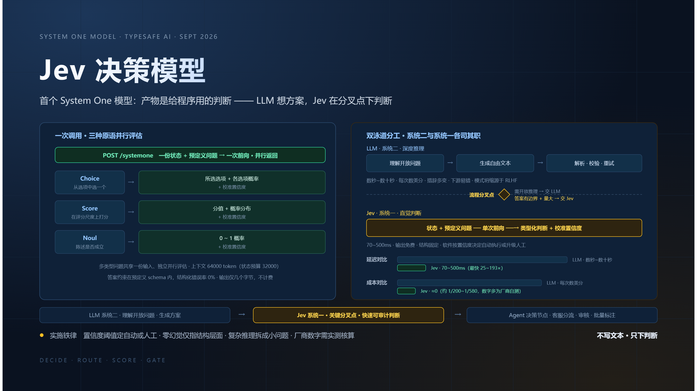
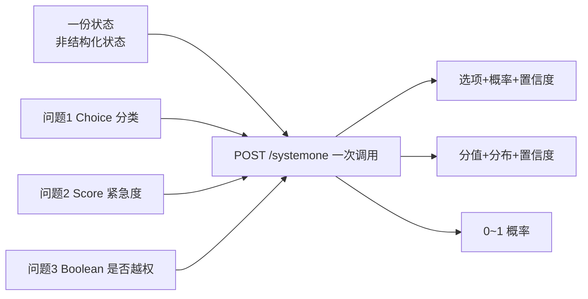
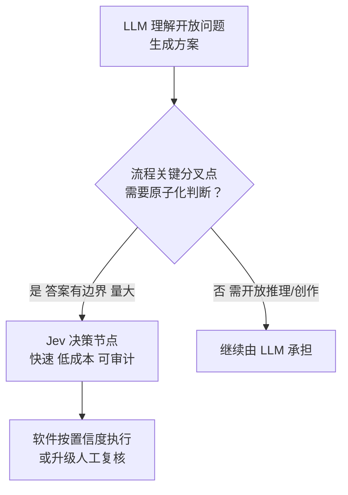

# Jev 决策模型

---

## 摘要

Jev 是 TypeSafe AI 于 2026 年 9 月发布的首个「System One 模型」。它刻意不做大语言模型（LLM）做的事——不生成自然语言文本，而是接收一份程序状态和若干预定义的问题，返回带校准概率的类型化决策，让软件可以直接读取字段而无需"生成文本再解析"。其动机源于 RLHF 把 LLM 塑成了讨好人类的聊天机器，而机器通信本不需自然语言。定位上 Jev 是流程里的判断节点，LLM 管开放推理创作，Jev 管高频有界的原子决策。它约 70~500 毫秒、$0.042/百万输入 token 且输出免费，提速降本达百倍量级（厂商口径）。

**关键词**：Jev；System One；决策模型；类型化输出；并行采样；校准置信度；RLHF；判断节点

---

## 1 定义与定位

Jev 是 TypeSafe AI 于 2026 年 9 月 15 日发布的第一个 System One 模型[[1]](#ref-1)[[2]](#ref-2)，是"系统一模型"这个新品类在工业界的首次落地[[2]](#ref-2)。

### 1.1 模型品类首创

"System One"取自心理学家丹尼尔·卡尼曼（Daniel Kahneman）的双系统理论——系统一是快速、直觉、自动化的反应，系统二是缓慢、深思熟虑的推理。TypeSafe 借用这组概念划分 AI 模型的分工：**Jev 对应系统一的直觉判断，LLM 对应系统二的深度推理**[[2]](#ref-2)[[3]](#ref-3)。这正是"系统一模型"这个品类的命名由来。它不是又一个"更便宜的 GPT"，而是一类全新的模型形态：**输入一份非结构化状态 + 一组预先定义的问题，输出的是带校准概率的类型化决策**[[3]](#ref-3)。

### 1.2 产物是给程序用的判断

一句话概括 Jev 与 ChatGPT、Claude 这类 LLM 的根本差异，**LLM 的产物是"给人看的文本"，Jev 的产物是"给程序用的判断"**[[1]](#ref-1)。一个典型例子：一条客服消息进来"接口开始返回 500 错误，订单处理不了"，传统做法是让 LLM 输出 JSON 再由程序解析校验；Jev 的做法是把消息作为状态传入，附上预定义问题，直接返回结构化的选项、分数与概率，代码立刻读取字段[[1]](#ref-1)。

它的核心属性可归纳为四点：

1. **类型化输出**：答案被约束在开发者预定义的类型里，不写自由文本，官方称在类型层面"不会产生幻觉"[[2]](#ref-2)。
2. **并行采样**：所有答案在一次前向计算中并行产生，而非逐 token 自回归地"往外蹦字"（详见 3.2）[[2]](#ref-2)。
3. **校准置信度**：每个决策都带一个概率，让软件知道何时可自动执行、何时应升级给人工复核[[3]](#ref-3)。
4. **面向机器的接口**：官方称之为"更像代码"——可靠、快速、自洽、类型安全[[3]](#ref-3)。

它与传统 LLM 的系统对比见表1：

| 维度   | System One 模型（Jev）             | 传统 LLM（系统二）   |
| ------ | ---------------------------------- | -------------------- |
| 输出   | 类型化决策（数据）                 | 自由文本（字符串）   |
| 延迟   | 约 70~500 毫秒                     | 数秒到数十秒         |
| 成本   | 约 $0.042/百万输入 token、输出免费 | 每次数美分量级       |
| 确定性 | 结构固定、带校准置信度             | 每次措辞可能不同     |
| 擅长   | 分类、路由、评分、守门             | 开放推理、写作、规划 |
| 类比   | 直觉反应                           | 深度思考             |

表1 Jev 与传统 LLM 的维度对比[[2]](#ref-2)[[3]](#ref-3)[[5]](#ref-5)

### 1.3 三种原语

Jev 提供三种可通过同一接口混用的问题原语，是它对"机器判断"的最小原子化抽象[[1]](#ref-1)[[2]](#ref-2)[[5]](#ref-5)：

| 原语           | 回答什么             | 返回内容                 |
| -------------- | -------------------- | ------------------------ |
| Choice         | 从若干选项中选一个   | 选项、各选项概率、置信度 |
| Score          | 在某个评分尺度上打分 | 分值、概率分布、置信度   |
| Boolean (Noul) | 一句陈述是否成立     | 0~1 的概率               |

表2 Jev 的三种问题原语[[1]](#ref-1)[[5]](#ref-5)

一次调用中，多个不同类型的问题共享一份输入，却独立、并行评估，可以混用[[1]](#ref-1)[[2]](#ref-2)。

## 2 背景

Jev 之所以被需要，根源在于生成式 LLM 与机器决策存在结构性错配。

### 2.1 生成式 LLM 不适合做机器决策

过去几年，我们习惯把一切丢给生成式大模型，包括那些其实只需要一个"是/否/选哪个"的琐碎判断[[1]](#ref-1)。但 LLM 是自回归文本生成器，逐 token 生成自然语言，应用层再用解析、重试、校验把文本"翻译"成软件可用的结构[[3]](#ref-3)。这一步"生成文本再解析"既慢、又贵、还会出错：模型多写一句解释就让下游流水线报错，结构不确定也让每次措辞可能不同[[1]](#ref-1)[[3]](#ref-3)。

### 2.2 RLHF 反向下注

这一判断来自 Jev 背后的 TypeSafe AI。创始人 Diogo Almeida 是 ChatGPT 研发的参与者、RLHF（基于人类反馈的强化学习）算法的提出者之一，与 Erik Gafni、Sasha Sheng 共同创办了 TypeSafe AI，公司此前长期隐身[[2]](#ref-2)；发布当天同时亮出 4000 万美元种子轮融资（DCVC 领投）与首个模型 Jev[[2]](#ref-2)。

Almeida 对 RLHF 时代的态度是反向的。他公开表示"我们一直在优化人类语言的处理能力……但在处理人类语言上表现出色，对自动化来说并没有用处，因为计算机使用的是不同的语言"[[2]](#ref-2)。TypeSafe 的核心论点是：RLHF 把 LLM 优化成了"讨好人类偏好的聊天机器"，带来模式坍缩、过度自信与可靠性问题，导致每个生产系统都需要人类在环；而机器之间的通信本就不需要自然语言，Jev 就是为"机器原生"的决策场景设计的[[3]](#ref-3)。

### 2.3 分工主张

TypeSafe 据此提出分工主张：**LLM 负责理解复杂的开放问题并生成方案，Jev 负责在流程的关键分叉点上做快速、可量化、可审计的判断，两者互补而非替代**[[3]](#ref-3)。这也是它反复强调的定位——Jev 不是用来替代生成式大模型，而是补上自动化系统里"软件可以直接依赖的判断接口"这一长期空缺[[1]](#ref-1)。

## 3 核心原理

Jev 的工作方式可拆成三个关键机制。

### 3.1 类型化输出

Jev 只从开发者预先定义的类型中选择答案，不写任何自由文本。因为答案被约束在给定的 schema 里，它不会"跑到剧本外"，官方称这一性质在类型层面"不会产生幻觉"[[2]](#ref-2)。这里的准确含义是输出永远是预期的数据结构（结构化错误率为 0%），且每个决策都带置信度，软件知道何时可自动执行、何时应升级人工复核[[3]](#ref-3)。注意"零幻觉"是厂商口径，仅指结构层面不出格，不表示决策一定正确。

### 3.2 并行采样

传统大模型逐个 token 自回归地"往外蹦字"，而 Jev 的所有答案在一次前向计算中并行产生，这是它能做到毫秒级响应的根本原因[[2]](#ref-2)。一次调用中，多个不同类型的提问共享一份输入，却独立、并行评估，可以混用[[1]](#ref-1)[[2]](#ref-2)。

图1 Jev 一次调用 一份状态与三种并行问题原语[[1]](#ref-1)[[2]](#ref-2)

### 3.3 校准置信度

每个决策都带一个校准过的置信度，让软件判断可以自动执行还是应升级给人工复核[[2]](#ref-2)[[3]](#ref-3)。这与 LLM 常见的过度自信形成对照，也是它作为"可依赖判断接口"的关键[[3]](#ref-3)。工程上，Jev 通过统一形态的决策接口被集成进编排工具，用于在流水线中做结构化路由[[9]](#ref-9)。

## 4 性能与成本

### 4.1 延迟

TypeSafe 报告 Jev 端到端延迟为 **70~500 毫秒**[[3]](#ref-3)[[4]](#ref-4)[[5]](#ref-5)，官网宣称在 System One 形态任务上比 LLM 快 **20~200 倍**[[1]](#ref-1)[[6]](#ref-6)。

### 4.2 定价

- 输入：**$0.042 / 百万输入 token**
- 输出：**不计费、免费**——因为 Choice/Score/Noul 的响应只有几个字节的结构化数据，没有"生成文本"可计费[[4]](#ref-4)[[5]](#ref-5)
- 上下文窗口 64000 token，其中给状态留 32000 token 预算[[3]](#ref-3)[[5]](#ref-5)

### 4.3 提速降本

- 官网列出比 LLM 更 **193.6x 快、444.6x 便宜**（在 System One 形态任务上），**这是公司自测、自评结果**——厂商自身构建了四个基准工作流，以两家外部大模型的平均回答为参照而非 ground truth[[4]](#ref-4)[[6]](#ref-6)。
- 第三方独立测试（Every）在一次提取任务上测得 Jev 约 **25x 更快、580x 更便宜**[[4]](#ref-4)。
- 在 TypeSafe 自家四工作流基准上，Jev 得分 67.8%，约与某一前沿模型打平、落后榜单前列数个百分点，但成本约为其 1/200；该"准确率"是**与共识大模型的吻合度，而非与 ground truth 的吻合度**[[3]](#ref-3)。

图2 LLM 与 Jev 的分工 判断节点的位置[[3]](#ref-3)

## 5 适用场景

### 5.1 Agent 决策节点

Jev 的高价值场景之一是给 Agent 充当决策节点：**工具选型、任务完成判据、风险拦截、结果验证**[[1]](#ref-1)[[6]](#ref-6)。在浏览器 Agent 中已有实现用它逐个完成"下一步点击什么"的实时决策，五步操作端到端 7.1 秒、单步决策延迟中位 150~300 毫秒[[4]](#ref-4)。

### 5.2 结构化判断与批量标注

更广泛的场景覆盖**客服分流、检索重排、引用支持判断、提示注入检测、内容审核、批量标注**等[[1]](#ref-1)[[6]](#ref-6)。此外，社区还出现了用 Jev 做模型路由、上下文压缩、代码工具等方向的实践[[2]](#ref-2)。

### 5.3 甜蜜点

Jev 的甜蜜点是"**答案有边界 + 判断量很大**"的组合——那些只需一个"是/否/选哪个"的琐碎判断被高频复用[[1]](#ref-1)。当调用变便宜，它就会被用在更多原本不值得动用模型的地方，这正是 Jevons 式"智力成本下降导致智力泛用"的愿景[[2]](#ref-2)。

由于 Jev 权重尚未开放，围绕它已出现一批用开源基座（如 Qwen3.5）+ LoRA 适配器 + 小型指针头（pointer head）复现同形态 Choice/Score/Noul 决策接口的开源替代模型，例如 Bosun（Apache-2.0，已发布 0.6B/1.7B 权重）、Kev、Nimble、Elephant 1 / Mammoth 1（基于 Qwen3.5、System One 兼容）、Drex 等[[7]](#ref-7)[[8]](#ref-8)。社区也在为它整理 SDK、演示与独立评测[[8]](#ref-8)。

## 6 局限与待验证

### 6.1 不擅长开放生成

Jev 不是通用模型：**不能写回复、总结、代码，不能做开放式规划；算术与精确字符串处理不可靠**[[3]](#ref-3)。

### 6.2 隐藏推理

几步以内的隐藏推理需要拆成小问题，或交给推理模型完成；官方建议把复杂判断拆成几个明确问题再组合，而不是一股脑让模型包办[[3]](#ref-3)[[2]](#ref-2)。

### 6.3 权重未开放

- **权重未开放**，目前为早期接入（early access）、仅文本输入[[3]](#ref-3)
- **独立校准数据稀少**，性能数字当前多为厂商自测，全部数据"另需更多独立验证和时间来回答"[[1]](#ref-1)[[3]](#ref-3)
- 它究竟是范式转变还是被放大的叙事，仍需观察[[1]](#ref-1)

## 总结

Jev 不是个写字的模型，而是把"选哪个、打几分、成不成立"这类答案有边界又量大到爆的原子判断单独拆出来，做成毫秒级、几乎零成本、给程序直接读的判断接口，专在流程分叉点上顶班当裁判，和大模型分工成一边想方案一边下判断；不过它眼下那些提速降本的数字大多是厂商自己报的，真想长期当生产依赖，还得拿真实的高频判断场景自己实测核算一把才踏实。

## 附录 知识点树

- 1 定义与定位
  - 1.1 品类首创 · System One 新品类（卡尼曼双系统）
  - 1.2 产物给程序用而非给人看文本（客服500示例）
  - 1.3 三种问题原语 Choice / Score / Boolean(Noul)
  - 核心属性四点 类型化 · 并行 · 校准置信度 · 面向机器
  - 维度对比表 Jev vs 传统 LLM
- 2 背景
  - 2.1 生成式 LLM 与机器决策错配（生成→解析慢贵错）
  - 2.2 RLHF 反向下注 · TypeSafe/Almeida/DCVC·4000万$
  - 2.3 分工主张 LLM想方案 / Jev下判断 互补非替代
- 3 核心原理
  - 3.1 类型化输出 零幻觉=厂商口径（仅结构不出格）
  - 3.2 并行采样 一次前向算非逐token自回归
  - 3.3 校准置信度 自动执行或转人工复核
- 4 性能与成本
  - 4.1 端到端延迟 70~500ms
  - 4.2 定价 输入$0.042/M 输出免费
  - 4.3 提速降本 厂商193.6x/444.6x vs 独立测25x/580x
- 5 适用场景
  - 5.1 Agent 决策节点 工具选型/完成判据/风险拦截/验证
  - 5.2 结构化判断与批量标注 客服分流/重排/审核
  - 5.3 甜蜜点 答案有界+量大 · 开源替代生态
- 6 局限与待验证
  - 6.1 不擅长开放生成 不能写/总结/规划，算术不可靠
  - 6.2 隐藏推理需拆分或交推理模型
  - 6.3 权重未开放 · early access · 独立校准数据少

## 参考文献

[1] 36氪. [&#34;刷屏全球的 AI 新顶流 Jev，一句话都不说，到底怎么玩？&#34;](https://m.36kr.com/p/3991613388241920) 36氪, 2026.
[2] 腾讯云开发者社区. [&#34;Jev 是什么？一文看懂这个&#39;只做判断、不说话&#39;的 AI 模型.&#34;](https://cloud.tencent.com/developer/article/2750097) 腾讯云, 2026.
[3] Sanity Glossary. [&#34;What is Jev? TypeSafe AI&#39;s System One decision model.&#34;](https://www.sanity.io/glossary/jev-typesafe-ai-model) Sanity, 2026.
[4] "TypeSafe AI Jev: System One Model, Pricing and Access." [ayautomate.com](https://www.ayautomate.com/blog/jev-typesafe-system-one-model), 2026.
[5] "Jev vs LLMs: Choosing Between TypeSafe AI's System One and Traditional LLMs." [zenmux.ai](https://zenmux.ai/blog/jev-vs-llms-choosing-between-typesafe-ais-system-one-and-traditional-large-language-models), 2026.
[6] Latent Space. [&#34;Jev: a &#39;System One Model&#39; that only decides/classifies/routes/scores — &gt;100x faster, &gt;200x cheaper than small frontier LLMs.&#34;](https://www.latent.space/p/ainews-jev-a-system-one-model-that) Latent Space, 2026.
[7] DataCamp. [&#34;Top 7 Open-Source TypeSafe Jev Alternatives.&#34;](https://www.datacamp.com/blog/top-open-source-jev-alternatives) DataCamp, 2026.
[8] AbdelStark. [&#34;Awesome TypeSafe Jev — a source-backed field guide with SDKs, demos, agent tools, and independent evaluations.&#34;](https://github.com/AbdelStark/awesome-typesafe-jev) GitHub, 2026.
[9] n8n Docs. [&#34;TypeSafe AI node for smarter workflow routing with Jev.&#34;](https://docs.n8n.io) n8n, 2026.
