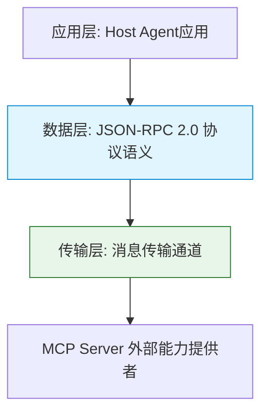
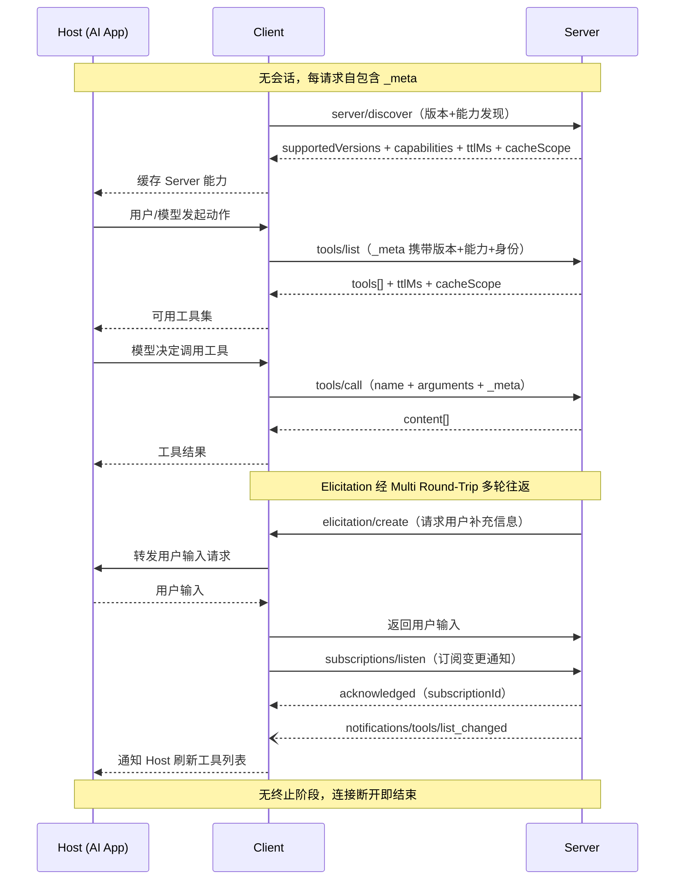
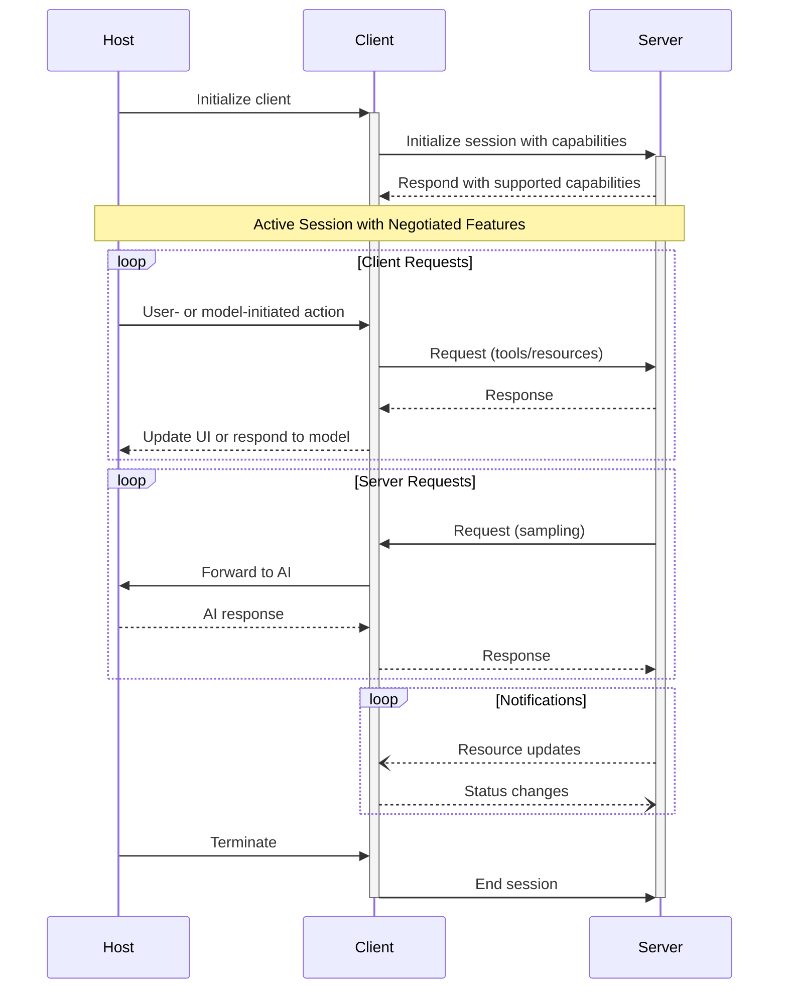
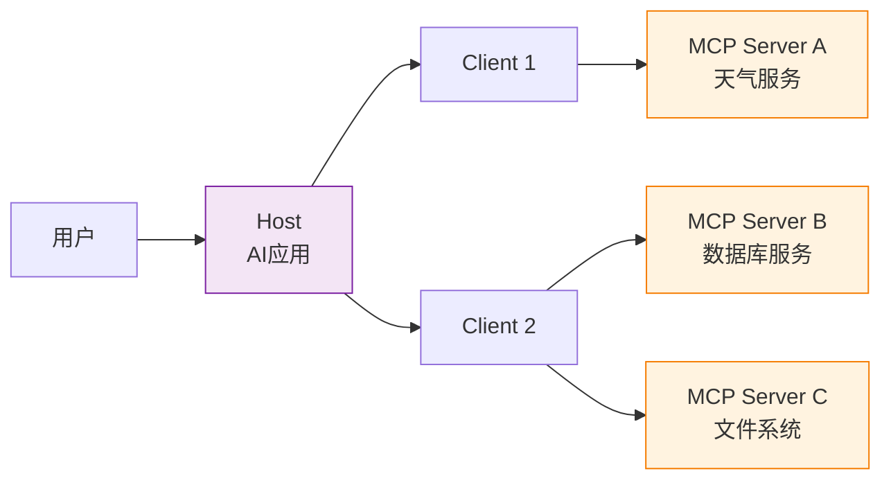
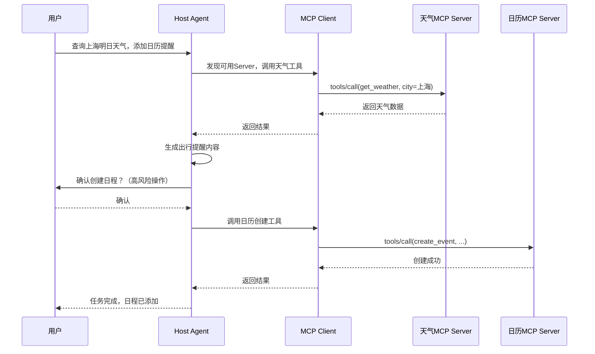

# 模型上下文协议（MCP）

## 摘要

模型上下文协议（Model Context Protocol, MCP）是一套基于 JSON-RPC 2.0 的开放标准化协议，通过定义统一的交互规范与能力原语，在大语言模型应用与外部数据、工具、业务系统之间构建标准化接入层。针对 AI Agent 外部系统对接成本高、协议碎片化的痛点，本文从协议架构、三层角色、三类原语与生命周期四个维度解析 MCP 技术规范，结合 Python SDK 示例辨析其与 Function Calling、LSP 的边界，并总结安全最佳实践。研究表明 MCP 可显著降低多系统集成成本，是构建可扩展 Agent 系统的关键基础设施。

**关键词**：模型上下文协议；AI Agent；JSON-RPC；工具调用

---

## 1 引言

大语言模型驱动的智能体（AI Agent）已成为人工智能落地的核心形态，其核心能力边界取决于外部系统的接入广度与深度。在传统开发模式中，Agent需针对文档系统、日历服务、数据库、业务接口等不同外部系统进行点对点API适配，不同系统的调用格式、认证机制、返回结构差异显著，导致集成代码冗余、迁移成本高、生态碎片化严重[[1]](#ref-1)。

模型上下文协议（Model Context Protocol，简称MCP）应运而生，它是由社区主导的开放协议，设计灵感源自语言服务器协议（Language Server Protocol, LSP），核心目标是标准化LLM应用与外部能力的接入方式，被业界称为“AI领域的USB接口”[[2]](#ref-2)。支持MCP的AI应用可自动发现、接入并调用符合规范的外部服务，无需重复开发适配层，大幅提升Agent系统的可扩展性与可维护性。

本文面向Agent开发者，从协议规范、架构设计、工程实现、安全实践四个层面展开论述，为Agent系统的外部能力接入提供完整的技术参考。

## 2 协议底层架构

MCP采用分层设计，自下而上分为传输层与数据层，基于JSON-RPC 2.0构建标准化消息交互机制。

### 2.1 协议分层模型

MCP的协议栈分为两层，各层职责边界清晰，可独立演进：



<p align="center"><b>图1 MCP协议分层架构</b></p>

1. **传输层**：负责JSON-RPC消息的物理传输，不解析协议语义。主流实现方式包括两种[[3]](#ref-3)：
- **Stdio模式**：通过标准输入输出流传输，适用于本地进程间通信，部署简单、安全性高。
   - **Streamable HTTP模式**：基于 HTTP POST 发送请求，SSE 流式推送响应，适用于远程服务接入，支持 OAuth 2.0 认证。
2. **数据层**：基于JSON-RPC 2.0规范定义消息结构与交互语义，是协议的核心层。包含生命周期管理、服务端能力原语、客户端能力原语、通用工具原语四大模块[[4]](#ref-4)。

### 2.2 消息格式规范

MCP所有消息严格遵循JSON-RPC 2.0规范，定义三类消息类型[[5]](#ref-5)：

- **请求（Request）**：包含唯一ID、方法名与参数，用于发起操作。ID不可为null，同一连接内不可重复。
- **响应（Response）**：携带与请求相同的ID，包含结果或错误对象，二者不可同时存在。
- **通知（Notification）**：不含ID，用于无需回复的事件推送，如日志、进度更新。

请求消息基础格式示例：

```json
{
  "jsonrpc": "2.0",  "id": "req_001",
  "method": "tools/call",
  "params": {
    "name": "get_weather",
    "arguments": { "city": "Shanghai" }
  }
}
```

### 2.3 会话生命周期

MCP 在 2026-07-28 版本后转为无状态协议，每个请求在 `_meta` 字段中携带协议版本与能力信息，服务端可独立处理每个请求：



<p align="center"><b>图2 MCP无状态交互时序图（2026-07-28 新版）</b></p>

此前版本（2025-11-25）为有状态协议，会话分为三个阶段[[6]](#ref-6)：

1. **初始化**：`initialize` 请求完成能力协商，必须是会话首个交互。
2. **运行**：工具调用、资源读取、模板调用等业务交互。
3. **关闭**：任意一方发起关闭通知，完成资源释放与会话终止。

服务端典型能力包括`tools`、`resources`、`prompts`、`logging`；客户端典型能力包括`sampling`（2026-07-28 起弃用）、`roots`、`elicitation`[[6]](#ref-6)。



<p align="center"><b>图3 MCP会话生命周期时序图（2025-11-25版）</b></p>

### 2.4 新旧版本对比

| 维度 | 旧版（2025-11-25） | 新版（2026-07-28） |
|------|-------------------|-------------------|
| 协议状态 | 有状态会话 | **无状态**，每请求自包含 `_meta` |
| 初始化 | `initialize` 握手 + 能力协商 | **`server/discover`** 发现请求（可缓存） |
| 会话生命周期 | 初始化→运行→关闭 三阶段 | **取消**，无会话概念 |
| Sampling | 客户端原语 | **已弃用**，直接对接 LLM API |
| Logging | 客户端原语 | **已弃用**，改用 stderr/OpenTelemetry |
| 传输 | Stdio + HTTP+SSE | Stdio + **Streamable HTTP** |
| 客户端原语 | Sampling/Roots/Elicitation | **仅 Elicitation** |
| 新增 | — | **Tasks 扩展**（长轮询+延迟结果） |

## 3 核心架构与角色定义

MCP采用Host-Client-Server三层架构模型，三类角色职责解耦，构成完整的交互链路。

### 3.1 角色职责划分

| 角色 | 定位 | 运行位置 | 核心职责 | 典型实例 |
| --- | --- | --- | --- | --- |
| Host（主应用） | Agent运行载体与用户入口 | 用户侧 | 管理对话会话、模型权限、连接生命周期；控制用户授权与高风险操作确认 | 桌面智能助手、IDE插件、企业办公Agent |
| Client（客户端） | 协议通信连接器 | Host内部 | 遵循MCP协议与Server通信；完成能力发现、请求转发、结果回传；一个Host可实例化多个Client对接多Server | MCP SDK客户端组件 |
| Server（服务端） | 外部能力封装提供者 | 外部系统侧 | 将本地/远程系统能力封装为MCP标准原语；接收并执行调用请求 | 天气服务MCP Server、数据库MCP Server |

完整交互链路为：**用户指令 → Host → Client → MCP Server → 外部业务系统**，执行结果沿原路径反向返回。



<p align="center"><b>图4 MCP三层架构交互图</b></p>

### 3.2 Sampling机制

Sampling 允许 MCP Server 反向请求 Host 侧 LLM 完成推理任务[[7]](#ref-7)，使服务端无需集成 LLM SDK。注意：2026-07-28 起已弃用，新实现应直接对接 LLM 提供商 API。

### 3.3 其他客户端原语

- **Roots**：服务端查询可操作的 URI 或文件系统边界，限定操作范围。
- **Elicitation**：服务端请求用户补充信息或确认操作，通过 `elicitation/create` 实现。

### 3.4 通知机制

服务端通过 `subscriptions/listen` 长连接推送变更通知（工具新增、修改、临时不可用），客户端订阅后在流上接收匹配事件。

### 3.5 授权框架

HTTP 传输推荐 OAuth 2.0 认证（bearer token、API key、自定义请求头），Stdio 传输从环境变量获取凭据。

## 4 核心能力原语

MCP Server对外提供三类标准化能力原语，覆盖动作执行、上下文供给、模板复用三大场景，构成Agent外部能力的完整表达体系。

### 4.1 Tools（工具原语）

Tools对应可执行的函数操作，支持模型通过结构化调用修改外部系统状态，是Agent动作能力的核心载体。典型能力包括天气查询、代码执行、数据库读写、日程创建等。

工具定义采用结构化JSON Schema，标准接口包括：

- `tools/list`：枚举服务端所有可用工具
- `tools/call`：执行指定工具调用

基于Python官方SDK的工具定义示例[[8]](#ref-8)：

```python
from mcp.server.fastmcp import FastMCP

mcp = FastMCP("WeatherServer")

@mcp.tool()
def get_weather(city: str) -> str:
    """
    查询指定城市的实时天气
    Args:
        city: 城市名称，如Shanghai、Beijing
    """
    # 实际业务逻辑：调用第三方天气API
    return f"{city} 今日天气：小雨，18-23℃，建议携带雨具"

if __name__ == "__main__":
    mcp.run()
```

### 4.2 Resources（资源原语）

Resources对应只读类上下文数据，用于向Agent提供任务所需的背景信息，不改变外部系统状态。典型资源包括项目文档、配置文件、数据库表结构、会议记录等。

资源通过统一资源标识符（URI）进行定位与访问，标准接口包括`resources/list`与`resources/read`。资源URI示例：

- `file://project/docs/readme.md`（本地文档资源）
- `db://sales/order_table`（数据库表结构资源）

### 4.3 Prompts（提示模板原语）

Prompts对应可复用的交互提示模板，封装特定场景的指令结构与输出规范，支持Agent直接调用完成标准化任务。典型模板包括代码审查模板、会议总结模板、故障分析模板等。标准接口包括`prompts/list`与`prompts/get`。

## 5 完整交互流程

以“查询上海明日天气并添加日历出行提醒”任务为例，MCP完整调用时序如下：




<p align="center"><b>图5 MCP调用时序图</b></p>

完整流程分为五个阶段：

1. **能力发现与任务规划**：Host检索已连接的MCP Server，获取可用工具集，拆解任务步骤。
2. **工具调用与结果返回**：Client向目标Server发起调用请求，Server执行并返回数据。
3. **信息整合与步骤推进**：Agent解析返回结果，规划下一步操作。
4. **高风险操作用户确认**：涉及修改外部数据的操作，触发人机在环（Human-in-the-loop）机制。
5. **执行操作与结果反馈**：用户确认后执行最终操作，返回任务结果。

## 6 相关概念辨析

### 6.1 MCP与Function Calling

Function Calling是大语言模型的原生能力，负责生成结构化的函数调用参数；MCP是接入层协议，负责标准化外部系统的发现、接入与交互流程。二者是互补关系：Function Calling解决“模型怎么调用”的问题，MCP解决“怎么接入更多系统”的问题[[9]](#ref-9)。

### 6.2 MCP与LSP

MCP在设计理念上借鉴了LSP（语言服务器协议）：LSP标准化了编辑器与语言服务的对接，MCP标准化了Agent与外部能力的对接。二者均采用客户端-服务器架构、JSON-RPC通信、能力协商机制，目标都是构建可复用的生态系统[[2]](#ref-2)。

### 6.3 MCP、Function Calling、Skill三者关系

- **Function Calling**：模型底层能力，生成调用指令。
- **MCP**：接入层标准，打通外部系统通道。
- **Skill**：业务层能力组合，由多个工具调用与逻辑流程封装而成。

三者逻辑关系：MCP提供标准化接入通道，Function Calling实现指令生成，二者结合支撑Skill构建，最终形成Agent完成真实任务的完整能力。

## 7 Agent开发安全最佳实践

MCP协议本身不强制实现安全机制，安全边界与权限控制需由Host与Server共同落地，面向Agent开发的核心实践原则包括：

1. **最小权限原则**：仅授予任务执行所需的最低权限，如只读场景不开放写入权限，严格限制Server可访问的资源范围[[10]](#ref-10)。
2. **高风险操作强制确认**：涉及数据修改、消息发送、资源删除等高风险操作，必须触发用户确认流程，禁止自动执行。
3. **敏感凭证隔离**：认证密钥、接口凭证等敏感信息由Client/Server层独立管理，严禁传入大模型上下文，防止提示注入泄露。
4. **输入校验与防注入**：对工具调用参数进行严格校验与清洗，防范Prompt Injection与命令注入攻击。
5. **全链路审计日志**：完整记录调用主体、目标Server、调用工具、传入参数、返回结果与执行时间，支持事后审计与问题排查。
6. **沙箱隔离**：执行代码、文件操作类工具时，运行在独立沙箱环境中，限制系统资源访问权限。

## 8 结论

MCP 通过标准化架构、能力原语与交互机制，解决了 AI Agent 多系统集成的碎片化问题。2026-07-28 新版取消有状态会话、改为无状态协议，进一步简化了集成复杂度。基于 MCP 构建外部能力层，可大幅降低开发与维护成本，是构建可扩展 Agent 系统的关键基础设施。

---

## 参考文献

<a id="ref-1"></a>[1] Model Context Protocol. ["MCP Specification."](https://modelcontextprotocol.io/specification) *Official*, 2025.  
<a id="ref-2"></a>[2] Model Context Protocol. ["MCP Architecture Overview."](https://modelcontextprotocol.io/docs/2025-11-25/learn/architecture) *Official*, 2025.  
<a id="ref-3"></a>[3] Vectree. ["Implementation Details of JSON-RPC Messaging in MCP."](https://vectree.io/pdf/c/implementation-details-of-json-rpc-messaging-and-protocol-negotiation-in-the-model-context-protocol) *Vectree*, 2025.  
<a id="ref-4"></a>[4] Model Context Protocol. ["Basic Protocol Messages."](https://modelcontextprotocol.io/specification/2024-11-05/basic/messages) *Official*, 2024.  
<a id="ref-5"></a>[5] Model Context Protocol. ["JSON-RPC Message Specification."](https://modelcontextprotocol.io/specification/2025-06-18/basic) *Official*, 2025.  
<a id="ref-6"></a>[6] Model Context Protocol. ["Lifecycle & Capability Negotiation."](https://modelcontextprotocol.io/specification/2025-06-18/basic/lifecycle) *Official*, 2025.  
<a id="ref-7"></a>[7] Model Context Protocol. ["Sampling Mechanism."](https://modelcontextprotocol.org/specification/2025-11-25/client/sampling) *Official*, 2025.  
<a id="ref-8"></a>[8] Model Context Protocol. ["Build an MCP Server - Python SDK."](https://modelcontextprotocol.io/docs/2026-07-28/develop/build-server) *Official*, 2026.  
<a id="ref-9"></a>[9] Microsoft. ["Semantic Kernel Adds MCP Support for Python."](https://devblogs.microsoft.com/semantic-kernel/semantic-kernel-adds-model-context-protocol-mcp-support-for-python/) *MS DevBlogs*, 2025.  
<a id="ref-10"></a>[10] Model Context Protocol. ["Authorization Framework."](https://modelcontextprotocol.io/specification/2025-06-18/basic/authorization) *Official*, 2025.  
<a id="ref-11"></a>[11] 屿哥扒透AI. ["Agent里的MCP到底是什么？"](https://v.douyin.com/3RIt4gSeyAM/) *抖音视频*, 2025.
