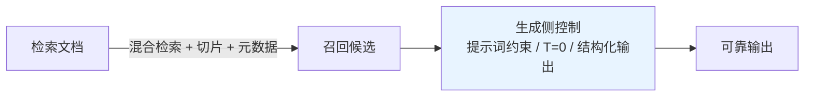
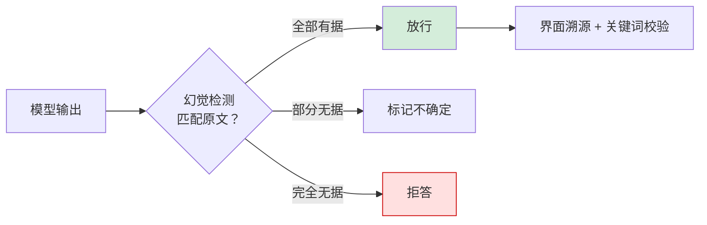
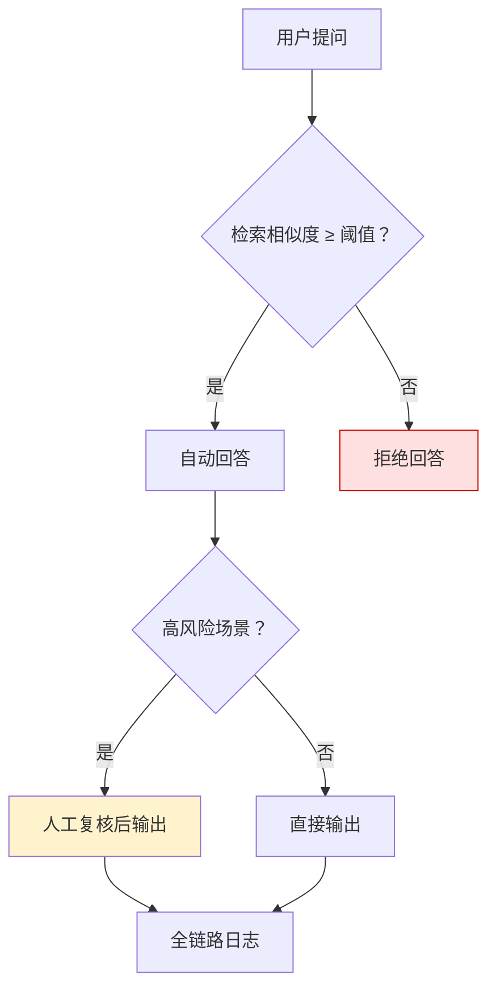

# RAG 准确率提升体系化方案

## 摘要

RAG（检索增强生成）受限于大模型固有的随机性与幻觉倾向，无法达到 100% 准确。从检索与生成两端源头抑制错误产生，通过多重校验机制识别并拦截不可靠输出，在极端场景下控制错误扩散。目标并非追求绝对正确，而是将出错概率压缩到可接受范围。

**关键词**：RAG；准确率保障；混合检索；幻觉检测；阈值控制；人工复核；全链路日志

---

## 1 核心认知

RAG 无法实现 100% 准确率[[4]](#ref-4)，这是大模型固有的随机性决定的。

### 1.1 为何不可达

大模型的随机性源于采样解码机制，幻觉则来自训练分布偏差[[1]](#ref-1)——二者均为架构级固有属性，调参只能缓解、无法根治。将 temperature 归零仅消除采样扰动，若错误答案在分布中已占高位，贪心解码仍会稳定输出错误结果。

### 1.2 可行路径

类比物流体系，日均亿级包裹必然存在出错，但通过流程设计将错误率压至极低水平。RAG 同理，正确目标是从工程与业务双维度降低出错概率，而非追逐不可能的零错误。

---

## 2 三层落地体系

### 2.1 架构层

#### 2.1.1 检索侧优化

| 手段 | 说明 |
|---|---|
| 混合检索 | 稠密向量捕捉语义、稀疏向量锁定精确匹配，双路融合兼顾两类查询 |
| 切片优化 | 按语义边界切分文档，保留上下文重叠，防止信息碎片化 |
| 元数据打标 | 入库时附加结构化标签（类别/时间/来源），支持按业务场景过滤召回 |

#### 2.1.2 生成侧控制

| 手段 | 说明 |
|---|---|
| 提示词约束 | 限定模型仅依据上下文作答，禁止使用自身知识补充 |
| temperature=0 | 贪心解码消除采样随机性 |
| 输出格式限制 | 强制输出检索原文的结构化 JSON，阻断自主概括 |

核心思路：将模型视为不可信的文本处理单元，用结构化契约约束其自由发挥空间。

图1 架构层保障机制

### 2.2 防护层

#### 2.2.1 幻觉检测

在输出链路上增设轻量校验模型，逐条比对生成内容与检索原文的匹配程度[[2]](#ref-2)——全部有据放行，部分存疑标记，完全无据拒答。

#### 2.2.2 界面溯源

回答同步展示原文引用来源与具体内容，使用户可自主比对验证。将信任关系从"盲信模型"转为"用户可核验"。

#### 2.2.3 关键词校验

面向医疗、法律、金融等高风险行业构建领域词库，命中时校验模型对关键词的解释是否与原文一致，防止关键信息被流畅编造。

图2 防护层校验流程

### 2.3 兜底机制

#### 2.3.1 阈值控制

对检索相似度设定门槛，低于阈值时直接拒答而非让模型强行生成，阈值通过离线标注与线上 A/B 标定。

#### 2.3.2 人工复核

高风险操作（处方开具、合同条款）在自动回答后增设人工确认环节[[3]](#ref-3)，低风险场景放行、高风险场景先进审核队列。

#### 2.3.3 全链路日志

完整记录提问、检索、生成全流程数据，支持问题回溯与错误归因（检索侧 or 生成侧），驱动工程体系持续迭代。

图3 兜底机制决策流程

三层关系：架构层管事前抑制，防护层管事中拦截，兜底层管事后止损。

---

## 总结

| 层级 | 目标 | 手段 | 时机 |
|---|---|---|---|
| 架构层 | 降低出错概率 | 混合检索 / 切片优化 / 元数据 / 生成约束 | 事前 |
| 防护层 | 校验输出可靠性 | 幻觉检测 / 界面溯源 / 关键词校验 | 事中 |
| 兜底层 | 控制错误代价 | 阈值拒答 / 人工复核 / 全链路日志 | 事后 |

承认 RAG 不可能零错误，用三层方案将概率压低、代价兜住，是工程实践的核心答案。

---

## 参考文献

[1] P. Lewis et al. ["Retrieval-Augmented Generation for Knowledge-Intensive NLP Tasks."](https://arxiv.org/abs/2005.11401) *NeurIPS*, 2020.  
[2] S. Chen et al. ["SecAlign: Defending Against Prompt Injection with Preference Optimization."](https://arxiv.org/abs/2410.05451) *ACM CCS*, 2025.  
[3] E. Debenedetti et al. ["AgentDojo: A Dynamic Environment to Evaluate Prompt Injection Attacks and Defenses for LLM Agents."](https://arxiv.org/abs/2406.13352) *NeurIPS Datasets & Benchmarks*, 2024.  
[4] 懂王Ai. ["RAG 如何保证 100% 准确率."](https://v.douyin.com/77ovS2AowBA/) *抖音*, 2025.  

