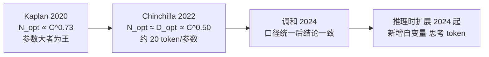
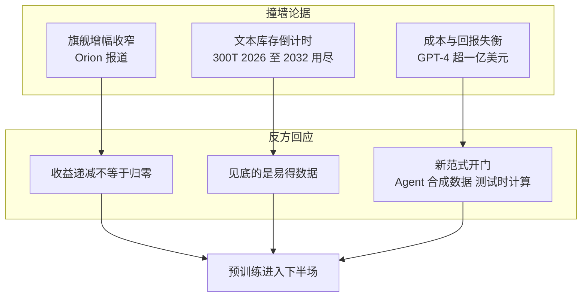
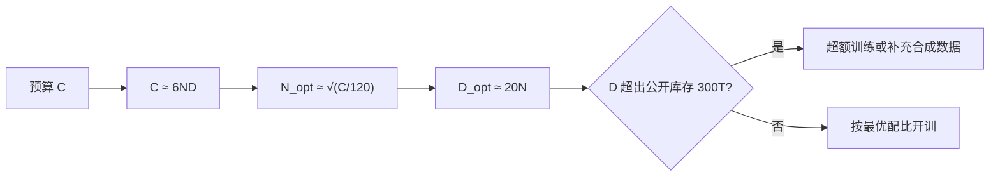

# Scaling Law



## 摘要

规模定律（Scaling Law）是描述大语言模型性能与其规模（参数量、数据量、计算量）之间呈幂律关系的经验规律，当模型参数、训练数据和算力按一定比例同步增加时，模型损失会以可预测的方式平滑下降，且这种关系跨越多个数量级依然成立。

**关键词**：规模定律、幂律、Kaplan、Chinchilla、涌现、推理时扩展、算力分配


## 背景

2020 年 1 月，OpenAI 的 Jared Kaplan 等人发布了后来影响整个产业走向的论文《Scaling Laws for Neural Language Models》[[1]](#ref-1)，说的是语言模型的损失随参数量、数据量和计算量按幂律下降，没有新架构也没有新算法，只有一批不同规模的模型和几条拟合公式。

含义却惊人，性能可以用钱直接买到。先用零头预算训小模型，外推就是大模型的收益预期。它把「模型能不能做好」这个开放问题变成了「肯花多少钱」的商业问题，既是融资叙事，也是算力分配的依据。当年 5 月，1750 亿参数的 GPT-3 问世[[2]](#ref-2)，此后几乎每个前沿模型的发布屏幕上都站着同一条向下的幂律曲线。

到 2026 年的今天，这条曲线被修正过、质疑过、宣布「接近极限」过，也长出了训练之外的第二条曲线。

## 1 基本概念

### 1.1 定义

规模定律（Scaling Law）刻画语言模型损失随参数量、数据量与计算量的幂律下降。规模定律回答一个极简的问题，把模型做大，损失能降多少？它涉及三个变量。

- **参数量 N**：模型可学习的权重数量
- **数据量 D**：训练消耗的 token 数
- **计算量 C**：工程上近似等于前两者的乘积（见 6.2）

三者的关系写成幂律形式

$$L(N) = L_\infty + A \cdot N^{-\alpha}, \qquad L(N, D) = E + \frac{A}{N^{\alpha}} + \frac{B}{D^{\beta}}$$

公式里有三类参数。

- **缩放指数**（α 与 β）：决定曲线的陡峭程度，是整条定律的灵魂
- **不可约损失**（$L_\infty$ 与 E）：语言本身的熵，算力再大也压不下去
- **前置系数**（A、B）：把理论值换算到具体架构和数据上

这里的损失指语言建模的交叉熵，不是你在应用里直接感受到的「回答好不好」，两者的换算并不透明，这正是后文 4.1 的伏笔。

### 1.2 幂律特性

**收益递减。** Kaplan 在其实验设定下估计参数的指数 α 约 0.076。代入计算，参数翻倍，损失只降约 5%；想让超额损失项减半，参数要翻约十三次，即约九千倍【推导】。这就是大模型的经济学底色，每一分钱换到的性能都在变少，但一直换得到。

**可外推。** 幂律在跨数量级上保持平滑，于是可以反过来用，先训练一串小模型（Kaplan 的实验覆盖 768 到 15 亿参数[[1]](#ref-1)[[3]](#ref-3)），拟合出指数和系数，再外推到更大规模预测模型表现。数千万美元级的训练任务可以在动工前就知道大致结果（见 6.1）[[1]](#ref-1)。

两个特性合起来是一句话，**它把一份昂贵的未来实验，压缩成一批便宜的现在的小实验**。这是它超越所有单点经验贡献的根本原因，这些特性的产业后果单列在 1.3。

### 1.3 为什么需要 Scaling Law

幂律的价值在于把「造大模型」从玄学变成可预测的工程问题，具体落在三个场景。

- **训练前预测**：动辄数千万美元级的开训决策，先用小模型拟合曲线，外推目标规模的损失水平，判断一次训练值不值得投入（见 6.1）
- **资源最优分配**：给定算力预算，按 N_opt 与 D_opt 的闭式解决定钱给更大的模型还是更多的数据，GPT-3 系与 LLaMA 系的路线分歧，本质上是对同一曲线不同位置的押注（见 2.3 与 6.2）
- **路线与资本依据**：头部实验室与投资人把它当作经营层面的第一性原理，年度算力预算、GPU 需求与融资叙事都由它背书（见 6.5）

三条用途共用同一条曲线，也一并承接它的失效边界与口径教训（见 6.4）。

### 1.4 经验规律

严格说，它不是定律。它是对特定架构（Transformer）、特定数据、特定训练流程的曲线拟合；换架构、换数据处理方式，指数和系数都会变。它是这五年被反复检验、大体稳定、但可以局部被推翻的经验规律。

这也是为什么本文标题没有用「第一性原理」这类修辞，物理学的第一性原理从守恒定律出发推导，不该随条件变；规模定律站在经验拟合的一侧，拟合条件一变就可能修正它。这个区分不是抠字眼，正因为它可修，2022 年的 Chinchilla 修正才有意义。

## 2 两大经典定律

两代定律与调和的演进，按时间线如下。



<p align="center">图 1 定律演进时间线</p>

### 2.1 Kaplan 定律和 Chinchilla 定律

Kaplan 定律主张新算力优先投参数，「参数大者为王」定了此后两年的路线，顺着它训出的 GPT-3[[2]](#ref-2)，按后来标准只喂到最优配比的十分之一左右【推导】。两年后 Hoffmann 等人给出 Chinchilla 修正，参数与数据等比例增长，相近总算力下，四分之一大小的 70B 模型配上数倍数据全面胜过 280B 的 Gopher[[4]](#ref-4)，行业随即开始核算自家旗舰的欠训。

两代定律的核心口径对比如下。

| 维度 | Kaplan（2020） | Chinchilla（2022） |
|---|---|---|
| 来源 | OpenAI[[1]](#ref-1) | DeepMind[[4]](#ref-4) |
| 参数口径 | 非嵌入参数 | 总参数 |
| 最优参数 | N_opt ∝ C^0.73 | N_opt ∝ C^0.50 |
| 最优数据 | 慢于参数增长 | 与参数等比例 |
| 最优 token/参数比 | 未给中心值 | 约 20 |
| 代表模型 | GPT-3（175B/300B，后被判定欠训） | Chinchilla（70B/1.4T） |
| 核心主张 | 参数大者为王 | 数据配比定生死 |

<p align="center">表 1 Kaplan 与 Chinchilla 对照</p>

### 2.2 分歧与调和

两家都是认真拟合，为什么数字差这么远？2024 年微软研究院的 Tim Pearce 与 MIT 的 Jinyeop Song 发表了调和论文《Reconciling Kaplan and Chinchilla Scaling Laws》[[3]](#ref-3)，给出了清晰的解释。

**参数口径**是主因。Kaplan 统计的是非嵌入参数（不含嵌入层与输出投影），而这两部分参数受词表大小影响很大。当换回「总参数量」口径、按 Chinchilla 的流程在小尺度模拟时，得到的最优参数指数是 0.51，与 Chinchilla 的 0.50 基本吻合；而按 Kaplan 的非嵌入口径在同样尺度上做局部拟合，会得到约 0.78 的局部指数，接近 Kaplan 的 0.73。也就是说，**Kaplan 的偏差主要来自口径与小尺度分析，而非方法错误**[[3]](#ref-3)。

同期 Porian 等人独立完成了调和，指出末层计算成本、warmup 时长、优化器跨规模调参三个因素同样有影响，修正后与 Chinchilla 高度一致[[5]](#ref-5)；Epoch AI 的 Besiroglu 等人对 Chinchilla 本身的拟合做了复现修正，方向一致，最优 token/参数比略有上移[[6]](#ref-6)。

这场分歧没有输家，产业却拿到两条教训，**引用任何 scaling 数字，先问参数怎么数的；对经验拟合而言，条件即结论**。此后发表的 scaling 研究都明确注明口径、调度与拟合方法。

### 2.3 两条产业路线

修正之后，头部实验室走向了两种站位。**OpenAI 系偏向大参数强模型**，上限优先，训练与推理都贵，赌的是前沿能力溢价。**Meta 主导的 LLaMA 系把账算到推理侧**，小参数模型主动超额喂数据（over-training），训练贵一点，换推理便宜一点，毕竟开源模型被部署的次数远多于被训练的次数。Llama 3 的 8B 用约 15T token 训练，约是 Chinchilla 配比的百倍【推导】，405B 版本花了约 3090 万 H100 GPU 小时[[7]](#ref-7)。

两条路都对，因为优化的目标函数不同，一个最小化前沿能力差距，一个最小化「训练加推理」的总拥有成本。**规模定律给出的是曲线，站在曲线哪个位置经营，是商业决策**。

## 3 关键分支与扩展

### 3.1 数据维度

- **重复数据的收益上限**：数据吃紧时，能不能把同一批数据过几十遍？Muennighoff 等人的「数据受限型语言模型」研究给出答案[[8]](#ref-8)：重复 4 个 epoch 以内几乎等于新数据；增益递减，到约 16 个 epoch 为止仍有有效增益，此后快速衰减趋零。重复不是免费的，但回本点比直觉远。
- **质量比数量微妙**：更严格的过滤把「多而杂」换成「少而精」很可能更划算。标志性结果是 RefinedWeb：精心过滤的纯网络数据胜过精选语料[[9]](#ref-9)，这个发现让高质量数据的可用储量估算大幅上移（见 4.2）。
- **数据混合**：代码、多语言、学科知识按什么比例掺入，也影响损失。业界已有「数据混合定律」的初步探索与线上混合配比的调优，多语法和代码占比较高的训练尤其值得显式规划。

### 3.2 架构维度

同参数下，加深还是拓宽？Kaplan 的实验显示，参数量固定时，深浅宽窄的形状差异对损失的影响只有几个百分点[[1]](#ref-1)；但不同形状的并行效率与推理开销不同，加宽优先属于工程折衷而非拟合结论【推导】。**稀疏混合专家（MoE）**方面，Clark 等人的统一律表明，相同计算预算下，路由模型优于同算力的稠密模型，且优势在损失跨过多个数量级后依然存在[[10]](#ref-10)。代价是路由机制的复杂性与训练稳定性问题，因此 MoE 的 scaling 系数不能直接照搬稠密模型的。

### 3.3 训练超参

幂律之外，三类「工具型」规律同样决定单位算力的产出。

- **临界批大小**：batch 太小，同样的算力换成通信换不来损失下降；太大则样本利用不充分。临界点可直接从梯度噪声估计出来[[11]](#ref-11)，是大规模训练的调参底线。
- **学习率调度**：Kaplan 与 Chinchilla 的分歧里就有调度与训练时长不匹配的成分[[5]](#ref-5)，调度方案与总训练长度锁定对齐，是可复现性的基本要求。
- **超参迁移（μP / μTransfer）**：超参最优值随规模变化，曾使每个超大规模训练都要重调一轮。Tensor Programs V 表明，用 μP 参数化后，小模型上调好的超参可以零样本迁移[[12]](#ref-12)。

### 3.4 下游任务迁移

训练损失是平滑的幂律，下游任务不必然买账，损失下降对下游指标的转换并不完全，尤其当微调数据分布与预训练分布偏移时。这正是第 4 章「曲线是否可信」之争的入口。

## 4 涌现与撞墙

两派论点的对阵格局如下。



<p align="center">图 2 撞墙与反驳的论证结构</p>

### 4.1 涌现与度量之争

Wei 等人 2022 年提出「涌现能力」的定义[[13]](#ref-13)，某个能力在模型规模低于某个阈值前接近随机水平，超过阈值后突然出现。few-shot 指令跟随、多步算术、思维链推理等任务都出现过这种形状。

2023 年，Schaeffer 等人的《Are Emergent Abilities of Large Language Models a Mirage?》泼了一盆有理有据的冷水[[14]](#ref-14)，论点是**阶跃可能是指标的产物**。他们的代表例子是 MMLU，用精确匹配计分（四选一全对才算对）时，能力提升在曲线上表现为突跳；换成 Brier 分之类的连续指标，同一批模型的表现就是平滑的。换句话说，能力底层可能一直在连续积累，只是离散公尺把过程折叠成了台阶。

这与规模定律的平滑曲线形成了张力。今天的共识接近「并存」，**底层损失平滑，指标可能阶跃，两者不必矛盾**。把涌现当成可规划的突破点风险很高，把幂律当成规划的平均线更稳妥。

### 4.2 撞墙论据

2024 至 2025 年，「Scaling 撞墙」从私下抱怨变成了行业叙事。论据有三条。

- **旗舰增幅收窄**：The Information 在 2024 年报道内部代号为 Orion 的下一代 GPT 模型改进幅度不及预期（媒体报道，非论文）[[15]](#ref-15)。同期多家头部实验室的旗舰迭代间隔变长、单次跃升变小，是可观测的行业现象。
- **数据侧的倒计时**：Epoch AI 给出一个明确窗口：**有效库存约 300 万亿 token**（90% 置信区间 100T 至 1000T）；若趋势延续，前沿模型将在 **2026 至 2032 年间（80% 置信区间）**用尽这份库存[[16]](#ref-16)。这个估算修正过一次：2022 年的原版曾预测高质量文本 2024 年前后用尽，随着过滤技术进步被推迟。瓶颈是真的，只是位置在移动。
- **成本与回报的失衡**：GPT-4 量级的训练被奥特曼公开证实为「一亿美元以上」（MIT 活动问答）[[17]](#ref-17)；Llama 405B 花了约 3090 万 GPU 小时[[7]](#ref-7)。每一次翻倍的价格变高、回报却越买越少，财务模型会先于物理极限亮红灯。

把论据推向情绪顶点的是 Ilya Sutskever。2024 年 12 月 NeurIPS 获奖演讲上，他说，**「Pre-training as we know it will unquestionably end」（我们已知的预训练，毫无悬念会终结）**。理由冷峻而简单，「计算还在长，数据在停长，因为我们只有一个互联网。」[[18]](#ref-18)

### 4.3 反方回应

- **收益递减不等于收益归零**：幂律的数学性质决定了不会出现「加钱也换不到」，只会出现「加钱不划算」。Epoch 的利润模型显示，从收益角度合理的超额训练倍数可高达约 100 倍，Llama 3-70B 即超额约 10 倍[[16]](#ref-16)。
- **耗尽的是易得数据**：高质量公开文本快见顶，但闭源私有数据、合同获取的领域数据、多模态数据都不在 300T 的库存里；合成数据通道也在扩张，只是要先解决「合成是否带来新多样性」这个议题。
- **新范式在开门**：Sutskever 自己在那场演讲里给出的出路就是后来的路线图：智能体、合成数据、测试时计算[[18]](#ref-18)。这不是安慰，这是路书。

### 4.4 下半场判断

这是笔者的判断而非论文结论，**预训练 Scaling 进入下半场的本质，是这条曲线从「默认推进」变成「按预算推进」**。活动的中心从训练侧向推理侧转移，但训练侧并未死亡，它只是在等新的数据供给结构（合成、合同获取、多模态）或新的表征效率（优化器、架构）把平衡点重新右移。把这条腿宣布死亡，多半会把下一段曲线提前写进历史，然后被它嘲笑。

## 5 新维度，推理时扩展

### 5.1 测试时算力

2024 年出现了一个新自变量，**测试时算力（test-time compute）**，即模型在回答前「思考」消耗的生成 token。Snell 等人给出了框架性结论，固定参数下，把测试时算力用在恰当的位置，效果可以胜过把模型放大，在难任务上尤其明显[[19]](#ref-19)。OpenAI 发布 o1 时也确认，性能随**训练时算力**与**测试时算力**两条轴都平滑提升[[20]](#ref-20)。曲线没变，但自变量多了一个。

### 5.2 代表工作

三件代表作的路线与成绩如下。

| 代表工作 | 时间 | 技术路线 | 公开成绩 | 意义 |
|---|---|---|---|---|
| OpenAI o1[[20]](#ref-20) | 2024-09 | 强化学习驱动的长思维链 | AIME 2024 从直答 13.4% 升到 83.3%，MATH 60.3%→94.8% | 性能随训练时 RL 与思考预算两轴平滑提升 |
| DeepSeek-R1[[21]](#ref-21) | 2025-01 | 无 SFT 的纯 RL（R1-Zero），自发涌现自我验证与「Aha moment」 | R1 与 o1 同站位，权重开源 | 首次开源摊开推理扩展 |
| s1[[22]](#ref-22) | 2025 | budget forcing 强制续写「Wait」促其自省 | 约 1000 条蒸馏样本微调，MATH-500 约 93% | 门槛比想象低，不专属闭门豪赌 |

<p align="center">表 2 三件代表性推理扩展工作</p>

### 5.3 两种 Scaling 的经济学对比

训练侧与推理侧的 Scaling，账本完全不同。

| 维度 | 预训练 Scaling | 推理时 Scaling |
|---|---|---|
| 投入性质 | 一次性投入，摊薄到所有请求 | 持续消耗，按请求线性增长 |
| 规模杠杆 | 每翻倍一次，全体系性能上移 | 只在这一次回答上生效 |
| 适配任务 | 无差别 | 难任务收益大，易任务几乎无效[[19]](#ref-19) |
| 典型浪费 | 大模型欠训 | 过度思考：多数简单问题第一轮即可答对[[23]](#ref-23) |
| 关键约束 | 数据储备、算力供给 | 等待时间、每请求成本 |

把「某次回答多想十倍」乘以每天亿级请求，就是一笔天文数字的推理费用。因此推理侧的正确姿势不是「多想最好」，而是按任务难度分配思考预算[[19]](#ref-19)，简单问题快答，难题多想。「算力分配」从训练室搬进了调度器。

### 5.4 双轮驱动

训练更多参数与回答时想更久，从对立变成了可同时调节的两根轴。2026 年的今天，推理预算已是头部模型的标配参数，地位如同当年的学习率；下一步是让模型自己学「该想多久」。至于下一个「奇点时刻」会不会出现在训练侧的回归，那取决于 3.1 与 4.3 里那些新数据供给方式能否把曲线的最优配比重新右移。

## 6 工程与现实

### 6.1 训练前预测

规模定律最直接的工业价值是**在训练之前知道训练能得到什么**。用最终预算的零头训练一批小模型，拟合指数与常数，外推得到大模型的预期损失[[1]](#ref-1)[[4]](#ref-4)；再把 3.3 的 μP 一并纳入，小模型实验的结果即可指导大模型配置。外推错了，等于把千万美元级的学费交在起点。

### 6.2 算力预算的分配公式

大规模训练的计算量有一个通用近似，**C ≈ 6ND**（前向 2 次、反向 4 次；不含通信与重算，两者会放大偏移）【推导】。给定预算 C，Chinchilla 配方给出闭式解[N_opt ≈ √(C/120)，D_opt ≈ 20N][[4]](#ref-4)。

给定算力预算后的分配与库存校验如下。



<p align="center">图 3 给定算力预算的分配与库存校验</p>

这个公式的力量在于展示约束。以 Epoch 预计 2028 年可能达到的 5×10²⁸ FLOPs 为例[[16]](#ref-16)，代入最优配方约需 20 万亿参数的模型，配对数据约 410 万亿 token【推导】，超出公开人类文本 300T 的库存[[16]](#ref-16)。换句话说，**若不突破文本库存，2028 年的限制不是「养不起大模型」，而是「养不起最优配比的大模型」**。这正是 3.1 与 4.3 的讨论能改变决策的地方。

### 6.3 稳定性与优化器

规模一大，训练「死机」也常见。损失突跳（loss spike）多源于数据侧或优化状态的小概率扰动，常见处置是回滚定时快照、切换数据重试，这是业内公开提及但不好写进报告的常规操作。

优化器这条线正在把幂律里的常数项往上顶。Kimi 团队的《Muon is Scalable for LLM Training》给出里程碑结果，给基于矩阵正交化的 Muon 加上权重衰减并调整更新尺度后，在计算最优对照下折算出**约 2 倍的算效**（达到 AdamW 相当性能只需约 52% 的 FLOPs），并训练了 16B 总参（3B 激活）的 MoE 模型 Moonlight，推到当前 Pareto 前沿[[24]](#ref-24)。这不是新的指数，但等效于白填进约一倍的算力。

### 6.4 失效边界

1. **口径错了，指数就错。** Kaplan 的教训：非嵌入参数口径在小尺度上系统性偏离[[3]](#ref-3)，引用任何 scaling 数字都要先确认参数口径。
2. **数据质量突变会拉走曲线。** 库存估算两年间的两次修正（见 4.2）说明数据侧的敏感性足以推着曲线走[[16]](#ref-16)；反过来，若训练里大规模掺入合成数据，拟合的外推区可能失效。
3. **架构换代可能重估指数。** MoE、长上下文、多模态各有自己的曲线[[10]](#ref-10)，直接搬稠密模型的系数会系统性出错。
4. **预训练幂律不覆盖后训练。** SFT、RLHF、RL 阶段各有自己的 scaling 体系，o1 的「RL 算力换性能」[[20]](#ref-20)就是一套新曲线，别把预训练的 α 搬过来。
5. **下游度量可能折叠能力。** 换个判分方式，阶跃就变平滑[[14]](#ref-14)；「预训练 loss 不动了所以到顶了」与「换个指标出现巨大跃升」都可能是度量错觉。

### 6.5 产业外溢

GPU 的需求曲线、数据中心的 CapEx、乃至融资叙事的底层公式，全都立在「规模换性能」上。这也是它被当作「AI 时代的摩尔定律」的直观原因，**它把资本开支装进了一个可外推的收益模型**。但摩尔定律是有产线计划背书的工程承诺，幂律是一次次拟合实验的总结；拿它讲故事时，别丢掉 6.4 的五条边界。

## 总结

规模定律以幂律形式刻画性能随参数、数据与算力的确定性提升，使大型训练的收益可在动工前测算，规模决策从经验判断转为量化推演。参数与数据的路线分歧经口径调和收敛于统一配比。公开文本库存趋近上限，算力翻倍的边际收益持续递减，能力扩展的重心转向测试时算力。定律并未失效，新自变量出现后重新拟合指数即可，它仍是算力投入决策中最有效的先验。

## 参考文献

<a id="ref-1"></a>[1] J. Kaplan, S. McCandlish, T. Henighan, et al. [Scaling Laws for Neural Language Models](https://arxiv.org/abs/2001.08361). arXiv:2001.08361, 2020.  
<a id="ref-2"></a>[2] T. Brown, B. Mann, N. Ryder, et al. [Language Models are Few-Shot Learners](https://arxiv.org/abs/2005.14165). arXiv:2005.14165, 2020.  
<a id="ref-3"></a>[3] T. Pearce, J. Song. [Reconciling Kaplan and Chinchilla Scaling Laws](https://arxiv.org/abs/2406.12907). TMLR, arXiv:2406.12907, 2024.  
<a id="ref-4"></a>[4] J. Hoffmann, S. Borgeaud, A. Mensch, et al. [Training Compute-Optimal Large Language Models](https://arxiv.org/abs/2203.15556). arXiv:2203.15556, 2022.  
<a id="ref-5"></a>[5] T. Porian, M. Wortsman, J. Jitsev, L. Schmidt, Y. Carmon. [Resolving Discrepancies in Compute-Optimal Scaling of Language Models](https://arxiv.org/abs/2406.19146). NeurIPS 2024 Spotlight, arXiv:2406.19146, 2024.  
<a id="ref-6"></a>[6] T. Besiroglu, E. Erdil, M. Barnett, J. You. [Chinchilla Scaling: A Replication Attempt](https://arxiv.org/abs/2404.10102). arXiv:2404.10102, 2024.  
<a id="ref-7"></a>[7] A. Grattafiori, A. Dubey, A. Jauhri, et al. [The Llama 3 Herd of Models](https://arxiv.org/abs/2407.21783). arXiv:2407.21783, 2024.  
<a id="ref-8"></a>[8] N. Muennighoff, A. Rush, B. Barak, et al. [Scaling Data-Constrained Language Models](https://arxiv.org/abs/2305.16264). ICLR 2024, arXiv:2305.16264.  
<a id="ref-9"></a>[9] G. Penedo, Q. Malartic, D. Hesslow, et al. [The RefinedWeb Dataset for Falcon LLM: Outperforming Curated Corpora with Web Data, and Web Data Only](https://arxiv.org/abs/2306.01116). arXiv:2306.01116, 2023.  
<a id="ref-10"></a>[10] A. Clark, D. de Las Casas, A. Guy, et al. [Unified Scaling Laws for Routed Language Models](https://arxiv.org/abs/2202.01169). ICML Oral 2022, arXiv:2202.01169.  
<a id="ref-11"></a>[11] S. McCandlish, J. Kaplan, D. Amodei, et al. [An Empirical Model of Large-Batch Training](https://arxiv.org/abs/1812.06162). arXiv:1812.06162, 2018.  
<a id="ref-12"></a>[12] G. Yang, E. J. Hu, I. Babuschkin, et al. [Tensor Programs V: Tuning Large Neural Networks via Zero-Shot Hyperparameter Transfer](https://arxiv.org/abs/2203.03466). arXiv:2203.03466, 2022.  
<a id="ref-13"></a>[13] J. Wei, Y. Tay, R. Bommasani, et al. [Emergent Abilities of Large Language Models](https://arxiv.org/abs/2206.07682). TMLR, arXiv:2206.07682, 2022.  
<a id="ref-14"></a>[14] R. Schaeffer, B. Miranda, S. Koyejo. [Are Emergent Abilities of Large Language Models a Mirage?](https://arxiv.org/abs/2304.15004). NeurIPS 2023, arXiv:2304.15004.  
<a id="ref-15"></a>[15] S. Palazzolo, E. Woo, A. Efrati. [OpenAI Shifts Strategy as Rate of GPT AI Improvements Slows](https://www.theinformation.com/articles/openai-shifts-strategy-as-rate-of-gpt-ai-improvements-slows). The Information, 2024-11（媒体，非论文）.  
<a id="ref-16"></a>[16] P. Villalobos, A. Ho, J. Sevilla, et al. [Will we run out of data? Limits of LLM scaling based on human-generated data](https://arxiv.org/abs/2211.04325). arXiv:2211.04325, 2022（2024 年 6 月修订；综述版见 Epoch AI 网站同名报告）.  
<a id="ref-17"></a>[17] W. Knight. [OpenAI's CEO Says the Age of Giant AI Models Is Already Over](https://www.wired.com/story/openai-ceo-sam-altman-the-age-of-giant-ai-models-is-already-over/). WIRED, 2023-04.  
<a id="ref-18"></a>[18] K. Robison. [OpenAI cofounder Ilya Sutskever says the way AI is built is about to change](https://www.theverge.com/2024/12/13/24320811/what-ilya-sutskever-sees-openai-model-data-training). The Verge, 2024-12.  
<a id="ref-19"></a>[19] C. Snell, I. Lee, K. Xu, A. Kumar. [Scaling LLM Test-Time Compute Optimally Can be More Effective than Scaling Model Parameters](https://arxiv.org/abs/2408.03314). arXiv:2408.03314, 2024.  
<a id="ref-20"></a>[20] OpenAI. [Learning to Reason with LLMs](https://openai.com/index/learning-to-reason-with-llms/). 2024.  
<a id="ref-21"></a>[21] DeepSeek-AI. [DeepSeek-R1: Incentivizing Reasoning Capability in LLMs via Reinforcement Learning](https://arxiv.org/abs/2501.12948). arXiv:2501.12948, 2025.  
<a id="ref-22"></a>[22] N. Muennighoff, Z. Yang, W. Shi, et al. [s1: Simple Test-Time Scaling](https://arxiv.org/abs/2501.19393). arXiv:2501.19393, 2025.  
<a id="ref-23"></a>[23] X. Chen, et al. [Do NOT Think That Much for 2+3=? On the Overthinking of o1-Like LLMs](https://arxiv.org/abs/2412.21187). arXiv:2412.21187, 2024.  
<a id="ref-24"></a>[24] J. Liu, J. Su, X. Yao, et al.（Moonshot AI 团队）. [Muon is Scalable for LLM Training](https://arxiv.org/abs/2502.16982). arXiv:2502.16982, 2025.  

## 知识点树

```text
Scaling Law
│
├─ 1 基本概念
│   ├─ 1.1 定义：三变量，一条幂律，三类参数
│   ├─ 1.2 幂律特性：收益递减，可外推
│   ├─ 1.3 为什么需要 Scaling Law：预测 分配 资本依据
│   └─ 1.4 经验规律：条件即结论，可被修正
│
├─ 2 两大经典定律
│   ├─ 2.1 Kaplan 定律和 Chinchilla 定律：调和不改趋势
│   ├─ 2.2 分歧与调和：口径为主因，三因素辅证
│   └─ 2.3 两条产业路线：上限优先 对照 推理侧摊销
│
├─ 3 关键分支与扩展
│   ├─ 3.1 数据维度：重复 质量与混合
│   ├─ 3.2 架构维度：形状不敏感，MoE 独立律
│   ├─ 3.3 训练超参：临界批大小 调度 迁移
│   └─ 3.4 下游任务迁移：转换不完全
│
├─ 4 涌现与撞墙
│   ├─ 4.1 涌现与度量之争：阶跃可能只是指标的产物
│   ├─ 4.2 撞墙论据：增幅收窄 库存倒计时 成本失衡
│   ├─ 4.3 反方回应：递减不归零 易得数据 新范式
│   └─ 4.4 下半场判断：从默认推进到按预算推进
│
├─ 5 新维度，推理时扩展
│   ├─ 5.1 测试时算力：第二自变量
│   ├─ 5.2 代表工作：o1 R1 s1
│   ├─ 5.3 两种 Scaling 的经济学对比
│   └─ 5.4 双轮驱动
│
└─ 6 工程与现实
    ├─ 6.1 训练前预测
    ├─ 6.2 算力预算的分配公式
    ├─ 6.3 稳定性与优化器
    ├─ 6.4 失效边界：五条
    └─ 6.5 产业外溢
```
