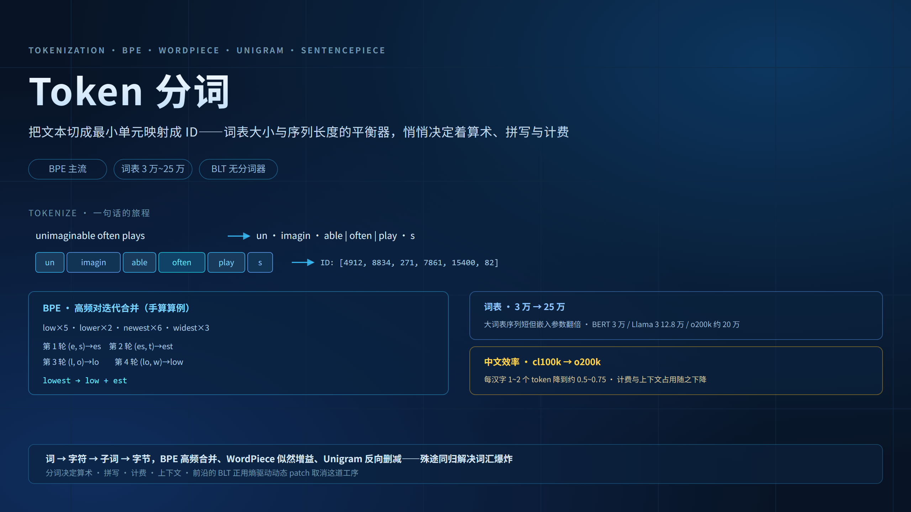

# Token 分词



---

## 摘要

分词（Tokenization）是大模型处理文本的第一道工序，把文本切成词表中的最小单元 Token 并映射为 ID，是离散符号进入神经网络的桥梁。本文按基础概念、算法演进、核心算法、中文特例、工程评估与前沿六个板块，拆解 BPE、WordPiece、Unigram 与 SentencePiece，讨论中文效率问题与词表权衡，并展望无分词器架构。核心结论是子词方案平衡了词表大小与序列长度，分词正走向动态切分。

**关键词**：分词；Token；BPE；WordPiece；Unigram；SentencePiece；词表；子词

## 1 基础概念

### 1.1 什么是 Token

Token 是文本进入模型前的最小处理单元，词、子词、字符、字节都可以充当，切分粒度由分词算法决定，四者构成从粗到细的层次关系。第一个要破除的误解是 Token 不等于词（Word），主流模型切出的单元大多是词片，英文单词 often 可能完整保留为一项，而 unimaginable 会被拆成 un、imagin、able 三块。

### 1.2 词表

切完的每个 Token 在词表里对应一个整数 ID，模型输入序列不是文字，而是这串 ID。词表大小是固定超参数，常见量级从 BERT 的 3 万、Llama 2 的 3.2 万，到 GPT-4 的 10 万、Llama 3 的 12.8 万、Gemma 与 GPT-4o 的 20 万到 25 万级，趋势是用更大的词表换取更短的序列。词表里还驻扎着承担控制功能的特殊 Token，如序列起止的 BOS 与 EOS、补齐批量的 PAD、兜底未知的 UNK，以及对话模板里的角色标记。

### 1.3 为什么需要分词

根源是神经网络只能做数值计算，文本必须先变成向量序列，分词就是离散符号到连续嵌入向量的桥梁。同时它还是一个折中装置，词表开太大会显著增大嵌入矩阵参数并加剧稀有词问题，切得太碎又拉长序列增加计算，整个算法演进史都在这两个约束之间找平衡。

## 2 分词算法演进

四条路线是一条清晰的权衡链，汇总如表 1 所示。

| 路线 | 做法 | 优点 | 致命伤 |
|---|---|---|---|
| 基于词 | 按空格与标点切分 | 直观、语义完整 | OOV 无穷多、词表爆炸、处理不了形态变化 |
| 基于字符 | 每字符一个 Token | 无 OOV、词表极小 | 序列过长、单字符语义太弱 |
| 基于子词 | 高频词保留，低频词拆分 | 词表与序列长度双赢 | 算法较复杂，成为主流方案 |
| 基于字节 | UTF-8 字节直接编码 | 任意输入均可表示，彻底消灭 UNK | 序列更长，需要模型自己学组合 |

<p align="center">表 1 四条分词路线的权衡对比</p>

演进的动力可以归结为一句话：基于词输给词表爆炸，基于字符输给序列长度，于是子词方案登场，保留高频整词、拆开低频词，让常见语义拿到完整 Token、罕见组合用碎片拼装。基于字节则是子词逻辑推到底的形态，直接放弃词表对输入的覆盖承诺，任何输入都能编码，代价是把组合的学习负担转移给了模型内部。

## 3 核心子词算法详解

### 3.1 BPE 算法

BPE（Byte Pair Encoding，字节对编码）是事实标准，GPT 系列、Llama、RoBERTa 均采用其字节级变体，GPT-2 起字节级 BPE 成为默认形态 [[1]](#ref-1)。训练阶段从字符级词表出发，反复统计语料中最高频的相邻符号对并合并成新符号；推理阶段按学到的合并规则顺序切分新文本。拿一个迷你语料手算，词频为 low 5 次、lower 2 次、newest 6 次、widest 3 次。

```
初始     l o w   l o w e r   n e w e s t   w i d e s t
第 1 轮  合并 (e, s)→es        频次 9，new es t 与 wid es t
第 2 轮  合并 (es, t)→est      得到 n e w est 与 w i d est
第 3 轮  合并 (l, o)→lo        频次 7
第 4 轮  合并 (lo, w)→low      低频前缀整体成词
编码示例 lowest → low + est（词表有 low 有 est，无 lowest）
```

可以看到 BPE 的哲学：高频搭配自动凝固成词表项，低频词被拆成高频碎片重组，这正是子词方案「高频保留、低频拆分」的具体实现。

### 3.2 WordPiece 算法

WordPiece 是 BERT 的方案 [[2]](#ref-2)，与 BPE 的差别在合并准则：它每次选择合并后能使语言模型似然增益最大的符号对，具体判据近似互信息打分，即最大化 freq(xy) 除以 freq(x) 与 freq(y) 的乘积，频率与捆绑度一起看；词内续片用 ## 前缀标记，例如 playing 会切成 play 与 ##ing。

### 3.3 Unigram LM

Unigram LM 反向而行 [[3]](#ref-3)，先构造一个偏大的候选词表，再用 EM 式迭代与剪枝删除对语料似然影响最小的子词，直至收敛到目标词表大小。由于每个切分方案带概率，它天然支持带采样的多解分词，这也是子词正则化数据增强的来源。

### 3.4 SentencePiece 框架

SentencePiece 不是算法而是工程框架 [[4]](#ref-4)，把空格当成普通字符（记作 ▁）实现语言无关，同时封装 BPE 与 Unigram 两种实现，T5 与 Llama 系列都基于它。

### 3.5 方案对比

三大算法与 SentencePiece 工具的对比见表 2。

| 算法 | 合并或删减准则 | 词内标记 | 代表用户 |
|---|---|---|---|
| BPE | 最高频相邻对迭代合并 | 无（字节级变体） | GPT 系列、Llama |
| WordPiece | 似然增益最大 | ## 前缀 | BERT、DistilBERT |
| Unigram | 迭代删除似然损失最小项 | 无 | T5、ALBERT |
| SentencePiece | 框架，封装 BPE 与 Unigram | ▁ 表示空格 | T5、Llama、多语言模型 |

<p align="center">表 2 三大分词算法与 SentencePiece 对比</p>

## 4 中文分词特有问题

### 4.1 无空格与切分歧义

中文没有空格分隔，还自带切分歧义，经典句子「南京市长江大桥」可切出"南京市/长江大桥"与"南京市长/江大桥"两种切法，是检验分词器的老谜题。

### 4.2 传统方法

预训练时代之前的中文分词是一套专门技术栈，规则路线有正向与反向最大匹配和最短路径法，统计路线有 HMM 与 CRF 序列标注，工程上常把词典建成有向图再用动态规划求最优切分。

### 4.3 深度学习时代

进入预训练时代后中文分词逐渐内化，BERT 中文版直接按单字切，中文 BPE 随大词表模型普及，LLM 时代专门的分词器不再是必需品，歧义消解已由模型在上下文中隐式完成。

### 4.4 中文 Token 效率

真正残留的问题是效率，早期词表下同一个意思中文常比英文消耗更多 token，GPT-4 的 cl100k 词表下一个汉字经常要占 1 到 2 个 token；词表涨到约 20 万的 o200k 之后降到约 0.5 至 0.75，同等中文内容的计费与上下文占用明显下降。选模型时值得用自己的真实语料算一遍碎片化率，而不只看词表大小。

## 5 分词工程与评估

### 5.1 评价指标

衡量分词质量有三个常用指标，碎片化率（Fragmentation Ratio）统计被切碎的词占比，压缩比衡量原始文本压到多少 token，fertility（生育率）算平均每个词产生几个 token，三者都是越低越好，最终还要用下游任务效果验证。

### 5.2 常用工具

工具侧三件套是 HuggingFace Tokenizers（Rust 实现，训练与编码都快）、SentencePiece 与 OpenAI 的 tiktoken [[6]](#ref-6)。

### 5.3 分词与模型成本

分词直接决定三笔成本，上下文窗口按 token 计数，API 计费按 token 单价，推理延迟随 token 序列长度增长。同样的提示词换个分词器，成本与延迟都会随之变化，这是多语言应用选型时最容易忽略的成本项。

## 6 前沿与扩展

### 6.1 词表大小权衡

词表大小是一道权衡题，大词表让序列更短、推理更快，但嵌入与输出层的参数随词表线性膨胀，以 25.6 万词表、4096 维隐藏层为例，仅嵌入矩阵一项就是 25.6 万乘 4096 约 10.5 亿参数，词表每翻一倍这笔账跟着翻倍；小词表省参数却拉长序列、增加计算。

### 6.2 多语言分词挑战

多语言场景下低资源语言的碎片化尤其严重，一段斯瓦希里语在主流词表里可能碎成数倍长度的 token；代码与中英混排同样考验词表覆盖。

### 6.3 对模型能力的影响

分词甚至影响模型能力。数字的切分方式与算术表现直接相关，同一个五位数在不同词表里可能整存、可能拆成两段、也可能逐位拆开，模型做进位加法时等于在拼碎片，逐位拆分的词表普遍更利于算术，字符级任务如拼写和数字母个数也常被词表卡住，让模型数出 strawberry 里有几个 r 很难，是因为它看到的根本不是字母序列。同一个 Token 在不同上下文与嵌入空间中的表现也不同，切分方式决定了模型的感知粒度。

### 6.4 新方向

前沿方向上最值得关注的是无分词器架构，Meta 的 Byte Latent Transformer 用按下一字节熵动态切分的 patch 取代固定词表 [[5]](#ref-5)，在 8B 参数、4T 字节的受控实验里性能追平基于词表的模型，噪声数据阶段推理 FLOPs 最多省 50%，分词的词表公平问题被从根上绕开。多模态也在把图像 patch 与音频片段纳入同一种 Token 语义，Token 正从文本单元泛化为万物单元。

## 总结

分词是把文本切成最小单元再映射成 ID 的第一道工序，本质是离散符号到向量的桥梁，同时承担着词表大小与序列长度的平衡器角色。算法从词到字符再到子词演进，BPE 用高频合并、WordPiece 用似然增益、Unigram 用反向删减，三家殊途同归都在解决词表爆炸，SentencePiece 则把工程封装做齐。中文的老问题是歧义与效率，新词表已大幅缓解但选型前仍要实测碎片化率。分词悄悄决定着算术、拼写与计费，前沿的动态 patch 架构正在尝试取消这道工序本身。

---

## 参考文献

<a id="ref-1"></a>[1] R. Sennrich, B. Haddow, A. Birch. "Neural Machine Translation of Rare Words with Subword Units." (https://arxiv.org/abs/1508.07909) *arXiv:1508.07909*, 2016.  
<a id="ref-2"></a>[2] J. Devlin, M.-W. Chang, K. Lee, K. Toutanova. "BERT: Pre-training of Deep Bidirectional Transformers for Language Understanding." (https://arxiv.org/abs/1810.04805) *arXiv:1810.04805*, 2019.  
<a id="ref-3"></a>[3] T. Kudo. "Subword Regularization: Improving Neural Network Translation Models with Multiple Subword Candidates." (https://arxiv.org/abs/1804.10959) *arXiv:1804.10959*, 2018.  
<a id="ref-4"></a>[4] T. Kudo, J. Richardson. "SentencePiece: A Simple and Language Independent Subword Tokenizer and Detokenizer for Neural Text Processing." (https://arxiv.org/abs/1808.06226) *arXiv:1808.06226*, 2018.  
<a id="ref-5"></a>[5] A. Pagnoni, R. Pasunuru, P. Rodriguez, et al. "Byte Latent Transformer: Patches Scale Better Than Tokens." (https://arxiv.org/abs/2412.09871) *arXiv:2412.09871*, 2024.  
<a id="ref-6"></a>[6] OpenAI. "tiktoken: a fast BPE tokeniser for use with OpenAI's models." (https://github.com/openai/tiktoken) *GitHub*, 2024.  

## 知识点树

```
Token 分词
│
├── 1. 基础概念
│   ├── 1.1 Token 的定义（最小处理单元 · 词到字节的层次 · Token 不等于词）
│   ├── 1.2 词表（3 万到 25 万量级 · ID 映射 · BOS / EOS / PAD / UNK）
│   └── 1.3 分词的必要性（数值化桥梁 · 词表与序列长度的平衡器）
│
├── 2. 分词算法演进
│   ├── 2.1 基于词（直观完整，但 OOV 与词表爆炸）
│   ├── 2.2 基于字符（无 OOV，但序列过长）
│   ├── 2.3 基于子词 ★ 主流（高频保留、低频拆分）
│   └── 2.4 基于字节（任意输入可编码，消灭 UNK）
│
├── 3. 核心子词算法详解
│   ├── 3.1 BPE ★★（高频合并 · byte-level 变体 · GPT 与 Llama 系）
│   ├── 3.2 WordPiece（似然增益 · ## 前缀 · BERT）
│   ├── 3.3 Unigram LM（反向删减 · EM 与剪枝 · 概率采样）
│   ├── 3.4 SentencePiece（工具框架 · 空格记作 ▁ · 语言无关）
│   └── 3.5 方案对比（表 2）
│
├── 4. 中文分词特有问题
│   ├── 4.1 无空格与切分歧义（南京市长江大桥）
│   ├── 4.2 传统方法（最大匹配 · HMM / CRF · 有向图与动态规划）
│   ├── 4.3 深度学习时代（字级切分 · 中文 BPE · 分词内化）
│   └── 4.4 中文 Token 效率（cl100k 每汉字 1~2 个，o200k 约 0.5~0.75）
│
├── 5. 分词工程与评估
│   ├── 5.1 评价指标（碎片化率 · 压缩比 · fertility）
│   ├── 5.2 常用工具（HF Tokenizers · SentencePiece · tiktoken）
│   └── 5.3 分词与模型成本（上下文 · 计费 · 推理速度）
│
└── 6. 前沿与扩展
    ├── 6.1 词表大小权衡（大词表短序列 vs 小词表省参数）
    ├── 6.2 多语言分词挑战（低资源碎片化 · 代码混合）
    ├── 6.3 对模型能力的影响（数字算术 · 拼写与数字母）
    └── 6.4 新方向（BLT 无分词器 · 动态分词 · 多模态 Token）
```
