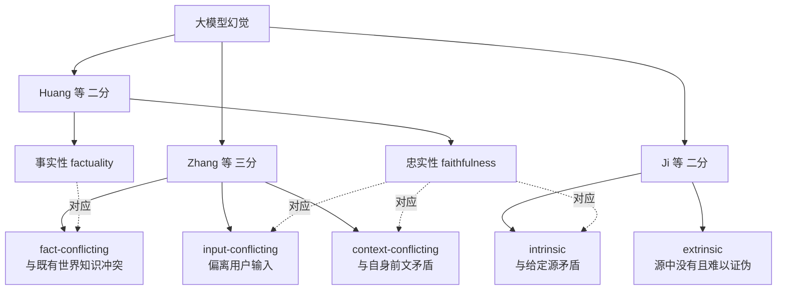
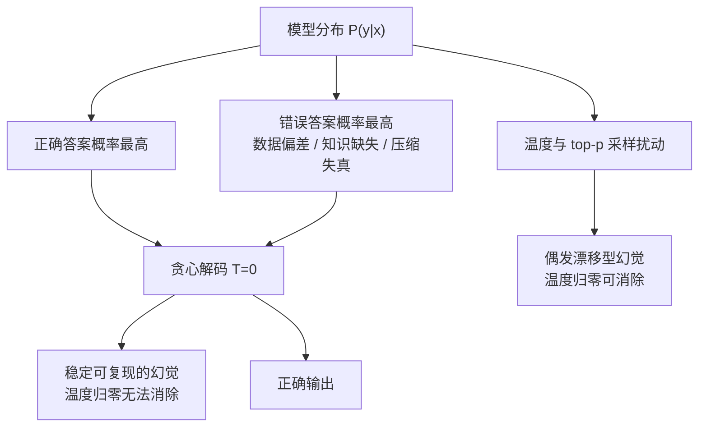
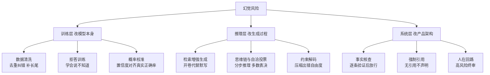

# 大模型幻觉成因与分层治理

**摘要**：大模型幻觉指模型生成的内容流畅自信、逻辑自洽，却在事实上错误或无据可依，其根源是训练目标"预测下一个词"与"回答为真"的系统性错位。它在温度归零的贪心解码下仍稳定复现，说明不是可消除的 bug，而是当前范式的固有属性。幻觉按比对基准分为事实性（与世界冲突）与忠实性（与输入冲突）两类，成因可归为数据偏差、采样随机性、知识截止、压缩失真四条。治理目标只能是分层压制而非彻底消除：训练层压低分布本身的错误率，推理层用检索与多路验证纠偏，系统层用核查、引用与人在回路兜底；前提是先能测——采样一致性、原子事实分解与生成期自校验分别覆盖在线、离线与流程内三种时机。

**关键词**：大模型幻觉；事实性幻觉；忠实性幻觉；贪心解码；检索增强生成；事实核查；拒答训练

---

## 一、定义

语言模型的训练目标是预测下一个词元、隐含判准为语言合理性，而用户的真实诉求是获取正确回答、判准为事实正确性，二者高度相关而不等价，落差之处即为幻觉。

给定输入 $x$ 与候选输出 $y$，模型按条件概率 $P_\theta(y\mid x)$ 选优，而概率最高并不等于为真。本文引入如下记号（非引自文献）：

$$\text{Hallucination}(x,y) \iff y=\arg\max_{y'} P_\theta(y'\mid x)\ \wedge\ \neg\,\mathrm{True}(y,x)$$

关键在于：模型内部没有任何模块计算 $\mathrm{True}(\cdot)$。它输出的是"自身分布里最像正确答案的序列"，而这个分布完全由语料写成。综述将其概括为流畅、语法正确、但事实不准确或缺乏外部证据支撑的内容生成[[1]](#ref-1)[[3]](#ref-3)。

危害的根源在于幻觉的**表征与正确回答完全同构**：语气自信、格式规范、细节丰富，与真实回答在字面层面无法区分，用户难以凭表面判断真伪[[1]](#ref-1)。

---

## 二、幻觉分类

### 2.1 事实性与忠实性

以"和谁比错了"为基准，幻觉分为两类[[2]](#ref-2)：

| 类型 | 比对基准 | 典型表现 |
|---|---|---|
| 事实性幻觉 factuality | 客观世界知识 | 编造不存在的论文、错误的历史日期、虚构人物言论 |
| 忠实性幻觉 faithfulness | 给定输入或上下文 | 摘要加入原文没有的内容、答非所问、无视指令约束 |

一句话区分：**事实性是"和世界比错了"，忠实性是"和输入比错了"**。摘要、翻译、检索增强生成这类以源文档为锚的任务，忠实性风险更突出，因为此时"对不对"的判据已经从世界知识换成了给定材料[[2]](#ref-2)[[9]](#ref-9)。

### 2.2 三种口径的对照

同一现象在文献里有三套切法，工程选型时容易混淆，映射关系如图1 所示：

<b>图1 三套幻觉分类口径的映射关系</b>

Huang 等以 factuality / faithfulness 为纲重构分类[[2]](#ref-2)；Zhang 等按比对对象三分，把"与自身前文矛盾"单列为 context-conflicting[[1]](#ref-1)；Ji 等在源文档型任务里按"是否与源冲突"划出 intrinsic 与 extrinsic[[3]](#ref-3)。三者不冲突，只是切分轴不同：**纵向看是比对对象（世界 / 输入 / 自身），横向看是可证伪性强弱**。

### 2.3 归因是提示词还是模型

治理前要先分诊。Anh-Hoang 等提出 Prompt Sensitivity 与 Model Variability 两个度量，把幻觉归因为提示词主导、模型主导、混合或未定四类，并给出可操作判据：**若改写提示词后幻觉消失，多半是提示词问题；若在不同提示词下幻觉持续，则指向模型内部行为**[[5]](#ref-5)。这条分诊线决定了后续投入应放在 prompt 工程还是模型治理上。

---

## 三、幻觉成因

综合综述对"数据—架构—推理"全生命周期的成因分析[[2]](#ref-2)[[3]](#ref-3)，可归纳为四条工程上可操作的成因线：

1. **数据偏差**。训练语料本身含错、含谣、含偏见；长尾领域数据稀疏，模型只能补白[[3]](#ref-3)。更隐蔽的一层在指令微调：SFT 数据里答案总是完整自信，模型学到的并非知识本身，而是"永远给出一个像样的答案"这一行为模式[[2]](#ref-2)。
2. **采样随机性**。解码时每个词元按概率分布抽样（温度、top-p），随机性会把生成引向低概率但表面连贯的分支；自回归结构使错误逐步累积，且模型倾向于顺着已经偏掉的上下文继续圆下去[[12]](#ref-12)。
3. **知识截止**。训练语料有时间边界，边界之后的世界变化模型无从知晓，却不会主动声明过时，而是沿用旧分布补出一个貌似合理的答案[[3]](#ref-3)。
4. **压缩失真**（本文概括）。参数容量有限，可视为对海量语料的有损压缩：高频知识压得准，长尾细节与精确数字在压缩中丢失或模糊，生成时被插值成近似但错误的内容，最终与数据偏差叠加，表现为长尾事实的系统性失真。

四条线分属不同环节，因此没有单一银弹——这也直接决定了第五、六节的分层结构。

---

## 四、核心机理

温度 $T$ 作用于 softmax 的缩放，$T$ 趋近 0 时退化为贪心解码，即每步取概率最高的词元。工程上常见误区是"把 temperature 调到 0 就不会乱编"。由第一节的形式化可以直接证伪：

设模型分布本身就把错误答案排在最高概率位（数据有错、知识缺失、压缩失真任一发生），那么贪心解码会**确定性地、可复现地**输出该错误答案。温度归零只切断了采样扰动这一路，切不断分布偏差这一路，如图2 所示。

<b>图2 温度归零只切断采样扰动路径</b>

实证侧与该推断一致：在受控提示词实验中，结构化提示（如思维链）能显著降低提示词敏感场景下的幻觉，但**部分模型的内在局限在多种提示词变体下持续存在**[[5]](#ref-5)——这正是"分布本身有偏"的表现。

由此得到本文的第一个工程结论：**调温度解决不了幻觉**。它只把偶发变成稳定，甚至让错误更难被发现。治理必须落到数据、训练、检索、验证多个层面。

---

## 五、检测

治理的前提是可测。综述已从检测角度对现有方法做过结构化归类[[4]](#ref-4)；按依赖强度从弱到强，可归为三条路径：

### 5.1 黑盒采样一致性

SelfCheckGPT 的出发点很朴素：**模型真懂的概念，多次采样得到的事实应当一致；幻觉事实则在随机采样间发散甚至互相矛盾**。做法是同一提问采样 $N$ 条响应，再衡量待检句与这些样本的一致度，得到幻觉分数 $S(i)\in[0,1]$，越接近 1 表示越可能是幻觉。它不需要外部知识库，也不需要访问输出概率分布，因此可直接用于闭源模型[[6]](#ref-6)。

### 5.2 原子事实分解

长文本整体二分会掩盖"大部分对、少数错"的常见形态。FActScore 把生成拆成一系列只含单条信息的原子事实，逐条对知识源验证后求支持比例：

$$\text{FActScore}(y)=\frac{1}{|F(y)|}\sum_{f\in F(y)}\mathbb{1}\!\left[f\ \text{可被知识源支持}\right]$$

其人工评测显示，先进模型在人传记生成任务上的 FActScore 仅落在 42.5%–71.5% 区间，ChatGPT 只有 58%[[8]](#ref-8)。同一批模型若按整段打分，这些差异会被完全抹平。

### 5.3 生成期自校验

Chain-of-Verification 走"先答后验"：模型按常规作答，再自行生成验证问题、独立回答并比对修正。在 Wikidata 列表任务上，它把 Llama 65B few-shot 基线的精确率从 0.17 提升到 0.36[[7]](#ref-7)。其价值在于**把核验动作前移到生成流程内**，不必等外部系统兜底。

三条路径互不替代：采样一致性适合闭源与在线监控，原子分解适合离线评测与模型选型，自校验适合对单次输出负责的业务链路。

---

## 六、三层治理

按"改什么"切分，治理天然分为三层（见图3）：

<b>图3 幻觉三层治理框架</b>

### 6.1 训练层压低分布本身的错误率

- **数据清洗**：去重、纠错、过滤矛盾低质数据、强化长尾覆盖，直接对冲数据偏差与压缩失真[[3]](#ref-3)。
- **拒答训练**：用含"应拒答"样本的数据训练，让模型学会说"我不知道 / 信息不足"，是对"永远给像样答案"行为模式的正面纠正[[2]](#ref-2)。
- **概率校准**：使模型自评的置信度与实际正确率对齐，让"有把握"成为可相信的信号。现代网络普遍存在过度自信，校准是独立于准确率之外的另一项指标[[11]](#ref-11)。校准到位，下游才敢用置信度做自动降级。

### 6.2 推理层用检索与多路验证纠偏

- **检索增强生成**：先检索外部资料注入上下文，用开卷考试代替凭记忆默写，直接补上知识截止的缺口[[9]](#ref-9)。工程实现细节可参见[大模型推理全链路.md](大模型推理全链路.md)。
- **思维链与自洽投票**：先分步推理再作答，减少一步到位的跳跃式脑补；在此基础上多次采样取多数或跨模型交叉验证，用集成压低单次出错概率[[10]](#ref-10)。
- **约束解码**：格式约束、枚举选项、明确"不确定就说不知道"，压缩输出空间的出错自由度。解码策略本身对文本质量有决定性影响[[12]](#ref-12)。

### 6.3 系统层把可证伪性交还给用户

- **事实核查**：输出后接核查模块，对关键声明逐条验证再放行，可采用 CoVe 式自校验或外部检索核验[[7]](#ref-7)。
- **强制引用**：无引用不声明，每个结论附来源，让读者能自行验证而非只能相信[[8]](#ref-8)。
- **人在回路**：对医疗、法律、金融等高风险场景保留人工终审权，作为自动检测残余漏检的最后闸门——本文将其列为系统层的必要组成。

---

## 七、工程避坑

1. **温度不是治理手段**。第四节已证，系统性幻觉在 $T=0$ 稳定复现；调低温度只是把偶发变稳定，反而更难被抽样发现。
2. **先归因，再治理**。按 2.3 节判断是提示词主导还是模型主导，否则会在 prompt 上反复调优却治不好分布偏差[[5]](#ref-5)。
3. **RAG 补的是知识截止，不是忠实性**。检索解决"没听说过"，不自动解决"答非所问"；以源文档为锚的场景仍需单独度量忠实性[[1]](#ref-1)[[9]](#ref-9)。
4. **拒答与可用性要一起权衡**。拒答训练提高可靠性但会压低覆盖，需按业务风险设阈值；置信度未校准前不要直接拿它做自动降级[[11]](#ref-11)。
5. **评测粒度要细到原子事实**。整段二分会掩盖"多数对、少数错"的常态，使不同模型不可比[[8]](#ref-8)。
6. **检测成本要前置测算**。采样一致性需要多次采样，原子分解需要检索与验证，上线前先估算延迟与调用开销[[6]](#ref-6)[[8]](#ref-8)。

---

## 总结

幻觉是训练目标（预测下一个词）与真值目标（回答为真）错位的结构性代价，在温度归零的贪心解码下仍稳定复现，因而属当前范式的固有属性，不是可以修掉的 bug。治理只能分层压制——训练层压低分布本身的错误率，推理层用检索与多路验证纠偏，系统层用核查、引用和人审兜底，三层互不替代。测不到就治不了，采样一致性、原子事实分解与生成期自校验分别覆盖在线、离线与流程内三种时机。落到工程上就是一句话，关键决策永远不要让"听起来对"直接等于"是对的"。

---

## 参考文献

[1] Y. Zhang et al. ["Siren's Song in the AI Ocean: A Survey on Hallucination in Large Language Models."](https://aclanthology.org/2025.cl-4.9/) *Computational Linguistics*, 2025.  
[2] L. Huang et al. ["A Survey on Hallucination in Large Language Models: Principles, Taxonomy, Challenges, and Open Questions."](https://arxiv.org/abs/2311.05232) *ACM Transactions on Information Systems*, 2025.  
[3] Z. Ji et al. ["Survey of Hallucination in Natural Language Generation."](https://arxiv.org/abs/2202.03629) *ACM Computing Surveys*, 2023.  
[4] A. Alansari, H. Luqman. ["A Comprehensive Survey of Hallucination in Large Language Models: Causes, Detection, and Mitigation."](https://arxiv.org/abs/2510.06265) *arXiv preprint*, 2025.  
[5] D. Anh-Hoang, V. Tran, L.-M. Nguyen. ["Survey and analysis of hallucinations in large language models: attribution to prompting strategies or model behavior."](https://doi.org/10.3389/frai.2025.1622292) *Frontiers in Artificial Intelligence*, 2025.  
[6] P. Manakul, A. Liusie, M. J. Gales. ["SelfCheckGPT: Zero-Resource Black-Box Hallucination Detection for Generative Large Language Models."](https://aclanthology.org/2023.emnlp-main.557/) *EMNLP*, 2023.  
[7] S. Dhuliawala et al. ["Chain-of-Verification Reduces Hallucination in Large Language Models."](https://arxiv.org/abs/2309.11495) *arXiv preprint*, 2023.  
[8] S. Min et al. ["FActScore: Fine-grained Atomic Evaluation of Factual Precision in Long Form Text Generation."](https://aclanthology.org/2023.emnlp-main.741/) *EMNLP*, 2023.  
[9] P. Lewis et al. ["Retrieval-Augmented Generation for Knowledge-Intensive NLP Tasks."](https://arxiv.org/abs/2005.11401) *NeurIPS*, 2020.  
[10] X. Wang et al. ["Self-Consistency Improves Chain of Thought Reasoning in Language Models."](https://arxiv.org/abs/2203.11171) *ICLR*, 2023.  
[11] C. Guo et al. ["On Calibration of Modern Neural Networks."](https://arxiv.org/abs/1706.04599) *ICML*, 2017.  
[12] A. Holtzman et al. ["The Curious Case of Neural Text Degeneration."](https://arxiv.org/abs/1904.09751) *ICLR*, 2020.  
[13] 码渡星河. ["面试官：怎么彻底解决大模型幻觉？候选人：用RAG检索资料！"](https://www.douyin.com/video/7686448207999536424) *抖音*, 2026-09-17.  
[14] ["面试官：大模型幻觉怎么解决？只会背RAG的直接淘汰"](https://v.douyin.com/Gl2sDeEj-8Q/) *抖音*.
