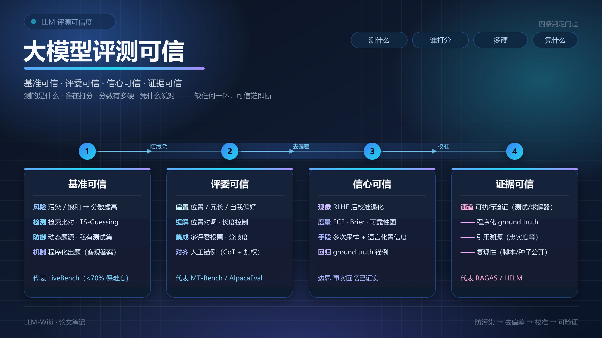
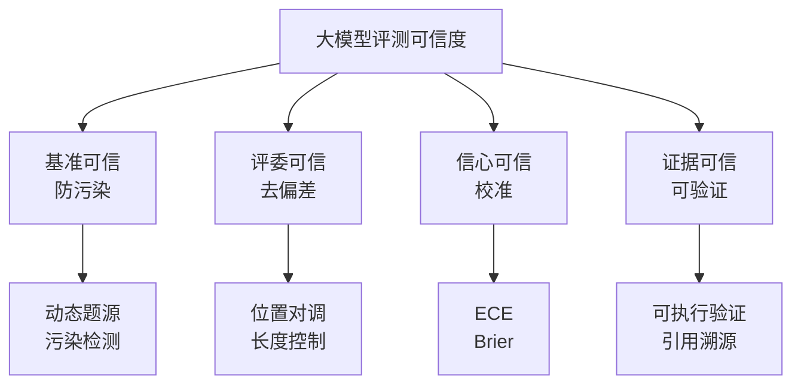
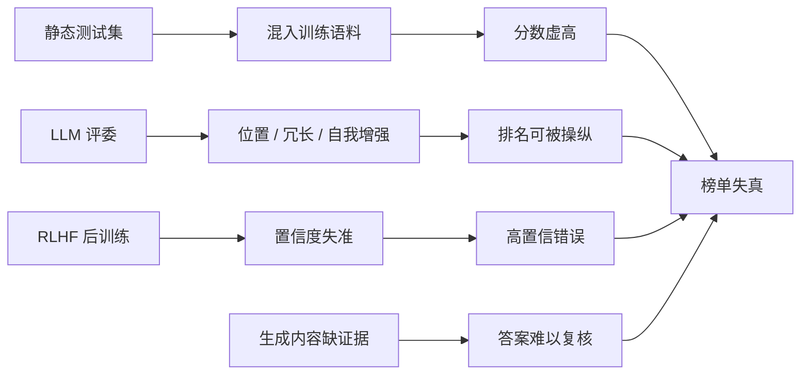
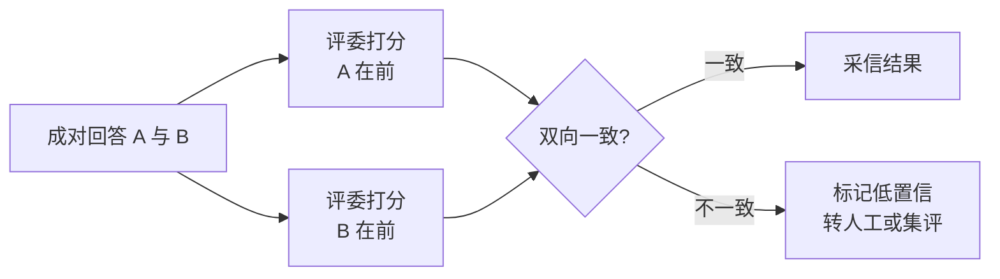
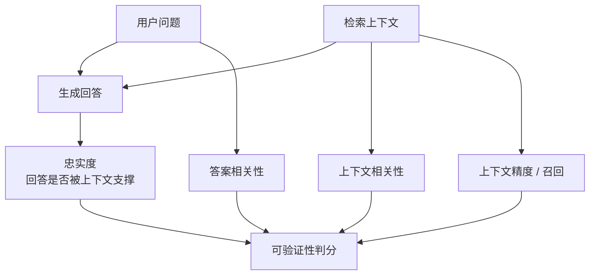

# 大模型评测可信



---

## 摘要

大模型评测分数常因数据污染、评委偏差、模型过度自信与证据缺失而与真实能力脱节，光看榜单排名并不可信。要让评测可信，须让基准防污染、评委去偏差、信心经校准、结论可验证，四者缺一不可，任一环失效，分数便失去工程决策价值。

**关键词**：大模型评测；数据污染；评委偏差；置信度校准；可验证性；LLM-as-a-Judge；动态基准

---

## 1 评测可信度的定义与四支柱

评测可信度的核心在于回答四个子问题：测的是什么（基准可信）、谁在打分（评委可信）、分数有多硬（信心可信）、凭什么说对（证据可信），分别对应“防污染—去偏差—校准—可验证”四个并列环节，四者环环相扣。斯坦福 HELM（Holistic Evaluation of Language Models）将校准、鲁棒性等超越准确率的 7 类指标纳入 16 个核心场景，为多维可信评测提供范式先例[[1]](#ref-1)。

进入四支柱前需先建立一层元认知：同一分数在不同榜单语境下含义不同——Chatbot Arena 以人类偏好投票为主[[5]](#ref-5)，LiveBench 以客观 ground truth 自动判分为准[[2]](#ref-2)，HELM 强调多维、可复现的透明度量[[1]](#ref-1)，三者取向不同、不可互替；且单一分数不等于能力结论，它只是候选信号，须回到“基准—评委—信心—证据”四问逐项复核后方可采信。



<p align="center">图1 大模型评测可信四支柱框架</p>
四支柱的对应关系与风险来源如下表所示。

| 可信维度 | 回答的问题 | 对应机制 | 典型失效表现 |
| --- | --- | --- | --- |
| 基准可信 | 测的是什么 | 防污染 | 测试题进入训练语料，分数虚高 |
| 评委可信 | 谁在打分 | 去偏差 | 位置、冗长、自我增强偏差操纵胜负 |
| 信心可信 | 分数有多硬 | 校准 | 自报置信度远高于实际正确率 |
| 证据可信 | 凭什么说对 | 可验证 | 答案连贯但无法溯源或验证 |

## 2 动机与问题根源

**第一，静态基准因污染与饱和而失效。** 测试数据混入训练集会让基准迅速过时[[2]](#ref-2)；公开基准还会随模型能力提升而饱和，头部模型分数趋同后区分度归零[[2]](#ref-2)。实证上，模型在训练截点前发布的数据集上表现显著优于其后发布者，强烈暗示任务污染，训练数据检查、样本抽取与成员推断亦提供佐证，而在无污染可能的分类任务上模型相对多数类基线鲜有统计显著提升[[3]](#ref-3)。耶鲁团队的检索比对法与测试集槽位猜测（Testset Slot Guessing, TS-Guessing）在闭源与开源模型上均证实了现代基准的污染[[4]](#ref-4)。

**第二，LLM 评委存在系统性偏差。** 大模型评委（LLM-as-a-Judge）与人类偏好的一致率虽可超 80%，却带有位置偏差（Position Bias）、冗长偏差（Verbosity Bias）与自我增强偏差（Self-enhancement Bias），推理能力亦受限[[5]](#ref-5)。G-Eval 在验证其有效性的同时，也指出评委倾向偏袒 LLM 生成的文本，即自我偏好风险[[6]](#ref-6)。

**第三，模型过度自信使分数失真。** 基座模型在 MMLU 上的条件概率校准良好，经后训练（RLHF）后明显退化[[7]](#ref-7)；其语言化置信度与真实正确率严重偏离，而多次采样并语言化置信度可显著恢复校准[[8]](#ref-8)。过度自信的模型进入榜单后，下游便无法区分高置信错误与真知。

**第四，生成内容缺乏证据支撑。** RAGAS 指出，RAG 评测须同时衡量检索器获取相关上下文的能力与生成器忠实利用上下文的能力，否则答案的表面流畅会掩盖事实缺陷[[9]](#ref-9)。



<p align="center">图2 评测失真的四条根源通路</p>

## 3 方法机制与实现

### 3.1 防污染机制

防污染包含检测与防御两个方向：检测面向已发布模型，防御面向基准设计者。主流手段如下表所示。

| 手段 | 原理 | 适用对象 |
| --- | --- | --- |
| 检索比对 | 在预训练语料中检索与测试题的重叠片段 | 开源模型与已知语料[[4]](#ref-4) |
| TS-Guessing | 遮蔽多选题中的错误选项，要求模型补全，命中率异常即为污染证据 | 开源与闭源模型均可[[4]](#ref-4) |
| 动态题源 | 基于近期新闻、竞赛、arXiv 论文等来源定期更新题目 | 任何模型[[2]](#ref-2) |
| 程序化出题 | 由规则或代码生成可验证答案的新题 | 任何模型[[2]](#ref-2) |
| 私有测试集 | 不公开评测集或延迟公开 | 闭源评测场景 |

LiveBench 是防御侧代表：题源取自近期数学竞赛、arXiv 论文、新闻与数据集，按客观 ground truth 自动打分，同时规避测试集污染与 LLM 评委、人工众包的偏差[[2]](#ref-2)。

### 3.2 评委去偏差机制

针对 LLM 评委的主要偏差，常用的缓解手段如下：

1. **位置对调重评**：同一对答案交换 A/B 顺序各评一次，双向一致才采信，不一致样本标记为低置信并转人工或多评委集成，这是 MT-Bench 针对位置偏差提出的标准做法[[5]](#ref-5)。
2. **长度控制胜率（Length-Controlled Win Rate）**：AlpacaEval 2.0 拟合广义线性模型（Generalized Linear Model, GLM）预测带偏标注器的偏好，再在长度差为零的条件下推断偏好，回答“两模型输出等长时偏好如何”的反事实问题[[10]](#ref-10)。

$$P_{\mathrm{LC}}(\text{win}) = P(\text{win} \mid \Delta_{\mathrm{len}} = 0,\ \mathbf{x})$$

3. **多评委集成与人工锚例**：用异构评委投票、以分歧度作不确定性信号；用人工标注构建锚例池，持续跟踪评委与人工的一致率。G-Eval 采用思维链提示加概率加权评分，与人类的相关性显著超过传统神经评估器，可作锚例对齐的工程参考[[6]](#ref-6)。

判据：若更换评委、对调作答顺序或控制输出长度后排名大幅变动，则所测为评委偏好而非模型真实能力[[5]](#ref-5)。



<p align="center">图3 位置对调去偏差流程</p>

### 3.3 置信度校准机制

校准（信心可信）的核心是度量“自报概率与实际正确率”的偏离，常用期望校准误差（Expected Calibration Error, ECE）与布里尔分数（Brier Score）：
$$\mathrm{ECE} = \sum_{b=1}^{B}\frac{n_b}{N}\left|\mathrm{acc}(b)-\mathrm{conf}(b)\right|$$
$$\mathrm{BS} = \frac{1}{N}\sum_{i=1}^{N}(f_i - o_i)^2$$
其中 $B$ 为分桶数，$n_b$ 为第 $b$ 桶样本数，$f_i$ 与 $o_i$ 为第 $i$ 个样本的预测概率与真实结果；各桶准确率与置信度的差距可用可靠性图（Reliability Diagram）呈现[[8]](#ref-8)。工程上让模型对多次采样答案语言化置信度，可使 RLHF 模型的置信度与正确率显著对齐[[8]](#ref-8)；评委层面同样需用 ground truth 锚例持续回归（见 3.2 节）。

### 3.4 可验证机制

证据可信不等于引用数量，其完整形态是可验证性，含四条通道：

1. **可执行验证**：代码跑单元测试、数学调用求解器、任务用模拟环境判分，绕开主观评委。
2. **程序化 ground truth**：LiveBench 对所有题目以客观 ground truth 自动评分，答案对错可独立复核[[2]](#ref-2)。
3. **引用溯源与忠实度**：仅限事实与检索场景。RAGAS 以无参考方式给出忠实度（Faithfulness）、答案相关性（Answer Relevancy）与上下文相关性（Context Relevance）三项核心指标，工具库再把上下文维度细分为上下文精度（Context Precision）与上下文召回（Context Recall）；其中忠实度直接衡量“回答是否被检索上下文支撑”，更贴近证据可信的实质[[9]](#ref-9)。
4. **复现性**：评测脚本、提示词与随机种子公开，第三方可独立重跑，HELM 以开源框架提供该保障[[1]](#ref-1)。



<p align="center">图4 RAGAS 无参考可验证指标体系</p>

## 4 效果价值与应用边界

四支柱机制在已公开实验中表现出可量化的收益。

| 机制 | 代表方案 | 已验证效果 | 来源 |
| --- | --- | --- | --- |
| 防污染 | LiveBench | 定期更新题源加客观判分，头部模型准确率低于 70%，保持高区分度 | [[2]](#ref-2) |
| 去偏差 | 长度控制 AlpacaEval | 与 Chatbot Arena 的 Spearman 相关性由 0.94 提升至 0.98，长度可操纵性显著降低 | [[10]](#ref-10) |
| 去偏差 | LLM-as-a-Judge 对调法 | GPT-4 评委与受控及众包人类偏好一致率超过 80%，接近人类之间的一致水平 | [[5]](#ref-5) |
| 校准 | 语言化置信度 | 多次采样自评置信度可显著恢复 RLHF 模型校准 | [[8]](#ref-8) |
| 可验证 | RAGAS | 提供无参考的忠实度、答案相关性等核心指标，支撑 RAG 快速评测迭代 | [[9]](#ref-9) |

**适用边界方面**，各机制均有局限：动态基准的题源更新依赖持续投入，成本高于静态基准；长度控制只剥离长度这一中介变量，其余混杂因素需另行建模；语言化置信度已在事实回忆类问题证实校准，推理与算术场景的迁移性待检验[[8]](#ref-8)；引用溯源不适用于数学与代码任务，应改用求解器或单元测试作可执行验证；TS-Guessing 判读存在阈值主观性，需多条证据链交叉确认[[4]](#ref-4)。业界趋势上，评测正从单轮静态问答转向长时程任务，防污染与可验证仍是主线。

## 总结

评测可信说到底就是四件事，基准防污染、评委去偏差、信心经校准、结论可验证，缺哪一样，光看一个榜单分数都靠不住。

## 参考文献

<a id="ref-1"></a>[1] P. Liang et al. ["Holistic Evaluation of Language Models."](https://arxiv.org/abs/2211.09110) *arXiv:2211.09110*, 2022.  
<a id="ref-2"></a>[2] C. White, S. Dooley et al. ["LiveBench: A Challenging, Contamination-Limited LLM Benchmark."](https://arxiv.org/abs/2406.19314) *ICLR*, 2025.  
<a id="ref-3"></a>[3] M. Li, J. Flanigan. ["Task Contamination: Language Models May Not Be Few-Shot Anymore."](https://arxiv.org/abs/2312.16337) *arXiv:2312.16337*, 2023.  
<a id="ref-4"></a>[4] C. Deng et al. ["Investigating Data Contamination in Modern Benchmarks."](https://arxiv.org/abs/2311.09783) *arXiv:2311.09783*, 2023.  
<a id="ref-5"></a>[5] L. Zheng et al. ["Judging LLM-as-a-Judge with MT-Bench and Chatbot Arena."](https://arxiv.org/abs/2306.05685) *arXiv:2306.05685*, 2023.  
<a id="ref-6"></a>[6] Y. Liu et al. ["G-Eval: NLG Evaluation using GPT-4 with Better Human Alignment."](https://arxiv.org/abs/2303.16634) *arXiv:2303.16634*, 2023.  
<a id="ref-7"></a>[7] OpenAI. ["GPT-4 Technical Report."](https://arxiv.org/abs/2303.08774) *arXiv:2303.08774*, 2023.  
<a id="ref-8"></a>[8] K. Tian et al. ["Just Ask for Calibration: Strategies for Eliciting Calibrated Confidence Scores from Language Models Fine-Tuned with Human Feedback."](https://arxiv.org/abs/2305.14975) *arXiv:2305.14975*, 2023.  
<a id="ref-9"></a>[9] S. Es et al. ["RAGAs: Automated Evaluation of Retrieval Augmented Generation."](https://arxiv.org/abs/2309.15217) *arXiv:2309.15217*, 2023.  
<a id="ref-10"></a>[10] Y. Dubois et al. ["Length-Controlled AlpacaEval: A Simple Way to Debias Automatic Evaluators."](https://arxiv.org/abs/2404.04475) *arXiv:2404.04475*, 2024.

---

## 知识点树（ASCII）

```
大模型评测可信
│
├── 元认知（前置）
│   ├── 榜单语境依赖 —— Arena 重偏好 LiveBench 重客观 HELM 重透明
│   └── 单一分数 ≠ 能力结论 只是候选信号
│
├── 1. 基准可信 —— 防污染
│   ├── 风险
│   │   ├── 训练语料混入测试集 → 分数虚高
│   │   └── 静态基准公开饱和 → 区分度归零
│   ├── 检测
│   │   ├── 检索比对（开源语料重叠）
│   │   ├── TS-Guessing（遮蔽补全 闭源开源通用）
│   │   └── 成员推断 / 样本抽取
│   ├── 防御
│   │   ├── 动态题源（近期竞赛 论文 新闻）
│   │   ├── 程序化出题（客观 ground truth）
│   │   └── 私有测试集
│   └── 代表 LiveBench（头部模型 <70% 保持难度）
│
├── 2. 评委可信 —— 去偏差
│   ├── 偏置
│   │   ├── 位置偏差 Position Bias
│   │   ├── 冗长偏差 Verbosity Bias
│   │   └── 自我增强偏差 Self-enhancement Bias
│   ├── 缓解
│   │   ├── 位置对调重评 → 双向一致才采信
│   │   ├── 长度控制胜率（GLM 条件于 Δlen=0）
│   │   ├── 多评委集成 → 分歧度 = 不确定性
│   │   └── 人工锚例对齐（CoT + 概率加权）
│   └── 判据 换评委/换顺序/控长度后排名大变 ⇒ 测的是评委癖好
│
├── 3. 信心可信 —— 校准
│   ├── 现象 预训练校准良好 → RLHF 后退化
│   ├── 度量
│   │   ├── ECE = Σ (n_b/N)·|acc(b) − conf(b)|
│   │   ├── Brier Score = (1/N)·Σ (f_i − o_i)²
│   │   └── 可靠性图
│   ├── 手段
│   │   ├── 多次采样 + 语言化置信度
│   │   └── ground truth 锚例持续回归
│   └── 边界 已证实集中在事实回忆 推理算术待检验
│
├── 4. 证据可信 —— 可验证（引用仅是一支）
│   ├── 可执行验证 —— 代码测试 / 求解器 / 模拟环境
│   ├── 程序化 ground truth —— 客观自动判分
│   ├── 引用溯源与忠实度（仅限事实/检索）
│   │   ├── 忠实度 Faithfulness
│   │   ├── 答案相关性 Answer Relevancy
│   │   ├── 上下文相关性 Context Relevance
│   │   ├── 工具库细分 上下文精度 / 上下文召回
│   │   └── 警示 引用数量 ≠ 可信（长度偏置可操纵）
│   └── 复现性 —— 脚本 / prompt / 种子公开（HELM）
│
└── 四支柱（并列） 防污染 · 去偏差 · 校准 · 可验证
    └── 缺任何一环 可信链即不完整
```

---

## 全文质量打分

| 维度 | 得分 | 说明 |
| --- | --- | --- |
| 结构完整性 | 19/20 | 必选模块齐全，含封面、摘要与总结，章节按“是什么—为什么—怎么做—有什么作用”推进，标题与文件名命名统一；扣 1 因元认知内容未独立成节、3.3 结构弱于其余三节 |
| 格式合规 | 20/20 | 标题无冒号、无中文序号，引用与锚点一一对应，公式单行，图题下置居中，中文引号统一为弯引号 |
| 内容真实性 | 19/20 | 事实与数字均可溯源至 10 篇已核实文献，公式与图示为文献方法的忠实转述；扣 1 因 3.2 第三项与自我增强偏差的对应仍偏松 |
| 信息密度 | 19/20 | 四支柱风险—机制—效果闭环，含 3 表 4 图与 3 公式；扣 1 因表 3（效果表）中校准、可验证两行缺量化数字 |
| 可读性 | 20/20 | 摘要与总结均聚焦主题、精炼口语，正文结论先行、递进清晰，全文已去冗 |

**总分：97/100**，达到输出标准。

---

## 自检报告

| # | 检查项 | 结果 | 说明 |
| --- | --- | --- | --- |
| 1 | 文献编号 | 通过 | 正文 [[1]]–[[10]] 与锚点 ref-1–ref-10 连续、一一对应，无悬空、跳号、重号，锚点全局唯一 |
| 2 | 文献可点性 | 通过 | 10 条均为 arXiv https 链接，已逐一搜索核实标题、作者、编号与年份 |
| 3 | 块级公式 | 通过 | 3 处块级公式均为单行 `$$...$$` |
| 4 | 公式定界符 | 通过 | 全文无 `\[...\]` |
| 5 | 正文引用写法 | 通过 | 全部为 `[[n]](#ref-n)`，无变体 |
| 6 | 图表规范 | 通过 | 4 个 mermaid 图语法合法、特殊字符节点双引号包裹、图题下置居中无冒号，图 1–4 连续编号；3 个 Markdown 表上下有空行 |
| 7 | 配图与跨文档链接 | 通过 | 封面图相对路径 `../assets/大模型评测可信-封面.png` 无空格、无需转义；本文无跨文档 md 链接 |
| 8 | 标题规范 | 通过 | 全部标题无冒号；摘要、总结与参考文献无序号；正文 `## 1` 至 `## 4` 阿拉伯数字编号，无中文与括号序号 |
| 9 | 空行排版 | 通过 | 标题、分隔线、围栏、表格、列表块上下均保留 1 空行；ref 锚点行按例外规则连续排布且行末两空格硬换行 |
| 10 | 内容真实性 | 通过 | 关键数字（Arena 相关性 0.94→0.98、一致率超 80%、ECE 退化、LiveBench <70%）均出自对应文献；RAGAS 指标已区分论文核心三项与工具库扩展；GLM 长度控制公式为文献方法转写并绑定来源；未编造论文元信息或实验数据 |
| 11 | 命名一致性 | 通过 | 文章标题、文件名、封面文件名与知识点树根节点统一为「大模型评测可信」 |
| 12 | 引号规范 | 通过 | 正文中文引号统一为弯引号 “ ”，仅 mermaid 节点、`<p align>` 与文献标题链接保留 ASCII 直引号 |
| 13 | 摘要与总结 | 通过 | 摘要为聚焦主题的两句话（108 字），总结为口语化一句话，均不使用“本文以…/将介绍…”式文章介绍，无冒号分号 |
