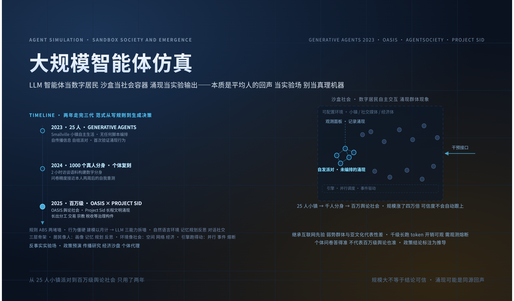
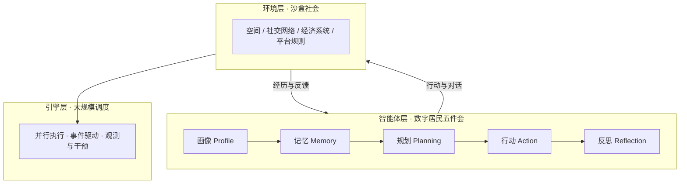

# 大规模智能体仿真



## 摘要

大规模智能体仿真（沙盒社会）用成百上千个 LLM 智能体充当「数字居民」，放进可配置的社会环境中自主交互，以涌现出的群体现象做社会科学的反事实实验。本文梳理它相对传统规则仿真的范式差异、可行性来源、三层参考架构与五个代表平台谱系，并给出四个正经用途与四条使用边界。核心结论是它适合当反事实实验场，不适合当真理机器，规模大不等于结论可信。

**关键词**：智能体仿真；沙盒社会；生成式智能体；涌现；社会模拟；AgentSociety；OASIS；数字分身

## 1 概念

沙盒社会的做法是把每个智能体当成一个「数字居民」，给它身份画像、记忆、目标与社交能力，放进一个可配置的环境（小镇、社交媒体、经济体）里自主生活，研究者观测群体层面的涌现现象。它与传统 Agent-Based Simulation（ABS，基于规则的智能体仿真）的差异如表 1 所示，范式变化发生在行为的来源上，从研究者写死的 if-else，变成模型对「我会怎么做」的生成式回答。

| 维度 | 传统规则 ABS | LLM 智能体沙盒 |
|---|---|---|
| 行为来源 | 研究者手工编写的规则脚本 | 模型基于记忆与目标的生成式决策 |
| 行为上限 | 只能复现已知规律 | 可涌现未预期的群体现象 |
| 建模成本 | 一个场景写一个月规则 | 自然语言描述环境即可开跑 |
| 可信度 | 规则透明、可解析验证 | 依赖模型先验，需另行校准 |

<p align="center">表 1 传统规则 ABS 与 LLM 智能体沙盒的范式对比</p>

可行性的立论点是 2023 年斯坦福的 Generative Agents 实验，25 个智能体在 Smallville 沙盒小镇自主生活，没有任何脚本编排，它们自行传播信息、形成关系，还自发组织了一场情人节派对 [[1]](#ref-1)。涌现行为的真实性第一次在 LLM 智能体身上得到验证，大规模化的大门由此打开。

## 2 可行性来源

传统 ABS 有两堵墙。第一是行为僵硬，规则只能覆盖设计者想到的情形，社会现象里大量的模糊、妥协与例外写不进去，导致仿真只能验证已知结论。第二是建模成本高，复杂场景的规则编写与调试以月计，研究者干脆放弃仿真退回问卷与历史数据。

LLM 恰好拆掉这两堵墙。其一，环境与规则可以用自然语言描述，建模成本从月级降到天级。其二，智能体天生具备记忆、规划与社交三种能力，能对没预设过的情境给出合理反应，涌现成为默认产物而非奇迹。其三，对话式交互让信息传播、合作与冲突都能以自然语言完成，社会网络的每条边都有了内容。

沿这条线，领域在两年内走完三代。第一代验证微观可信，其立论实验见第 1 章。第二代验证个体复刻，用 2 小时访谈语料为 1000 个真人构建数字分身，其对社会调查问卷的回答精度接近本人两周后的自我重测一致性 [[2]](#ref-2)。第三代验证宏观规模，沙盒从千人涨到百万级，开始长出经济与治理结构。

## 3 架构与谱系

### 3.1 居民、环境、引擎三层

现有平台的骨架高度一致，可拆成三层，如图 1 所示。



<p align="center">图 1 沙盒社会三层参考架构</p>

智能体层决定「居民像不像人」，画像给身份，记忆给连续性，规划给主动性，反思把经历沉淀成稳定态度。环境层决定「社会像不像社会」，空间布局、社交网络拓扑与经济约束共同框定交互的可能。引擎层决定「跑不跑得动」，千级以上规模靠并行调度与事件驱动，配套观测面板与干预接口，否则百万智能体只是高成本的黑箱。

### 3.2 平台谱系

五个代表平台覆盖了从微观到宏观的规模谱系，汇总如表 2 所示。

| 平台 | 规模 | 核心贡献 | 适合研究 |
|---|---|---|---|
| Generative Agents（斯坦福） | 25 个 | 首次验证涌现行为，开源 Smallville | 行为可信度、信息传播 |
| 1000 People（斯坦福） | 1000 个真人分身 | 访谈语料驱动的个体复刻 | 问卷调查代理、态度预测 |
| AgentSociety（清华） | 大规模引擎 | 社会科学实验平台，分析与干预一体化 | 政策预演、社会系统干预 |
| OASIS（CAMEL-AI） | 百万级 | 社交媒体仿真，20 余种交互行为 | 谣言扩散、极化、羊群效应 |
| Project Sid（Altera） | 千级（Minecraft） | 长程文明涌现，分工与治理规范 | 机制设计、协作演化 |

<p align="center">表 2 大规模智能体仿真代表平台谱系</p>

需要说明的是 Project Sid，据综述 [[4]](#ref-4) 收录与公开报道，它在 Minecraft 中让数百到上千个智能体长期共存，涌现出分工、交易、宗教与税收治理等文明构件，但其官方技术报告暂无公开可点链接，引用时应注明来源性质。

## 4 用途与边界

### 4.1 正经用途

- **政策预演**，税收、补贴、限流等政策先在沙盒跑一遍看群体反应，AgentSociety 即以此为核心定位 [[3]](#ref-3)；
- **传播研究**，OASIS 类平台做谣言扩散、极化形成与干预的反事实实验，变量可控、可重复 [[5]](#ref-5)；
- **经济与组织沙盘**，借鉴 Project Sid 的文明涌现范式，做机制设计与协作演化的沙盘推演；
- **个体代理**，数字分身替人类预答问卷，降低社科实验成本，精度已接近自我重测水平 [[2]](#ref-2)。

### 4.2 边界与陷阱

- **保真度存疑**，LLM 继承的是互联网文本的人类先验而非具体人群，仿真结果是「平均人」的推演，弱势群体与亚文化代表性差，据此下政策结论应标注为推导；
- **同源偏置**，所有智能体共享少数几个底座模型，群体多样性是伪多样，涌现现象可能是模型同质性的回声而非社会规律；
- **规模不等于有效**，微观可信与宏观涌现经常脱节，个体分身问卷答得准，不代表百万级舆论演化也准，两级结论需分别校准；
- **成本与伦理**，千级智能体长期运行的 token 开销可观，沙盒会失控，需要观测与熔断，而在沙盒里做社会干预实验本身也有伦理边界，坏点子不该因为发生在沙盒里就随便试。

## 总结

大规模智能体仿真就是用 LLM 智能体当数字居民、沙盒当社会容器、涌现当实验输出，从 25 人的小镇派对走到百万级舆论社会只用了两年。三层架构记住居民、环境、引擎就能对上所有平台，四类用途是政策预演、传播研究、经济沙盘和个体代理。但要记住它是平均人的回声而非真实社会的镜子，规模大不等于结论可信，当反事实实验场用，别当真理机器用。

---

## 参考文献

<a id="ref-1"></a>[1] J. S. Park, J. O'Brien, C. J. Cai, M. R. Morris, P. Liang, M. S. Bernstein. ["Generative Agents: Interactive Simulacra of Human Behavior."](https://arxiv.org/abs/2304.03442) *arXiv:2304.03442*, 2023.  
<a id="ref-2"></a>[2] J. S. Park, C. Zou, A. Shaw, E. L. Hill, C. Cai, M. R. Morris, R. Willer, P. Liang, M. S. Bernstein. ["Generative Agent Simulations of 1,000 People."](https://arxiv.org/abs/2411.10109) *arXiv:2411.10109*, 2024.  
<a id="ref-3"></a>[3] J. Piao, Y. Yan, J. Zhang, et al. ["AgentSociety: Large-Scale Simulation of LLM-Driven Generative Agents."](https://arxiv.org/abs/2502.08691) *arXiv:2502.08691*, 2025.  
<a id="ref-4"></a>[4] Y. Mou, et al. ["From Individual to Society: A Survey on Social Simulation Driven by LLM-based Agents."](https://arxiv.org/abs/2412.03563) *arXiv:2412.03563*, 2024.  
<a id="ref-5"></a>[5] Z. Yang, et al. ["OASIS: Open Agents Social Interaction Simulations on One Million Agents."](https://arxiv.org/abs/2411.11581) *arXiv:2411.11581*, 2024.  

## 知识点树

```
大规模智能体仿真
├── 1 沙盒社会的定义
│   ├── 数字居民 + 沙盒社会 + 涌现观测
│   └── 与传统规则 ABS 的范式差异（行为来源 / 成本 / 可信度）
├── 2 可行性来源
│   ├── 规则 ABS 两堵墙（行为僵硬 · 建模成本高）
│   ├── LLM 三能力（自然语言环境 · 记忆规划反思 · 对话式社交）
│   └── 三代演进（Smallville 25 人 → 千人分身 → 百万级社会）
├── 3 三层架构与平台谱系
│   ├── 智能体层 · 画像 / 记忆 / 规划 / 行动 / 反思
│   ├── 环境层 · 空间 / 社交网络 / 经济系统
│   ├── 引擎层 · 并行调度 · 事件驱动 · 观测干预
│   └── 平台谱系 · Generative Agents / 1000 People / AgentSociety / OASIS / Project Sid
└── 4 用途与边界
    ├── 四用途 · 政策预演 / 传播研究 / 经济沙盘 / 个体代理
    └── 四陷阱 · 保真度存疑 / 同源偏置 / 规模不等于有效 / 成本与伦理
```
