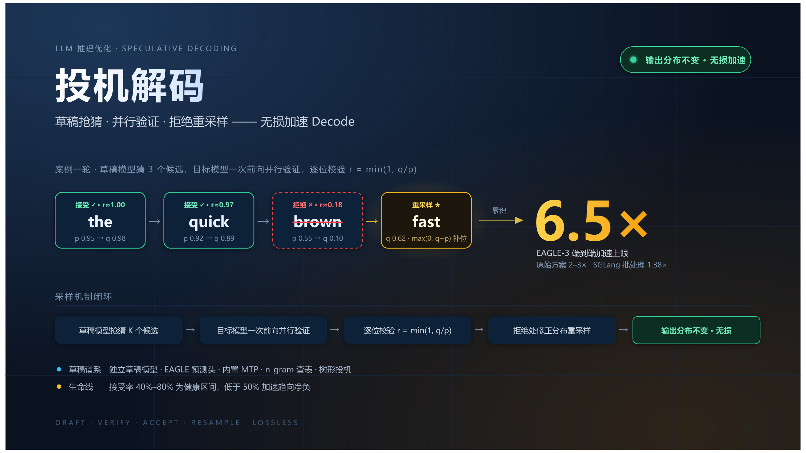
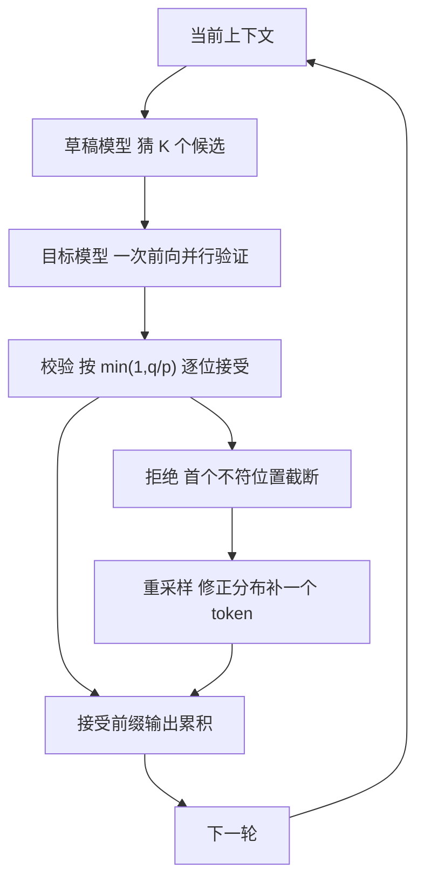

# 投机解码



## 摘要

投机解码（Speculative Decoding）是一种在不改变输出分布的前提下加速大模型自回归 Decode 阶段的推理优化。Decode 阶段逐 token 生成、受显存带宽限制（memory-bound），每步只产出一个 token 却要搬运全量权重。投机解码用一个低成本草稿模型抢先起草一串候选 token，再由目标模型一次前向并行验证整串候选，按概率匹配逐位接受、在拒绝处从修正分布重采样，从而将"验证 K 个 token"的开销压缩到近似"生成 1 个 token"，同时保持输出分布不变，实现无损加速。通过案例演示、采样机制、草稿分类到工程落地，逐层讲透其原理与实证。

**关键词**：投机解码；拒绝采样；草稿模型；自投机；EAGLE；MTP；vLLM；SGLang

## 1 问题与动机

### 1.1 自回归串行与 memory-bound

大模型在 Decode 阶段逐 token 自回归生成文本，每一步都依赖上一步输出、无法并行，天然串行。更关键的是这一阶段受**显存带宽**而非算力限制：模型每前进一步都要把全量权重从显存搬到计算单元，却只换回一个 token 的输出，搬运权重耗时远大于计算耗时。因此 Decode 处于典型的 memory-bound 状态，GPU 算力大量闲置 [[1]](#ref-1)。

### 1.2 核心洞察

两个直觉催生了投机解码。其一，生成中的大量 token 相当"好猜"——冠词、标点、常用短语都有明显的高概率答案，不值得让大模型逐位精算。其二，既然 Decode 受访存限制，**让目标模型并行验证 K 个候选 token，与逐一生成单个 token 成本几乎相同**——两者都要把权重读一遍。既然如此，不如一次搬完权重、一次多验证几个候选。

### 1.3 核心目标

投机解码承诺在**不改变输出分布**的前提下加速推理，即**无损加速**：同样的输出、更短的时间 [[1]](#ref-1) [[2]](#ref-2)。

## 2 案例演示

为讲清机制，设定一段英文续写场景。目标模型 T 与草稿模型 D 共享同一词表，理想续写为 "the quick brown fox"。

### 2.1 草稿

草稿模型 D 基于当前前缀，快速自回归猜出 K=3 个候选 token，并给出各自的草稿概率：

$$x_1=\texttt{the}\ (p=0.95),\quad x_2=\texttt{quick}\ (p=0.92),\quad x_3=\texttt{brown}\ (p=0.55)$$

### 2.2 验证

目标模型 T 把这三个候选当作一个 batch，只做一次前向，同时算出三个位置的输出概率：$q(\texttt{the})=0.98$、$q(\texttt{quick})=0.89$、$q(\texttt{brown})=0.10$。由于 Decode 访存受限，一次并行计算远快于逐 token 跑三次前向 [[1]](#ref-1)。

### 2.3 校验

对每个候选，按接受概率 $r=\min(1,\ q/p)$ 逐位判定：

$$r_1\approx\min\!\big(1,\tfrac{0.98}{0.95}\big)=1.00,\quad r_2\approx\min\!\big(1,\tfrac{0.89}{0.92}\big)=0.97,\quad r_3\approx\min\!\big(1,\tfrac{0.10}{0.55}\big)=0.18$$

前两个候选接受概率很高，大概率进入输出；第三个候选「brown」因草稿与目标分布分歧大（q 明显低于 p）、大概率被拒绝，校验在此截断。

### 2.4 重采样

在首个被拒绝的位置，从修正分布重新采样一个 token 补位。此例中位置 3 的目标分布里，草稿猜的「brown」（q=0.10）低于 p、处于被压低区域，而「fast」（q=0.62）出现概率高于 p，重采样大概率落在「fast」。于是最终累积为 "the quick fast"，本轮结束。整个流程如图1 所示，接受与重采样细节如图2 所示。



<p align="center">图1 投机解码一轮流程</p>


<p align="center">图2 接受与重采样细览</p>

## 3 采样机制

投机解码的采样机制由三部分构成：逐位接受、拒绝截断与拒绝处重采样。它们共同保证草稿候选被规范地筛入输出，并维持输出分布不变。

### 3.1 接受规则与直觉

上一节的验证环节可以抽象成一条接受规则：**只要草稿的概率没有明显超过目标模型**，就接受它；一旦草稿过自信（p 明显大于 q），就按比例丢弃。形式化为接受概率 $r=\min(1,\ q/p)$ [[1]](#ref-1)。

### 3.2 重采样分布保真

投机解码的"无损"由重采样这一步保证。在被拒绝的位置，从修正分布重新采样：

$$P_{\text{resample}}(x)\ \propto\ \max\big(0,\ q(x)-p(x)\big)$$

可以证明，这使每一步的边缘分布恰为目标分布 q——无论草稿模型多差，重采样都能纠正偏差，最终输出与目标模型直接采样完全一致 [[1]](#ref-1) [[2]](#ref-2)。

### 3.3 期望接受长度

一轮主循环无论接受几个 token，目标模型都只做一次前向，至多产出 K+1 个 token（K 个接受 + 1 个重采样补位）。单轮收益由**期望接受长度**刻画：

$$E[\text{accepted}]=\sum_{i=1}^{K}\prod_{j<i}p(x_j)\cdot r(x_i)$$

它由草稿分布 p 与目标分布 q 的接近度决定：越接近接受率越高、期望接受长度越大。极端情形 p≡q 时一轮全部接受、产出 K 个 token；反之接受率趋零则无收益、甚至因额外草稿开销转为净负。投机解码的加速本质是"摊薄权重加载"——同一份权重搬运换来更多 token [[2]](#ref-2)。

## 4 草稿分类

草稿的类别决定了方案的成本、接受率与适用场景，主流分为以下几类。

### 4.1 独立草稿模型

用同家族的较小模型作草稿（如 Llama-8B 草稿 → Llama-70B 目标），代表是 Leviathan 与 Chen 的原始方案 [[1]](#ref-1) [[2]](#ref-2)。优点：零额外训练、开箱即用；代价：要求草稿与目标**共享同一词表**，并需常驻部署小模型、占用显存。适用于草稿质量要求高、可接受额外显存成本的场景。

### 4.2 附加预测头 Medusa 与 EAGLE

不引入独立小模型，从目标模型自身加推断头作草稿。Medusa 在模型头部加多个并行 decoding head、一次预测多个未来 token；EAGLE 系列复用目标特征做特征级自回归，其中 EAGLE-2 引入动态树形草稿、EAGLE-3 改为直接 token 预测并融合多层特征。这类自投机省去独立小模型部署，是稠密模型的高性价比选择。当前 vLLM 的投机解码核心支持已转向 EAGLE 等，Medusa 主导地位相对衰退 [[3]](#ref-3)。

### 4.3 模型内置 MTP

部分架构在训练时就内置多 token 预测（Multi-Token Prediction, MTP），目标模型带一个 MTP 头、推理时直接用作草稿。代表为 DeepSeek V3、腾讯混元，官方即插即用、零额外部署，是 MoE 模型的首选 [[4]](#ref-4)。

### 4.4 无模型草稿

完全不引入模型，通过 n-gram 或 Prompt-Lookup 从历史序列、已有 prompt 或检索结果中直接查下一步候选。零部署、零显存增量，特别适合摘要、RAG、代码编辑等高重复强规律文本；缺点依赖文本规律性，自由生成内容收益有限。

### 4.5 部分层 LayerSkip

用大模型前若干浅层作草稿、全层做验证，节约独立草稿模型的部署，依赖层间协同完成草稿与验证的配合。

### 4.6 树形投机

草稿候选可从链式升级为**树形投机**（Tree Speculative Decoding）：一次生成多个分支的候选，用树注意力掩码在目标模型一次前向中并行验证整棵树，显著提高单次验证的接受率。代价是需用树形掩码管理 token 间依赖、工程更复杂，现为提升接受率的主流手段。

选型速览：MoE 且自带 MTP 直接用内置 MTP；稠密模型追求高性能用 EAGLE-2/3；高重复强规律文本用 n-gram/Prompt-Lookup 零成本方案；有同族小模型可用独立草稿模型。

## 5 工程落地

### 5.1 引擎支持

主流推理引擎已内置投机解码。vLLM 通过 `--speculative-model` 指定草稿模型、`--num-speculative-tokens`（即 K）设定候选数 [[3]](#ref-3)；SGLang 通过 `--speculative-algorithm EAGLE3` 启用 EAGLE-3 草稿 [[5]](#ref-5)；自定义草稿头的训练可由 LMSYS 开源框架 SpecForge 完成，支持 EAGLE3、DFlash、Domino 等多种算法 [[6]](#ref-6)。

### 5.2 关键参数与调优

关键调参落在草稿长度与验证预算上：草稿长度 K（单轮候选数，建议 4–8，过大收益递减）与树宽（EAGLE 树形分支宽度）；以及单轮投放到目标模型并行验证的 token 总量（对应 `num-draft-tokens`）。两者共同决定单轮的接受潜力与验证开销。

### 5.3 接受率生命线与失效场景

接受率是投机解码的生命线，本质反映草稿与目标分布的契合度。工程经验上，接受率低于约 50% 时验证收益被重采样抵消、趋向净负；40%–80% 是健康区间，越高加速越明显。主要失效场景：高并发 QPS 下与连续批处理争抢资源、草稿与目标 tokenizer 或行为不匹配、显存紧张放不下草稿。最佳适用场景是单用户低延迟（聊天、Agent、代码补全）与输入输出高重复（RAG、摘要、代码）。

### 5.4 与其他加速技术正交叠加

投机解码作用于 Decode 的访存摊薄，与以下技术在目标层面正交、可在同一引擎中叠加：

- **量化**（FP8/INT4）：压缩权重传输、降低访存压力
- **PagedAttention / KV Cache**：优化显存、放大 batch
- **CUDA Graph / FlashAttention**：降低 kernel 启动与开销

正交叠加使收益可累加，是工程上常见组合 [[3]](#ref-3)。

## 6 实证与趋势

### 6.1 实证加速

不同草稿方案的端到端加速差异明显。原始投机解码（Leviathan/Chen）在常见场景可带来约 2–3× 的 Decode 加速 [[1]](#ref-1) [[2]](#ref-2)；EAGLE-3 在五项任务上取得最高 **6.5×** 加速、较 EAGLE-2 提升约 1.4×，并在 SGLang 框架 batch size 64 下取得 1.38× 吞吐提升 [[5]](#ref-5)。

### 6.2 前沿演进

草稿训练正走向系统化：SpecForge 把"围绕目标采集特征 → 训练草稿 → 导出"变成一条可复用流水线，并开源多款草稿模型 [[6]](#ref-6)。草稿算法持续多样化：

- **DFlash**：块扩散草稿
- **Domino**：并行草稿骨干 + 轻量修正头
- **DSpark**：半自回归 + 自适应验证

这些新方法不断刷新接受率与端到端加速，推动投机解码成为主流推理引擎的标配能力。

## 7 总结

投机解码用一个便宜的小模型抢先猜一串 token，让大模型一次并行验证、能接受的收下、猜错的在拒绝处重采样补一个，全程不改变输出分布，靠摊薄权重加载换来无损加速。草稿怎么选、接受率保住，是它好用与否的关键。

## 参考文献

<a id="ref-1"></a>[1] Y. Leviathan et al. ["Fast Inference from Transformers via Speculative Decoding."](https://arxiv.org/abs/2211.17192) *ICML*, 2023.  
<a id="ref-2"></a>[2] C. Chen et al. ["Accelerating Large Language Model Decoding with Speculative Sampling."](https://arxiv.org/abs/2302.01318) *arXiv:2302.01318*, 2023.  
<a id="ref-3"></a>[3] vLLM Project. ["Speculative Decoding (vLLM Docs)."](https://docs.vllm.ai/en/v0.17.0/features/speculative_decoding/) *vLLM Documentation*, 2025.  
<a id="ref-4"></a>[4] nebius. ["MTP-DeepSeek-V3-0324 (Model Card)."](https://huggingface.co/nebius/MTP-DeepSeek-V3-0324) *Hugging Face*, 2025.  
<a id="ref-5"></a>[5] Y. Li, F. Wei, C. Zhang, H. Zhang. ["EAGLE-3: Scaling up Inference Acceleration of Large Language Models via Training-Time Test."](https://doi.org/10.52202/085713-4562) *NeurIPS*, 2025.  
<a id="ref-6"></a>[6] The SpecForge Team. ["SpecForge v0.3.0: a Unified Disaggregated and Colocated Speculative Decoding Stack."](https://www.lmsys.org/blog/2026-08-04-specforge-v0-3/) *LMSYS Blog*, 2026.  

---

## 附录 知识点树

```text
投机解码 知识树
│
├─ 1 问题与动机
│   ├─ 1.1 自回归串行与 memory-bound
│   ├─ 1.2 核心洞察
│   └─ 1.3 核心目标
│
├─ 2 案例演示
│   ├─ 2.1 草稿
│   ├─ 2.2 验证
│   ├─ 2.3 校验
│   └─ 2.4 重采样
│
├─ 3 采样机制
│   ├─ 3.1 接受规则与直觉
│   ├─ 3.2 重采样分布保真
│   └─ 3.3 期望接受长度
│
├─ 4 草稿分类
│   ├─ 4.1 独立草稿模型
│   ├─ 4.2 附加预测头 Medusa 与 EAGLE
│   ├─ 4.3 模型内置 MTP
│   ├─ 4.4 无模型草稿
│   ├─ 4.5 部分层 LayerSkip
│   └─ 4.6 树形投机
│
├─ 5 工程落地
│   ├─ 5.1 引擎支持
│   ├─ 5.2 关键参数与调优
│   ├─ 5.3 接受率生命线与失效场景
│   └─ 5.4 与其他加速技术正交叠加
│
└─ 6 实证与趋势
    ├─ 6.1 实证加速 EAGLE-3 6.5× 等
    └─ 6.2 前沿演进 SpecForge · DFlash/Domino
```