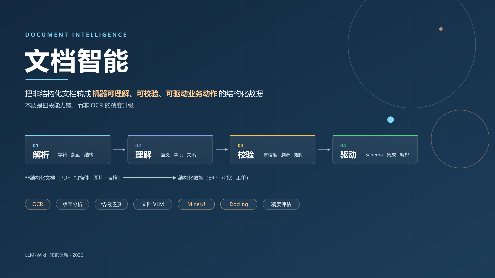
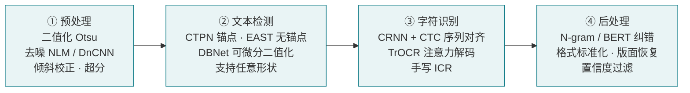
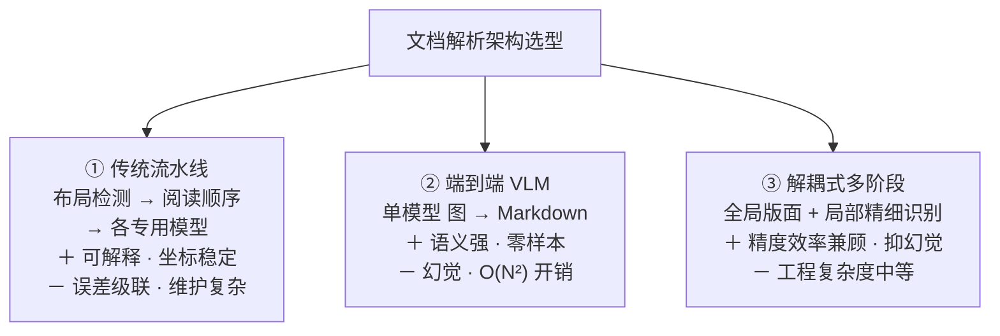
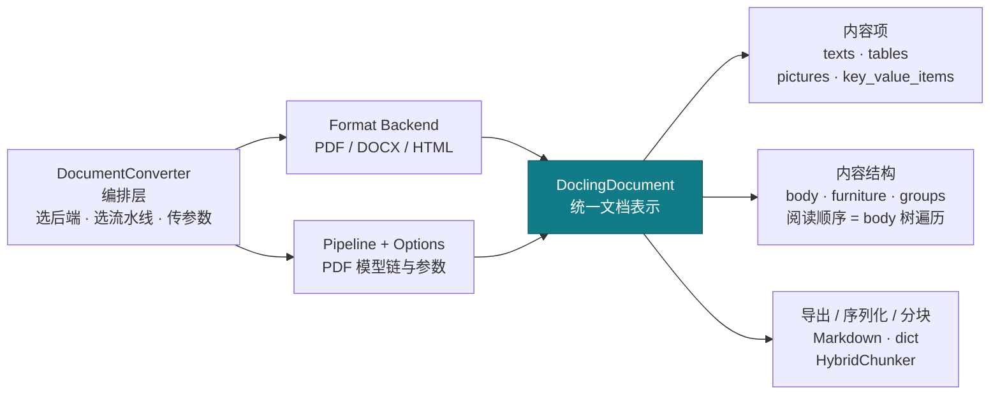

# 文档智能



## 摘要

文档智能把非结构化文档转成机器可理解、可校验、可驱动业务动作的结构化数据，本质是解析、理解、校验、驱动四段能力链，而非 OCR 的精度升级，识别准只是起点，数据能算、能查、能触发动作才算跑通。

**关键词**：文档智能；OCR；版面分析；结构还原；文档VLM；MinerU；Docling；精度评估


## 引言

从字符识别到结构化数据，中间隔着一条完整的能力链。合同、发票、报关单、订单、物流单等业务凭证都是非结构化的，版式千变万化且年年更新。纯人工录入慢且错，纯靠通用 OCR 又常常"识别准但业务跑不通"[[1]](#ref-1)。

根源在 OCR 的输出形态：它解决"页面上有什么字"，输出文本流；而业务需要"这份文档意味着什么、该触发什么动作"，两者之间隔着一整套结构还原与语义判断。遇到多栏排版、跨页表格、公式、印章压字时，文本流不仅丢失二维关系，还会因阅读顺序错乱而彻底失真。

文档智能是一条四段能力链，而非一个识别模型，任何一段缺失业务都跑不通。全文按此展开——先立定义与阶梯，再拆解析层五支线，继而对比两条工程路线，最后落到校验、部署与评估。

---

## 1 定义与能力阶梯

### 1.1 四段能力链

文档智能可以定义为把非结构化文档（PDF、扫描件、图片、表格）转换成机器可理解、可校验、可驱动下游动作的结构化数据。

定义内含四个递进的能力段：

| 能力段 | 覆盖范围 | 回答的问题 | 输出形态 |
| --- | --- | --- | --- |
| 解析 | 字符、版面、结构 | 文档里有什么、在哪、怎么组织 | 带坐标的结构化元素 |
| 理解 | 语义、字段、关系 | 这份文档意味着什么 | 字段、实体、关系 |
| 校验 | 置信度、溯源、规则 | 抽出来的数据可不可信 | 置信分、坐标、校验结论 |
| 驱动 | Schema、集成、编排 | 该触发什么真实业务动作 | 系统调用、流程状态 |

<p align="center">表1 文档智能四段能力链</p>

四段是能力叠加而非替代：只做前两段＝看得见但不可信，只做后两段＝没有可靠输入。这是后文所有工程结论的前提。


<p align="center">图1 文档智能四段能力链</p>

图中深青填充为最终产物，灰色为输入源。

### 1.2 五层能力阶梯

把四段能力链按"回答的问题"再切一刀，得到从 OCR 到 IDP 的五层阶梯。每上一层，问题就换一次，输出的信息密度也随之跃升。

| 层级 | 名称 | 技术形态 | 回答的问题 | 输出 |
| --- | --- | --- | --- | --- |
| L0 | 字符层 | OCR | 这里有什么字 | 文本流 |
| L1 | 版面层 | Layout | 字在哪、什么层级 | 区块与坐标 |
| L2 | 结构层 | Structure | 表格几行几列、公式是什么 | HTML / LaTeX |
| L3 | 语义层 | Understanding | 这份文档讲什么 | 字段、实体、关系 |
| L4 | 业务层 | IDP | 该触发什么动作 | 校验、路由、回写 |

<p align="center">表2 从 OCR 到 IDP 的五层能力阶梯</p>

工业级产品已有对应：Google Document AI 的处理器正按此组织——数字化（OCR）、提取（表单/布局/自定义/预训练解析器）、分类（分类器/拆分器），且所有处理器都能提取文本与布局[[12]](#ref-12)。

AI 时代的关键变化不是 OCR 被淘汰，而是它从"产品"降级为"组件"——仍是流水线第一阶段，但不再定义能力上限。2023 年起 VLM 对该领域产生颠覆性影响，2024 至 2025 年 Mistral OCR、DeepSeek-OCR、PaddleOCR-VL 等专用模型相继推出，以远小于通用 VLM 的参数量取得领先性能，OCR 的定义正从"字符识别"扩展为"文档理解"[[2]](#ref-2)。

### 1.3 与 OCR、IDP 的边界

三者常被混用，边界却清楚。OCR 解决"页面上有什么文字"，输出原始文本或可搜索 PDF；IDP（智能文档处理）解决"这份文档意味着什么、该触发什么动作"，输出映射到业务模式的结构化字段[[2]](#ref-2)。文档智能覆盖两者之间的完整链路，并额外承担校验与驱动职责。

两者差异集中在五维：输出形式（文本 vs 结构化字段）、上下文感知（无 vs 理解文档类型与字段含义）、数据验证（无 vs 业务规则与外部数据交叉校验）、异常处理（无 vs 低置信度路由人工）、系统集成（需定制 vs 预置 ERP/CRM 连接器）[[2]](#ref-2)。

---

## 2 输入形态与预处理链路

输入形态直接决定预处理链路，这是工程实现中第一个必须做出的判断。

| 形态 | 特征 | 核心难点 | 处理路径 |
| --- | --- | --- | --- |
| PDF 原生电子版 | 有文本层，可直接抽取 | 版面还原、阅读顺序 | 文本层提取 + 版面分析 |
| PDF 扫描版 | 只有图像层 | 倾斜、噪点、印章压字 | 图像增强 + OCR |
| 拍摄图片 | 手机拍照、透视畸变 | 光照不均、几何畸变、模糊 | 几何校正 + 超分 + OCR |
| 表格 | Excel、网页表、图片表 | 二维结构、合并单元格 | 结构识别 |

<p align="center">表3 四种输入形态与处理路径</p>

常被误解的一点：**原生 PDF 有文本层不代表简单**。文本层本身不携带可靠的阅读顺序与结构语义，照样会遇到双栏读串、表格塌成一行。

图像质量有明确量化门槛：低于 300 DPI 准确率明显下降，劣质扫描件可降 20% 以上；150→300 DPI 通常提升约 20%，高精度场景推荐 300 至 600 DPI。倾斜校正需控制在 ±1° 以内；去噪在噪声标准差 25 的高斯噪声上可使准确率从 62% 提升至 89%[[2]](#ref-2)。

---

## 3 解析层之一 OCR 原理与局限

### 3.1 四段式流水线

OCR 分四阶段，各自解决一个独立问题。



<p align="center">图2 OCR 四段式流水线</p>

四个环节统一用浅青底标出，表示同一处理链上的并列阶段。

**预处理**标准化图像：Otsu 自适应二值化消除光照不均，高斯/双边滤波去椒盐噪声并用形态学修复笔画断裂，霍夫变换检测倾角后仿射校正，直方图均衡或 CLAHE 增强对比度[[2]](#ref-2)。

**文本检测**定位文字。传统用 MSER 连通域分析，深度模型三选：CTPN（CNN+RNN 垂直锚点）、EAST（无锚点、支持多角度）、DBNet（可微分二值化，任意形状）[[2]](#ref-2)。

**字符识别**把文字区域转成字符序列。主流是 CRNN（CNN 提特征 + RNN 建模序列 + CTC 解决长度不对齐），TrOCR 用自注意力捕捉字符依赖，长文本与复杂字体更强[[2]](#ref-2)。

**后处理**校正结果：N-gram 或 BERT 纠错、统一日期金额格式、恢复段落与阅读顺序、按 softmax 置信度过滤[[2]](#ref-2)。

### 3.2 精度水位与手写差异

行业基准：清晰印刷体 CER 可低于 1%，手写体 3% 至 5%；工整手写准确率可达 90% 以上，潦草书写仅 70% 至 80%，医生处方等极端场景仍是难点[[2]](#ref-2)。

路线差异：印刷体用模板匹配或特征提取即可，深度学习中 CRNN+CTC 满足大部分场景；手写体更依赖上下文与序列建模，Transformer 显著优于传统 CRNN[[2]](#ref-2)。

### 3.3 六条结构性局限

这些不是调参能解决的，而是"文本流"输出形态本身的边界。

| 局限 | 本质原因 | 典型后果 |
| --- | --- | --- |
| 只认字不认结构 | 输出是文本流，丢失二维空间关系 | 表格塌成一行、多栏混读 |
| 版式敏感 | 训练分布外的版式泛化能力差 | 换供应商模板即失效 |
| 误差级联 | 检测错则识别必错，无法回滚 | 单点错误污染整页 |
| 阅读顺序盲区 | 缺乏全局版面理解 | 双栏论文读成左栏全文加右栏全文 |
| 公式与表格无力 | 二维结构无法用序列表达 | LaTeX 乱码、单元格错位 |
| 语义缺失 | 不知道字段的业务含义 | 金额与税号抽反也照常输出 |

<p align="center">表4 OCR 的六条结构性局限</p>

其中最具工程杀伤力的一条是语义缺失：字符准确率可达 99%，但发票总额提取错误仍会直接导致经济损失。字符级指标救不了字段级错误，这一点在第 9 章评估体系中会再次展开。

---

## 4 解析层之二 版面分析

版面分析是最容易被低估的一环：阅读顺序错了后面全错，因为它决定所有元素按什么顺序拼接。

### 4.1 五个核心任务

| 任务 | 内容 |
| --- | --- |
| 区域检测 | 文本块、标题、表格、图片、公式、页眉页脚、页码、印章 |
| 阅读顺序还原 | 单栏、双栏、多栏、竖排、图文混排、跨栏段落 |
| 层级构建 | 章节树、列表嵌套、段落归属、标题与正文关联 |
| 元素分类 | 正文与装饰性元素（页眉页脚等 furniture）的区分 |
| 文档切分 | 多文档合一 PDF 的 Splitter |

<p align="center">表5 版面分析的五个核心任务</p>

### 4.2 传统方案与 VLM 方案的差异

| 维度 | 传统方案 | VLM 方案 |
| --- | --- | --- |
| 检测模型 | LayoutLMv3、YOLO 等专用检测器 | 提示词直接输出 bbox |
| 阅读顺序 | 规则加坐标排序 | 模型预测 |
| 优势 | 快、可控、坐标稳定 | 语义强、零样本 |
| 短板 | 复杂版式失效 | 坐标漂移、幻觉 |

<p align="center">表6 版面分析传统方案与 VLM 方案对比</p>

阅读顺序最难，因为它在视觉上没有显式标注，只能靠模型推断。传统方案靠坐标排序，单栏可靠，但多栏嵌套、侧边栏、脚注穿插时规则迅速失效；VLM 有语义理解能力，却会因坐标漂移导致 bbox 与实际位置对不上，影响溯源。

MinerU 2.5 在此改进两点：保留页眉页脚页码等非正文元素以保证内容完整，并用更精细的标签体系表达列表、参考文献、代码块[[3]](#ref-3)。

---

## 5 解析层之三 表格结构还原

表格的二维结构无法用序列表达，这是它比线性文本困难的根源。现代表格识别通常分为四个阶段。


<p align="center">图3 表格结构还原四阶段</p>

深青填充为最终输出环节，其余为中间处理阶段。

四阶段各司其职：区域检测用 Faster R-CNN、YOLO 等定位表格；结构识别解析行列与合并单元格坐标，主流用 Transformer 自注意力或 GNN 推理单元格关系；内容识别逐格调用 OCR；还原将结果填回结构，输出 Excel、JSON 或 HTML[[2]](#ref-2)。

### 5.1 难点谱系

| 表格类型 | 难点 |
| --- | --- |
| 有线表 | 表格线断裂、印章干扰 |
| 无线表 | 无边界，靠文本空间分布与语义特征推断单元格边界（最难） |
| 异形表 | 多级表头、跨行跨列的不规则合并 |
| 跨页表 | 需通过语义与版式双特征判断前后页连续性 |
| 旋转表 | 倾斜或旋转需先校正 |

<p align="center">表7 表格结构的五类难点</p>

商用服务对无线表、嵌套表等难例的效果已优于早期版本，并能在一定程度上规避印章干扰与表格线断裂[[2]](#ref-2)。

### 5.2 关键技术

**TableFormer**（CVPR 2022）用 Transformer 直接预测表格结构，不依赖 OCR 结果，是 Docling 的表格引擎[[4]](#ref-4)——价值在于切断"OCR 错则结构也错"的级联。

**两阶段解耦**先结构后内容，避免结构判断被内容误差污染。Docling 的 `do_cell_matching` 开关可选"结构映射回 PDF 单元格"或"用结构预测的文本单元格"；多列被错误合并为一列时，关闭它可改善[[5]](#ref-5)。

自 1.16.0 起 TableFormer 分 `FAST`（更快、准确率较低）与 `ACCURATE`（默认，处理复杂表格）两档[[5]](#ref-5)。

---

## 6 解析层之四 公式识别

公式识别把二维数学结构序列化为 LaTeX 或 MathML，难点随复杂度非线性上升。

| 形态 | 特征 |
| --- | --- |
| 行内公式 inline | 嵌在正文流中，需与文字正确分离 |
| 行间公式 display | 独立成块，通常居中并带编号 |
| 复杂结构 | 多行对齐、矩阵、分段函数、上下标嵌套 |
| 混排公式 | 中英文混排、公式内嵌中文 |

<p align="center">表8 公式的四类形态</p>

| 方案 | 定位 | 特点 |
| --- | --- | --- |
| UniMERNet | 专用模型 | 面向真实场景数学表达式识别[[6]](#ref-6) |
| 文档 VLM | 端到端 | 公式作为内容块直接输出 LaTeX |
| pix2tex | 轻量方案 | 复杂公式表现弱 |

<p align="center">表9 公式识别代表方案</p>

评测用 **CDM**（Character Detection Matching），比纯编辑距离更贴近"公式是否视觉正确"——编辑距离会把结构正确但符号顺序不同的公式判错，CDM 则通过字符检测匹配衡量渲染一致性。OmniDocBench 同时采用 `display_formula_Edit_dist` 与 `display_formula_CDM`[[7]](#ref-7)。

MinerU 2.5 把复杂长公式与中英混排公式的准确解析列为其相对 2.0 的核心改进[[3]](#ref-3)。

---

## 7 解析层之五 文档 VLM 的三大范式

架构选择可归纳为三条路线，并非"新的取代旧的"，而是精度、成本、可维护性的不同权衡。



<p align="center">图4 文档解析三大范式及其权衡</p>

三条路线并列，各自的 ＋ 为优势、－ 为短板，不预设优劣。

| 范式 | 机制 | 优势 | 短板 |
| --- | --- | --- | --- |
| 传统流水线 | 布局检测、阅读顺序、文本与公式表格各自专用模型 | 可解释、模块可替换、坐标稳定 | 误差级联、维护复杂、复杂版式失效 |
| 端到端 VLM | 单模型直接由图生成 Markdown | 语义强、零样本、架构简单 | 幻觉、高分辨率 O(N²) 开销 |
| 解耦式多阶段 | 阶段一做全局版面分析，阶段二做局部精细识别 | 兼顾精度与效率、可解释、抑制幻觉 | 工程复杂度中等 |

<p align="center">表10 文档解析三大范式对比</p>

### 7.1 端到端的三个结构性障碍

据 MinerU2.5 技术报告，端到端在文档场景有三个障碍[[3]](#ref-3)。

**token 冗余**：文档图大量空白/低信息区，原生分辨率编码产生海量视觉 token，O(N²) 复杂度使算力不可承受。

**幻觉**：文本密集区模型倾向"猜"而非"读"，长文档上尤其严重。

**分辨率两难**：裁剪降低开销但牺牲语义一致性与版面信息；原生分辨率保留细节却产生数量惊人的 token，工程上不可行[[3]](#ref-3)。

解法是解耦：把全局版面分析与局部内容识别拆开，让高分辨率只作用于真正需要精细识别的局部。

---

## 8 工程实现的两条路线

### 8.1 MinerU 从模块化流水线到解耦式 VLM

MinerU 在 2.5 从流水线转向解耦式 VLM。早期方案用 PDF-Extract-Kit 编排版面检测、公式识别、表格抽取等专用模型，便于单组件优化，但误差在阶段间传播、多栏与跨页版面鲁棒性有限、模块依赖使维护繁琐[[3]](#ref-3)。

MinerU2.5 是 1.2B 参数的解析 VLM，用由粗到细的两阶段解耦全局版面分析与局部内容识别。


<p align="center">图5 MinerU2.5 两阶段解析策略</p>

浅青为两个解析阶段，深青为结构化输出。

**架构三件套**：语言模型 0.5B Qwen2-Instruct（解析任务对 LLM 依赖低），1D-RoPE 换 M-RoPE 适配裁剪块多分辨率；视觉编码器 675M NaViT（Qwen2-VL 初始化），支持动态分辨率与 2D-RoPE；Patch Merger 对 2×2 视觉 token 做 pixel-unshuffle，折中效率与性能[[3]](#ref-3)。

**两阶段参数**：Stage I 整页缩放至 1036×1036，固定尺寸换取更稳 bbox 与更高训练效率；Stage II 按版面裁原图局部、原生分辨率输入，上限 2048×28×28，兼顾细节与算力[[3]](#ref-3)。

**训练三阶段**：Stage 0 模态对齐（先只训 Patch Merger 两层 MLP 并冻结其余，再全解冻做视觉指令微调）、Stage 1 解析预训练、Stage 2 解析微调，配数据引擎生成语料[[3]](#ref-3)。

收益复合：算力降一个数量级、可解释性提升、幻觉被结构性抑制、两阶段可独立迭代[[3]](#ref-3)。

### 8.2 Docling 统一文档模型与可插拔流水线

Docling 走另一条路：不做单一解析模型，而做可编排的文档转换框架。



<p align="center">图6 Docling 三层架构与统一文档表示</p>

深青为中枢数据结构 DoclingDocument，其余为输入与输出通道。

Docling 为每种格式维护一个转换器，由它决定用哪个后端解析、哪个流水线协调执行、传哪些选项；转换结果即 DoclingDocument[[8]](#ref-8)。

**DoclingDocument** 是核心价值：一个 pydantic 类型，统一表达文本/表格/图片、章节与分组层级、正文与页眉页脚之分、所有项的 bbox 与来源[[9]](#ref-9)。

数据结构分两类。内容项存于 `texts`（段落、标题、公式，基类 `TextItem`）、`tables`、`pictures`、`key_value_items`；内容结构封装在 `body`（正文树根）、`furniture`（页眉页脚等非正文）、`groups`（列表、章节容器）。各项以 JSON 指针互引，阅读顺序由 `body` 树遍历决定[[9]](#ref-9)。

**流水线组件**离线预取五类模型：版面、TableFormer、图片分类、代码与公式、EasyOCR。均可插拔——OCR 可换 RapidOCR/Tesseract，TableFormer 分 FAST/ACCURATE 两档，可强制整页 OCR 或接远程 VLM[[5]](#ref-5)。

**RAG 分块**由 `HybridChunker` 承担，每个 chunk 自带 `headings` 层级路径与 `prov` 坐标，可直接入库[[5]](#ref-5)。

**隐私设计**：默认全本地不共享数据；用远程服务须显式设 `enable_remote_services=True`，否则抛 `OperationNotAllowed()`[[5]](#ref-5)。"默认不联网"使私有部署天然合规。

### 8.3 两条路线的定位差异

| 维度 | MinerU | Docling |
| --- | --- | --- |
| 出身 | 上海人工智能实验室、OpenDataLab | IBM Research |
| 核心 | 高精度解析（自研文档 VLM） | 统一文档模型与可插拔流水线 |
| 强项 | 复杂版面、公式、表格精度 | 文档结构建模、多格式支持、RAG 分块 |
| 形态 | 解析引擎 | 转换框架与工具箱 |
| 输出 | Markdown、JSON（带 bbox） | DoclingDocument 多格式导出 |
| 适合场景 | 追求最高精度解析结果 | 需要可编排、可扩展的文档底座 |

<p align="center">表11 MinerU 与 Docling 定位差异</p>

Docling 技术报告阐述了同一思路：以统一文档表示为中枢，后端、流水线与选项解耦，同一份文档可经不同路径加工后落到同一个可导出对象模型[[13]](#ref-13)。

两者共同趋势是从"流水线拼装"走向"统一模型 + 结构化文档表示"——这是当前阶段的架构共识：无论自研模型还是做框架，最终都要落到一个显式、可查询的文档对象模型。

---

## 9 校验、部署与评估

### 9.1 校验三支柱

"可校验"是文档智能区别于普通 OCR 的核心：数据必须能被追问。三支柱缺一不可。

| 支柱 | 机制 | 作用 |
| --- | --- | --- |
| 置信度 | 字段级 confidence 输出，阈值经离线标注与线上 A/B 标定 | 低置信度自动路由到人工队列 |
| 溯源 | page_no 与 bbox 坐标、原文引用可回溯 | 让答案可核验而非盲信模型 |
| 规则校验 | 业务一致性（价税合计等于金额加税额）、跨单据对齐、Schema 校验 | 拦截语义层面的错误 |

<p align="center">表12 校验三支柱</p>

落地走五步法[[1]](#ref-1)：

1. **采集**：汇聚单据，统一格式与命名
2. **分类**：判断类型并分流
3. **提取**：多模态抽关键字段，而非整页 OCR
4. **审核**：按业务规则校验，低置信度转人工
5. **录入**：回写 ERP 或财务中台

审核环节不能省。实践中的兜底闭环是"抽取—规则校验—转人工"：模型给每个字段打置信度，低于阈值的连同上下文推给业务人员确认，结果再反哺模型[[1]](#ref-1)。这才是生产环境跑得稳的组合。

### 9.2 私有部署

四个驱动力[[2]](#ref-2)：

- **合规**：上传云端可能被用于训练，违反数据最小化原则；EDPB 指出大量个人数据训练 OCR 模型可能违反 GDPR
- **数据主权**：合同、财务、医疗、证件类不可出内网
- **成本**：按页计费在高吞吐下累积
- **可控**：需要定制、微调与版本锁定

架构分四层【推导】：

- **模型层**：离线预取解析模型、本地 OCR 与 VLM
- **服务层**：vLLM/SGLang + 任务队列，长文档异步化
- **存储层**：原文档、解析产物、中间态、向量库
- **治理层**：权限继承、审计、脱敏

该分层由前文归纳得出，非某一文献直接主张。

三个部署陷阱：

- **隐写文本层**：OCR 生成的可搜索 PDF 在图像下方留有不可见文本层，黑色矩形遮盖后仍可恢复，多起脱敏失败均源于此[[2]](#ref-2)
- **资源超限静默死**：被内核杀死（退出码 137）时 Agent 收不到回调，须外置监控兜底[[10]](#ref-10)
- **版本升级缺回归**：模型或组件升级后输出变化，无固定回归集则质量下降难被发现

### 9.3 三层精度评估

三层须同时评估，缺一层结论都不可信。

| 层 | 回答 | 指标 |
| --- | --- | --- |
| 字符层 | 字对不对 | CER、WER、归一化编辑距离 |
| 结构层 | 结构对不对 | TEDS、TEDS-S、版面 mAP、阅读顺序编辑距离、公式 CDM |
| 语义层 | 意思对不对 | 字段级准确率与 F1、STP 率、DocVQA、InfoVQA、RAGAS 忠实度 |

<p align="center">表13 精度评估三层指标体系</p>

CER 用 Levenshtein 距离计算（插入+删除+替换 除以真值字符数）[[2]](#ref-2)；TEDS 是表格树编辑距离相似度，TEDS-S 只比结构不含文本。字段级准确率衡量特定字段（如发票总额、保单号）是否完全正确，是文档自动化最关键的指标——字符准确率可达 99%，但发票金额抽错仍直接造成损失；金融与证件类要求 99.9%，这是直通式处理的门槛。STP 率指无需人工干预即可通过工作流的比例，2026 年领先系统可达 95%[[2]](#ref-2)。

### 9.4 OmniDocBench v1.6 基准

OmniDocBench 是当前被广泛采用的端到端文档解析基准，发表于 CVPR 2025[[11]](#ref-11)[[7]](#ref-7)。

它评估文本、公式、表格、版面布局与阅读顺序：输入整页图像，输出含四类元素的 Markdown；领域覆盖多语言学术、金融、教科书、报纸、杂志、演示文稿[[7]](#ref-7)。

规模 1,651 页 = 1,355 基础 + 100 公式复杂 + 99 版面复杂 + 97 表格复杂；分辨率跨 570×829 至 10142×14342[[7]](#ref-7)。

官方指标八项，描述与方向如下表。

| 指标 | 描述 | 方向 | 所属层 |
| --- | --- | --- | --- |
| text_block_Edit_dist | 正文文字准确度，与真值的归一化编辑距离 | 越低越好 | 字符 |
| table_Edit_dist | 表格内文字准确度，单元格文本的编辑距离 | 越低越好 | 字符 |
| display_formula_Edit_dist | 行间公式 LaTeX 还原准确度，公式串编辑距离 | 越低越好 | 字符 |
| table_TEDS | 表格结构加内容整体还原度，HTML 树编辑距离相似度 | 越高越好 | 结构 |
| table_TEDS_structure_only | 只看表格结构，忽略单元格文本 | 越高越好 | 结构 |
| display_formula_CDM | 公式渲染视觉一致性，字符检测匹配 | 越高越好 | 结构 |
| reading_order_Edit_dist | 阅读顺序正确性，与真值顺序的编辑距离 | 越低越好 | 结构 |
| normalized_score | 综合得分，文本、公式、表格加权归一 | 越高越好 | 综合 |

<p align="center">表14 OmniDocBench v1.6 官方指标集</p>

表14 中有三组容易混淆的指标[[7]](#ref-7)：

- **Edit_dist 与 CDM 的差别在度量对象**：前者比较字符串序列，对符号顺序敏感；后者先把 LaTeX 渲染成图再比对字符位置，对"写法不同但视觉等价"的公式更宽容
- **TEDS 与 TEDS-S 的差别在是否计入文本**：TEDS 同时惩罚结构错误与内容错误，TEDS-S 只惩罚结构错误，两者差距大说明结构对但文字识别差
- **table_Edit_dist 与 text_block_Edit_dist 分属两个对象**：前者只统计表格内文字，后者统计正文文本块，分别衡量表格与正文的文字质量

评分用官方 v1.6 评估器在 Docker 沙箱中逐页独立进行；EvalScope 对各页指标取平均，Overall 仅基于文本、公式、表格三组件聚合计算[[7]](#ref-7)。

### 9.5 四个评估陷阱

| 陷阱 | 表现 | 对策 |
| --- | --- | --- |
| 基准不等于业务 | 受控测试基准 98% 的系统，在真实业务文档上可能降至 85% | 用真实语料做 POC，覆盖低质量扫描、复杂表格、多页 PDF |
| 字符指标掩盖字段错误 | 字符准确率 99% 但发票总额抽错 | 把字段级准确率作为核心验收指标 |
| 单一指标失真 | 只报 TEDS 不报文本精度 | 三层同时报 |
| 静态基准饱和 | 公开榜单被持续刷榜，失去区分度 | 建私有测试集，模型变更必跑回归 |

<p align="center">表15 四个评估陷阱</p>

第一条尤其值得强调。据腾讯云技术百科的建议，应选取一至两个典型文档类型做概念验证测试，使用真实业务文档（包含低质量扫描件、复杂表格、多页 PDF 等边缘案例）量化异常率与人工校正工作量；重点关注系统在真实文档语料库上的表现，而非理想条件下的基准数据——一个在受控测试中基准达 98% 的系统，在实际业务文档上可能降至 85%[[2]](#ref-2)。

---

## 10 六条能力边界

综合全文，六条必须记住的边界。

| 边界 | 含义 |
| --- | --- |
| 字符准不等于业务对 | 字段级准确率才是黄金指标，金融与证件类需 99.9% |
| 多模态不是银弹 | 多模态能同时理解文字、表格线、印章位置与排版逻辑，稳定性明显优于单模态 OCR，但仍需人工兜底闭环[[1]](#ref-1) |
| 审核环节不能省 | 低置信度转人工加结果反哺，才能持续保持准确率 |
| 绝对准确不可达 | 应把目标从 100% 准确率改为把出错概率压到可接受范围 |
| 模型上限由数据决定 | MinerU2.5 的数据引擎在报告中占据与模型架构同等甚至更重的篇幅[[3]](#ref-3) |
| 文档是 Agent 的感官 | 解析质量直接决定下游 Agent 的决策质量 |

<p align="center">表16 六条能力边界</p>

最后一条在 AI 应用语境下尤其关键：当 Agent 读取合同、财报、票据完成任务时，解析质量不再是独立工程指标，而是决策链的第一环。解析错一个数字，后续所有推理都建立在错误前提上。

---

## 总结

文档智能不是把 OCR 做得更准，而是把文档变成能算、能查、能校验的数据。四段能力链里，解析负责看清，理解负责看懂，校验负责信得过，驱动负责用得上，少一段业务就跑不通。技术上，端到端 VLM 想一步到位，结果被 token 冗余和幻觉拖住，真正跑通的是解耦式两阶段，先用低分辨率看全局，再按版面切局部、用原分辨率细看。工程上，MinerU 追求解析精度，Docling 提供可编排的文档底座，两者都收敛到同一个共识，就是必须有一个显式的结构化文档表示。评估三层缺一层都不可信，但决定业务跑通的是字段级准确率与 STP 率。最后记住，文档是 Agent 的眼睛，眼睛花了，脑子再好也没用。

---

## 参考文献

<a id="ref-1"></a>[1] 阿里云开发者社区. ["非结构化单据自动化：文档智能五步法与版式兜底实践."](https://developer.aliyun.com/article/1760885) *阿里云开发者社区*, 2026-09-04.  
<a id="ref-2"></a>[2] 腾讯云开发者社区. ["OCR 技术百科."](https://cloud.tencent.com.cn/developer/techpedia/2709) *腾讯云技术百科*, 2026-09-14.  
<a id="ref-3"></a>[3] J. Niu et al. ["MinerU2.5: A Decoupled Vision-Language Model for Efficient High-Resolution Document Parsing."](https://arxiv.org/abs/2509.22186) *arXiv:2509.22186*, 2025.  
<a id="ref-4"></a>[4] S. Nassar et al. ["TableFormer: Table Structure Understanding with Transformers."](https://openaccess.thecvf.com/content/CVPR2022/papers/Nassar_TableFormer_Table_Structure_Understanding_With_Transformers_CVPR_2022_paper.pdf) *CVPR*, 2022.  
<a id="ref-5"></a>[5] Docling Project. ["Docling Usage Documentation."](https://docling.cn/docling/usage/) *Docling 官方文档*, 2026.  
<a id="ref-6"></a>[6] OpenDataLab. ["UniMERNet: A Universal Network for Real-World Mathematical Expression Recognition."](https://github.com/opendatalab/unimernet/) *GitHub*, 2024.  
<a id="ref-7"></a>[7] ModelScope. ["OmniDocBench-v1.6 评测适配文档."](https://evalscope.readthedocs.io/zh-cn/v1.11.0/benchmarks/omni_doc_bench_v1_6.html) *EvalScope 官方文档*, 2026.  
<a id="ref-8"></a>[8] Docling Project. ["Docling 架构文档."](https://docling.cn/docling/concepts/architecture/) *Docling 官方文档*, 2026.  
<a id="ref-9"></a>[9] Docling Project. ["DoclingDocument 文档结构文档."](https://docling.cn/docling/concepts/docling_document/) *Docling 官方文档*, 2026.  
<a id="ref-10"></a>[10] 腾讯云开发者社区. ["CubeSandbox: 60 毫秒启动的 AI Agent 沙箱."](https://cloud.tencent.cn/developer/article/2735539) *腾讯云开发者社区*, 2026-09-02.  
<a id="ref-11"></a>[11] L. Ouyang et al. ["OmniDocBench: Benchmarking Diverse PDF Document Parsing with Comprehensive Annotations."](https://arxiv.org/abs/2412.07626) *CVPR*, 2025.  
<a id="ref-12"></a>[12] Google Cloud. ["Document AI 概览."](https://docs.cloud.google.cn/document-ai/docs/overview?hl=zh-cn) *Google Cloud 官方文档*, 2026-10-15.  
<a id="ref-13"></a>[13] IBM Research. ["Docling Technical Report."](https://arxiv.org/abs/2408.09869) *arXiv:2408.09869*, 2024.  

---

## 附录 知识点树

```
文档智能  Document Intelligence
│
├─ Ⅰ 定义与阶梯
│  ├─ 四段能力链
│  │   ├─ ① 解析  字符 · 版面 · 结构
│  │   ├─ ② 理解  语义 · 字段 · 关系
│  │   ├─ ③ 校验  置信度 · 溯源 · 规则
│  │   └─ ④ 驱动  Schema · 集成 · 编排
│  ├─ 五层阶梯  L0 字符层 → L1 版面层 → L2 结构层 → L3 语义层 → L4 业务层
│  └─ 概念边界  OCR ≠ 文档解析 ≠ 文档智能 ≠ IDP
│
├─ Ⅱ 输入形态
│  ├─ PDF 原生   有文本层，仍需版面还原
│  ├─ PDF 扫描   只有图像层，必须走 OCR
│  ├─ 拍摄图片   透视畸变、光照不均
│  └─ 表格       二维结构、合并单元格
│
├─ Ⅲ 解析层五支线
│  ├─ 1. OCR
│  │   ├─ 四段流水线  预处理 → 检测 → 识别 → 后处理
│  │   ├─ 关键参数    300 DPI 分水岭
│  │   ├─ 精度水位    印刷 <1% / 手写 3–5% / 潦草 70–80%
│  │   └─ 六条局限    无结构 · 版式敏感 · 误差级联 · 顺序盲区 · 公式表格无力 · 语义缺失
│  ├─ 2. 版面分析    区域检测 · 阅读顺序 · 层级构建 · 元素分类 · 文档切分
│  ├─ 3. 表格还原    区域检测 → 结构识别 → 单元格识别 → 还原
│  │                 TableFormer · 两阶段解耦 · cell matching
│  ├─ 4. 公式识别    inline / display / 复杂结构 / 混排；CDM 评测
│  └─ 5. 文档 VLM    传统流水线 / 端到端 / 解耦式多阶段
│
├─ Ⅳ 工程实现
│  ├─ MinerU 2.5     1.2B 解耦式 VLM
│  │   ├─ 架构        NaViT 675M + Patch Merger + Qwen2 0.5B
│  │   ├─ 两阶段      Stage I 1036×1036 全局 / Stage II 原生分辨率局部
│  │   └─ 训练        Stage 0 对齐 → Stage 1 预训练 → Stage 2 微调
│  └─ Docling        统一文档模型 + 可插拔流水线
│      ├─ 三层架构    DocumentConverter / Backend / Pipeline
│      ├─ 数据模型    DoclingDocument（texts / tables / pictures / body / furniture / groups）
│      └─ 特性        可插拔 OCR · HybridChunker · 默认全本地
│
├─ Ⅴ 校验与驱动
│  ├─ 校验三支柱  置信度 · 溯源 · 规则校验
│  ├─ 驱动四层    Schema 映射 · 系统集成 · 流程编排 · Agent 接入
│  └─ 五步法      采集 → 分类 → 提取 → 审核 → 录入
│
├─ Ⅵ 私有部署
│  ├─ 四驱动力    合规 · 数据主权 · 成本 · 可控
│  ├─ 架构分层    模型层 · 服务层 · 存储层 · 治理层
│  └─ 三陷阱      隐写文本层 · 资源超限静默死 · 版本升级缺回归
│
├─ Ⅶ 精度评估
│  ├─ 三层指标    字符 CER/WER · 结构 TEDS/CDM/mAP · 语义 字段F1/STP
│  ├─ OmniDocBench v1.6  1,651 页 · 八项官方指标
│  └─ 四陷阱      基准≠业务 · 字符掩盖字段 · 单一指标失真 · 静态基准饱和
│
└─ Ⅷ 能力边界
    ├─ 字符准 ≠ 业务对
    ├─ 多模态不是银弹
    ├─ 审核环节不能省
    ├─ 绝对准确不可达
    ├─ 模型上限由数据决定
    └─ 文档是 Agent 的感官
```
