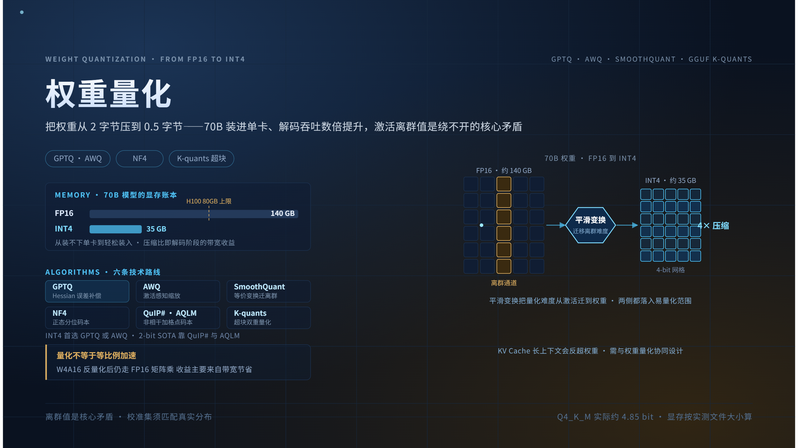
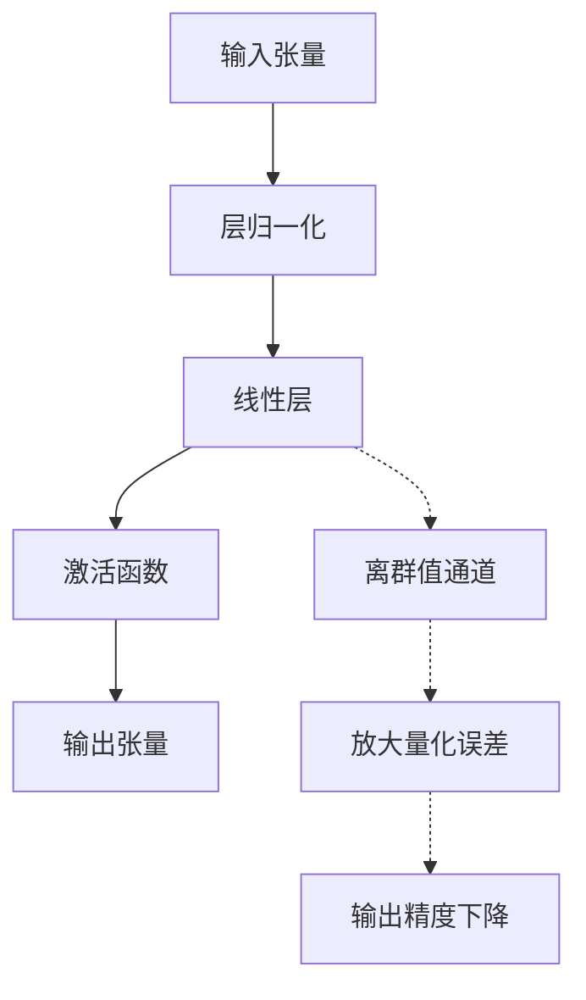
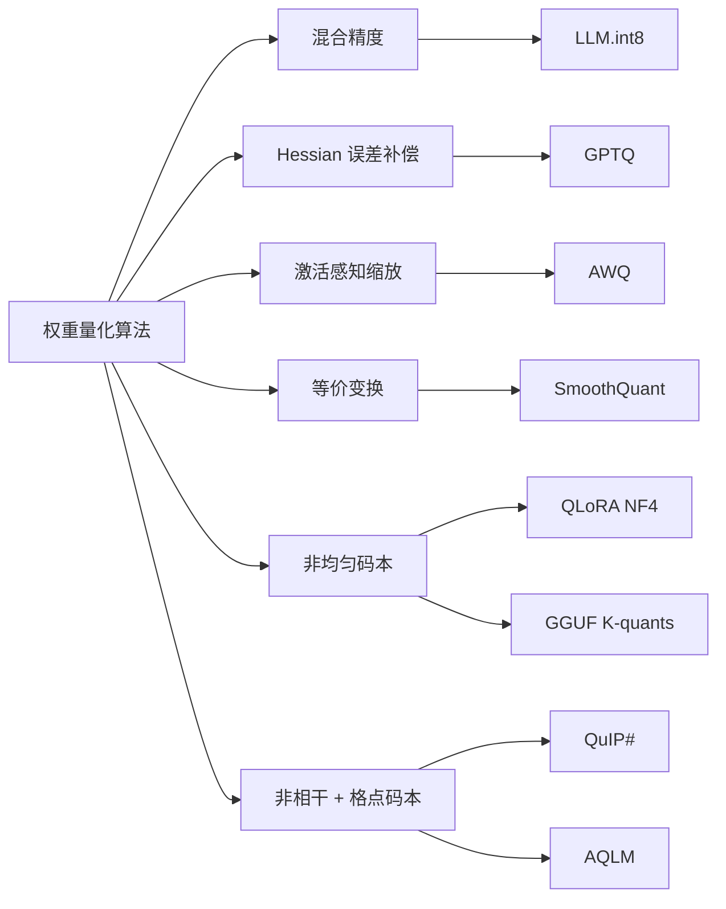
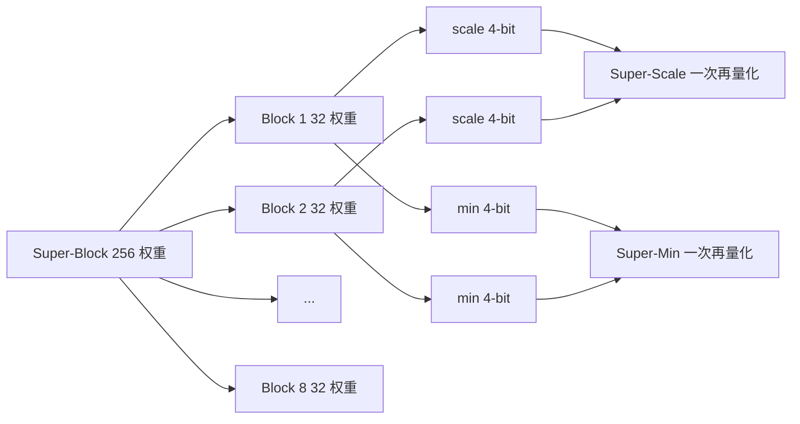
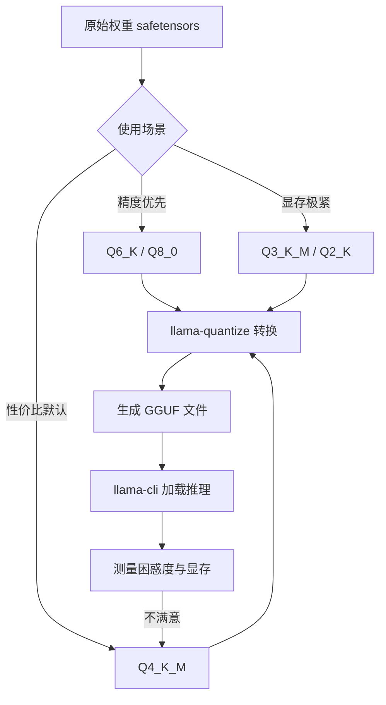
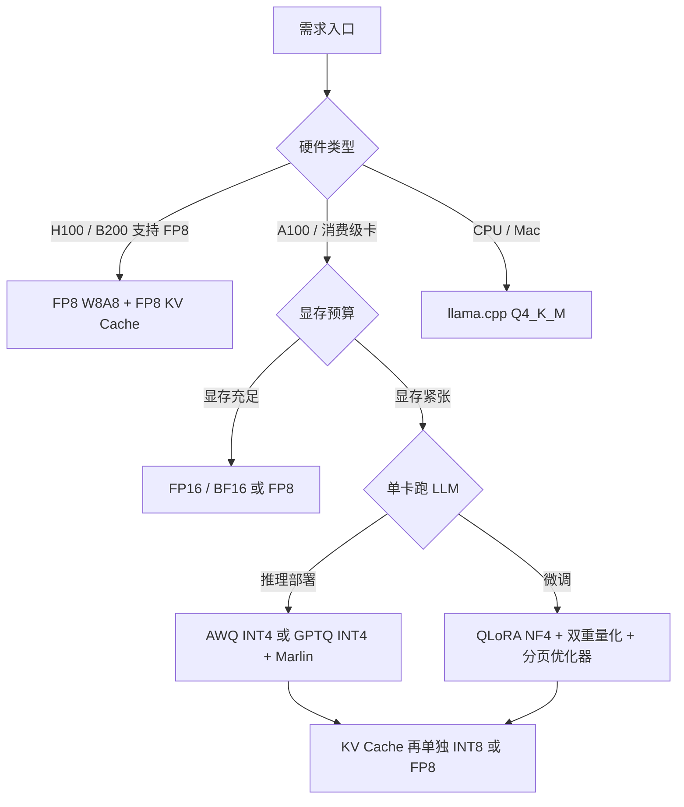

# 权重量化



## 摘要

权重量化把 FP16/FP32 权重映射到 INT8/INT4/FP8 等低比特，在可控精度损失下实现显存压缩与推理加速。

**关键词**：权重量化；训练后量化；量化感知训练；GPTQ；AWQ；SmoothQuant；NF4；K-quants；非相干处理；格点码本

---

## 1 引言与问题根源

大语言模型自 2020 年代以来参数规模持续攀升，一个 70B 级模型以 FP16 存储即需约 140 GB HBM，已超出单张 H100 80 GB 的显存上限。权重量化的核心动机在于缓解 HBM 显存占用与显存带宽两大推理瓶颈：把权重从 2 字节压到 0.5 字节既能让 70B 模型装入单卡，也能让解码阶段的矩阵乘从带宽受限瓶颈中释放出数倍吞吐，同时配合 H100 原生 FP8 Tensor Core 可进一步提升算力利用率【1】。

然而，直接对权重进行位宽对折并非无损。Transformer 的激活分布存在离群值：少数 hidden dimension 会出现幅值远高于其他通道的激活，使得对激活做低比特量化的数值误差急剧放大，这是 INT8 纯权重+激活量化早期失败的根源，也是后续一系列算法绕不开的核心矛盾【1】。除此之外，小模型（≤1B）对低比特的敏感度显著高于 7B+ 模型，量化位宽与质量损失之间并非线性关系，每对折一次的代价都更大。

在模型压缩技术的整体版图中，权重量化与剪枝、知识蒸馏、低秩分解各有侧重：剪枝改变网络连接结构、蒸馏需要额外训练成本、低秩分解受限于矩阵秩假设，而权重量化由于无需改动网络拓扑、无需训练、压缩比高，成为从训练好的 checkpoint 走向生产部署的标配路径，在工程实践中优先级最高【10】。

图 1 给出了大语言模型推理过程中权重激活离群值的存在及其对量化精度的影响。



<p align="center">图 1 Transformer 推理流水线中激活离群值的作用示意</p>

## 2 量化基础原理

### 2.1 仿射量化与对称非对称

量化的本质是用仿射变换把浮点张量映射到低比特整数网格上。对给定的浮点张量 $x$：

$$q = \mathrm{clip}\!\left(\mathrm{round}\!\left(\frac{x}{s}\right) + z,\, q_{\min},\, q_{\max}\right)$$

$$\hat{x} = s \cdot (q - z)$$

其中 $s$ 是缩放因子，$z$ 是零点偏移，用于把整数 0 对齐浮点 0，避免真实值 0 被量化成非 0 数。对称量化令 $z = 0$，$s = \max(|x|) / q_{\max}$，适合近似零中心正态分布的权重张量；非对称量化令 $z = \mathrm{round}(-x_{\min}/s)$ 充分利用整个整数区间，更适合分布偏移的激活张量。

### 2.2 量化粒度

粒度从粗到细可分为四类，粒度越细精度越高，但元数据开销也越大：

| 粒度 | 作用范围 | 典型应用 |
|---|---|---|
| Per-tensor | 整个张量一个 scale | 早期 CNN、简单 INT8 |
| Per-channel | 每个输出通道一个 scale | LLM 主流 |
| Per-group | 通道内每 32/64/128 权重一组 | GPTQ、AWQ 的 4-bit |
| Per-block + Super-block | GGUF 的 32 权重/块 + 8 块为一超块 | K-quants 全系列 |

<p align="center">表 1 量化粒度与典型应用</p>

### 2.3 静态量化与动态量化

静态量化用一份校准数据集（通常 128~512 条代表性样本）离线计算每层的 scale/z 并存进权重文件，推理时直接使用，适合分布固定的场景；动态量化仅对权重提前量化，激活的 scale 在推理时按 batch 在线计算，适合激活分布随输入波动的场景。LLM 推理通常对权重用静态（weight-only）、对激活用动态，两者结合以兼顾精度与吞吐。

## 3 按量化对象分类

### 3.1 仅权重量化

仅权重量化把权重压到低比特、激活保留 FP16，反量化后用 FP16 Tensor Core 做矩阵乘，是当前 LLM 单卡部署最普遍的形态，以 W8A16 / W4A16 为代表。矩阵乘实际仍在 FP16 上执行，加速主要来自 HBM 带宽节省而非算力密度提升，因此解码阶段收益显著、prefill 阶段收益相对有限。

### 3.2 权重与激活联合量化

权重与激活都压到 8-bit（W8A8）或 8-bit 浮点（FP8）才能真正用上 NVIDIA Hopper 架构的 FP8 Tensor Core 与 INT8 Tensor Core，获得最高算力密度。最大障碍是激活离群值问题：直接 W8A8 会因少数大激活主导 scale，把其余通道精度压低，必须先做 SmoothQuant 这类等价变换把激活难度迁移到权重上，详见第 5.4 节【4】。

### 3.3 KV Cache 量化技术

长上下文场景下 KV Cache 显存可能反超权重本身，因此需单独量化。KV Cache 可采用 per-channel INT8、FP8-E4M3 或 NVFP4 等格式：NVIDIA 在 Blackwell 架构上的实测表明，相比 FP8 KV Cache，NVFP4 KV Cache 可带来 3× TTFT 降低与 20% 缓存命中率提升，准确率损失小于 1%【9】。KV Cache 量化与权重量化同样重要，二者需协同设计。

## 4 按流程分类

### 4.1 PTQ 训练后量化

PTQ（Post-Training Quantization，训练后量化）是模型训练完成后，用少量校准数据离线计算 scale 与补偿，不需要反向传播与训练标签的量化路径。优点是成本低、流程简单，是当前 LLM 主流量化方式；缺点是受校准集分布影响较大，需要校准数据与真实输入分布尽量一致【10】。

### 4.2 QAT 量化感知训练

QAT（Quantization-Aware Training，量化感知训练）在训练或微调前向图中插入"伪量化"节点模拟量化噪声，反向通过 Straight-Through Estimator（STE）绕过 round 的不可导问题，让模型在训练中主动适应量化损失。衍生方法 LSQ（Learned Step Size Quantization）进一步把 scale 也作为可学习参数参与梯度优化，在 ≤4-bit 极限压缩场景下比 PTQ 更稳健。代价是需要训练资源与数据，部署门槛高于 PTQ。

### 4.3 PTQ 与 QAT 对比

| 维度 | PTQ | QAT |
|---|---|---|
| 是否需要训练 | 否，仅需校准集 | 是，需反向传播 |
| 计算成本 | 分钟到小时级 | 小时到天级 |
| 精度损失 | 4-bit 良好，≤2-bit 显著退化 | 极限压缩下显著优于 PTQ |
| 数据需求 | 数百条代表性样本 | 训练集或微调集 |
| 典型代表 | GPTQ / AWQ / SmoothQuant | LSQ / torchao QAT |

<p align="center">表 2 PTQ 与 QAT 对比</p>

## 5 主流权重量化算法

本节按"算法核心思想—数学机制—精度收益"逐个介绍六类代表性 PTQ 方法。整体技术路线关系如图 2 所示。



<p align="center">图 2 主流权重量化算法技术路线关系</p>

### 5.1 LLM.int8 混合精度分解

LLM.int8 是早期 INT8 LLM 量化的代表方案，由 Dettmers 等人在 2022 年提出【1】。其核心洞察是：Transformer 中存在离群特征——少数 feature 维度的激活幅值远高于其他维度，与这些维度相连的权重即使产生微小量化误差也会被大幅激活放大，导致输出显著偏离原始值【1】。

为此 LLM.int8 提出两步分解：先对权重和激活做 vector-wise 量化，每个内积都有独立的归一化常数；对检测到的离群维度，将其切出放入独立的 FP16 矩阵乘分支，其余 99.9% 以上维度用 INT8 计算。这种混合精度方案在不损失精度的前提下把 175B 模型的推理显存减半，OPT-175B / BLOOM 可在单台服务器上运行【1】。代价是混合精度路径降低了硬件利用率，后续工作通过识别离群子空间并用更精细的 kernel 合并两条路径以降低开销。

### 5.2 GPTQ Hessian 误差补偿

GPTQ 是 Frantar 等人 2022 年提出的逐层 PTQ 算法，全称 Accurate Post-Training Quantization for Generative Pre-trained Transformers，arXiv 编号 2210.17323【2】。它基于经典最优脑外科方法，将量化视作逐列权重的序贯优化问题：每量化一列权重时，其引入的量化误差会通过 Hessian 逆矩阵分配到尚未量化的列上作为补偿，使最终层输出的偏差最小化【2】。

其关键更新公式为：

$$W_{i}^{*} = \operatorname*{arg\,min}_{W_{i}} \left( Q(W_{i}) - W_{i} \right)^{2} \left[ H^{-1}_{F} \right]_{ii}$$

$$\delta F = -\frac{W_{i} - Q(W_{i})}{\left[ H^{-1}_{F} \right]_{ii}} \cdot \left( H^{-1}_{F} \right)_{:,i}$$

其中 $H_F = 2 X_F^T X_F$ 为该层输入的 Hessian，$W_i$ 为当前列，$\delta F$ 是补偿到剩余未量化列上的误差增量【2】。这种误差反馈机制使 GPTQ 在 3-4 bit 上精度远超直接 Min-Max 或 MSE 量化，能把 175B 模型在几 GPU 小时内一次量化到 3-4 bit，是 INT4 权重量化的事实标准之一。缺点是仅压权重不压激活，且量化过程耗时（7B 模型消费卡约 1 小时）。

### 5.3 AWQ 激活感知缩放

AWQ 由 Lin 等人在 2023 年提出，arXiv 编号 2306.00978，2024 年获 MLSys 最佳论文【3】。其核心观察是：权重并非同等重要——只占约 1% 的"显著权重"贡献了绝大部分模型质量，而显著与否应由激活分布而非权重幅值决定【3】。

与 LLM.int8 把显著权重保留为 FP16（产生混合精度算子）不同，AWQ 通过数学等价变换对显著通道的权重做逐通道缩放保护：对第 $j$ 个通道引入缩放因子 $s_j$，把线性层改写为 $y = (X \operatorname{diag}(s^{-1})) \cdot (\operatorname{diag}(s) \cdot W)$，激活通道被缩小、对应权重通道被放大，输出不变但显著权重的相对量化误差被压低【3】。缩放因子 $s_j$ 由激活统计离线搜索得到，无反向传播、不过拟合校准集，因此对指令微调模型与多模态模型泛化好【3】。AWQ 配套的 TinyChat 推理框架通过 SIMD 感知权重打包与 kernel 融合，在边缘 GPU 上取得 3-4× 加速【3】。

### 5.4 SmoothQuant 等价变换迁移

SmoothQuant 由 Xiao 等人提出，发表于 ICML 2023，arXiv 编号 2211.10438【4】。与 AWQ 解决"权重难量化"不同，SmoothQuant 解决的是激活难量化的问题：LLM 激活在某些通道会出现幅值 70 以上的极端 outlier，直接 W8A8 会把这些通道的 scale 拉得过大，导致其余通道精度崩塌【4】。

SmoothQuant 的处理方式是把量化难度从激活平滑迁移到权重：对第 $j$ 个通道引入缩放因子 $s_j$，做变换 $Y = (X \operatorname{diag}(s^{-1})) \cdot (\operatorname{diag}(s) W) = X' W'$，激活的极端幅值被压平、权重的幅值方差被放大，两侧都落入易量化范围【4】。超参数 $\alpha$ 控制迁移比例（$\alpha = 0.5$ 是 OPT-13B 上的常用折中）。该变换可离线完成并融合进上一层，不增加运行时操作；实测在 OPT / BLOOM / GLM / LLaMA 系列上取得最高 1.56× 加速与 2× 显存节省，使 530B 模型可在单节点内服务【4】。

### 5.5 NF4 与 QLoRA

QLoRA 是 Dettmers 等人 2023 年提出的微调方案，arXiv 编号 2305.14314，其核心是 4-bit NormalFloat（NF4）数据类型：神经网络权重近似服从零均值正态分布，而普通 INT4 是均匀网格，与实际分布不匹配；NF4 把 16 个量化点放置在标准正态分布的分位点上，靠近 0 处密、远 0 处稀，理论上是正态分布下信息论最优的 4-bit 格式【5】。

QLoRA 配套三项技术：NF4 量化、双重量化（对每 64 权重共享的 FP32 scale 再做一次 INT8 量化，额外节省约 0.37 bit/权重）、分页优化器（通过统一内存把 Adam 优化器状态按需分页到 CPU，避免长序列训练时的显存溢出）【5】。在冻结的 NF4 基座上插入可训练的 LoRA 适配器，即可在单卡 48 GB 上微调 65B 模型且不掉精度，是 HuggingFace 生态最主流的 LLM 微调路径之一【5】。NF4 主要用于微调而非纯推理部署，推理场景更常用 GPTQ/AWQ。

### 5.6 极限低比特 QuIP# 与 AQLM

追求 ≤2-bit 时直接均匀量化会导致灾难性精度损失，前沿方法引入两个新思路：非相干处理与格点码本。

QuIP# 由 Tseng 等人提出，arXiv 编号 2402.04396，是 QuIP 的改进版【6】。其三个关键技术：一是用随机 Hadamard 变换（RHT）实现非相干处理，把权重与 Hessian 的相关性打散，使权重分布由长尾变为类球形的亚高斯分布，避免个别元素主导量化误差；二是引入基于 E8 格的码本做向量量化——E8 格在 8 维单位球中达到最优球堆积，是比整数网格信息密度更高的码本结构；三是结合微调进一步提升对原模型的保真度【6】。实测 QuIP# 在 ≤4-bit 场景下超越现有 PTQ，在 2-bit 上有显著优势【6】。

AQLM 由 Egiazarian 等人提出，发表于 ICML 2024，arXiv 编号 2401.06118【7】。它把信息检索领域的加性量化推广到 LLM：用多个码本逐项相加逼近每个权重向量，并对跨 transformer block 的码本参数进行联合优化。AQLM 是首个在 <3-bit 区间达到 Pareto 最优的方案，在 2-bit 上显著优于已知方法【7】。

## 6 GGUF 与 llama.cpp 生态

### 6.1 K-quants 与超块结构

GGUF 的 K-quants 系列（Q2_K、Q3_K、Q4_K、Q5_K、Q6_K）采用超块 + 双重量化的层级仿射结构：8 个普通 32-权重的 block 组成一个 256 权重的 super-block，每个 block 有自己的 scale/min，而 super-block 再对这 8 个 scale/min 做一次低比特量化以摊薄元数据开销【8】。这种结构比传统单层仿射量化在同位宽下有更低困惑度。

超块结构示意如图 3 所示。



<p align="center">图 3 K-quants 超块与双重量化结构示意</p>

### 6.2 文件命名与推荐表

GGUF 文件命名 `Q{n}_{K}_{M}` 表示"位宽 - K-quant 方法 - 质量档位"，K 系列常见档位与推荐如表 2 所示【8】。

| 量化档位 | 平均 bits/权重 | 典型用途 | 精度说明 |
|---|---|---|---|
| Q2_K | 2.56 | 极限压缩、超大模型低显存实验 | 质量明显下降，长对话与指令跟随退化 |
| Q3_K_M | 3.91 | 8 GB 卡跑 7B~13B | 优于旧 Q3 格式，有一定精度损失 |
| Q4_K_M | 4.85 | 主流默认，性价比最高 | 相比 FP16 困惑度损失约 1%~2% |
| Q5_K_M | 5.54 | 精度敏感的中高端卡 | 接近 Q6，损失可忽略 |
| Q6_K | 6.59 | 近乎无损部署 | 困惑度损失极小 |
| Q8_0 | 8.5 | 几乎无损、调参基准 | 与 FP16 几乎无差别 |

<p align="center">表 2 GGUF K-quants 常见档位对比</p>

值得注意的是，`Q4_K_M` 中的 K 指 K-quant 方法而非 K-means 聚类，且不同张量会被分配不同量化类型——例如 MoE 模型的 `ffn_down_exps` 张量常被自动升到 `q6_K`，因此 Q4_K_M 的实际位宽约 4.85 bit/权重而非严格 4.0【8】。一个经验法则是：优先选能装入显存的最高量化档，到 Q5_K_M 以上就不用再反复斟酌。

### 6.3 文件选择流程

从原始权重到实际运行的决策流程如图 4 所示。



<p align="center">图 4 llama.cpp 量化文件选择流程</p>

## 7 性能与工具链

### 7.1 主流算法对比

不同算法在核心思想、典型位宽、校准需求、精度表现上差异显著，汇总如表 3 所示【1】【2】【3】【4】【5】【6】【7】。

| 算法 | 核心思想 | 位宽 | 是否需校准 | 是否需训练 | 主要优点 | 主要缺点 |
|---|---|---|---|---|---|---|
| LLM.int8 | 混合精度隔离离群特征 | W8A16 | 否 | 否 | 精度几乎无损、兼容性好 | 混合精度路径降低算力利用率 |
| GPTQ | Hessian 逆矩阵误差反馈 | W4 / W3 | 是（128+ 样本） | 否 | 精度高、工业事实标准 | 量化耗时长、仅压权重 |
| AWQ | 激活感知缩放保护显著权重 | W4 / W3 | 是 | 否 | 无反向传播、跨域泛化好 | 精度上限略低于 GPTQ |
| SmoothQuant | 等价变换迁移激活离群 | W8A8 | 是 | 否 | 支持真低比特矩阵乘 | 需调节 α、仅适合 8-bit |
| QLoRA NF4 | 正态分位码本 + 双重量化 | W4 | 否 | 可选微调 | 微调场景显存最优 | 主要服务微调、非推理首选 |
| GGUF K-quants | 超块双重量化 | 2~8 bit | 否 | 否 | 文件格式统一、CPU/GPU 通用 | 极低比特下质量下降明显 |
| QuIP# / AQLM | 非相干 + 格点/加性码本 | W2 | 是 | 微调 | 2-bit 下 SOTA | kernel 生态未普及 |

<p align="center">表 3 主流权重量化算法对比</p>

### 7.2 去量化与混合精度 kernel

W4A16 模式下的"反量化+矩阵乘"是一体化完成的，Marlin 是当前 NVIDIA GPU 上最主流的 4-bit 混合精度 GEMM kernel，vLLM 与 TensorRT-LLM 均内置了多种模板实例以适配不同矩阵形状【12】。Marlin 的关键优化包括把 INT4 权重在寄存器内反量化为 FP16、用 Tensor Core 执行 FP16 乘加、并以 Split-K 并行减少访存延迟，在解码场景下相对原生 FP16×FP16 可显著提升吞吐【12】。AWQ 配套的 TinyChat 框架则针对边缘 GPU 做了 SIMD 感知权重打包与 kernel 融合【3】。

### 7.3 主流工具链

不同工具链覆盖的量化格式与典型用法差异较大，汇总如表 4 所示【11】【12】。

| 工具 / 框架 | 支持格式 | 典型用法 |
|---|---|---|
| bitsandbytes | INT8 / NF4 / INT4 | HuggingFace 一行加载即量化，QLoRA 微调首选【11】 |
| AutoGPTQ / AutoAWQ | INT4 / INT3 | 一行命令量化 HF 模型，vLLM 直接加载 |
| llama.cpp | GGUF 全系列（K-quants、IQ 系列） | CPU / Mac / 消费级 GPU 本地推理首选【8】 |
| vLLM | AWQ、GPTQ、FP8、Marlin、bitsandbytes | 生产环境高吞吐 serving【12】 |
| TensorRT-LLM | FP8、INT8、W4A16、NVFP4 | NVIDIA 端到端最优 kernel |
| torchao | int8 / int4 / float8 / QAT | PyTorch 原生生态，支持 QAT+LoRA |

<p align="center">表 4 主流量化工具链生态对比</p>

## 8 工程要点与避坑指南

### 8.1 选型决策路径

选型可按"硬件—显存预算—精度要求"三步递进，决策流程如图 5 所示。



<p align="center">图 5 权重量化选型决策流程</p>

### 8.2 常见避坑清单

- 校准集分布与真实数据分布偏差：PTQ 极度依赖校准数据，若校准用英文 Wiki 而线上是中文对话会导致精度显著退化，建议用 128~512 条与目标任务匹配的样本【10】。
- 激活离群值问题：LLM 在某些 hidden dim 上会出现数值极端大的激活，直接 W8A8 会失效；必须先做 SmoothQuant 或换用 AWQ 这类 weight-only 方案绕开【1】【4】。
- 小模型对小位宽更敏感：1B 以下模型 INT4 损失明显大于 7B+，能上 Q5_K_M / Q6_K 就别强行压缩为 Q4【8】。
- 混合精度算子的精度：LayerNorm、RoPE、Softmax、logits 输出通常保持 FP32/FP16，强行全量化会引入 NaN 或严重退化。
- 量化只是减权重比特、不等于等比例加速：W4A16 的矩阵乘在反量化之后仍是 FP16 计算，加速主要来自带宽节省；要真正用上低比特 Tensor Core 需 W8A8/FP8 或专门 Marlin kernel【12】。
- KV Cache 不量化则长上下文显存反超权重，务必与权重量化协同设计【9】。
- GGUF 的 Q4_K_M 不等于严格 4-bit：元数据与部分张量升级使其平均位宽约 4.5~4.9 bit，估算显存时要按实测文件大小算，不要按理论值【8】。
- AWQ 与 GPTQ 选择：AWQ 无需反向传播、对指令模型与多模态更稳；GPTQ 精度上限略高但量化时间长，二者在 INT4 上差距通常很小，可按生态兼容性选择【2】【3】。

## 9 最小可运行示例

### 示例 1 AutoGPTQ 量化并推理

```python
from transformers import AutoTokenizer, AutoModelForCausalLM
from auto_gptq import AutoGPTQForCausalLM, BaseQuantizeConfig
model_id = "Qwen/Qwen2.5-7B-Instruct"
tokenizer = AutoTokenizer.from_pretrained(model_id)
calib_data = [tokenizer.decode(s) for s in
              [tokenizer(c)["input_ids"] for c in
               ["大家好，今天天气如何？", "Please explain quantization briefly."]]]
quant_config = BaseQuantizeConfig(bits=4, group_size=128, desc_act=True)
model = AutoGPTQForCausalLM.from_pretrained(model_id, quant_config,
                                            calib_data)
model.save_quantized("./qwen2.5-7b-gptq-int4")
```

### 示例 2 AWQ 量化

```bash
pip install autoawq
awq_entrypoints --model_path Qwen/Qwen2.5-7B-Instruct \
                --w_bit 4 --q_group_size 128 \
                --zero_point --load_awq_model \
                --dump_quant ./qwen2.5-7b-awq-int4
```

### 示例 3 llama.cpp 生成 GGUF 并推理

```bash
# 1 从 HF 下载并转为 GGUF
python convert_hf_to_gguf.py ./Qwen2.5-7B-Instruct --outfile qwen-f16.gguf
# 2 转换为 Q4_K_M
./llama-quantize qwen-f16.gguf qwen-q4km.gguf Q4_K_M
# 3 启动推理
./llama-cli -m qwen-q4km.gguf -p "用一句话解释权重量化" -n 128
```

### 示例 4 vLLM 加载量化模型

```python
from vllm import LLM
llm = LLM(model="TheBloke/Qwen2.5-7B-Instruct-AWQ",
          quantization="awq_marlin",
          kv_cache_dtype="fp8",
          gpu_memory_utilization=0.9)
out = llm.generate(["请用 50 字介绍权重量化"])
```

## 总结

权重量化通过把模型权重压到低比特，既能让大模型装入单卡显存，又能借带宽节省提升推理速度，精度损失在可控范围内，GPTQ、AWQ 是 INT4 推理常用方案，NF4 更适合微调，GGUF 适合本地部署，极限低比特靠 QuIP# 和 AQLM 突破，工程上要注意离群值、校准集分布和 KV Cache 协同，避免把权重量化等同于等比例加速。

---

## 10 参考文献

<a id="ref-1"></a>[1] T. Dettmers, M. Lewis, Y. Belkida, L. Zettlemoyer. "LLM.int8(): 8-bit Matrix Multiplication for Transformers at Scale."(https://arxiv.org/abs/2208.07339) *arXiv:2208.07339*, 2022.  
<a id="ref-2"></a>[2] E. Frantar, S. Ashkboos, T. Hoefler, D. Alistarh. "GPTQ: Accurate Post-Training Quantization for Generative Pre-trained Transformers."(https://arxiv.org/abs/2210.17323) *ICLR*, 2023.  
<a id="ref-3"></a>[3] J. Lin, J. Tang, H. Tang, S. Yang, W.-M. Chen, W.-C. Wang, G. Xiao, X. Dang, C. Gan, S. Han. "AWQ: Activation-aware Weight Quantization for LLM Compression and Acceleration."(https://arxiv.org/abs/2306.00978) *MLSys Best Paper*, 2024.  
<a id="ref-4"></a>[4] G. Xiao, J. Lin, M. Seznec, H. Wu, J. Demouth, S. Han. "SmoothQuant: Accurate and Efficient Post-Training Quantization for Large Language Models."(https://arxiv.org/abs/2211.10438) *ICML*, 2023.  
<a id="ref-5"></a>[5] T. Dettmers, A. Pagnoni, A. Holtzman, L. Zettlemoyer. "QLoRA: Efficient Finetuning of Quantized LLMs."(https://arxiv.org/abs/2305.14314) *arXiv:2305.14314*, 2023.  
<a id="ref-6"></a>[6] A. Tseng et al. "QuIP#: Even Better LLM Quantization with Hadamard Incoherence and Lattice Codebooks."(https://arxiv.org/abs/2402.04396) *ICML*, 2024.  
<a id="ref-7"></a>[7] V. Egiazarian, A. Panferov, D. Kuznedelev, E. Frantar, A. Babenko, D. Alistarh. "Extreme Compression of Large Language Models via Additive Quantization."(https://arxiv.org/abs/2401.06118) *ICML*, 2024.  
<a id="ref-8"></a>[8] ggml-org. "llama.cpp quantize README."(https://github.com/ggml-org/llama.cpp/blob/master/tools/quantize/README.md) *GitHub*, 2025.  
<a id="ref-9"></a>[9] NVIDIA Developer. "Optimizing Inference for Long Context and Large Batch Sizes with NVFP4 KV Cache."(https://developer.nvidia.com/blog/optimizing-inference-for-long-context-and-large-batch-sizes-with-nvfp4-kv-cache) *NVIDIA Technical Blog*, 2026.  
<a id="ref-10"></a>[10] X. Shen et al. "Post Training Quantization of Large Language Models with SmoothQuant, AWQ, and GPTQ."(https://arxiv.org/abs/2405.07135) *arXiv:2405.07135*, 2024.  
<a id="ref-11"></a>[11] bitsandbytes-foundation. "bitsandbytes GitHub Repository."(https://github.com/bitsandbytes-foundation/bitsandbytes) *GitHub*, 2025.  
<a id="ref-12"></a>[12] vLLM Project. "vLLM BitsAndBytes Documentation."(https://docs.vllm.ai/en/v0.10.2/features/quantization/bnb.html) *vLLM Docs*, 2025.
