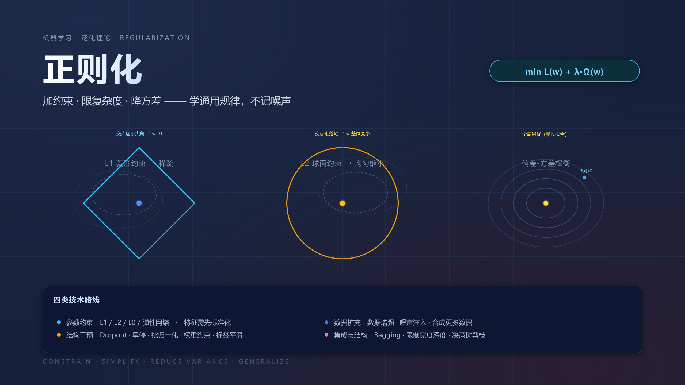
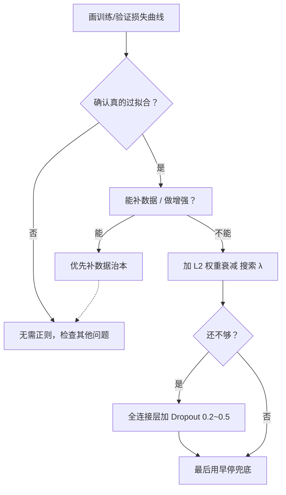

# 正则化

---

## 摘要

正则化是在训练目标中加入约束或惩罚、限制模型复杂度以提升泛化能力的技术，以少许偏差为代价压低有效复杂度、换取方差大降，让模型学通用规律而非死记噪声，从而在新数据上误差大幅下降。

**关键词**：正则化；过拟合；L1/L2；Dropout；权重衰减；AdamW；偏差-方差权衡；泛化

---

## 1 背景

过拟合的表象很一致，模型在训练集上表现出色，在陌生的测试数据上大幅退化。一个典型的示意情形是训练准确率 99%、测试准确率 70%——近 30 个百分点的差距，就是过拟合的宽度。

Zhang 等人 2017 年的实验进一步揭示了根源：将标准图像数据集的标签全部替换为随机乱码后，多种深度网络架构仍能将训练误差降至接近零[[2]](#ref-2)。连纯噪声都能完全拟合，说明模型默认**不区分"规律"和"噪声"**——只要容量足够、不加约束，它能记住训练集中的任何内容。

正则化由此定义：**在训练目标中加入约束或惩罚，限制模型复杂度，从而提升泛化能力的一类技术**。它的定位是在"拟合数据"与"保持模型简单"之间进行权衡。

---

## 2 目标函数加惩罚项

### 2.1 数学形式

设模型参数为 $w$，原训练目标为损失函数 $L(w)$。正则化将其改写为：

$$\min_{w} \; L(w) + \lambda \cdot \Omega(w)$$

三项要素：

- $L(w)$：经验风险，即训练误差；
- $\Omega(w)$：正则项，惩罚模型复杂度；
- $\lambda \ge 0$：超参数，控制惩罚强度。λ 越大越偏向简单模型，λ 越小越偏向拟合数据。

### 2.2 参数范数家族

| 类型 | 正则项 Ω(w) | 效果 | 别名与出处 |
|------|------------|------|-----------|
| L2 正则 | $\lambda\lVert w\rVert_2^2$ | 权重整体变小、趋于平滑 | 岭回归 / Ridge / 权重衰减[[3]](#ref-3) |
| L1 正则 | $\lambda\lVert w\rVert_1$ | 部分权重精确为零，附带特征选择 | Lasso[[4]](#ref-4) |
| L0 正则 | 非零参数个数 | 最直接的稀疏约束，但求解是 NP 难问题，实践中多由 L1 近似 | — |
| 弹性网络 | $\lambda_1\lVert w\rVert_1 + \lambda_2\lVert w\rVert_2^2$ | 兼得稀疏选择与相关特征下的稳定性 | Elastic Net[[5]](#ref-5) |

L2 的提出可以追溯到 Hoerl 与 Kennard 1970 年针对病态设计矩阵提出的岭回归[[3]](#ref-3)；L1 即 Tibshirani 1996 年提出的 Lasso，作为子集选择的连续替代方案[[4]](#ref-4)；弹性网络由 Zou 与 Hastie 于 2005 年提出，并指出它具有"组效应"——高度相关的变量倾向于同进同出[[5]](#ref-5)。

### 2.3 几何直觉

在参数空间中，L1 的约束区域是菱形，尖角落在坐标轴上，损失等高线与约束区域的交点大概率落在尖角处，对应部分参数精确为零；L2 的约束区域是光滑的球面，交点几乎不可能落在坐标轴上，对应所有参数被均匀缩小[[1]](#ref-1)。简言之：**L1 把解推向坐标轴（稀疏），L2 把解推向原点（均匀缩小）**。

---

## 3 过拟合的病理

### 3.1 诱因

过拟合通常出现在三个条件叠加时：参数过多、数据太少、噪声偏大。此时模型的容量远超数据所能约束的范围，剩余的自由度被用来"死记"训练样本。

### 3.2 误差分解

统计学习理论将泛化误差分解为三部分[[1]](#ref-1)：

$$\text{总误差} = \text{偏差}^2 + \text{方差} + \text{噪声}$$

- **过拟合的模型**：偏差很低（训练集拟合完美），但方差很高（数据分布稍变，预测剧烈波动）；
- **欠拟合的模型**：偏差高、方差低，两头都差。

正则化的主攻方向是**降低方差**，代价是偏差略微升高。这是一次显式的权衡：主动放弃部分拟合精度，换取模型对数据扰动的稳定性。

### 3.3 理论依据

背后是奥卡姆剃刀：在解释力相同的前提下，更简单的模型更可信。正则化将这条原则落实为目标函数中一个可调系数 λ，使"偏好简单"直接参与优化过程。

---

## 4 四类技术路线

正则化的手段可分四类：**参数约束**（损失加惩罚）、**结构干预**（改造网络）、**数据扩充**（源头稀释噪声）、**集成与结构限制**（平均与缩小假设空间）。各类主流手段的全貌如表1 所示。

| 类别 | 方法 | 机制 | 特点 | 典型场景 |
|------|------|------|------|---------|
| 参数约束 | **L1（Lasso）** | 惩罚 $\lVert w\rVert_1$ 之和 | 把权重推到精确 0，稀疏解，可做特征选择[[4]](#ref-4) | 特征筛选、稀疏模型 |
| 参数约束 | **L2（岭/权重衰减）** | 惩罚 $\lVert w\rVert_2^2$ 之和 | 把权重拉向 0（不归零），平滑防过拟合；SGD 下等价权重衰减[[3]](#ref-3) | 通用线性/神经网络 |
| 结构干预 | **Dropout** | 训练时按概率 $p$ 置零单元输出 | 不让网络依赖单个节点，近似训练多个共享权重的精简子网[[6]](#ref-6) | 深度网络/Transformer |
| 结构干预 | **提前停止** | 验证集 loss 回升即停 | 简单直接，靠验证集卡训练时机 | 各类训练 |
| 数据扩充 | **数据扩增/噪声注入** | 增加多样性数据 | 从源头稀释噪声记忆[[1]](#ref-1) | 视觉/文本任务 |

表1 主流正则化手段速览

### 4.1 参数约束（最经典）

即第2章的 L1/L2/弹性网络。选型要点：

- 特征数远大于样本数、需要特征筛选 → L1 或弹性网络；
- 特征高度相关、需要稳定估计 → L2 或弹性网络；
- 两者都成问题 → 弹性网络。

使用前提：**特征必须先标准化**。L1 与 L2 对特征尺度敏感，量纲大的特征会主导惩罚梯度，量纲小的特征形同未受约束。

### 4.2 结构干预（神经网络专用）

- **Dropout**：训练时以一定概率随机失活神经元，测试时关闭随机并缩放激活。Srivastava 等人 2014 年提出该方法，核心机制是打破神经元间的共适应；每次失活对应训练一个子网络，整体等效于隐式的集成平均[[6]](#ref-6)[[7]](#ref-7)；
- **早停（Early Stopping）**：监控验证集误差，一回升即停止并回滚最优参数。它等价于隐式限制参数搜索的范围；
- **批量归一化（Batch Norm）**：Ioffe 与 Szegedy 2015 年提出，主要目的是稳定各层输入分布、加速训练，因 mini-batch 统计量引入的随机性而附带轻微的正则效果[[9]](#ref-9)；
- **权重约束**：如 max-norm，限制权重向量的范数上限，直接截断而非软惩罚；
- **标签平滑（Label Smoothing）**：将 one-hot 标签软化为平滑分布，抑制模型对单一类别过度自信[[10]](#ref-10)。

### 4.3 数据扩充（从源头降方差）

- **数据增强**：对样本施加保持语义的变换（旋转、裁剪、加噪等），扩充有效样本量；
- **噪声注入**：在输入或权重上叠加噪声，其效果在理论上有分析支撑，向输入注入噪声与某些正则项存在等价关系[[1]](#ref-1)；
- **合成或收集更多数据**：对应第3章"数据太少"这一诱因，从信息量上治本，是数据层面最直接的解法。

### 4.4 集成与结构限制

- **Bagging**：Breiman 1996 年提出，对训练集做 bootstrap 重采样训练多个基学习器后聚合，通过平均显著降低方差，且收益来自基学习器本身的不稳定性——基学习器对数据扰动越敏感，聚合的效果越明显[[11]](#ref-11)；
- **结构限制**：直接缩减假设空间，如限制网络宽度/深度、决策树剪枝。

---

## 5 三重视角

同一件事，三个学科视角给出三种理解。

### 5.1 频率学派

正则化是对参数空间的显式约束：限制解落在某个可行区域内，避免拟合出极端、不稳定的参数组合。

### 5.2 贝叶斯视角

在最大后验估计框架下，正则项恰好对应参数的先验分布的对数：L2 等价于高斯先验，L1 等价于拉普拉斯先验[[1]](#ref-1)。λ 越大，先验越集中于零点附近——正则化强度即先验的"信念强度"。

### 5.3 优化视角

有研究指出，损失曲面上"尖锐"的极小值泛化能力差，而平坦的极小值更稳健；正则化在效果上倾向于把优化过程引向更平坦的区域，抑制对训练集细节的过度拟合[[12]](#ref-12)。

---

## 6 调参与实施

### 6.1 λ 的选择

λ 是核心超参数，标准做法是在验证集上通过交叉验证搜索：

- λ 太小：正则形同虚设，过拟合依旧；
- λ 太大：模型过度保守，转为欠拟合，训练与测试表现同时变差。

常用搜索范围在 $10^{-5}$ 到 $10^{-2}$ 之间按对数尺度取值。

### 6.2 实施顺序（诊断驱动）

图1 诊断驱动的正则化实施顺序

图为**单一路径引导**，实际叠加时需对照 6.4 核查方法间是否冲突（如标签平滑、BN 随 batch 的正则效果变化）。

### 6.3 三条铁律

1. **先标准化**：L1/L2 之前必须做特征标准化，否则惩罚被大量纲特征主导；
2. **只罚 w 不罚 b**：偏置只平移不弯曲函数曲面，惩罚它没有方差收益，只损失表达能力[[1]](#ref-1)；
3. **Adam 必配 AdamW**：SGD 下"权重衰减 ≡ L2"成立，但 Loshchilov 与 Hutter 证明该等价在 Adam 的自适应学习率下失效，L2 惩罚会被显著削弱；他们提出的 AdamW 将权重衰减从梯度自适应机制中解耦，在多项实验中改善了泛化表现[[8]](#ref-8)。

### 6.4 局限与冲突

- **过强则反噬**：λ 过大导致欠拟合，正则化强度必须由交叉验证控制；
- **救不了数据不足**：样本极少时，任何正则化都无法凭空创造信息；
- **方法之间会冲突**：Müller 等人 2019 年发现，用标签平滑训练的教师网络在知识蒸馏中效果反而变差——平滑抹去了 logits 中的类别相似性信息[[10]](#ref-10)；BN 依赖 mini-batch 统计，其正则效果与 batch 规模相关，经验上随 batch 增大而减弱。

---

## 总结

正则化以约束模型复杂度为代价，换取在未知数据上更稳、更准的泛化。它虽是常规手段，却须对症下药——强度由诊断确定，方法与场景匹配，不可一味堆叠。

---

## 参考文献

[1] T. Hastie, R. Tibshirani, J. Friedman. ["The Elements of Statistical Learning."](https://hastie.su.domains/ElemStatLearn/) *Springer*, 2nd ed., 2009.  
[2] C. Zhang, S. Bengio, M. Hardt, B. Recht, O. Vinyals. ["Understanding Deep Learning Requires Rethinking Generalization."](https://arxiv.org/abs/1611.03530) *ICLR*, 2017.  
[3] A. E. Hoerl, R. W. Kennard. ["Ridge Regression: Biased Estimation for Nonorthogonal Problems."](https://doi.org/10.1080/00401706.1970.10488634) *Technometrics*, 12(1):55–67, 1970.  
[4] R. Tibshirani. ["Regression Shrinkage and Selection via the Lasso."](https://doi.org/10.1111/j.2517-6161.1996.tb02080.x) *JRSS-B*, 58(1):267–288, 1996.  
[5] H. Zou, T. Hastie. ["Regularization and Variable Selection via the Elastic Net."](https://doi.org/10.1111/j.1467-9868.2005.00503.x) *JRSS-B*, 67(2):301–320, 2005.  
[6] N. Srivastava, G. Hinton, A. Krizhevsky, I. Sutskever, R. Salakhutdinov. ["Dropout: A Simple Way to Prevent Neural Networks from Overfitting."](https://www.cs.toronto.edu/~rsalakhu/papers/srivastava14a.pdf) *JMLR*, 15:1929–1958, 2014.  
[7] G. E. Hinton, N. Srivastava, A. Krizhevsky, I. Sutskever, R. Salakhutdinov. ["Improving Neural Networks by Preventing Co-adaptation of Feature Detectors."](https://arxiv.org/abs/1207.0580) *arXiv:1207.0580*, 2012.  
[8] I. Loshchilov, F. Hutter. ["Decoupled Weight Decay Regularization."](https://arxiv.org/abs/1711.05101) *ICLR*, 2019.  
[9] S. Ioffe, C. Szegedy. ["Batch Normalization: Accelerating Deep Network Training by Reducing Internal Covariate Shift."](https://arxiv.org/abs/1502.03167) *ICML*, 2015.  
[10] R. Müller, S. Kornblith, G. E. Hinton. ["When Does Label Smoothing Help?"](https://arxiv.org/abs/1906.02629) *NeurIPS*, 2019.  
[11] L. Breiman. ["Bagging Predictors."](https://doi.org/10.1007/BF00058655) *Machine Learning*, 24(2):123–140, 1996.  
[12] N. S. Keskar, D. Mudigere, J. Nocedal, M. Smelyanskiy, P. T. P. Tang. ["On Large-Batch Training for Deep Learning: Generalization Gap and Sharp Minima."](https://arxiv.org/abs/1609.04836) *ICLR*, 2017.  
