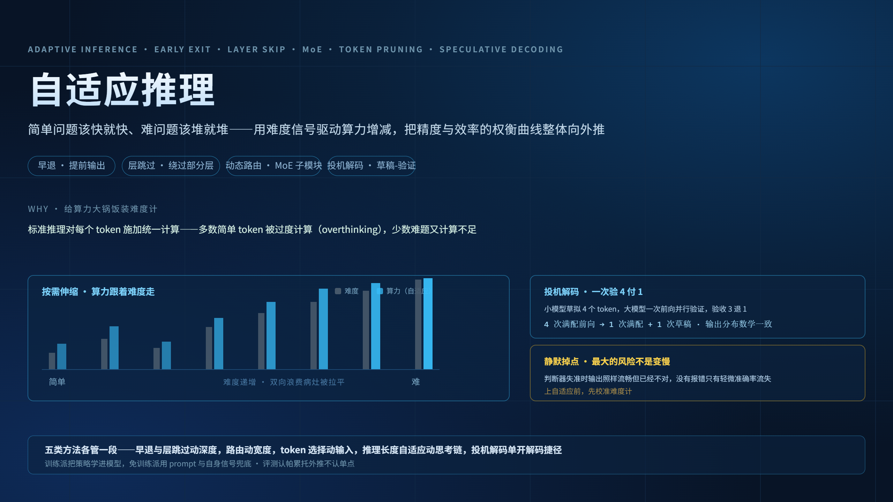

# 自适应推理



---

## 摘要

自适应推理主张计算资源应随输入难度与不确定性动态分配，而非对所有输入施加统一计算量。标准推理对每个 token 花费同样的计算，简单输入被过度计算，困难输入又计算不足；自适应推理用难度信号驱动增减决策，在深度、宽度、输入与推理长度四个维度按需伸缩，并以投机解码开辟解码捷径，其价值在于把精度与效率的权衡曲线整体向外推。最大的风险不是变慢而是判断器失准带来的静默掉点。

**关键词**：自适应推理；早退；层跳过；混合专家；投机解码；测试时计算；置信度校准

## 1 背景

标准 Transformer 是算力大锅饭，不管 token 是虚词还是定理关键词，都过满配的计算，而输入难度实际差着量级。病灶是双向浪费，多数简单 token 被过度计算（overthinking），少数难题又计算不足。自适应推理与普通效率优化的分野在于，效率关注「缩短」，自适应关注「按需伸缩」，简单的问题该快就快，难的问题该堆就堆。

形式化地看，可建模为一个策略优化问题，在任务性能与计算成本的双重目标下学习分配策略，其价值不是追求单点最优，而是把精度与效率的权衡曲线整体向外推，即帕累托前沿的改善。均匀算力与难度分布的错配如图 1 所示。

```
输入:  今天    天气    真好    ，所以   我们    证明    哥德巴赫   猜想
算力:  ██      ██      ██      ██      ██      ██      ██        ██
难度:  ▁       ▂       ▁       ▂       ▂       ████    ██████    █████
```

<p align="center">图 1 均匀算力与实际难度分布的错配</p>

## 2 技术方法

方法谱系按「什么被自适应」分为五类，先看与本文主线最近的三类。

### 2.1 早退

在网络中间层设置出口，样本置信度足够时提前输出，不再经过后续层 [[1]](#ref-1)。出口判据有置信度阈值、熵、边际以及学习到的停止策略；子类型从单出口、多出口到位置本身可学习的动态出口调度。优势是实现简单且对硬件友好，难点在出口策略的跨域泛化。

### 2.2 层跳过

对简单样本绕过部分层的执行，与早退同属动态深度，差别在于层跳过是「绕过」而非「提前终止」，不要求中间分类器。Mixture-of-Depth 用路由器让多数 token 走浅路径，实测总计算量下降而性能持平 [[2]](#ref-2)。

### 2.3 动态路由

根据输入决定激活哪些子模块。混合专家（MoE）的路由网络为每个 token 选择少量专家，Switch Transformers 采用 Top-1 路由 [[3]](#ref-3)，后续变体使用 Top-2 或 Top-k；另有两支衍生路线，按推理深度分层路由的深度特化 MoE 与不确定性高时激活更多专家的置信度自适应路由。核心挑战是负载均衡与路由训练稳定性。MoE 严格说改变的是宽度而非深度，但与早退共享「按 token 分配算力」的内核。

### 2.4 Token 选择

跳过对输出贡献小的 token 或空间位置。视觉场景用动态分辨率、区域裁剪与 patch 选择，语言场景对应 token 剪枝与稀疏注意力中的 token 选择。Byte Latent Transformer 按字节熵动态切 patch 是同思想的序列粒度版本 [[4]](#ref-4)，难处切细、易处切粗。

### 2.5 推理长度自适应

大模型场景下的核心目标是简单问题短链输出、困难问题延长推理链，策略有四档，置信度或答案稳定性驱动的早停、难度估计驱动的长度调制、分块推理按需展开，以及用强化学习训练「何时停止」的停止策略 [[5]](#ref-5)。工业级验证是测试时计算扩展的研究结论，在小模型上多花测试时算力可以胜过参数大一个量级的模型 [[6]](#ref-6)，o1 类推理模型即此路线的落地。有评测报告推理长度可缩减约一成到五成而不掉准确率 [[5]](#ref-5)。

## 3 解码捷径

投机解码值得单列，因为它是工业界落地最广的自适应手段，且不改变模型本身。机制是小模型先草拟多个后续 token，大模型一次前向并行验证，接受的部分是零成本净收益，拒绝的部分只损失草稿成本，数学上保证输出分布与目标模型一致 [[7]](#ref-7)，完整流程如图 2 所示。

```
小模型草稿:  今天 → 天气 → 真好 → 不错       （一次吐 4 个，便宜）
大模型验证:  并行核验 4 个，接受 3 个，退 1 个 （一次满配，验 4 付 1）
净效果:      原本 4 次满配前向 → 1 次满配 + 1 次草稿
```

<p align="center">图 2 投机解码的草稿验证流程</p>

LayerSkip 把该思想推到极致，同一模型浅层当草稿器、全层当验证器，早退与自投机合成一套端到端方案 [[8]](#ref-8)。后续工作沿两条线深化，SpecEE 用投机模型把早退预测器的搜索空间缩小到投机 token 候选上 [[9]](#ref-9)，DEL 按上下文动态选退出层与草稿长度 [[10]](#ref-10)。经济账的关键变量是接受率，草稿与目标分布越接近越赚，任务越发散越亏，代码与结构化文本接受率高收益大，创意写作收益趋零。

## 4 实现范式

### 4.1 训练派

- **强化学习**，把计算分配作为策略动作，以任务性能加计算成本的复合奖励优化 [[5]](#ref-5)；
- **监督微调**，用带可变推理长度或出口标签的数据，让模型内化自适应行为；
- **学习控制器**，单独训练轻量模块预测出口时机、路由决策或推理长度。

### 4.2 免训练派

- **提示条件化**，prompt 指令直接控制推理深度，如简要回答或详细推理；
- **反馈驱动终止**，用置信度、答案稳定性或熵等自身信号触发停止；
- **模块化组合**，推理时动态组合不同能力的模块按需调用。

两派的分工是，训练派上限高但要数据与训练资源，且策略偏移的风险与奖励标尺直接相关，免训练派零成本上线，但上限受制于底座已有能力。

## 5 关键机制

### 5.1 难度信号

判断「难不难」的信号分两族。基于输出的有 softmax 置信度、熵与边际；基于内部状态的有隐藏状态范数、表示稳定性与自我确定性。两族信号都受同一个威胁：模型置信度并非天然可靠，自由生成场景的 token 置信度欠校准 [[11]](#ref-11)，RLHF 后校准进一步退化，未经校准的置信度会导致过早自信退出。

### 5.2 停止策略

静态阈值简单但难以跨模型与数据集迁移；输入自适应阈值按样本难度动态调节退出门槛；在线学习策略用 Bandit 或强化学习在服务中持续调整退出决策。

### 5.3 权衡度量

核心指标是在给定计算预算下最大化精度，或在给定精度下最小化计算量，常用度量有平均每样本 FLOPs、推理 token 数与延迟。自适应方法的价值判据是把权衡曲线向外推的幅度，而非任何单点数字。

## 6 评测与应用

### 6.1 评测要点

结果层看准确率与 Pass@k，效率层看平均推理 token 数、FLOPs、延迟与能耗，两层必须同时报告才能定位帕累托改善。一个常见误区是更高的最终准确率不等于更强的自适应能力，可能仅来自更多采样或测试时搜索；真正的自适应证据有两类，跨任务自适应看习得的分配策略能否迁移到新问题，任务内自适应看面对新证据时能否修订假设。

### 6.2 应用场景

- **边缘与端侧推理**，算力内存受限设备上按需分配计算，如移动端 LLM 与车载系统；
- **LLM 服务降本**，避免简单查询产生冗长思维链，直接砍推理账单；
- **实时决策系统**，延迟约束下简单情形快速通过、困难情形深入推理。

## 7 边界与对照

- **静默掉点**。判断器失准时输出照样流畅但已经不对，没有报错只有轻微的准确率流失，比匀速慢更难察觉，上自适应前先校准难度计。
- **真实服务缩水**。跳层与早退破坏静态 batching 与 KV Cache 的规整性，论文中的加速比在真实服务上通常减半。
- **算力放大错误方向**。测试时算力堆在错误方向上等于定向放大错误，长思考链自带绕圈与偏好继续思考的失效模式。
- **跨领域同构**。认知心理学中的自适应推理是个体按任务需求调整推理策略，Newell 的认知统一理论把这类适应刻画为理性主体在问题空间中按目标与资源切换行为 [[12]](#ref-12)，与 LLM 自适应推理共享「难度感知、资源切换、效果反馈」的同构结构。

## 总结

自适应推理给算力大锅饭装难度计，五类方法各管一段，早退与层跳过动深度、路由动宽度、token 选择动输入、推理长度自适应动思考链，投机解码单开解码捷径。难度信号驱动增减决策，训练派把策略学进模型、免训练派用 prompt 与自身信号兜底。评测认帕累托不认单点，落地的最大风险不是慢而是险，判断器失准就是静默掉点，先校准难度计再谈省算力。

---

## 参考文献

<a id="ref-1"></a>[1] T. Schuster, A. Fisch, J. Gupta, M. Dehghani, D. Bahri, V. Q. Tran, Y. Tay, D. Metzler. ["Confident Adaptive Language Modeling."](https://arxiv.org/abs/2207.07061) *arXiv:2207.07061*, 2022.  
<a id="ref-2"></a>[2] D. Raposo, S. Ritter, B. Richards, et al. ["Mixture-of-Depths: Dynamically Allocating Compute in Transformer-Based Language Models."](https://arxiv.org/abs/2404.02258) *arXiv:2404.02258*, 2024.  
<a id="ref-3"></a>[3] W. Fedus, B. Zoph, N. Shazeer. ["Switch Transformers: Scaling to Trillion Parameter Models with Simple and Efficient Sparsity."](https://arxiv.org/abs/2101.03961) *arXiv:2101.03961*, 2022.  
<a id="ref-4"></a>[4] A. Pagnoni, R. Pasunuru, P. Rodriguez, et al. ["Byte Latent Transformer: Patches Scale Better Than Tokens."](https://arxiv.org/abs/2412.09871) *arXiv:2412.09871*, 2024.  
<a id="ref-5"></a>[5] A. Kumar, Z. Zhuang, et al. ["Training Language Models to Reason Efficiently."](https://arxiv.org/abs/2502.04463) *arXiv:2502.04463*, 2025.  
<a id="ref-6"></a>[6] C. Snell, J. Lee, K. Xu, A. Kumar. ["Scaling LLM Test-Time Compute Optimally can be More Effective than Scaling Model Parameters."](https://arxiv.org/abs/2408.03314) *arXiv:2408.03314*, 2024.  
<a id="ref-7"></a>[7] C. Chen, S. Borgeaud, G. Irving, J.-B. Alayrac, L. Sifre. ["Accelerating Large Language Model Decoding with Speculative Sampling."](https://arxiv.org/abs/2302.01318) *arXiv:2302.01318*, 2023.  
<a id="ref-8"></a>[8] M. Elhoushi, A. Shrivastava, D. Liskovich, et al. ["LayerSkip: Enabling Early-Exit Inference and Self-Speculative Decoding."](https://arxiv.org/abs/2404.16710) *arXiv:2404.16710*, 2024.  
<a id="ref-9"></a>[9] J. Xu, J. Pan, Y. Zhou, S. Chen, J. Li, Y. Lian, J. Wu, G. Dai. ["SpecEE: Accelerating Large Language Model Inference with Speculative Early Exiting."](https://doi.org/10.1145/3695053.3730996) *ISCA*, 2025, arXiv:2504.08850.  
<a id="ref-10"></a>[10] H. Entezari Zarch, L. Gao, C. Jiang, M. Annavaram. ["DEL: Context-Aware Dynamic Exit Layer for Efficient Self-Speculative Decoding."](https://openreview.net/forum?id=cAFxSuXQvT) *COLM*, 2025, arXiv:2504.05598.  
<a id="ref-11"></a>[11] S. Kadavath, T. Conerly, A. Askell, et al. ["Language Models (Mostly) Know What They Know."](https://arxiv.org/abs/2207.05221) *arXiv:2207.05221*, 2022.  
<a id="ref-12"></a>[12] A. Newell. ["Unified Theories of Cognition."](https://www.hup.harvard.edu/books/9780674921016) *Harvard University Press*, 1990.  

## 知识点树

```
自适应推理
│
├── 1 问题定义
│   ├── 大锅饭病灶（均匀算力 vs 十倍难度差）
│   ├── 按需伸缩命题（区别于单纯缩短的效率优化）
│   └── 帕累托框架（权衡曲线外推而非单点最优）
│
├── 2 技术方法
│   ├── 早退（中间层出口 · CALM · 置信度/熵判据）
│   ├── 层跳过（绕过而非终止 · 无需中间分类器 · MoD）
│   ├── 动态路由（MoE Top-k 专家 · 负载均衡挑战）
│   ├── Token 选择（视觉动态分辨率 · 语言 token 剪枝 · BLT 熵切分）
│   └── 推理长度自适应（早停/难度调制/分块/RL 停止策略）
│
├── 3 解码捷径
│   ├── 投机解码（草稿-验证 · 分布一致性保证）
│   ├── LayerSkip（浅层草稿 · 全层验证 · 端到端）
│   └── 接受率经济账（代码高收益 · 创意写作收益趋零）
│
├── 4 实现范式
│   ├── 训练派（RL 策略 · SFT 内化 · 轻量控制器）
│   └── 免训练派（prompt 控深 · 反馈终止 · 模块组合）
│
├── 5 关键机制
│   ├── 难度信号（输出族 vs 内部状态族）
│   ├── 停止策略（静态阈值/自适应阈值/在线学习）
│   └── 校准陷阱（自信地错 → 过早退出）
│
├── 6 评测与应用
│   ├── 帕累托评测（准确率与效率同时报告）
│   ├── 评测误区（高准确率 ≠ 强自适应）
│   └── 场景（端侧/服务降本/实时决策）
│
└── 7 边界与对照
    ├── 静默掉点（无报错的准确率流失）
    ├── 真实服务缩水（batching 与 KV Cache 规整性）
    └── 跨领域同构（认知心理学 · Newell 统一认知理论）
```
