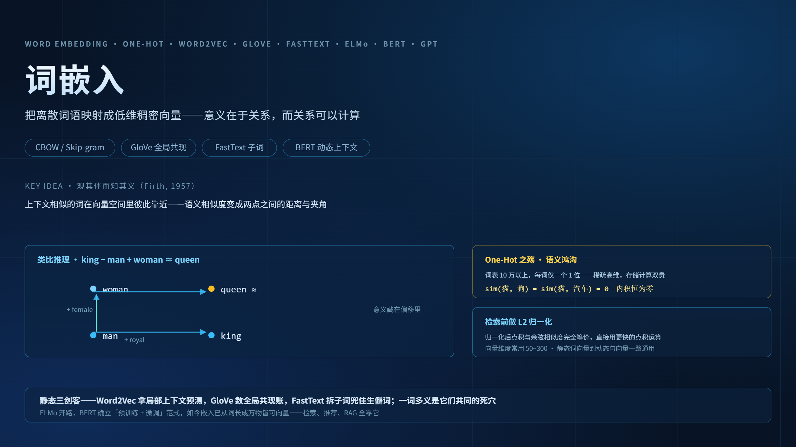
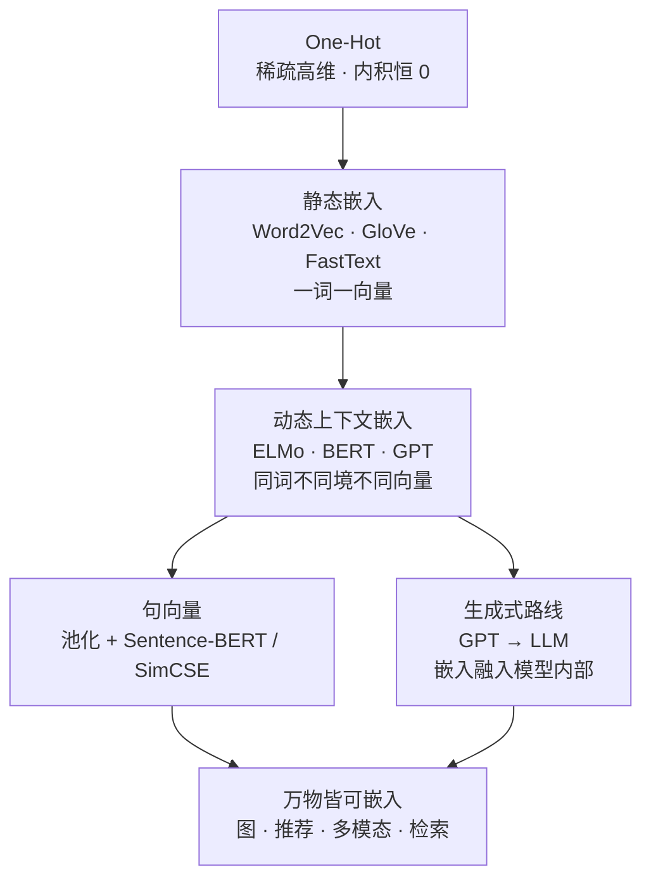
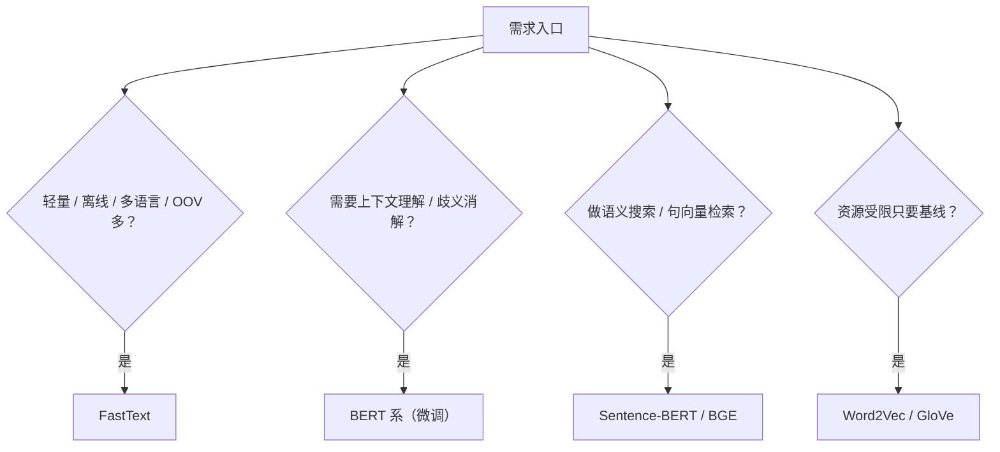

# 词嵌入

## 摘要

词嵌入把离散词语映射为低维稠密向量，使语义关系成为向量空间中可计算的几何关系。本文以分布式假设为理论起点，梳理 Word2Vec、GloVe、FastText 三类静态嵌入的预测式与统计式路线及其共性局限，进而呈现 ELMo、BERT、GPT 接力的动态上下文革命与池化句向量，最后给出嵌入质量的内外两轨评估、应用场景与工程选型决策，并以万物皆可嵌入收束前沿图景。

**关键词**：词嵌入；分布式假设；Word2Vec；GloVe；FastText；BERT；句向量；对比学习

---

## 1 问题根源与理论根基

### 1.1 从 One-Hot 的缺陷说起

在词嵌入出现之前，NLP 最常用的是独热编码（One-Hot）：每个词表示成长度为词表大小 $V$ 的向量，只有对应位置是 1，其余全为 0。它有三个致命缺陷：

1. **维度灾难**：实际词表常达 10 万以上，向量维度巨大，存储与计算成本高；
2. **稀疏性**：向量几乎全为 0，不适合作为神经网络的输入；
3. **语义鸿沟**：最本质的问题——任意两个 One-Hot 向量的内积恒为 0，「猫」和「狗」在数学上与「猫」和「汽车」一样毫无关系，模型完全无法感知语义相似性。

词嵌入的解决方案是把稀疏高维向量映射为低维稠密连续向量（通常 50~300 维），核心理论依据是 1957 年语言学家 Firth 提出的分布式假设 [[1]](#ref-1)——上下文相似的词，语义也相似。由于「猫」和「狗」都经常出现在「宠物」「喂食」「可爱」附近，它们在训练后会自然获得相近的向量；而「汽车」的上下文完全不同，向量自然远离。

### 1.2 类比推理与相似度度量

训练良好的词嵌入有一个著名的类比推理性质：

$$\vec{king} - \vec{man} + \vec{woman} \approx \vec{queen}$$

国家与首都（北京之于中国，正如东京之于日本）、动词时态（walking 之于 walked，正如 swimming 之于 swam）等语义关系，都呈现规律的向量偏移 [[3]](#ref-3)。

度量两个词向量的相似度，常用三种方式（见表 1）：

| 度量 | 公式 | 特点 |
|---|---|---|
| 余弦相似度 | $\cos(\theta) = \frac{u \cdot v}{\|u\|\|v\|}$ | 只看方向，不受向量长度影响，最常用 |
| 欧氏距离 | $\|u - v\|_2$ | 直观，但受维度增长影响 |
| 点积 | $u \cdot v$ | 计算最快 |

表 1 词向量相似度度量方式对比

一个重要的工程等价关系：对向量做 L2 归一化后，点积与余弦相似度完全等价。这就是向量数据库中常用点积实现余弦检索的原因。

## 2 静态嵌入方法谱系

所谓「静态」，是指每个词在整个语料中只有一个固定向量。

### 2.1 Word2Vec：预测式学习

Word2Vec 由 Mikolov 团队提出 [[2]](#ref-2) [[3]](#ref-3)，本质是一个浅层神经网络，有两种训练架构：

- **CBOW（连续词袋）**：用上下文词预测中心词。例如给定 "the cat ___ on the" 预测 "sat"，训练快，对高频词效果好；
- **Skip-gram**：用中心词预测上下文词。给定 "sat" 去预测 "the""cat""on""the"，对低频词效果更好，精度更高。

以 Skip-gram 为例，记 $v_C$ 为中心词输入向量、$u_w$ 为词 $w$ 的输出向量，训练目标是最大化：

$$P(w_O \mid w_C) = \frac{\exp(u_O \cdot v_C)}{\sum_{w \in V} \exp(u_w \cdot v_C)}$$

式中的输出矩阵要遍历整个词表（可达 10 万以上），每步训练复杂度 $O(V)$，代价极高。**负采样** [[3]](#ref-3) 的解法是不做全词表 Softmax，把多分类转化为二分类——判断「（中心词，上下文词）」这个词对是真实共现还是随机拼凑的负样本，每个正样本只需采样 5~20 个负样本对比训练：

$$\log \sigma(v_C \cdot u_O) + \sum_{k=1}^{K} \mathbb{E}_{u_k} \left[\log \sigma(-v_C \cdot u_k)\right]$$

另一个优化技巧是**层次 Softmax**：用 Huffman 树组织词表，把复杂度从 $O(V)$ 降到 $O(\log V)$ [[2]](#ref-2)。此外还有高频词下采样（对 the、of 一类词按频率丢弃）与动态窗口（训练时在 $[1, w]$ 内均匀随机缩短实际窗口）。

训练完成后，网络中保留两套参数：输入矩阵与输出矩阵。常见实现取输入矩阵作为词向量；不过也有实现取输出矩阵，或取二者的平均、拼接，具体取法视实现而定，这一点常被忽略。

### 2.2 GloVe：统计式学习

Word2Vec 只利用了局部上下文窗口，GloVe（Stanford, 2014）认为应该同时利用全局共现统计 [[4]](#ref-4)：先统计整个语料中词对共现次数 $X_{ij}$，再做加权最小二乘拟合：

$$J = \sum_{i,j} f(X_{ij}) \left( w_i^T \tilde{w}_j + b_i + \tilde{b}_j - \log X_{ij} \right)^2$$

三个容易写错的细节：

- $w_i$ 是中心词向量，$\tilde{w}_j$ 是上下文词向量，两套独立参数；
- $b_i$、$\tilde{b}_j$ 是对应偏置项；
- 权重函数 $f(X)$ 在 $x < x_{max}$ 时取 $(x/x_{max})^{\alpha}$（通常 $\alpha = 0.75$），此后恒为 1，作用是抑制高频词（the、of 等）主导损失。

训练完成后通常取 $w_i + \tilde{w}_i$（或二者平均）作为最终词向量。GloVe 与 Word2Vec 性能相当，实践中常互为基线 [[4]](#ref-4)。

### 2.3 FastText：子词建模

FastText（Facebook 提出，2016 年提交、2017 年见刊 TACL）的独到之处是把每个词拆成字符 n-gram，词向量等于其所有子词向量之和 [[5]](#ref-5)。例如 "where" 可拆出 "wh""whe""her""ere" 等 n-gram。

这带来一个关键能力：解决 OOV（未登录词）问题——即使某个词训练时从未出现，也可以用它的字符 n-gram 拼出向量。FastText 因此特别适合黏着语等形态丰富的语言（如芬兰语），中文场景则由字级子词获益；对拼写不规范的社交媒体文本同样稳健，至今仍是轻量级多语言场景的高性价比选择 [[5]](#ref-5)。

### 2.4 传统方法

在神经网络方法之前，已有基于矩阵分解的语义表示：

- **LSA（潜在语义分析）**：对「词-文档」矩阵做 SVD 分解，捕捉潜在语义维度；
- **PPMI + SVD**：用正向点互信息构造「词-词」矩阵再分解，且在理论上与 Skip-gram 带负采样的隐式目标等价 [[6]](#ref-6)。

### 2.5 静态嵌入的共性局限

无论 Word2Vec、GloVe 还是 FastText，都存在三个根本限制：

1. **一词一向量，无法处理一词多义**："bank" 无论指「河岸」还是「银行」，都对应同一个向量；
2. **无法捕捉语序与句法结构**：「猫追狗」和「狗追猫」得到相同的词袋表示；
3. **对未登录词无能为力**（FastText 的子词机制除外）。

这些局限直接催生了下一场革命。

## 3 动态上下文嵌入

核心思想：同一个词在不同语境中，应该得到不同的向量表示。从 One-Hot 到万物嵌入的演进谱系如图 1 所示。

图 1 从 One-Hot 到万物嵌入的表示学习演进谱系

### 3.1 ELMo：先驱

ELMo（Allen AI, 2018）用双向 LSTM 语言模型建模上下文，词向量是各层 LSTM 隐状态的加权组合，权重可在下游任务中学习 [[7]](#ref-7)。它以特征感知（feature-based）的方式使用——把 ELMo 向量作为附加特征喂给下游模型，不改变下游结构，为 BERT 铺平了道路，但计算复杂度较高。

### 3.2 BERT：范式确立

BERT（Google, 2018）基于双向 Transformer 编码器，通过两个任务预训练 [[8]](#ref-8)：

- **MLM（掩码语言建模）**：随机遮住约 15% 的 token，让模型根据上下文预测被遮的词——本质是「完形填空」，实现真正的双向理解；
- **NSP（下一句预测）**：判断两个句子是否连续。

需要加注的是：后续 RoBERTa 的研究表明 NSP 的贡献有限——去掉 NSP 后性能不降反升，因此后续多数模型已移除该任务，只保留 MLM [[9]](#ref-9)。

BERT 确立了「预训练 + 微调」范式：在海量无标注语料上预训练，再在具体任务上微调少量参数即可。由于注意力机制依赖完整上下文，"bank" 在 "river bank" 与 "bank account" 中会得到不同的向量——一词多义问题从根本上得到解决。衍生家族包括 RoBERTa（更强训练策略）[[9]](#ref-9)、ALBERT（参数共享）、DistilBERT（蒸馏压缩）与中文场景的 MacBERT。

### 3.3 GPT 系列：另一条路线

GPT（OpenAI）采用单向（从左到右）Transformer 解码器做生成式预训练 [[10]](#ref-10)。它牺牲了双向理解，换取了生成能力，最终演化为今天的大语言模型——词嵌入作为独立技术，已融入模型内部的嵌入层与注意力机制中。

### 3.4 从词向量到句向量：池化策略

Transformer 输出的是 token 级向量序列，要得到句子级向量需要池化，三种策略见表 2：

| 池化策略 | 做法 | 说明 |
|---|---|---|
| CLS pooling | 取首个 `[CLS]` token 的向量 | 原始 BERT 的设计，未经任务微调时效果差 |
| Mean pooling | 平均所有 token 向量 | 稳健常用，多数句向量模型的默认选择 |
| Last-token pooling | 取最后一个 token | 生成式 LLM 底座句向量常用（如 e5-mistral） |

表 2 token 向量到句向量的三种池化策略

注意：经典 E5（large/base 档）官方使用 mean pooling，last-token 是指令微调的生成式底座（如 e5-mistral、LLM2Vec）采用的方式，二者不可混淆。

句向量领域的代表工作：Sentence-BERT（孪生网络结构，使句向量可高效预计算，适合大规模检索）[[11]](#ref-11)、SimCSE（用对比学习训练句向量）[[12]](#ref-12)，以及中文场景的 BGE、M3E、text2vec。

## 4 嵌入质量评估

### 4.1 内在评估：直接考察词向量

- **语义相似度数据集**：WordSim-353、SimLex-999、中文 CA8，让模型给词对打相似度分后与人工标注对比，计算 Spearman 相关系数；
- **类比推理**：Google analogy test set（如 "king − man + woman = ?"），用类比准确率衡量；
- **最近邻检索**：P@k、MRR、Recall@k。

### 4.2 外在评估：看下游任务表现

把嵌入喂给文本分类、情感分析、NER、检索、问答等任务，用 Accuracy、F1、mAP 等指标衡量。内在评估快但不一定预测实际效果，最终仍需外在评估验证。

## 5 应用场景

词嵌入的用途远不止查询相似词：

1. **语义搜索 / 信息检索**：将查询与文档映射到同一向量空间，以相似度匹配，支持查询扩展与短文本理解；
2. **推荐系统**：把用户行为、物品描述嵌入向量空间做相似性推荐；
3. **文本分类与情感分析**：词向量作为分类器的输入特征；
4. **聚类、去重、关键词抽取**；
5. **RAG（检索增强生成）**：Embedding 模型 + 向量数据库 + LLM 的组合，是当前知识问答系统的标准架构；
6. **跨模态扩展**：CLIP 将「嵌入」思想推广到图文联合空间，实现以文搜图 [[15]](#ref-15)。

## 6 工程实践与选型

### 6.1 获取嵌入的方式

获取词向量的常见方式见表 3。

| 方式 | 适用场景 |
|---|---|
| 直接下载预训练向量 | GloVe、fastText 官方提供多语言向量 |
| 库调用 | gensim（Word2Vec）、HuggingFace Transformers（BERT 系） |
| 领域微调 | 通用向量在医疗、法律等领域效果不佳时 |
| 从头训练 | 仅当领域非常特殊且语料充足时 |

表 3 获取词嵌入的四种方式

### 6.2 超参数经验值

- 向量维度：300 是经典默认值；
- 窗口大小：5~10；负采样数：5~20；
- 数值细节：在检索或计算余弦相似度之前做 L2 归一化——配合点积可直接复用更快的距离实现，等价性论证见 §1.2。

### 6.3 向量存储与检索

大规模嵌入检索依赖向量数据库（Faiss、Milvus、Qdrant、Pinecone）与近似最近邻搜索（ANN）算法：HNSW（图索引，高召回低延迟）、IVF（倒排文件索引）、PQ（乘积量化压缩）。

### 6.4 选型决策

选型决策路径如图 2 所示。

图 2 词嵌入与句向量模型选型决策流程

## 7 万物嵌入与前沿泛化

「嵌入」早已超越词的范畴，成为表示学习的通用范式：

- **图节点嵌入**：DeepWalk、node2vec 把社交网络中的节点映射到向量空间；
- **用户 / 商品嵌入**：推荐系统中的协同过滤表示；
- **多模态嵌入**：CLIP、BLIP 建立图文联合空间 [[15]](#ref-15)；
- **对比学习**：SimCLR（视觉）、SimCSE（句向量），核心思想是拉近正样本对、推远负样本对 [[12]](#ref-12)，已成为训练嵌入的主流方法；
- **检索嵌入**：DPR（密集段落检索）[[13]](#ref-13)、ColBERT（延迟交互，token 级细粒度匹配）[[14]](#ref-14) 把检索质量推向新高度；
- **大模型时代**：LLM 内部的嵌入层与上下文注意力机制可视为「动态嵌入」的极致演化——词嵌入作为独立技术已经融入模型本身。

## 总结

词嵌入就是让词的意思变成坐标，谁跟谁近全看上下文关系。Word2Vec 拿局部上下文猜词，GloVe 数全网共现的账，FastText 把词拆成字母碎片兜住生僻词，可它们都倒在同一个坑上——一个词永远只有一个向量，多义词分不开。ELMo 先试动态，BERT 把上下文理解做扎实，GPT 一路走向生成。评测别只信相似度榜单，最后还得拿到下游任务见真章。如今嵌入早已从词长成万物皆可向量，检索、推荐、RAG 全靠它，当年那句观其伴而知其义，到今天依然管用。

---

## 参考文献

[1] J. R. Firth. ["A Synopsis of Linguistic Theory 1930–1955."](https://en.wikipedia.org/wiki/J._R._R._Firth) *Studies in Linguistic Analysis*, 1957.  
[2] T. Mikolov, K. Chen, G. Corrado, J. Dean. ["Efficient Estimation of Word Representations in Vector Space."](https://arxiv.org/abs/1301.3781) *arXiv:1301.3781*, 2013.  
[3] T. Mikolov, I. Sutskever, K. Chen, G. Corrado, J. Dean. ["Distributed Representations of Words and Phrases and their Compositionality."](https://arxiv.org/abs/1310.4546) *NeurIPS*, 2013.  
[4] J. Pennington, R. Socher, C. D. Manning. ["GloVe: Global Vectors for Word Representation."](https://aclanthology.org/D14-1162/) *EMNLP*, 2014.  
[5] P. Bojanowski, E. Grave, A. Joulin, T. Mikolov. ["Enriching Word Vectors with Subword Information."](https://arxiv.org/abs/1607.04606) *TACL*, 2017.  
[6] O. Levy, Y. Goldberg. ["Neural Word Embedding as Implicit Matrix Factorization."](https://aclanthology.org/N14-1047/) *NAACL*, 2014.  
[7] M. E. Peters, M. Neumann, M. Iyyer, M. Gardner, C. Clark, K. Lee, L. Zettlemoyer. ["Deep Contextualized Word Representations."](https://aclanthology.org/N18-1202/) *NAACL*, 2018.  
[8] J. Devlin, M.-W. Chang, K. Lee, K. Toutanova. ["BERT: Pre-training of Deep Bidirectional Transformers for Language Understanding."](https://aclanthology.org/N19-1423/) *NAACL*, 2019.  
[9] Y. Liu, M. Ott, N. Goyal, J. Du, M. Joshi, D. Chen, O. Levy, M. Lewis, L. Zettlemoyer, V. Stoyanov. ["RoBERTa: A Robustly Optimized BERT Pretraining Approach."](https://arxiv.org/abs/1907.11692) *arXiv:1907.11692*, 2019.  
[10] A. Radford, K. Narasimhan, T. Salimans, I. Sutskever. ["Improving Language Understanding by Generative Pre-Training."](https://cdn.openai.com/research-covers/language-unsupervised/language_understanding_paper.pdf) *OpenAI*, 2018.  
[11] N. Reimers, I. Gurevych. ["Sentence-BERT: Sentence Embeddings using Siamese BERT-Networks."](https://aclanthology.org/D19-1410/) *EMNLP*, 2019.  
[12] T. Gao, X. Yao, D. Chen. ["SimCSE: Simple Contrastive Learning of Sentence Embeddings."](https://aclanthology.org/2021.emnlp-main.752/) *EMNLP*, 2021.  
[13] V. Karpukhin, B. Oğuz, S. Min, P. Lewis, L. Zettlemoyer, Y. Wu. ["Dense Passage Retrieval for Open-Domain Question Answering."](https://aclanthology.org/2020.emnlp-main.550/) *EMNLP*, 2020.  
[14] O. Khattab, M. Zaharia. ["ColBERT: Efficient and Effective Passage Search via Contextualized Late Interaction over BM25."](https://dl.acm.org/doi/10.1145/3397271.3401075) *SIGIR*, 2020.  
[15] A. Radford, J. W. Kim, C. Hallacy, A. Ramesh, G. Goh, S. Agarwal, G. Sastry, A. Askell, P. Mishkin, J. Clark, G. Krueger, I. Sutskever. ["Learning Transferable Visual Models From Natural Language Supervision."](https://arxiv.org/abs/2103.00020) *ICML*, 2021.  
