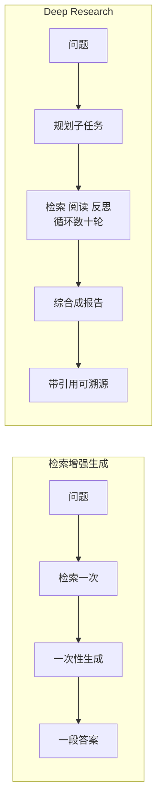

# DeepResearch与RAG分野

## 对比表

| 维度 | 检索增强生成（RAG） | Deep Research |
|---|---|---|
| 检索轮次 | 一次检索后即生成 | 循环数十轮 |
| 路径来源 | 流程写死，由工程师预设 | 模型自主决定，遇死路可回退、转向 |
| 产物形态 | 一段答案 | 结构化报告 + 句子级引用 |
| 内核能力 | 检索 + 拼装 | 检索 + 规划 + 反思 + 综合写作 |

表1 单轮检索与多步研究的四维差异

## 核心结论

- 二者常被混为一谈，但根本差别只有一个：**路径由谁决定**。
- RAG 的流程由工程师预设，步骤固定、可预测、成本可控；Deep Research 的路径由模型在运行中生成，能处理预设外的分支。
- **判据是会不会自己决定下一步查什么**，而不是看检索了多少次——一个写死的二十轮流水线，仍然只是 RAG。

## 要点拆解

### 为什么会分化

分野来自训练方式，不是产品包装。RAG 是工程拼装，模型本身没被训练去规划检索；Deep Research 用端到端强化学习让模型在真实浏览任务上习得规划、回退与转向能力。详见 [[端到端强化学习研究]]。

### 各自适合什么

| 场景 | 更适合 | 理由 |
|---|---|---|
| 单点事实、明确文档问答 | RAG | 一次检索足够，成本与延迟都低 |
| 跨多源综述、需交叉验证 | Deep Research | 需要多轮追加检索与路径调整 |
| 要求低延迟在线问答 | RAG | Deep Research 单次数分钟起 |
| 产出可溯源的初稿 | Deep Research | 句子级引用是硬需求 |

### 共存关系

两者并非替代关系。生产系统常见形态是：RAG 做底座检索与快速应答，遇到需要跨源综合的复杂请求再升级到 Deep Research 路径。参见 [[RAG检索优化五层]] 与 [[DeepResearch能力边界与风险]]。

## 相关页面

- [[Deep Research定义]]：判据与四要素的出处
- [[端到端强化学习研究]]：能力来源的机制说明
- [[Agent循环]]：自主决策循环的通用形态
- [[RAG准确率保障体系]]：RAG 侧的可靠性手段
- [[DeepResearch总览]]：领域入口页

## 参考来源

- [[raw/papers/Deep Research.md]]
