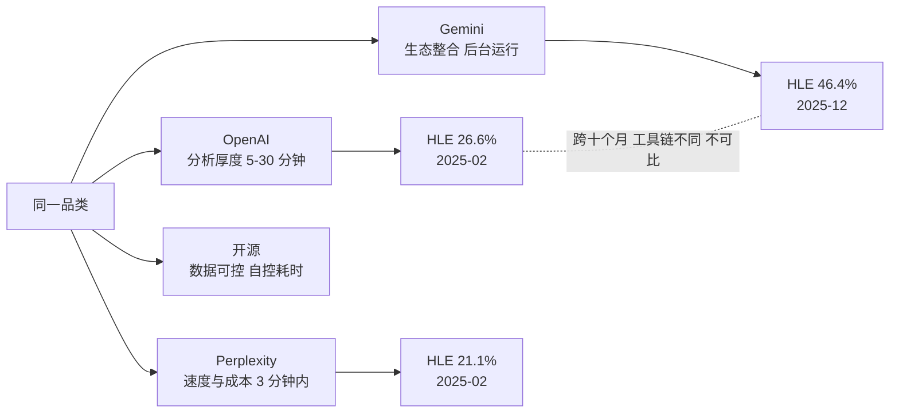

# DeepResearch路线对比

## 对比表

| 方案 | 底座 | 单任务耗时 | HLE | 侧重 |
|---|---|---|---|---|
| OpenAI Deep Research | o3 早期版本 | 5–30 分钟 | 26.6% | 分析厚度 |
| Perplexity Deep Research | 定制 DeepSeek R1 + 测试时计算扩展 | < 3 分钟 | 21.1% | 速度与成本 |
| Gemini Deep Research（2025-12 API 版） | Gemini 3 Pro | 后台运行 | 46.4% | 生态整合 |
| 开源方案 | Qwen 系 32B 等 | 自控 | — | 数据可控 |

表1 四条路线的取舍对照

## 核心结论

- 同一品类，各方取舍不同：**深度、速度、生态、可控**四个方向各占一个。
- 这四个数字**不可直接比较**，因为代际与工具链都不同。
- 正确的读法不是「该公司强于该公司」，而是「同一时期内，这一品类在快速迭代」。

## 要点拆解

### 为什么不可比

OpenAI 的 26.6% 是 2025 年 2 月 o3 时代的成绩，Gemini 的 46.4% 是 2025 年 12 月 Gemini 3 Pro 的成绩，相隔十个月且工具链不同。

Gemini 侧 46.4% 与 BrowseComp 59.2% 出自 2025 年 12 月开放 API 时的官方口径，更强的 Max 版本 HLE 达 54.6%。把它当作强弱依据是误读。

### 取舍各自的代价

| 路线 | 优势 | 代价 |
|---|---|---|
| 分析厚度 | 报告更厚、引用更密 | 单次数十分钟，批量场景成本高 |
| 速度与成本 | 三分钟内交付 | 调查深度受限，适合中等复杂问题 |
| 生态整合 | 后台运行、与办公套件打通 | 依赖平台生态，可迁移性弱 |
| 开源可控 | 数据不出域、可微调 | 效果依赖自研 RL 与工程投入 |

### 怎么看这类横评

先问三个变量：什么配置、几次尝试、哪版题库。这三项任一不同，分数即不可比。详见 [[DeepResearch评测基准]] 的口径警示小节。

## 相关页面

- [[DeepResearch评测基准]]：分数怎么读才不出错
- [[DeepResearch开源复现]]：第四条路线的三条具体实现
- [[DeepResearch与RAG分野]]：它与另一品类的分野
- [[DeepResearch总览]]：领域入口页

## 参考来源

- [[raw/papers/Deep Research.md]]
