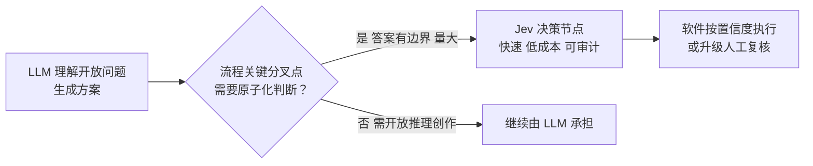

# Jev 与传统 LLM 对比

## 一句话

**LLM 产出「给人看的文本」，Jev 产出「给程序用的判断」**。二者对应卡尼曼双系统的系统二 vs 系统一，互补而非替代。

## 系统对比表

| 维度 | System One 模型（Jev） | 传统 LLM（系统二） |
|---|---|---|
| 输出 | 类型化决策（数据） | 自由文本（字符串） |
| 延迟 | 约 70~500 毫秒 | 数秒到数十秒 |
| 成本 | 约 $0.042/百万输入 token、输出免费 | 每次数美分量级 |
| 确定性 | 结构固定、带校准置信度 | 每次措辞可能不同 |
| 擅长 | 分类、路由、评分、守门 | 开放推理、写作、规划 |
| 类比 | 直觉反应 | 深度思考 |

## 成本优势（务必区分口径）

- **厂商口径**：官网称比 LLM 快 **193.6x**、便宜 **444.6x**（System One 形态任务，公司自测自评）。
- **独立实测**：第三方 Every 在一次提取任务上测得约 **25x 更快、580x 更便宜**。
- **质量**：TypeSafe 自家四工作流基准 Jev 得分 67.8%，约与前沿模型打平，成本约为其 1/20。

## 关键差异点

- **多写一句解释就报错**：LLM 生成文本再解析，结构不确定导致下游流水线报错；Jev 输出永远在 schema 内（结构化错误率 0%）。见 [[类型化输出]]。
- **无可靠置信度**：LLM 每次措辞可能不同；Jev 每个决策带校准置信度。见 [[校准置信度]]。
- **速度来源**：Jev 并行采样一次前向计算，LLM 逐 token 自回归。见 [[并行采样机制]]。

## 相关导航

- 模型：[[Jev 决策模型]]
- 品类：[[System One 模型]]
- 总览：[[Jev 决策模型总览]]
- 落地：[[Jev 应用与落地]]
- 素材摘要：[[Jev决策模型·素材摘要]]

