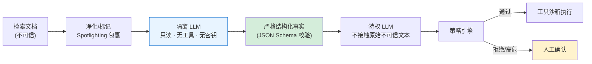

# Prompt 注入架构层防御方案对比

## 核心结论

- 五套方案各有取舍：**SecAlign 是当前"低效用损失 + 低 ASR"的最优点，CaMeL 提供可证明安全但集成复杂度最高，双 LLM 以约 2× token 成本换取结构性隔离。**
- StruQ 对优化攻击仍脆弱（27%/45% ASR），不能作为唯一防线。

## 五方案横向对比

| 方案 | 机制 | 效果 | 出处 |
|---|---|---|---|
| **StruQ** | 提示与数据分双通道，专门训练的 LLM 只遵循提示通道指令 | 抗注入能力显著提升，任务效用损失极小 | USENIX Security 2025[[1]](#ref-1) |
| **SecAlign** | 偏好优化：构建含注入输入/安全输出/不安全输出的偏好数据集 | 首个将各类注入成功率降至 **10% 以下**，对新型攻击有泛化性 | ACM CCS 2025[[2]](#ref-2) |
| **Task Shield** | 从"防有害操作"转向"确保任务对齐"，逐条验证指令与工具调用 | AgentDojo 上攻击成功率 **2.07%**，效用 **69.79%** | ACL 2025[[3]](#ref-3) |
| **双 LLM 架构** | 隔离 LLM（只读无工具）+ 特权 LLM（只接收结构化字段） | 结构性切断"注入→工具"路径 | Design Patterns 2025[[4]](#ref-4) |
| **CaMeL** | 控制流/数据流双模型 + 能力系统插桩 | **可证明安全**，AgentDojo 效用 77%（未防护 84%） | Google DeepMind 2025[[5]](#ref-5) |

## 双 LLM 架构数据流

<b>图1 双 LLM 架构数据流</b>

## 选型建议

- **有微调权限的团队**：优先 SecAlign（效用损失最小、ASR 最低）
- **追求可证明安全**：CaMeL（需重写 Agent 逻辑，集成复杂度最高）
- **快速落地**：双 LLM 架构（不改模型，结构性隔离，但 token 成本翻倍）
- **高频工具调用场景**：Task Shield（测试时防御，但延迟敏感）

## 相关页面

- [[Prompt注入分层防御体系]]：六层防御全景
- [[CaMeL能力沙箱]]：可证明安全架构详解
- [[双LLM模式]]：双 LLM 架构基础
- [[任务对齐验证]]：Task Shield 所属范式
- [[Prompt注入防御成本与误报权衡]]：各方案延迟/成本/效用全景对比

## 参考来源

- [[raw/papers/Prompt注入与防范.md]]

---

[1] S. Chen, J. Piet, C. Sitawarin, D. Wagner. ["StruQ: Defending Against Prompt Injection with Structured Queries."](https://arxiv.org/abs/2402.06363) *USENIX Security*, 2025.
[2] S. Chen et al. ["SecAlign: Defending Against Prompt Injection with Preference Optimization."](https://arxiv.org/abs/2410.05451) *ACM CCS*, 2025.
[3] F. Jia, T. Wu, X. Qin, A. Squicciarini. ["Task Shield: Enforcing Task Alignment to Defend Against Indirect Prompt Injection in LLM Agents."](https://arxiv.org/abs/2412.16682) *ACL*, 2025.
[4] L. Beurer-Kellner et al. ["Design Patterns for Securing LLM Agents against Prompt Injection."](https://arxiv.org/abs/2506.08837) *arXiv*, 2025.
[5] E. Debenedetti et al. ["Defeating Prompt Injections by Design."](https://arxiv.org/abs/2503.18813) *arXiv*, 2025.
