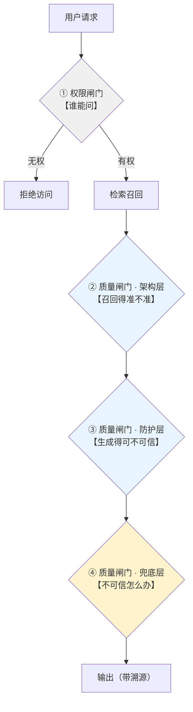

# RAG质量三道闸门对比

## 两组闸门的关系

## 核心结论

**两组闸门正交，不是同一件事**：权限闸门管**可见范围**（数据边界），质量闸门管**可信程度**（结论边界）。有序先后但无替代关系——权限正确不等于内容可信，内容可信也不等于有权访问。

## 逐项对比

| 维度 | RAG 质量三道闸门 | RAG 权限隔离三道闸门 |
|---|---|---|
| 回答的问题 | 答案**可不可信** | 用户**能不能看到** |
| 核心目标 | 压缩出错概率、控制错误代价 | 防止越权访问与数据外泄 |
| 闸门一 | 架构层：混合检索/切片/元数据/生成约束 | 认证闸门：身份与租户边界 |
| 闸门二 | 防护层：幻觉检测/界面溯源/关键词校验 | 行级闸门：记录/文档/字段可见性 |
| 闸门三 | 兜底层：阈值拒答/人工复核/全链路日志 | 字段级闸门：敏感字段脱敏与最小化 |
| 失败后果 | 答案错、结论误导 | 数据泄漏、越权访问 |
| 部署时机 | 事前 + 事中 + 事后全程 | 入库与检索全程 |
| 详见 | [[RAG准确率保障体系]] | [[RAG权限隔离全链路架构]] |

## 交互点（工程上真正要关注的）

两组闸门并非简单叠加，有三个真实交互点：

1. **权限过滤会降低召回覆盖率 → 触发质量闸门拒答**：权限规则过严时召回为空，系统按 [[RAG阈值拒答机制]] 拒答。用户观感是"系统坏了"，实则是权限与质量闸门叠加的结果，排查时需先确认是哪一层拦的。
2. **元数据打标是两套体系的公共依赖**：质量体系用元数据做业务过滤（场景/时间/类别），权限体系用元数据做行级鉴权（租户/权限位）。建议**同一套 metadata schema** 同时承载两类标签，避免两套标注口径打架，参见 [[元数据规范]]、[[向量库metadata过滤能力对比]]。
3. **溯源展示必须做权限二次校验**：[[RAG界面溯源设计]] 会把引文原文暴露给用户，若原文含敏感字段，必须先脱敏再展示，否则界面溯源会变成新的泄漏面。

## 相关页面

- [[RAG准确率保障体系]]：质量三道闸门的展开
- [[RAG权限隔离全链路架构]]：权限三道闸门的展开
- [[RAG质量保障主题]]：本页所属主题
- [[RAG阈值拒答机制]]：权限过滤导致召回为空时的表现
- [[元数据规范]]：两套体系共享的元数据基座
- [[段落字段级权限细化]]、[[分层权限模型]]、[[LLM权限最小化]]：权限侧概念簇
- [[向量库metadata过滤能力对比]]：metadata 过滤能力的产品差异

## 参考来源

- [[raw/papers/RAG准确率提升.md]]：质量三道闸门的来源
- [[RAG权限隔离全链路架构]]：权限三道闸门的既有结论