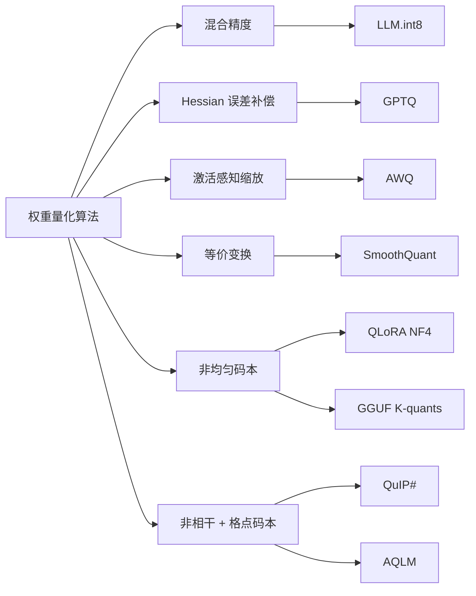

# 主流量化算法对比

## 核心结论

主流权重量化算法可按核心思想分七族：LLM.int8（混合精度隔离离群特征）、GPTQ（Hessian 误差反馈）、AWQ（激活感知缩放）、SmoothQuant（等价变换迁移激活离群）、QLoRA NF4（正态分位码本 + 双重量化）、GGUF K-quants（超块双重量化）、QuIP# 与 AQLM（非相干 + 格点/加性码本）。整体定位一句话：INT4 生产默认 GPTQ/AWQ，微调显存最优 NF4，本地部署 GGUF，2-bit 前沿看 QuIP# 与 AQLM。

图 1 主流权重量化算法技术路线关系

## 要点拆解

### 七算法总表

| 算法 | 核心思想 | 位宽 | 是否需校准 | 是否需训练 | 主要优点 | 主要缺点 |
|---|---|---|---|---|---|---|
| LLM.int8 | 混合精度隔离离群特征 | W8A16 | 否 | 否 | 精度几乎无损、兼容性好 | 混合精度路径降低算力利用率 |
| GPTQ | Hessian 逆矩阵误差反馈 | W4 / W3 | 是（128+ 样本） | 否 | 精度高、工业事实标准 | 量化耗时长、仅压权重 |
| AWQ | 激活感知缩放保护显著权重 | W4 / W3 | 是 | 否 | 无反向传播、跨域泛化好 | 精度上限略低于 GPTQ |
| SmoothQuant | 等价变换迁移激活离群 | W8A8 | 是 | 否 | 支持真低比特矩阵乘 | 需调节 α、仅适合 8-bit |
| QLoRA NF4 | 正态分位码本 + 双重量化 | W4 | 否 | 可选微调 | 微调场景显存最优 | 主要服务微调、非推理首选 |
| GGUF K-quants | 超块双重量化 | 2~8 bit | 否 | 否 | 文件格式统一、CPU/GPU 通用 | 极低比特下质量下降明显 |
| QuIP# / AQLM | 非相干 + 格点/加性码本 | W2 | 是 | 微调 | 2-bit 下 SOTA | kernel 生态未普及 |

表 1 主流权重量化算法对比

### 谱系读法

- 历史线：LLM.int8（2022）先承认离群值并隔离 → GPTQ/AWQ/SmoothQuant（2022-2023）在 PTQ 框架内治离群或补偿误差 → NF4（2023）换码本 → QuIP#/AQLM（2024）换几何；
- 场景线：纯推理 W4 选 GPTQ/AWQ，真低比特矩阵乘选 SmoothQuant W8A8，微调选 QLoRA NF4，本地部署选 [[K-quants]]，显存极限压到 2-bit 再上 QuIP#/AQLM；
- 门槛线：零训练是七族里六族的默认（除 QAT 系），差别在校准需求与量化耗时。

### 与工具链的衔接

算法到生产的映射：GPTQ/AWQ → AutoGPTQ/AutoAWQ → vLLM + Marlin；NF4 → bitsandbytes；K-quants → llama.cpp；详见 [[量化工具链与kernel]] 与 [[量化选型与避坑]]。

## 相关页面

- [[权重量化]]：算法对比所属的上位概念，六族算法的原理页索引。
- [[GPTQ]]、[[AWQ]]、[[SmoothQuant]]、[[NF4 量化]]、[[K-quants]]、[[极限低比特量化]]：各算法原理页。
- [[量化选型与避坑]]：把本表翻译成决策流程。

## 参考来源

[[raw/papers/权重量化.md]]
