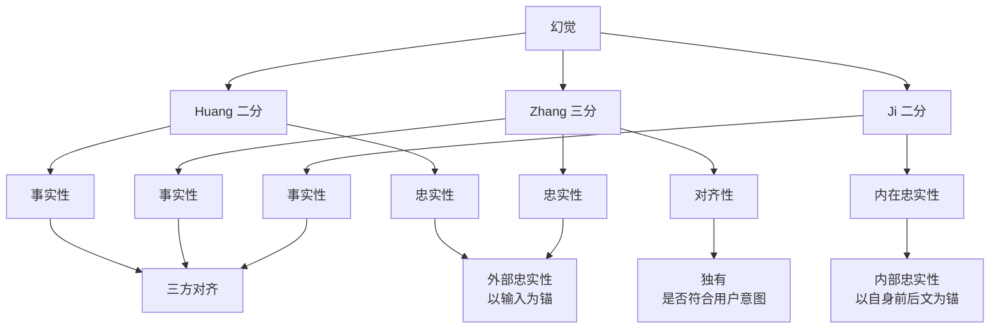

---
type: comparison
source: "[[raw/papers/大模型幻觉成因与分层治理.md]]"
description: "对比 Huang 二分、Zhang 三分与 Ji 二分三套幻觉分类口径：前者按事实性/忠实性，中者按事实性/忠实性/对齐性，后者按事实性/内在忠实性；三套口径正交，映射关系见表。"
created_at: 2026-10-11 23:12:03
updated_at: 2026-10-11 23:12:03
tags: [hallucination, taxonomy, factuality, faithfulness, comparison]
---

# 幻觉分类三套口径对比

## 核心结论

文献里至少存在三套幻觉分类口径，**切分基准不同、彼此正交**，不可混用：

| 来源 | 分类 | 切分基准 |
|---|---|---|
| Huang 等 | 事实性 / 忠实性 | 与世界比 / 与输入比 |
| Zhang 等 | 事实性 / 忠实性 / 对齐性 | 世界 / 输入 / 用户意图 |
| Ji 等 | 事实性 / 内在忠实性 | 世界 / 自身前后文 |

三套的**事实性一侧完全对齐**，分歧在「非事实性」这一侧切得多细。

## 要点拆解

### 事实性：三方对齐

三套口径都把「与客观世界知识冲突」单列为事实性。这是幻觉研究里唯一达成共识的类别。

### 忠实性：外部锚与内部锚的差异

| | 外部忠实性（以输入为锚） | 内部忠实性（以自身前后文为锚） |
|---|---|---|
| Huang / Zhang 的忠实性 | ✔ | — |
| Ji 的内在忠实性 | — | ✔ |

**Huang 与 Zhang 的忠实性锚在给定输入上**（摘要加了原文没有的内容、答非所问），而 **Ji 的内在忠实性锚在模型自己的前后文上**（前文说 A、后文说非 A）。

两者是不同的失效模式：前者是「无视材料」，后者是「自相矛盾」。工程上前者更常见，也更难自动检测。

### 对齐性：Zhang 独有

Zhang 等额外引入**对齐性**，指的是输出是否符合用户意图（如该拒答时不拒答、该简洁时不冗长）。这一维度在另外两套里被归入 [[事实性幻觉与忠实性幻觉]] 的忠实性，或干脆不讨论。

对齐性与 拒答训练 直接相关——拒答训练纠正的正是「该说不知道却硬答」这一对齐失败。

### 用哪套

- 做学术综述或写论文 → 用 Zhang 三分，覆盖最全。
- 做工程分类与治理分工 → 用 [[事实性幻觉与忠实性幻觉]] 的二分，因为它**直接对应两类不同的治理手段**（补知识 vs 约束生成）。
- 做一致性评估 → 用 Ji 二分，内部忠实性有专门的自动检测手段。

## 相关页面

- [[事实性幻觉与忠实性幻觉]]：二分法的完整展开。
- [[大模型幻觉定义与本质]]：三套口径共同的根因。
- [[幻觉三层治理框架]]：分类如何决定治理层。
- 拒答训练：对齐性一侧的主要手段。

## 参考来源

- [[raw/papers/大模型幻觉成因与分层治理.md]]
