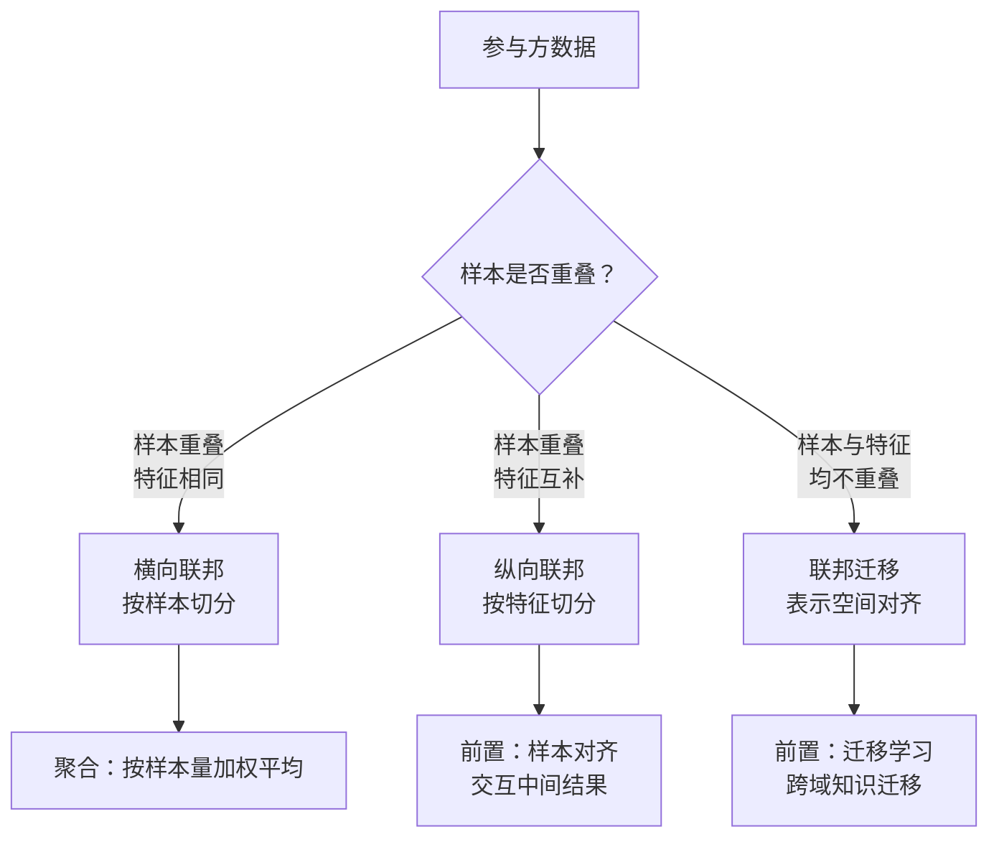

# 横向联邦与纵向联邦

## 核心结论

三类划分的判据只有一条：**参与方数据在样本与特征上是否重叠**。

- 样本重叠、特征相同 → 横向联邦，按样本切分，聚合方式直接可用加权平均。
- 样本重叠、特征互补 → 纵向联邦，按特征切分，**必须先做样本对齐**。
- 样本与特征都不重叠 → 联邦迁移，靠迁移学习对齐表示空间。

## 要点拆解

### 三类的结构对比

| 维度 | 横向联邦 | 纵向联邦 | 联邦迁移 |
|---|---|---|---|
| 数据重叠 | 样本不同、特征相同 | 样本相同、特征互补 | 样本与特征均不重叠 |
| 切分维度 | 按样本切分 | 按特征切分 | 不对齐切分，做表示对齐 |
| 前置条件 | 无需样本对齐 | **须先对齐共同样本** | 需可迁移的公共表示 |
| 典型场景 | 多家银行做同类风控 | 银行（交易）+ 电商（消费） | 跨地区、跨业务知识迁移 |
| 主要难点 | 数据分布异构（Non-IID） | 中间结果交互的安全与效率 | 表示空间不对齐、迁移有效性 |

### 为什么纵向联邦更难

纵向联邦的核心难点不在「怎么切」，而在**切完之后怎么安全地交互**：

1. **样本对齐本身需要保护隐私**——求交集又不能泄露非交集部分的样本 ID，通常需要隐私求交（PSI）类协议。
2. **中间结果交互带来额外攻击面**——梯度与中间表示都可能被反推，仍需 [[安全聚合SecAgg]] 与 [[差分隐私]] 一类的机制兜底。

相比之下，横向联邦因为特征空间相同，聚合可以直接复用 [[FedAvg联邦平均]] 的加权平均，工程门槛低得多。

### 选型路径

先问两边能否对上同一批样本，再问特征是否互补：

| 判断结果 | 走向 |
|---|---|
| 能对上同批样本，特征相同 | 横向联邦 |
| 能对上同批样本，特征互补 | 纵向联邦 |
| 对不上，但存在可迁移的公共表示 | 联邦迁移 |
| 对不上且无可迁移表示 | 不具备联邦条件，回到集中式或本地建模 |

## 相关页面

- [[联邦学习]]：本页所属的范式定义与三段划分来源。
- [[FedAvg联邦平均]]：横向联邦的基础聚合算法。
- [[安全聚合SecAgg]]：纵向联邦交互中间结果时的防护机制之一。
- [[联邦学习总览]]：三类划分在领域全景中的位置。

## 参考来源

- [[raw/papers/联邦学习.md]]（§1.4 类型划分）
- 线上原文：[https://arxiv.org/abs/1902.04885](https://arxiv.org/abs/1902.04885)（Yang 等，2019）
