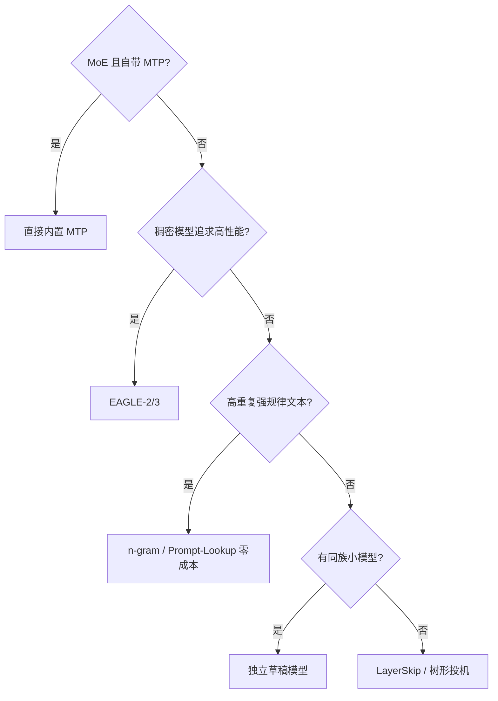

# 草稿模型方案对比

## 核心结论

草稿方案决定投机解码的成本、接受率与适用场景。选型核心逻辑：**MoE 且自带 MTP 直接用内置 MTP；稠密模型追求高性能用 EAGLE；高重复强规律文本用 n-gram/Prompt-Lookup 零成本；有同族小模型可用独立草稿模型。**

## 六类方案横向对比

| 方案 | 草稿来源 | 部署成本 | 训练要求 | 接受率潜力 | 适用场景 |
|------|---------|---------|---------|-----------|---------|
| 独立草稿模型 | 同族小模型 | 高（常驻部署） | 零，开箱即用 | 高 | 草稿质量要求高、可接受显存成本 |
| Medusa | 目标自身加多头 | 中 | 训练多头 | 中 | 稠密模型早期方案 |
| EAGLE | 目标特征级自回归 | 低（自投机） | 训练草稿头 | 高（6.5×） | 稠密模型追求高性能 |
| 内置 MTP | 训练时内置 | 零 | 训练时内置 | 高 | MoE 模型首选 |
| 无模型草稿 | n-gram/Prompt-Lookup | 零 | 零 | 依赖文本规律 | 摘要/RAG/代码等高重复杂文 |
| 部分层 LayerSkip | 目标浅层 | 低 | 层间协同 | 中 | 节约独立草稿部署 |
| 树形投机 | 多分支候选 | 中 | 视草稿而定 | 最高 | 追求单次验证高接受率 |

## 选型决策流

## 成本与收益权衡

- **部署成本最低**：无模型草稿（零部署、零显存增量）与内置 MTP（官方即插即用）。
- **性能上限最高**：树形投机（多分支一次验证）与 EAGLE（特征级 + 6.5× 实证）。
- **演进去向**：Medusa 主导地位被 EAGLE 取代，草稿训练走向 [[SpecForge]] 统一流水线。

## 相关页面

- [[草稿模型分类]]：机制详述
- [[投机解码]]：机制总览
- [[期望接受长度]]：接受率的量化

## 参考来源

- [[raw/papers/投机解码.md]]