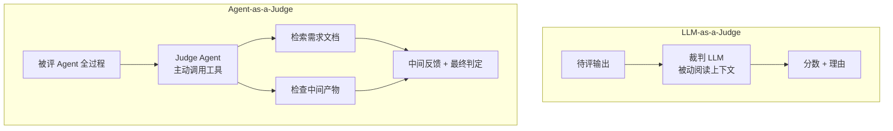

# Agent-as-a-Judge

## 两类裁判的机制差异

<b>图1 LLM-as-a-Judge 与 Agent-as-a-Judge 的机制差异</b>

## 核心结论

- Agent-as-a-Judge = **拿 agentic 系统评估另一个 agentic 系统**，是 [[LLM-as-a-Judge]] 的延伸而非替代。
- 关键升级是**主动取证**：judge agent 可自主调用工具读取需求文档、检索资料、与被评系统的中间产物交互，从而在任务全程提供**中间反馈**，而非只对终稿打分。
- 在 DevAI 基准（55 个真实 AI 开发任务、365 条分层用户需求）上，它**显著优于 LLM-as-a-Judge、可靠性与人工基线相当**，评估环节比人工专家节省约 **97.72% 时间与 97.64% 成本**。

## 要点拆解

- **为什么需要它**：被动的单次文本打分器判不了多步 agentic 过程——看不到「中间产物是否偏离需求」，也拿不到需求文档做对照。
- **中间反馈的价值**：反馈粒度从「终稿好不好」细化到「第几步开始偏」，既可评可诊断，也能作为 reward 信号或早停信号。
- **典型局限**：依赖够强的 judge agent；且存在「谁评估评估者」的元评估（meta evaluation）问题——judge agent 自身的可靠性同样需要被度量。
- 元评估问题的现有应对方向包括动态多 Agent 辩论式裁判、独立验证节点等，见 [[独立验证机制]]。

## 相关页面

- [[LLM-as-a-Judge]]：所延伸的被动打分范式
- [[人工评估与裁判校准]]：Agent-as-a-Judge 以人工基线为水位参照
- [[四类评估方法对比]]：四类评估方法横向对比
- [[Agent评估组合策略]]：它被安排在「离线深度评估」阶段
- [[独立验证机制]]：生产/审核分离的相邻工程实践
- [[意图评测]]：另一条「评测方法论先行」的落地参照

## 参考来源

- [[raw/papers/Agent轨迹评估和结果评估.md]]
- [Agent-as-a-Judge: Evaluate Agents with Agents](https://arxiv.org/abs/2410.10934)，arXiv:2410.10934
- [metauto-ai/agent-as-a-judge](https://github.com/metauto-ai/agent-as-a-judge)
