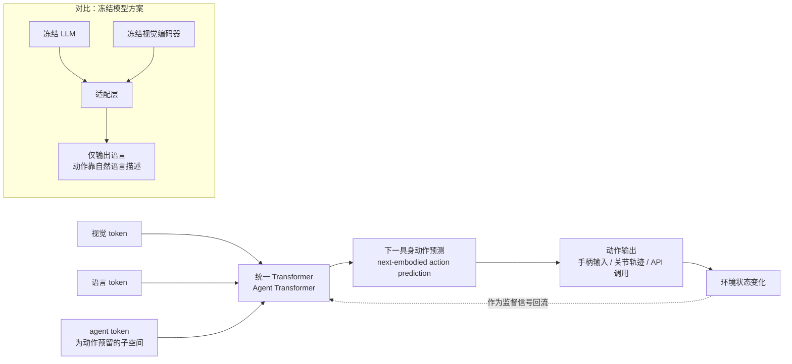

# AgentToken与下一动作预测

## 核心结论

Agent Transformer 的核心动作只有一件：**在视觉 token 和语言 token 之外，为「动作」预留第三类 token——agent token**，从而把动作空间并入同一个 Transformer 的输入输出接口，并用「下一具身动作预测」作为统一训练目标。

它回答的是一个具体工程问题：**当动作无法用自然语言准确描述时，怎么让模型学会它。** 抓手是 token，不是 prompt。

## 要点拆解

### agent token 是什么、不是什么

**是**：为智能体行为保留的、输入输出空间中的一段特定子空间。对机器人或游戏，它对应手柄输入这类连续或离散控制信号的动作空间；对工具调用场景，它也可以承载「调用某个图像编辑模型」这一动作。

**不是**：
- 不是新增的一种模态编码器——它是**接口约定**，不是感知通路；
- 不是 tool call 的别名——见下文两者的差异；
- 不是必须端到端重训才能用——可以先用 LLM/VLM 初始化各子模块，再叠加 agent token 训练。

### 相对「冻结 LLM + 冻结视觉编码器」的四项优势

论文给出的对照方案是 Flamingo、BLIP-2、LLaVA 这一类：冻结语言模型与视觉编码器，只训中间的适配层。Agent Transformer 的优势在于：

| 优势 | 具体含义 |
|---|---|
| 可定制到语言难以表述的任务 | 手柄输入、控制信号这类动作空间，用自然语言描述本身就失真 |
| 可解释性更好 | 能直接读到 agent token 的概率分布，判断「为什么做这个动作」 |
| 隐私合规 | 医疗、法律等强隐私域的模型可私有化，不必依赖闭源大模型 |
| 成本更低 | 相对小的 agent transformer 可能显著便宜于大型闭源模型 |

第三条和第四条是常被忽略的落地理由——它们与能力无关，却常是项目能否成立的决定因素。

### 训练两步法

1. **定义域内目标**：明确任务与动作空间，为每个动作分配唯一 agent token；**凡是能用自动规则判定任务成功的环节，都尽量自动化**，这直接放大可用训练数据量；否则只能依赖基础模型生成或人工标注。
2. **持续改进**：监控性能、收集反馈、继续微调；同时检查偏见与伦理问题，达标后再部署。

第一步里「自动判成功」的优先级被高估得少、低估得多：它同时决定了数据规模与迭代速度。

### 与工具调用的本质差异

| 维度 | Function Tool / MCP Tool | agent token |
|---|---|---|
| 动作表示 | 结构化 JSON 参数，语义由 description 承载 | 预留 token 子空间，语义由训练涌现 |
| 适用动作 | 已有能力的标准化封装 | 难以自然语言化的连续/专用动作 |
| 可解释性来源 | 参数与返回值的审计日志 | agent token 的概率分布 |
| 训练要求 | 无需训练，靠提示与 schema | 需要动作数据做预训练或微调 |

两者的关系是**互补而非替代**：能用工具表达的动作优先用工具（便宜、可审计），工具表达不了的动作才上 agent token。工具的规范见 [[Function Tool设计规范]]。

### 下一具身动作预测的意义

把训练目标从「预测下一个词」改成「预测下一个具身动作」，带来两个结构变化：

- **监督信号变了**：不再只有文本共现，而是动作与状态转移的因果对应；
- **错误可被证伪**：动作执行后环境状态会给出对错，这是文本生成拿不到的即时真值。

这条变化正是 [[环境接地式幻觉治理]] 的机制基础，也是 [[具身Agent与环境接地]] 定义中「行动侧」的落地方式。

## 相关页面

- [[具身Agent与环境接地]]：本页所属的定义层，动作要给谁用。
- [[环境接地式幻觉治理]]：动作被环境证伪，如何反过来抑制幻觉。
- [[Agent训练方法阶梯]]：agent token 训练在整体训练路径中的位置。
- [[Function Tool设计规范]]：工具型动作的标准做法，与本页构成互补对照。
- [[AgentAI综述总览]]：本节所属的论文骨架。

## 参考来源

- 线上原文：[https://arxiv.org/abs/2401.03568](https://arxiv.org/abs/2401.03568)（§3.1-§3.3 Agent Transformer 定义与创建，图 7 统一多模态 Transformer）
- 本地备份：[[raw/papers/Agent-AI-Surveying-the-Horizons-of-Multimodal-Interaction.pdf]]