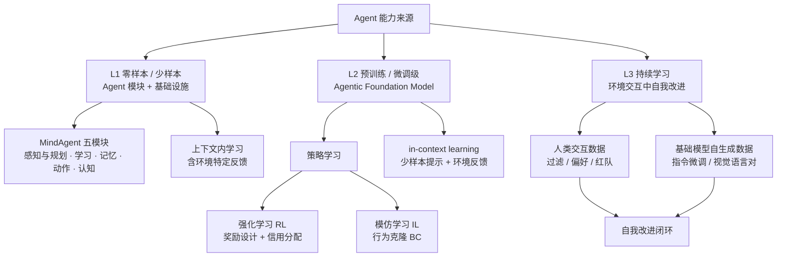

# Agent训练方法阶梯

## 核心结论

Agent 的能力不是二选一（「用大模型」还是「训小模型」），而是**三级阶梯**：先用零样本模块把系统跑起来，再用预训练/微调把动作能力固化到模型里，最后用环境交互数据持续自我改进。每级的前置成本与收益差别很大，选错级是最常见的设计失误。

**一句话**：L1 买现成能力，L2 买专用能力，L3 买随环境演进的能力。

## 要点拆解

### L1 零样本/少样本：先用模块拼出来

论文的 MindAgent 基础设施给出五个模块：**环境感知与任务规划、Agent 学习、记忆、通用动作预测、认知**。心智模型很小——目标是最小设计下先证明「调度与协调」可行，再谈训练。

这一级的关键手段是 **in-context learning**：把示例放进提示，用少样本让模型理解任务；在具身场景还可以**把环境特定反馈一并放进上下文**，让模型在下一次动作里修正。

**适用前提**：任务可描述、动作可用自然语言或结构化参数表达、样本量少。**主要局限**：上下文容量与一致性无法保证长任务，且能力上限被预训练模型锁死。

### L2 预训练/微调：把动作能力训进模型

这一级的分水岭是模型是否**针对动作**训练过。白板方案（冻结 LLM/VLM + 适配层）属于 L1 的延长线，真正进 L2 的是 [[AgentToken与下一动作预测]] 的 agent token 训练。

策略学习的两条路线：

| 路线 | 机制 | 主要障碍 | 何时优先 |
|---|---|---|---|
| 强化学习 RL | 通过与环境交互、最大化奖励学最优策略 | 奖励函数设计依赖专家经验；数据量大；长时程信用分配难 | 奖励可自动计算、环境可高频试错 |
| 模仿学习 IL | 从专家数据学策略 | 直接学专家策略泛化差；需海量专家数据 | 有专家示范、试错代价高 |

**论文的取舍值得记住**：它主张用**无限记忆智能体做模仿学习**，并用 in-context prompt 或**隐式奖励函数**刻画专家行为的关键特征，而不是直接复制专家策略。理由是纯模仿在未见情境下泛化差，而隐式奖励把「专家为什么这么做」学进去，从而绕开「需要海量专家数据」的老问题。

行为克隆（BC）是 IL 的代表框架，RT-1/RT-2 这类基于 Transformer 的端到端模型是其当代形态：输入图像序列与语言，直接输出动作序列。

### L3 持续学习：当前 Agent 普遍缺的一级

论文明确指出：**当前基于基础模型的 Agent 大多绑定在预训练模型上，一般不随环境持续交互而学习**。这是被点名的开放问题，不是已解决问题。

两条数据来源：

- **人类交互数据**：把交互样本过滤后当训练数据（规则过滤/模型分类/人工筛选）、人类偏好学习（多输出择优选）、红队安全训练；
- **基础模型自生成数据**：指令微调（大模型当教师蒸馏给小模型，代表是 Alpaca/Vicuna 路线）、视觉语言对自动重标注（如 LLaVA 用约 15 万条模型生成的指令数据）。

**必须知道的负结论**：论文引用的工作指出，指令微调能迁移写作风格与部分指令跟随能力，但**教师与学生之间在事实性与能力上仍存在显著差距**。这意味着自生成数据不能无脑替代真实标注。

### 三级阶梯的选型口诀

| 你的处境 | 该选 |
|---|---|
| 验证可行性、样本少、任务可描述 | L1：模块 + 少样本 |
| 动作难以自然语言化、需要私有化、成本敏感 | L2：agent token 训练 |
| 环境持续变化、有稳定用户交互数据 | L3：但先确认 L1/L2 已达标 |

**不要跳级**：L3 在当前 Agent 工程里基本没有成熟范式，在有稳定 L1/L2 基线之前投入 L3，通常换来的是不可归因的波动。

## 相关页面

- [[AgentToken与下一动作预测]]：L2 的载体与训练目标。
- [[具身Agent与环境接地]]：这套训练为谁服务。
- [[协作效率指标CoS]]：训练之后怎么量化协作水平。
- [[AgentAI综述总览]]：本节所属的论文骨架。
- [[微调与RAG分工]]：语言模型 SFT/DPO 的通用微调知识，与 Agent 训练的分工差异。
- [[递归自我改进RSI]]：L3 持续自我改进再往上走一层——当改进对象变成「改进机制本身」时才叫 RSI，本页的 L3 是其工程前身。

## 参考来源

- 线上原文：[https://arxiv.org/abs/2401.03568](https://arxiv.org/abs/2401.03568)（§4.1-§4.3 学习策略与机制、§8 持续与自我改进）
