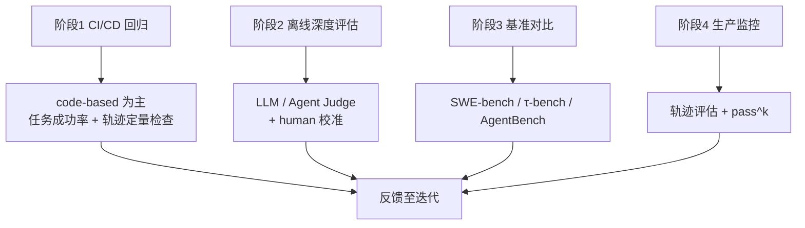

# Agent评估组合策略

## 四阶段组合

<b>图1 四类方法与两类指标的分阶段组合</b>

## 核心结论

- 四类评估方法与两类指标**并非互斥**，真实评估体系必须按研发生命周期分阶段组合，单一方法包打全场是常见误判。
- 组合的顺序符合「先便宜确定性、再贵语义性、最后只看线上真实分布」的工程直觉。
- 生产监控阶段以**轨迹评估 + pass^k** 为主，是「结果做门槛、轨迹做诊断、一致性做标尺」的最终落点。

## 要点拆解

| 阶段 | 主要手段 | 关键动作 |
|---|---|---|
| CI/CD 回归 | code-based 结果评估做硬门槛 | 任务成功率 + 测试通过率，辅以轨迹定量检查（步数、循环、预算），保证改动不引入回归 |
| 离线深度评估 | [[LLM-as-a-Judge]] + [[Agent-as-a-Judge]] | 打输出质量分、评复杂多步过程，定期用 human 标注做裁判校准与安全审计 |
| 基准对比 | 公开基准横向对比 | SWE-bench 看代码、[[τ-bench]] 看工具+用户交互+pass^k、AgentBench 看多环境决策，警惕数据污染与 domain mismatch |
| 生产监控 | [[轨迹评估]] 为主 | 把失败 session 转成 eval case 持续追踪，配合 pass^k 观察长期一致性 |

- **选型逻辑**：结果可验证优先 code-based，语义判断用校准过的 LLM judge，过程复杂用 agent judge，安全与校准离不开 human，可靠性永远同时看 [[pass@k与pass^k]]。
- 与既有工程的接口：CI 侧与 [[持续评估]]（把真实任务固化为 eval 套件）天然衔接；生产侧与 [[监控闭环]]、[[输出验证与人工审批]] 构成上下层分工。

## 相关页面

- [[Agent评估体系总览]]：组合策略在五层结构中的位置
- [[四类评估方法对比]]：被组合的四类方法的能力边界
- [[持续评估]]：CI 回归 eval 套件的具体形态
- [[独立验证机制]]：验证与生产职责分离的相邻机制
- [[监控闭环]]：生产指标监控与自动修复闭环

## 参考来源

- [[raw/papers/Agent轨迹评估和结果评估.md]]
