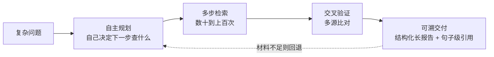

# Deep Research定义

## 核心结论

Deep Research 指模型在给定复杂问题时，**自主**完成多轮检索、阅读、验证并交付长报告的能力。

判据只有一条：**看它会不会自己决定下一步查什么**。流程写死的系统，即便检索很多次，也不属于这一类。

## 要点拆解

### 四要素

| 要素 | 含义 | 缺失会怎样 |
|---|---|---|
| 自主规划 | 模型自己决定下一步查什么 | 退化为固定流水线，遇预设外路径即卡住 |
| 多步检索 | 数十次到上百次搜索，构成轨迹 | 证据面覆盖不足，无法跨源比对 |
| 交叉验证 | 对同一事实从多个来源比对 | 单点采信，错误来源直接进入报告 |
| 可溯交付 | 结构化报告，论断可点回出处 | 产出无法核验，只能当参考读物 |

### 命名与时间线

该能力由 OpenAI 于 2025 年 2 月首次以「Deep Research」命名发布，底座为 o3 早期版本，专为网页浏览优化。此后 Perplexity、Gemini 相继推出同类产品，开源侧亦有复现路线。

### 能力分层

按任务性质把适用场景分四层，据此判断该不该用：

| 层级 | 任务性质 | 典型问题 | 建议 |
|---|---|---|---|
| L1 | 事实查询 | 现在股价多少 | 不该用 |
| L2 | 单点问答 | 解释一个概念 | 不必用 |
| L3 | 多源综述 | 比较竞品、调研赛道 | 最适用 |
| L4 | 决策结论 | 该不该投、选哪家 | 用作输入，人做终判 |

越靠上越不该用（成本与时延不划算），越靠下越要人收尾（结论责任不可外推）。

## 相关页面

- [[DeepResearch与RAG分野]]：最易混淆的对照，差别在路径归属
- [[端到端强化学习研究]]：这个能力是怎么训出来的
- [[DeepResearch能力边界与风险]]：能做与不能做的清单
- [[DeepResearch总览]]：本概念的领域入口页

## 参考来源

- [[raw/papers/Deep Research.md]]
