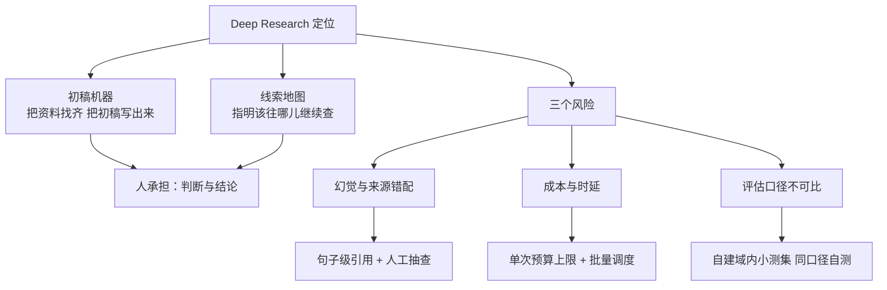

# DeepResearch能力边界与风险

## 核心结论

它的正确定位是**初稿机器 + 线索地图**：负责把资料找齐、把初稿写出来，判断与结论仍由人承担。

边界不是能力不足，而是能力形态决定的分工——它能替代调研的体力部分，替代不了判断的责任部分。

## 要点拆解

### 能做与不能做

| 能做 | 不能做 |
|---|---|
| 跨多个来源综合信息 | 实时性，单次数分钟至半小时 |
| 产出有结构的长报告 | 墙后内容，付费墙与登录墙之后读不到 |
| 每条论断可溯源到原文 | 权威性判断，官方亦承认难以区分权威来源 |
| 附带数据计算与图表 | 替代人的最终判断 |

四条不能做里，**权威性判断**最容易被忽视：官方自己也承认难以区分来源权威度。这意味着报告给出十条来源，哪条该信仍需人来定。

### 三个风险与兜底

| 风险 | 说明 | 兜底 |
|---|---|---|
| 幻觉与来源错配 | 引用真实存在但不支持论断的页面，最难发现 | 句子级引用 + 人工抽查 |
| 成本与时延 | 单次数十分钟计算量，批量使用需算预算与排队 | 单次预算上限 + 批量调度 |
| 评估口径不可比 | 工具配置、尝试次数、题库版本各异 | 自建域内小测集，同口径自测 |

### 第三条风险的处置最实用

拿自己领域的十个真实问题建一个小测集，用同一口径测量，比看任何公开榜单都可靠。

这条建议的隐含前提是：**公开榜单回答的是「这个品类整体怎么样」，不是「它在我这个场景里能不能用」**。域内小测集补的正是后半问。

### 什么时候不该用

对照 [[Deep Research定义]] 的能力分层，L1 事实查询与 L2 单点问答不该用，L4 决策结论只能当输入。成本与时延决定了它是重武器，不是默认选项。

## 相关页面

- [[句子级引用归因]]：第一风险的具体核对流程
- [[Deep Research定义]]：能力分层决定该不该用
- [[DeepResearch评测基准]]：口径不可比的技术原因
- [[Agent成本四维预算]]：成本控制的通用框架
- [[DeepResearch总览]]：领域入口页

## 参考来源

- [[raw/papers/Deep Research.md]]
