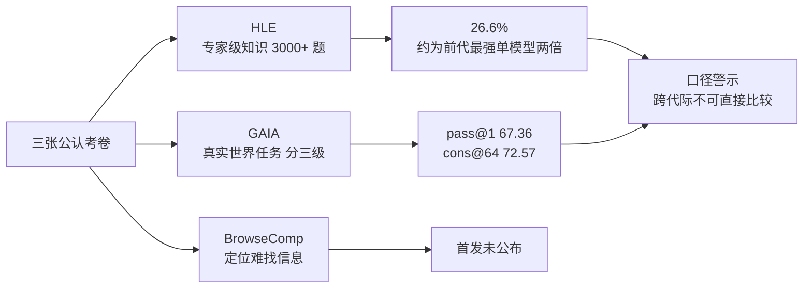

# DeepResearch评测基准

## 核心结论

当前公认的考卷有三张，各自适用面不同。

值得注意的不是均值提升，而是**最难的 Level 3 提升幅度最大**（42.31 → 58.03）——Level 3 需要多步推理与跨源综合，恰是这类能力最该发挥作用的区间。

**分数依赖工具配置、尝试次数与题库版本，跨时间跨厂商直接比较会得出错误结论。**

## 要点拆解

### 三张考卷

| 基准 | 考察内容 | Deep Research 成绩 |
|---|---|---|
| Humanity's Last Exam | 专家级知识，3000+ 题、100+ 学科 | 26.6% |
| GAIA | 真实世界任务，分三级难度 | pass@1 67.36%；cons@64 72.57% |
| BrowseComp | 定位难找的信息 | 官方未在首发公布 |

### HLE 横向对照

同一评测配置下的对照，Deep Research 26.6% 约为前代最强单模型的两倍：

| 模型 | HLE |
|---|---|
| GPT-4o | 3.3% |
| Grok-2 | 3.8% |
| Claude 3.5 Sonnet | 4.3% |
| Gemini Thinking | 6.2% |
| OpenAI o1 | 9.1% |
| DeepSeek-R1 | 9.4% |
| o3-mini（medium） | 10.5% |
| o3-mini（high） | 13.0% |
| Deep Research | 26.6% |

### GAIA 三级明细

| 配置 | Level 1 | Level 2 | Level 3 | 均值 |
|---|---|---|---|---|
| 前 SOTA | 67.92 | 67.44 | 42.31 | 63.64 |
| Deep Research（pass@1） | 74.29 | 69.06 | 47.6 | 67.36 |
| Deep Research（cons@64） | 78.66 | 73.21 | 58.03 | 72.57 |

表1 GAIA 分级成绩

### 为什么 Level 3 最值得看

Level 1 与 Level 2 的提升幅度有限，说明单步或少数几步能解决的问题，前代模型已处理得不错。真正拉开差距的是 Level 3：需要多步推理、跨源比对与路径调整，正是端到端强化学习训练出来的能力区间。

### 口径警示的具体含义

三个变量会让分数失去可比性：

| 变量 | 影响 |
|---|---|
| 工具配置 | 是否具备沙箱执行、能否读 PDF 与图片 |
| 尝试次数 | pass@1 与 cons@64 差距可达数个百分点 |
| 题库版本 | 同一基准不同版本题目不同 |

因此看到任何 Deep Research 跑分，先问三个问题：什么配置、几次尝试、哪版题库。四家厂商数字的不可比性详见 [[DeepResearch路线对比]]。

## 相关页面

- [[DeepResearch路线对比]]：各厂商数字的时空口径差异
- [[DeepResearch开源复现]]：开源方案的实测成绩
- [[基准污染与动态基准]]：评测数据的通用风险
- [[pass@k与pass^k]]：尝试次数如何影响指标读数
- [[DeepResearch总览]]：领域入口页

## 参考来源

- [[raw/papers/Deep Research.md]]
