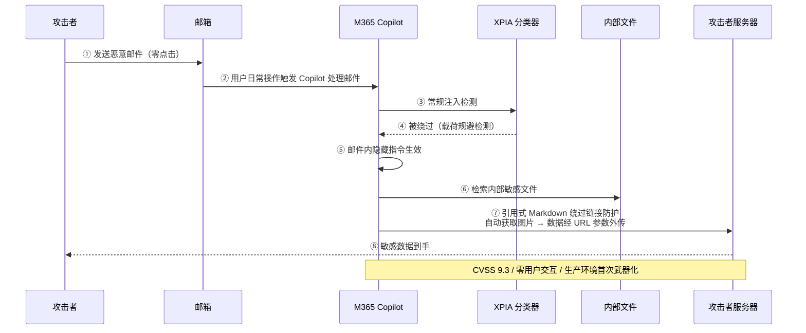

# EchoLeak 零点击攻击案例

## 核心结论

- 2025 年 6 月披露的 EchoLeak（CVE-2025-32711）被评为 **CVSS 9.3**，是**首个在生产 LLM 系统中被武器化用于实际数据窃取的零点击 Prompt 注入攻击**。
- 攻击串联了多重绕过：规避 Microsoft 的 XPIA 分类器、利用引用式 Markdown 绕过链接防护、滥用自动获取图像与 Teams 代理完成外传，充分说明**单点防御的脆弱性**。

## 完整攻击链时序

<b>图1 EchoLeak 零点击攻击链时序</b>

## 攻击要点分析

1. **零点击**：用户无需任何交互，日常操作即可触发 Copilot 处理恶意邮件。
2. **分类器绕过**：载荷经过精心设计，规避了 Microsoft 的 XPIA（跨提示注入攻击）分类器。
3. **链接防护绕过**：利用引用式 Markdown 格式，使输出中的 URL 不被识别为恶意链接。
4. **外传通道**：滥用自动获取图像功能与 Teams 代理，将敏感数据经 URL 参数外传至攻击者服务器。

## 防御启示

- **分类器不是银墙**：EchoLeak 证明分类器可以被绕过，不能作为唯一防线。
- **输出层过滤至关重要**：如果 M365 Copilot 剥离了外链图片渲染，外传通道即被切断。
- **Agent 界面应剥离外链图片渲染**，堵住 Markdown 图片外泄通道。

## 相关页面

- [[Prompt注入攻击类型谱系]]：EchoLeak 在案例矩阵中的定位
- [[Prompt注入危害分层]]：信息层危害的最严重实例
- [[Promptware Kill Chain]]：EchoLeak 是 Kill Chain 七阶段的完整实例
- [[新兴Prompt注入攻击向量]]：EchoLeak 推动的防御演进

## 参考来源

- [[raw/papers/Prompt注入与防范.md]]
