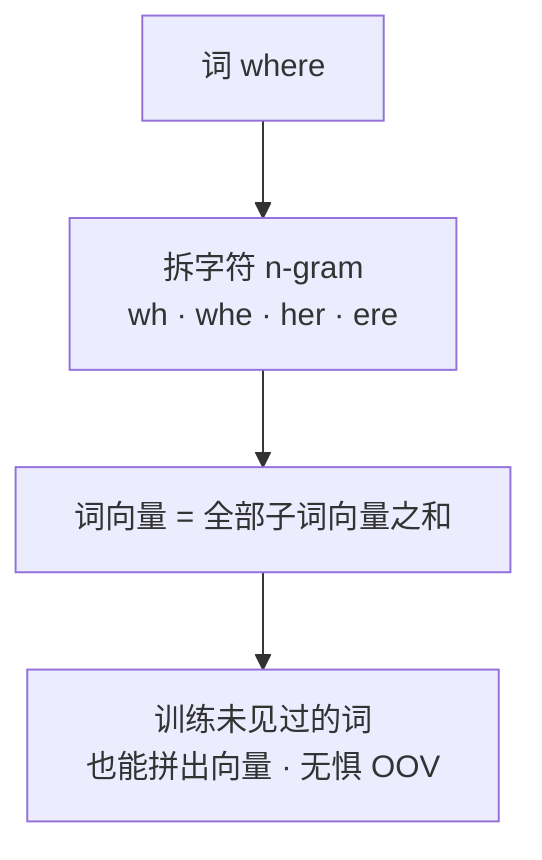

# FastText

## 核心结论

FastText 的独到之处是把每个词拆成字符 n-gram，词向量等于其所有子词向量之和 [[5]](#ref-5)，例如 "where" 可拆出 "wh""whe""her""ere" 等；即使某词训练时从未出现，也能用字符 n-gram 拼出向量，解决 OOV（未登录词）问题。

图 1 FastText 子词求和的向量构造机制

## 要点拆解

### 子词机制带来的能力

- **OOV 消解**：未登录词由子词拼出，是静态嵌入三方案里唯一自带该能力的；
- **形态丰富的语言**：黏着语（如芬兰语）尤其受益；
- **中文场景**：由字级子词获益；
- **文本规范容错**：对拼写不规范的社交媒体文本稳健。

### 定位

2016 年提交、2017 年见刊 TACL [[5]](#ref-5)；至今仍是轻量级多语言场景的高性价比选择——没有上下文建模的精度，但训练快、部署轻、无惧生僻词。

## 相关页面

- [[Word2Vec]]、[[GloVe]]：另外两条静态嵌入路线。
- [[静态嵌入方案对比]]：三方案共性与局限。
- [[分词路线演进]]：子词思想在分词侧的同源实现。
- [[词嵌入]]：分布式假设与度量基础。
- [[词嵌入·素材摘要]]：本页所在素材全篇索引。

## 参考来源

[[raw/papers/词嵌入.md]]
