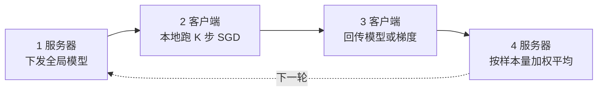

# FedAvg联邦平均

## 核心结论

FedAvg 的聚合规则是**按各客户端样本量加权平均**，而非简单等权：

$$w^{(t+1)} = \sum_{k=1}^{K} \frac{n_k}{n} w_k^{(t)}$$

其中 $n_k$ 为第 $k$ 个客户端样本数，$n=\sum_k n_k$。

**它的核心贡献是通信效率，不是精度提升**——把计算下沉到客户端、把通信压到最低，这是原始论文的设计出发点。

## 要点拆解

### 单轮四步流程

| 步骤 | 动作 | 关键点 |
|---|---|---|
| ① 下发 | 服务器广播当前全局模型 | 只发给被选中的客户端子集 |
| ② 本地训练 | 客户端用本地数据跑 K 步 SGD | K 是可调的关键参数 |
| ③ 回传 | 上传更新后的模型或梯度 | 通信开销发生在这一步 |
| ④ 聚合 | 服务器按样本量加权平均 | 得到新全局模型 |

### 为什么 K 是核心参数

**K 越大，通信轮次越少**。原始论文系统分析了「通信轮次 vs 本地计算量」的权衡关系：在移动网络下带宽是稀缺资源，把计算推到本地、把通信压到最低，整体训练成本才可接受。

同期另一条路线（Konečný 等）着眼于降低**单次上传体积**，采用结构化更新与草图（sketch）压缩每轮传输量——与 FedAvg 的「减少轮次」形成互补的两条通信优化路径。

### 失效点：非独立同分布

FedAvg 在数据非独立同分布（Non-IID）时性能显著下降：各客户端数据分布差异大，本地模型朝自身分布优化，加权平均后相互抵消，全局模型反而变差。

对应的修正方案是 [[FedProx近端优化]]：在本地目标上加近端项，把本地模型约束在全局模型邻域内。

## 相关页面

- [[联邦学习]]：本页所属的范式定义。
- [[FedProx近端优化]]：针对 Non-IID 的修正方案。
- [[安全聚合SecAgg]]：与 FedAvg 配套的隐私传输机制。
- [[联邦学习总览]]：本页在领域全景中的位置。

## 参考来源

- [[raw/papers/联邦学习.md]]（§3.1 FedAvg 聚合）
- 线上原文：[https://arxiv.org/abs/1602.05629](https://arxiv.org/abs/1602.05629)（McMahan 等，2016）
- 线上原文：[https://arxiv.org/abs/1610.05492](https://arxiv.org/abs/1610.05492)（Konečný 等，2016）
