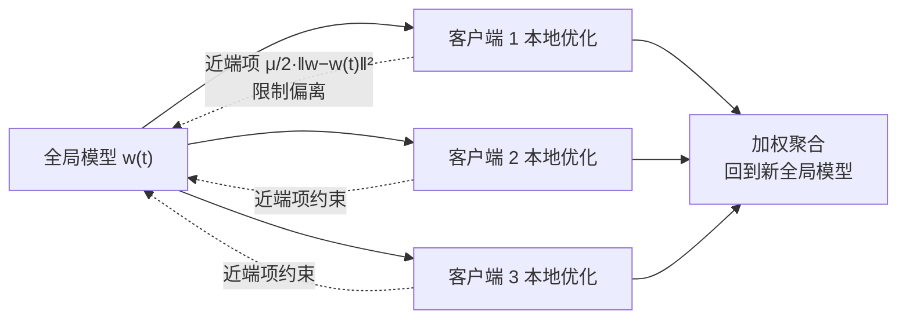

# FedProx近端优化

## 核心结论

FedProx 用来解决 [[FedAvg联邦平均]] 的主要失效点：**非独立同分布（Non-IID）导致的漂移**。它把本地目标从「单纯最小化本地损失」改为「本地损失 + 近端罚项」，使本地模型不能跑离全局模型太远。

## 要点拆解

### 它修正的两个异构性

| 异构类型 | 具体表现 | FedProx 的对策 |
|---|---|---|
| 系统异构 | 设备算力、网络差异大，慢设备掉队 | 允许客户端完成**可变的本地工作量**，部分工作也能被纳入 |
| 统计异构 | 各客户端数据分布不一致，本地模型相互拉扯 | 加**近端项**约束本地模型偏离幅度 |

### 近端项的形式

本地子问题由 $F_k(w)$ 改为：

$$F_k(w) + \frac{\mu}{2}\left\| w - w^{(t)} \right\|^2$$

其中 $w^{(t)}$ 是本轮的全局模型，$\mu$ 是控制约束强度的系数。

**这个罚项的作用是「限制漂移」**：$\mu$ 越大，本地模型越贴近全局模型；$\mu \to 0$ 时退化为原始 FedAvg。

### 实测效果

文献报告在高度异构设置下，FedProx 相对 FedAvg 的收敛过程更稳定，**平均绝对测试精度提升约 22%**。

注意该数字针对「高度异构」场景，在接近独立同分布的数据上两者差距会显著缩小。

### 边界

- 近端项只抑制漂移，不改变数据本身分布不一致的事实——极端异构下精度仍受限。
- $\mu$ 是新增超参，需按异构程度调；过大会拖慢收敛。
- 它不解决隐私问题，防护仍依赖 [[安全聚合SecAgg]] 与 [[差分隐私]]。

## 相关页面

- [[FedAvg联邦平均]]：本页要修正的基线算法。
- [[联邦学习]]：本页所属的范式定义。
- [[联邦学习总览]]：Non-IID 难题在领域全景中的位置。

## 参考来源

- [[raw/papers/联邦学习.md]]（§3.2 FedProx 修正）
- 线上原文：[https://arxiv.org/abs/1812.06127](https://arxiv.org/abs/1812.06127)（Li 等，MLSys 2020）
