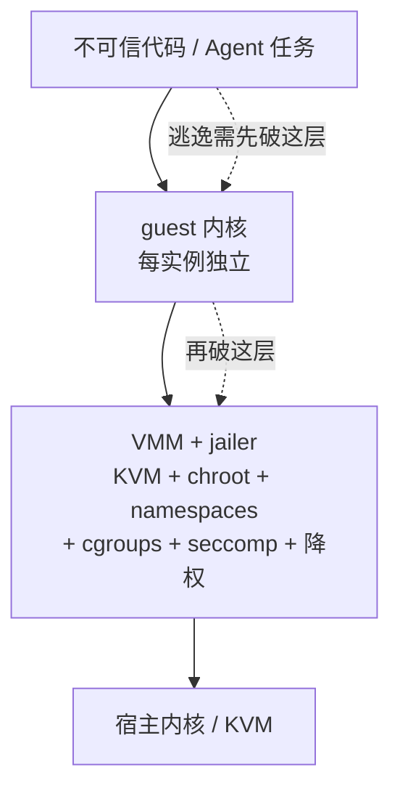

# Firecracker微虚拟机

## 核心结论

Firecracker 是 AWS 用 Rust 写的**极简虚拟机监视器**，基于 KVM，每个 microVM 拥有独立 guest 内核。**逃逸需先破 guest 内核、再破 KVM 与 VMM**，攻击面远小于共享内核方案，因此成为 [[隔离技术谱系]] 上与 TEE 相邻的最强通用档。

关键指标：启动约 125ms、单实例 VMM 内存低于 5MiB、单机可跑数千实例；是 AWS Lambda 与 Fargate 的隔离底座，也是**云端不可信代码多租户执行的事实标准**，截至成稿无已知 VM 逃逸 CVE。

## 要点拆解

### hypervisor 隔离是必要而非充分条件

VMM 与 jailer 本身仍会出漏洞。**jailer = KVM + chroot + namespaces + cgroups + seccomp + 降权的组合外壳**，运行时与 guest 内核必须同等严格地打补丁——虚拟化层不是免维护区，这一条与 [[沙箱选型权衡与落地避坑]] 的第二条教训同源。

### 它在横评中的位置

| 方案 | 用法 |
|---|---|
| E2B | Firecracker microVM，约 150-200ms |
| AWS Bedrock AgentCore | Firecracker，一会话一 microVM |
| 腾讯云 CubeSandbox | 基于 KVM 启动轻量化 microVM 实例，快照克隆压至 60ms |

具体对照见 [[Agent沙箱平台横评]]；让 125ms 再降一个数量级的手段见 [[沙箱冷启动加速技术]]。

### 与 gVisor 的分野

两者都是百毫秒级，但 gVisor 不需 KVM、可跑在普通虚拟机内，见 [[gVisor用户态内核]]；Firecracker 需要 KVM 与裸金属，换来更强的内核隔离。这条分野是 [[沙箱隔离技术选型对比]] 的核心维度之一。

## 相关页面

- [[隔离技术谱系]]：microVM 在共享强度链上的位置。
- [[gVisor用户态内核]]：同样面向不可信代码的另一条技术路线。
- [[沙箱冷启动加速技术]]：以快照克隆把 microVM 启动压到 60ms 的做法。
- [[容器逃逸与沙箱绕过]]：共享内核方案的天花板，即 microVM 存在的理由。
- [[Agent沙箱技术全景总览]]：本页所属的领域全景。

## 参考来源

- [[raw/papers/Agent沙箱.md]]
