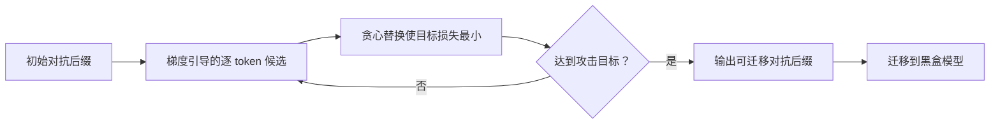

# GCG对抗攻击

## 核心结论

- **GCG 通过贪心坐标梯度搜索自动生成可迁移的对抗后缀**，无需人工设计提示即可诱导对齐模型输出有害内容[[3]](#ref-3)。
- 关键威胁在于**可迁移性**：在开源白盒模型上搜出的后缀，能迁移到 ChatGPT、Claude 等黑盒模型上生效——这正是[[红队测试边界与军备竞赛]]「军备竞赛」判断的技术依据。
- 它是[[红队测试四步闭环]]迭代阶段「以自动化攻击驱动规模化发现」的代表技术，与红队语言模型、[[PyRIT]] 并列。

## 工作原理

<b>图1 GCG 的贪心坐标梯度搜索循环</b>

- **手段定位**：属于[[三大威胁向量]]中越狱的自动化实现，生成的是对抗后缀而非手工角色扮演提示。
- **防御应对**：见[[越狱攻击]]的拒绝方向强化与分类器防御；[[Constitutional Classifiers]] 在 3000+ 小时人类红队下拦截通用越狱。

## 相关页面

- [[AI安全与红队测试总览]]：本页所在的上位总览
- [[越狱攻击]]：GCG 所服务的攻击类型
- [[红队测试四步闭环]]：迭代阶段的技术选型
- [[红队实现方式对比]]：梯度优化攻击在成本/覆盖/可迁移性上的定位
- [[红队测试边界与军备竞赛]]：可迁移性带来的持续对抗
- [[提示词注入]]：注入侧的关联攻击面（既有沉淀）

## 参考来源

- [[raw/papers/AI安全与红队测试.md]]

---

[3] A. Zou, Z. Wang, N. Carlini, M. Nasr, J. Z. Kolter, and M. Fredrikson. [Universal and Transferable Adversarial Attacks on Aligned Language Models](https://arxiv.org/abs/2307.15043) *arXiv:2307.15043*, 2023.
