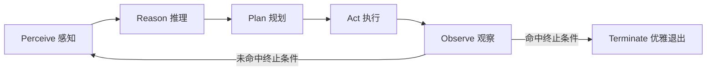

# Harness循环五阶段

## 核心结论

- Agent 循环抽象为五阶段：**Perceive（感知）→ Reason（推理）→ Plan（规划）→ Act（执行）→ Observe（观察）**，循环往复直至命中终止条件。
- 切入本质：**脚手架把模型上一步动作的结果并入下一步 prompt，持续采样直到模型认为任务完成或超出上下文上限**。
- 每阶段都有失败模式与对应工程护栏（见下表），是编排层的核心推进机制。

## 循环示意

图1 Harness 循环五阶段示意

## 五阶段与工程护栏

| 阶段 | 职责 | 失败模式 | 工程护栏 |
|---|---|---|---|
| Perceive | 接收用户输入、工具返回、错误信号 | 上下文污染 | 上下文分层与来源标注 |
| Reason | LLM 基于当前上下文决策 | 幻觉、prompt injection | 系统提示词约束 + 外部校验器 |
| Plan | 复杂任务拆解为子任务 | 无边界规划 | 确定性逻辑前置 |
| Act | 调用工具/API/DB/代码执行 | 越权、重复调用、误操作 | 四层幂等防御 + 沙箱 |
| Observe | 检查结果并判断是否完成 | 误判完成、循环打转 | 终止条件 + 断路器 |

## 相关页面

- [[Agent工程化三层架构总览]]：编排层的入口
- [[Agent终止条件多路熔断]]：Observe 命中终止时的退出
- [[Agentic Harness]]：五阶段的宿主运行时（既有视角）
- [[Agent循环]]：循环本体的另一种抽象（三阶段）

## 参考来源

- [[raw/papers/Agent工程化三层架构.md]]