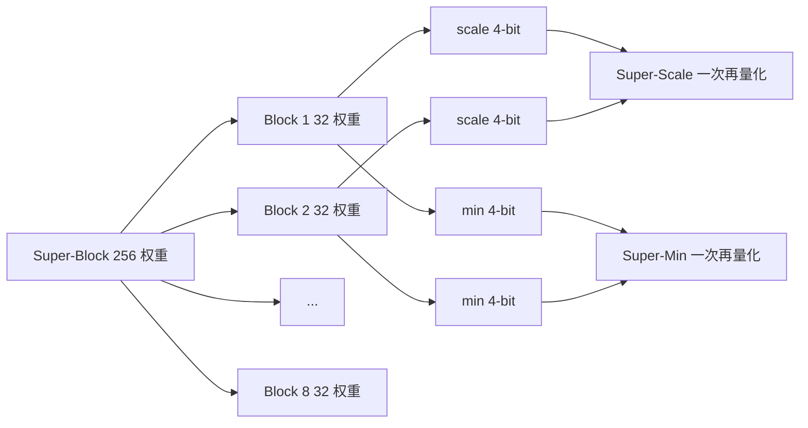

# K-quants

## 核心结论

K-quants 是 GGUF 格式的超块 + 双重量化层级仿射结构：8 个普通 32-权重的 block 组成一个 256 权重的 super-block，每个 block 有自己的 scale/min，super-block 再对这 8 个 scale/min 做一次低比特量化以摊薄元数据开销 [[8]](#ref-8)。这种结构比传统单层仿射量化在同位宽下有更低困惑度，支撑了 llama.cpp 在 CPU/消费级硬件上的本地推理生态，Q4_K_M 是性价比最高的主流默认档。

图 1 K-quants 超块与双重量化结构示意

## 要点拆解

### 命名与档位

GGUF 文件命名 `Q{n}_{K}_{M}` 表示「位宽 - K-quant 方法 - 质量档位」。注意 `Q4_K_M` 中的 K 指 K-quant 方法而非 K-means 聚类；不同张量会被分配不同量化类型——例如 MoE 模型的 `ffn_down_exps` 张量常被自动升到 `q6_K`，因此 Q4_K_M 的实际位宽约 4.85 bit/权重而非严格 4.0 [[8]](#ref-8)。

| 量化档位 | 平均 bits/权重 | 典型用途 | 精度说明 |
|---|---|---|---|
| Q2_K | 2.56 | 极限压缩、超大模型低显存实验 | 质量明显下降，长对话与指令跟随退化 |
| Q3_K_M | 3.91 | 8 GB 卡跑 7B~13B | 优于旧 Q3 格式，有一定精度损失 |
| Q4_K_M | 4.85 | 主流默认，性价比最高 | 相比 FP16 困惑度损失约 1%~2% |
| Q5_K_M | 5.54 | 精度敏感的中高端卡 | 接近 Q6，损失可忽略 |
| Q6_K | 6.59 | 近乎无损部署 | 困惑度损失极小 |
| Q8_0 | 8.5 | 几乎无损、调参基准 | 与 FP16 几乎无差别 |

表 1 GGUF K-quants 常见档位对比

### 选型经验

一个经验法则是：优先选能装入显存的最高量化档，到 Q5_K_M 以上就不用再反复斟酌 [[8]](#ref-8)；估算显存时按实测文件大小算，不要按理论值。完整服务化的决策流程与示例见 [[量化选型与避坑]] 与 [[llama.cpp]]。

### 与双重量化的同源性

对 scale/min「再量化一次」的双重量化思想与 NF4 的双重量化 [[5]](#ref-5) 同构：元数据本身也吃比特，超块把元数据的单位摊得更薄。ultra-low 档（Q2_K）质量明显下降，因为码本粒度已经不够表达尾部【推导】。

## 相关页面

- [[权重量化]]：K-quants 所属的上位概念，非均匀码本与超块族代表。
- [[llama.cpp]]：承载 K-quants 的文件格式与推理生态实体。
- [[NF4 量化]]：双重量化思想的 QLoRA 版。
- [[量化选型与避坑]]：档位选择的完整流程。

## 参考来源

[[raw/papers/权重量化.md]]
