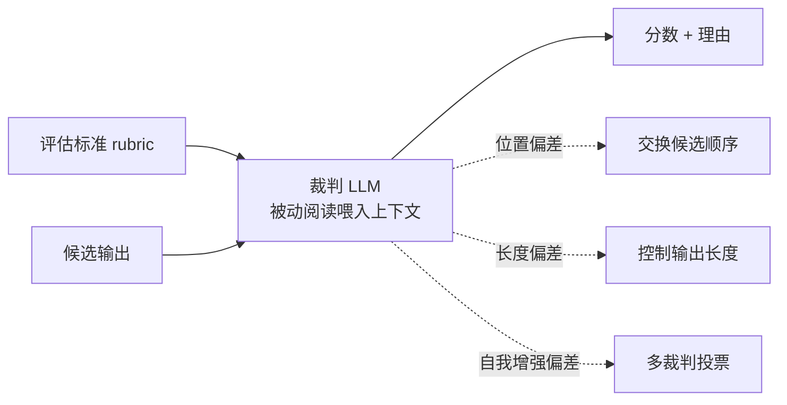

# LLM-as-a-Judge

## 机制与偏差缓解

<b>图1 LLM-as-a-Judge 的机制与三条偏差缓解路径</b>

## 核心结论

- 标准形态是「**评估标准 + 候选输出 → 裁判 LLM → 分数与理由**」，支持单输出打分与成对比较（pairwise comparison）。
- 它与人类偏好一致性**超过 80%**，达到人与人一致性水平，因此可作为人类偏好的可扩展近似。
- 但它的本质是**被动的单次文本打分器**——只能依据喂入的上下文判断，无法主动获取需求文档、对比中间产物，评估多步 agentic 过程的能力受限。这一限制正是 [[Agent-as-a-Judge]] 的出发点。

## 要点拆解

- **已知偏差**：位置偏差（偏好某个位置的候选）、长度偏差（偏好更长或更短的输出）、自我增强偏差（偏好自己或同族模型的输出）。
- **缓解手段**：交换候选顺序、控制候选长度、多裁判投票（含异构模型投票）。
- **定位**：处于「语义判断」一侧，判「输出质量、相关性、安全性」，与判「可枚举验证」的 code-based 互补；两类手段的分工见 [[结果评估]]。
- **与人工的关系**：它近似人类偏好但不等于金标准，需要定期用人工标注做校准与审计，见 [[人工评估与裁判校准]]。

## 适用边界

- 适合：开放文本的输出质量、相关性、groundedness 打分与成对比较。
- 不适合：需要真实执行才能确认的终态正确性（交给 code-based）、需要主动取证的多步过程审查（交给 [[Agent-as-a-Judge]]）。

## 相关页面

- [[Agent-as-a-Judge]]：从被动打分走向主动取证的延伸形态
- [[人工评估与裁判校准]]：裁判的可信度锚点
- [[LLM评委偏差与去偏差]]：三类偏差的细则与定向缓解手段
- [[长度控制胜率]]：冗长偏差的定量去偏方案
- [[四类评估方法对比]]：四类评估方法横向对比
- [[幻觉检测三条路径]]：裁判/校验类方法的相邻思路
- [[输出验证与人工审批]]：裁判结论进入线上闸门后的处理路径

## 参考来源

- [[raw/papers/Agent轨迹评估和结果评估.md]]
