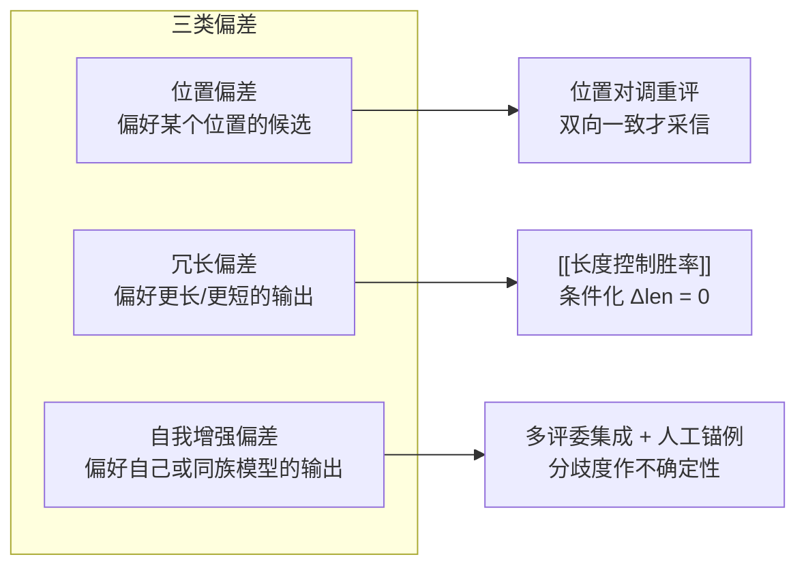

# LLM评委偏差与去偏差

## 偏差与缓解手段的对应关系

<b>图1 三类偏差与三条缓解路径</b>

## 核心结论

- 大模型评委与人类偏好的一致率虽可**超过 80%**，但带有**位置偏差**（Position Bias）、**冗长偏差**（Verbosity Bias）与**自我增强偏差**（Self-enhancement Bias），且评委自身的推理能力有限[[LLM-as-a-Judge]]。
- 三类偏差都有**定向缓解手段**：位置偏差用对调重评、冗长偏差用长度控制、自我增强用多评委集成与人工锚例；三者的共性是**把「评委偏好」从「模型真实能力」里剥离出来**。
- **判据**：若更换评委、对调作答顺序或控制输出长度后排名大幅变动，则所测为评委偏好而非模型真实能力。

## 要点拆解

- **位置对调重评**：同一对答案交换 A/B 顺序各评一次，双向一致才采信，不一致样本标记为低置信并转人工或多评委集成 —— 这是 MT-Bench 针对位置偏差提出的标准做法。
- **长度控制胜率**：见[[长度控制胜率]]，以反事实推断回答「两模型输出等长时偏好如何」，与 Chatbot Arena 的 Spearman 相关性由 0.94 提升至 0.98。
- **多评委集成与人工锚例**：用异构评委投票、以分歧度作不确定性信号；用人工标注构建锚例池，持续跟踪评委与人工的一致率。G-Eval 的思维链提示加概率加权评分与人类相关性更高，可作锚例对齐的工程参考。
- **与既有页面的分工**：[[LLM-as-a-Judge]] 讲裁判范式与定位（被动单次打分器），本页讲偏差细则与去偏差手段；[[人工评估与裁判校准]] 讲人工锚点如何为自动化裁判提供可信度校准；[[四类评估方法对比]] 讲四类方法的横向选型。
- **残留局限**：多评委集成与人工锚例并非某一类偏差的定向解，更多是通用兜底；长度控制只剥离长度这一中介变量，其余混杂因素需另行建模。

## 相关页面

- [[LLM-as-a-Judge]]：裁判范式的定义、定位与适用边界
- [[长度控制胜率]]：冗长偏差的定量去偏方案
- [[人工评估与裁判校准]]：人工锚点与一致率跟踪
- [[四类评估方法对比]]：四类评估方法横向对比
- [[大模型评测可信体系总览]]：评委可信支线在四支柱中的位置
- [[大模型评测可信·素材摘要]]：素材出处

## 参考来源

- [[raw/papers/大模型评测可信.md]]
