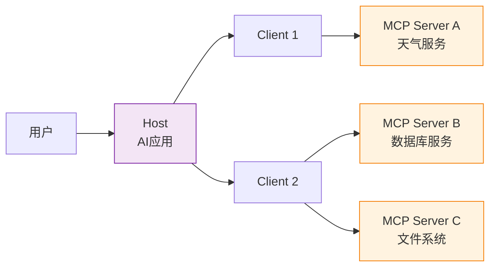

# MCP 三层架构

## 核心结论

MCP 采用 Host-Client-Server 三层架构模型，三类角色职责解耦，构成完整的交互链路。

## 角色职责

| 角色 | 定位 | 运行位置 | 核心职责 | 典型实例 |
|------|------|----------|----------|----------|
| **Host** | Agent 运行载体与用户入口 | 用户侧 | 管理对话会话、模型权限、连接生命周期；控制用户授权与高风险操作确认 | 桌面智能助手、IDE 插件、企业办公 Agent |
| **Client** | 协议通信连接器 | Host 内部 | 遵循 MCP 协议与 Server 通信；完成能力发现、请求转发、结果回传 | MCP SDK 客户端组件 |
| **Server** | 外部能力封装提供者 | 外部系统侧 | 将本地/远程系统能力封装为 MCP 标准原语 | 天气服务、数据库、文件系统 |

## 交互链路

**用户指令 → Host → Client → MCP Server → 外部业务系统**，执行结果沿原路径反向返回。

## 关键特性

- 一个 Host 可实例化多个 Client 对接多个 Server
- 每个 Client 与 Server 保持 1:1 专用连接
- Server 可本地运行（Stdio）或远程服务（Streamable HTTP）

## 相关页面

- [[MCP协议总览]]：协议整体架构
- [[MCP协议分层架构]]：传输层与数据层
- [[MCP核心原语]]：Server 提供的能力
- [[MCP无状态交互]]：新版交互机制

## 参考来源

- [[raw/papers/MCP.md]]
