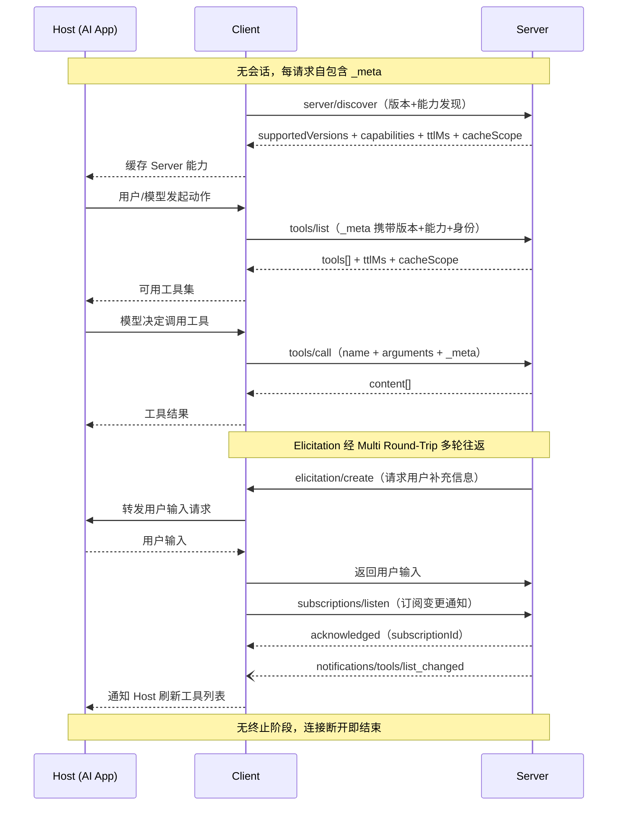

# MCP 无状态交互

## 核心结论

MCP 在 2026-07-28 版本后转为无状态协议，每个请求在 `_meta` 字段中携带协议版本与能力信息，服务端可独立处理每个请求。

## 要点拆解

### server/discover

客户端发送 `server/discover` 请求，服务端返回：
- `supportedVersions`：支持的协议版本列表
- `capabilities`：服务端能力声明（tools/resources/prompts）
- `ttlMs` + `cacheScope`：缓存提示

### 每请求自包含

每个请求在 `_meta` 中携带：
- `io.modelcontextprotocol/protocolVersion`：协议版本
- `io.modelcontextprotocol/clientCapabilities`：客户端能力
- `io.modelcontextprotocol/clientInfo`：客户端身份

### 交互流程

### 与旧版对比

| 维度 | 旧版（2025-11-25） | 新版（2026-07-28） |
|------|-------------------|-------------------|
| 初始化 | `initialize` 握手 + 能力协商 | `server/discover` 发现请求 |
| 会话状态 | 有状态，服务端维护会话 | 无状态，每请求独立 |
| 终止 | 显式关闭通知 | 连接断开即结束 |

## 相关页面

- [[MCP协议分层架构]]：数据层与传输层
- [[MCP新旧版本对比]]：完整对比表
- [[MCP三层架构]]：Host-Client-Server 角色
- [[MCP核心原语]]：Tools/Resources/Prompts

## 参考来源

- [[raw/papers/MCP.md]]
