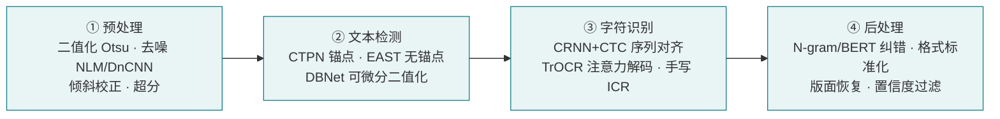

# OCR文档解析

## 简介

OCR（光学字符识别）是 [[文档智能]] 解析段的起点，解决"页面上有什么字"。它是四段式流水线，每一阶段解决一个独立问题。

## 四段式流水线

- **预处理**：Otsu 自适应二值化消除光照不均；高斯/双边滤波去椒盐噪声并用形态学修复笔画断裂；霍夫变换检测倾角后仿射校正；直方图均衡 / CLAHE 增强对比度。
- **文本检测**：传统 MSER 连通域；深度模型三选：CTPN（CNN+RNN 垂直锚点）、EAST（无锚点、多角度）、DBNet（可微分二值化、任意形状）。
- **字符识别**：CRNN（CNN 提特征 + RNN 建模序列 + CTC 解决长度不对齐）；TrOCR 用自注意力、长文本与复杂字体更强；手写 ICR。
- **后处理**：N-gram / BERT 纠错、统一日期金额格式、恢复段落与阅读顺序、按 softmax 置信度过滤。

## 精度水位与手写差异

- 行业基准：清晰印刷体 CER 可低于 1%，手写体 3%-5%。
- 工整手写准确率可达 90% 以上，潦草书写仅 70%-80%，医生处方等极端场景仍是难点。
- 印刷体用模板匹配或特征提取即可，CRNN+CTC 满足大部分场景；手写体更依赖上下文与序列建模，Transformer 显著优于传统 CRNN。

## 图像质量门槛

- 低于 300 DPI 准确率明显下降，劣质扫描件可降 20% 以上；150→300 DPI 通常提升约 20%；高精度场景推荐 300-600 DPI。
- 倾斜校正需控制在 ±1° 以内；去噪在噪声标准差 25 的高斯噪声上可使准确率从 62% 提升至 89%。

## 六条结构性局限

这些不是调参能解决的，而是"文本流"输出形态本身的边界（对应 [[文档智能能力边界]] 的"多模态不是银弹"）：

| 局限 | 本质原因 | 典型后果 |
|---|---|---|
| 只认字不认结构 | 输出是文本流，丢失二维空间关系 | 表格塌成一行、多栏混读 |
| 版式敏感 | 训练分布外的版式泛化能力差 | 换供应商模板即失效 |
| 误差级联 | 检测错则识别必错，无法回滚 | 单点错误污染整页 |
| 阅读顺序盲区 | 缺乏全局版面理解 | 双栏论文读成左栏+右栏全文 |
| 公式表格无力 | 二维结构无法用序列表达 | LaTeX 乱码、单元格错位 |
| 语义缺失 | 不知道字段的业务含义 | 金额与税号抽反也照常输出 |

其中最具工程杀伤力的是**语义缺失**：字符准确率可达 99%，但发票总额提取错误仍直接导致经济损失。字符级指标救不了字段级错误，这正是 [[文档智能]] 四段能力链必须延伸到理解/校验/驱动的根源，也是 [[文档精度评估三层]] 中"字符掩盖字段"陷阱的来源。OCR 因此从"产品"降级为"组件"（见 [[文档智能]] 能力阶梯）。

## 相关

- [[版面分析]]（下游）、[[表格结构还原]]、[[公式识别]]、[[文档VLM三大范式]]
- 工具：[[MinerU]]、[[Docling]]