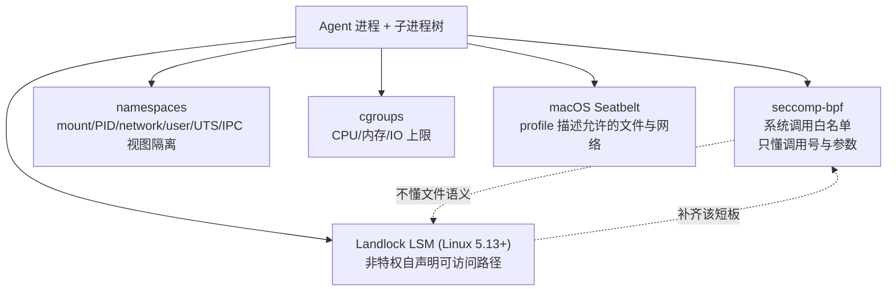

# OS原语沙箱机制

## 核心结论

OS 原语是**最轻量的一档**：不虚拟化、不起容器，直接用内核特性约束进程及其子进程树，启动开销近零、内存停留在进程级，本地即可用。它是 [[Agent沙箱平台横评]] 中 Codex CLI 与 Claude Code 的共同选择。

## 要点拆解

### 五种内核特性各管什么

- **seccomp-bpf**：用 BPF 程序把进程可发起的系统调用收窄到白名单。它**只识别调用号与参数，不识别「这个 open 打开的是不是敏感文件」这类应用语义**；
- **namespaces**：把进程对 mount/PID/network/user/UTS/IPC 的视图隔离开，是容器的基石；
- **cgroups**：限制 CPU/内存/IO 用量，防资源耗尽；
- **Landlock LSM**（Linux 5.13+）：让非特权进程自声明可访问的文件路径，**补齐 seccomp 的文件语义短板**；
- **macOS Seatbelt（sandbox-exec）**：进程级强制访问控制，用 profile 描述允许的文件与网络操作；短板是网络常为「全有或全无」，profile 亦易写错。

### 根本局限与混合架构

局限在于**只作用于系统调用层**，故本地 Agent 普遍采用混合架构：

> **OS 原语管文件 + 用户态代理管网络**——沙箱内仅保留一个 Unix domain socket 出口，由沙箱外代理按域名白名单放行，新域名交用户确认。

这正是 [[Agent沙箱平台横评]] 里 Claude Code「代理 + 域名白名单」与 Codex「禁网 + 越界审批」两条路线的技术底座，也是「跨公司收敛到 OS 原语 + 网络代理 + 沙箱与审批解耦」这一收敛信号的组成部分。

### Seatbelt 的已知短板

profile 容易写错意味着**配置错误即等于无防护**——这与 [[沙箱选型权衡与落地避坑]] 的第二条教训「沙箱是概率性降低损失，不是绝对保证」直接呼应。

## 相关页面

- [[隔离技术谱系]]：OS 原语在共享强度链上的位置。
- [[沙箱隔离技术选型对比]]：与容器、gVisor、microVM、Wasm 的横向对照。
- [[Agent沙箱平台横评]]：以 OS 原语为隔离层级的两个本地 Coding Agent。
- [[Agent沙箱技术全景总览]]：本页所属的领域全景。

## 参考来源

- [[raw/papers/Agent沙箱.md]]
