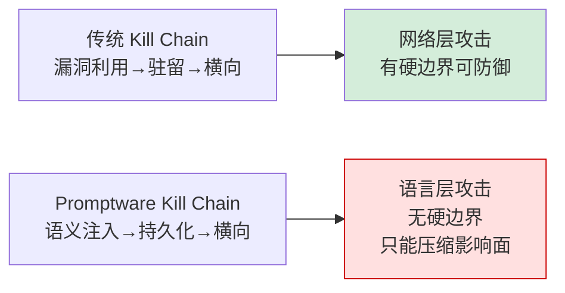

# Promptware Kill Chain

## 核心结论

- 攻击从"单次输出劫持"演化为**多阶段、可持久化、可横向移动的 Promptware Kill Chain**。
- 防御从"检测注入"转向按阶段布防，而非只在入口拦截。
- OWASP 已为 Agentic 场景单独立榜（ASI01 Agent Goal Hijack）[[1]](#ref-1)。

## 七阶段攻击链

| 阶段 | 名称 | 说明 |
|---|---|---|
| 1 | 初始访问 | 通过外部内容（网页/邮件/文档）将注入载荷送入 Agent 上下文 |
| 2 | 提权越狱 | 绕过安全对齐，让模型忽略原有指令层级 |
| 3 | 侦察 | 探测可用工具、权限边界、数据访问范围 |
| 4 | **持久化** | 注入写入长期记忆，跨会话存活 |
| 5 | 命令与控制 | 通过工具调用与外部服务器建立通信通道 |
| 6 | **横向移动** | 被攻陷 Agent 向对等 Agent 传播污点指令 |
| 7 | 达成目标 | 数据外泄、未授权操作、系统破坏 |

## 与传统 Kill Chain 的关键差异

<b>图1 两类 Kill Chain 对比</b>

关键差异：传统 Kill Chain 运行在有硬边界的网络层（防火墙/入侵检测可拦截），Promptware Kill Chain 运行在无硬边界的语言层（模型无法根本区分指令与数据），因此防御重心从"检测并阻断"转向"假设已发生、按阶段压缩影响面"。

## 相关页面

- [[新兴Prompt注入攻击向量]]：六类新型攻击向量与对应新防线
- [[Prompt注入攻击类型谱系]]：四类注入载体与已验证案例
- [[Prompt注入分层防御体系]]：按阶段布防的六层体系
- [[EchoLeak零点击攻击案例]]：Kill Chain 七阶段完整实例

## 参考来源

- [[raw/papers/Prompt注入与防范.md]]

---

[1] OWASP Foundation. ["OWASP Top 10 for Agentic Applications: ASI01 Agent Goal Hijack."](https://genai.owasp.org/2025/12/09/owasp-top-10-for-agentic-applications-the-benchmark-for-agentic-security-in-the-age-of-autonomous-ai/) *OWASP GenAI Security Project*, 2025-12-09.
