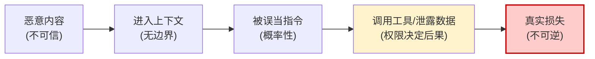

# Prompt 注入危害分层

## 核心结论

- 危害严重程度取决于 LLM 的集成方式与自主权大小，**随权限增大而放大**。
- 危害沿传导链逐级升级：恶意内容 → 进入上下文 → 被误当指令 → 调用工具/泄露数据 → 真实损失。

## 三层危害分类

| 危害层级 | 具体表现 | 前提条件 | 案例对应 |
|---|---|---|---|
| **信息层** | 敏感数据泄露、系统提示与基础设施细节暴露 | 只需读权限 | EchoLeak、Bing Chat 外泄链 |
| **逻辑层** | 输出被操纵、决策被劫持、声誉受损 | 无需工具 | Chevrolet $1 成交 |
| **执行层** | 未授权功能访问、连接系统中执行命令、资金损失 | 需要写权限/工具 | Claude Computer Use 恶意软件案、ChatGPT 记忆持久化 |

## 危害传导链

<b>图1 注入危害传导链</b>

关键洞察：注入危害是概率性事件（模型可能拒绝执行），但一旦模型服从，后续传导由**权限大小**决定后果严重程度——这就是最小权限原则的根据。

## 相关页面

- [[Prompt注入定义与边界]]：注入的定义与边界
- [[Prompt注入攻击类型谱系]]：四类攻击载体与案例矩阵
- [[Prompt注入根因分析]]：为什么注入在架构上无法避免
- [[EchoLeak零点击攻击案例]]：信息层危害的最严重实例

## 参考来源

- [[raw/papers/Prompt注入与防范.md]]
