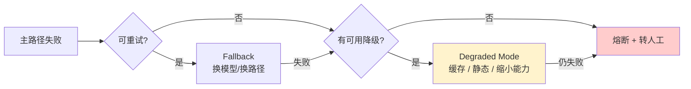

# Prompt 注入失效模式与降级方案

## 核心结论

- **每一层防御都会失效**，系统必须预定义"失效时怎么办"。
- 关键区分：**fail-closed**（默认拒绝，安全优先）vs **fail-open**（默认放行，可用优先），高危工具必须 fail-closed。
- **未测试过失效条件的降级路径等于不存在。**

## 九类失效场景与降级动作

| 失效场景 | 检测信号 | 降级动作 | Fail 模式 |
|---|---|---|---|
| 隔离 LLM 被注入 | 输出 JSON Schema 解析失败/字段越界 | 拒绝→重试 1 次→回退到模板化摘要 | **fail-closed** |
| 特权 LLM 被注入 | 工具参数偏离任务目标（Task Shield 拒绝） | 阻断工具调用+告警，输出降级为只读摘要 | **fail-closed** |
| 策略引擎（OPA）宕机 | 健康检查超时 | 高危工具全部拒绝，仅放行白名单只读操作 | **fail-closed** |
| 分类器服务超时 | p99 > 500ms | 降级到正则黑名单+后置异步审计 | fail-open（可配置） |
| 上游 LLM 供应商中断 | 5xx/限流 | **Fallback 链**→**降级模式**（缓存回复/静态提示/转人工） | fail-open 降级 |
| 重试风暴放大故障 | 重试队列积压 | **熔断器**：CLOSED→OPEN→HALF_OPEN 状态机 | 强制熔断 |
| RAG 文档污染入库 | 溯源标记异常/哈希不匹配 | 整批隔离，回滚到上次可信索引快照 | **fail-closed** |
| 长期记忆被持久化注入 | 记忆条目无签名或来源不可信 | 记忆条目签名+用户可见可删+定期审计 | fail-closed |
| 静默质量退化 | 输出长度骤降、JSON 解析失败率、工具参数分布异常 | 告警+切换备用模型 | 可观测性兜底 |

## 三层降级语义

<b>图1 三层降级语义</b>

关键原则：**Fallback 保持质量，降级模式保持可用，熔断器防止故障扩散。**

## 相关页面

- [[Prompt注入分层防御体系]]：六层防御体系
- [[Prompt注入防御成本与误报权衡]]：防御成本与效用的非线性权衡
- [[纵深防御五原则]]：fail-closed 是安全优先原则的体现
- [[熔断器状态机]]：熔断器的 CLOSED/OPEN/HALF_OPEN 三态机制

## 参考来源

- [[raw/papers/Prompt注入与防范.md]]
