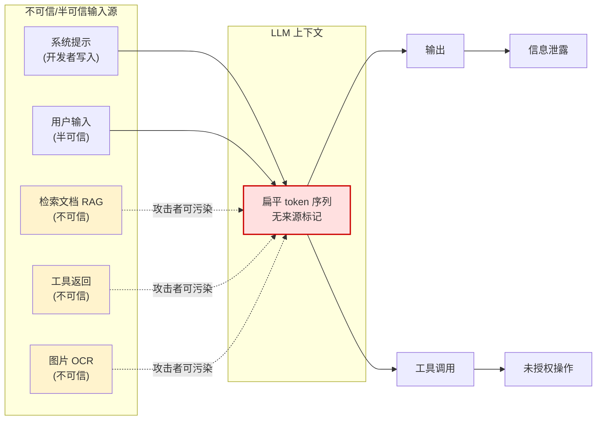

# Prompt 注入定义与边界

## 核心结论

- Prompt 注入被 OWASP 列为 LLM 应用十大风险之首（LLM01）[[1]](#ref-1)，2023（v1.0）与 2025（v2.0）两版均保持第一。
- 不利用解释器的语法缺陷，而是利用模型处理语言本身的方式——语义层面的"指令劫持"。
- LLM 上下文中所有来源的内容被拼接为同质 token 流，**任一入口都可被污染**。

## 定义

攻击者通过用户输入、检索文档、工具返回或其他外部内容，把恶意指令带入模型上下文，诱导模型改变原有行为。OWASP LLM01:2025 定义为"精心构造的输入使 LLM 以非预期方式行事，包括绕过安全指南或执行未授权操作"。

## 注入 vs 越狱

| 维度 | Prompt 注入 | 越狱 |
|---|---|---|
| 攻击目标 | 应用逻辑、数据、权限 | 模型的安全对齐与内容策略 |
| 典型后果 | 数据外泄、误调用工具 | 生成有害/违禁内容 |
| 责任主体 | 应用开发者 | 模型厂商 + 应用方 |
| 是否需工具 | 可无工具即可泄密 | 通常无真实世界损害 |
| 防御重心 | 架构与权限 | 对齐训练 + 内容过滤 |

## 上下文混合注入点

<b>图1 LLM 上下文混合注入点</b>

关键洞察：系统提示、用户输入、RAG 文档、工具返回、图片 OCR 在 LLM 眼中全是同质 token 流，无来源标记，攻击者从任一入口注入均可劫持模型行为。

## 相关页面

- [[Prompt注入攻击类型谱系]]：注入的四类载体与场景细分
- [[Prompt注入根因分析]]：为什么 LLM 架构上无法根本区分指令与数据
- [[LLM-Agent安全防护总览]]：注入在 Agent 安全体系中的定位
- [[提示词注入]]：注入的风险分类与防御方向

## 参考来源

- [[raw/papers/Prompt注入与防范.md]]

---

[1] OWASP Foundation. ["OWASP Top 10 for LLM Applications 2025: LLM01 Prompt Injection."](https://genai.owasp.org/llm-top-10/) *OWASP GenAI Security Project*, 2025.
